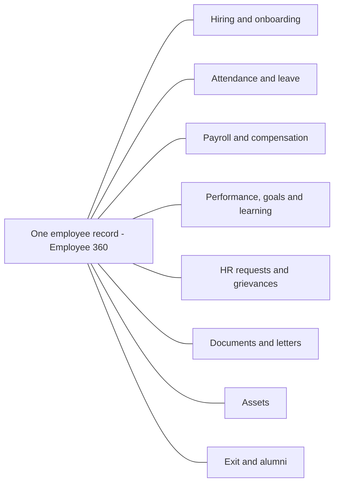
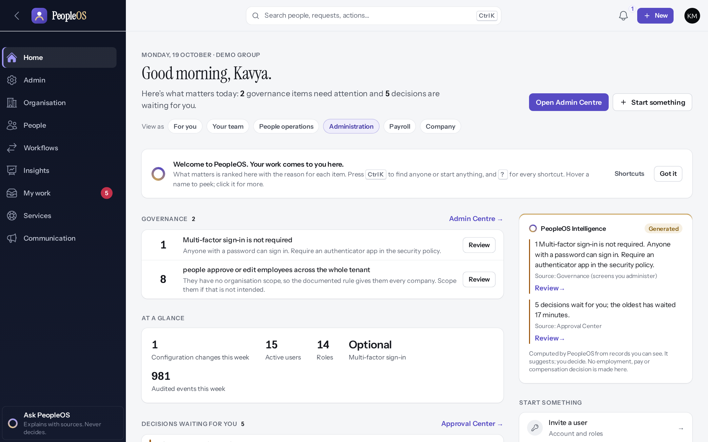

# 1. Product overview

> **In this chapter:** what Markedge PeopleOS is, what it does for a business, who uses it, and whether it fits
> your organisation. **Who should read it:** business owners, HR leaders and anyone evaluating PeopleOS.

> **About this edition.** This handbook describes the PeopleOS application as built on 19 October 2026. Every screen
> shown is a genuine screenshot of the application, taken in a demonstration environment that contains only fictional
> people and companies (for example "Demo Group", "Demo Technologies", Priya Nair, Amit Verma). Anything that depends on
> your commercial agreement with Markedge is marked **"To be confirmed with the SaaS provider."**

---

## 1.1 Understanding the product in 5 minutes

### What is PeopleOS?

**Markedge PeopleOS** is an online HR system. It keeps everything about your employees in one place and runs the HR
work around them: hiring and onboarding, attendance and leave, payroll, performance reviews, learning, HR requests,
announcements, and finally exit and alumni. Your staff open it in a web browser; there is nothing to install.

PeopleOS is a *SaaS* product (Software as a Service): Markedge runs the software for you, and your organisation
gets its own private, separate space in it. In this handbook that private space is called your **organisation**
(the software sometimes calls it a *tenant*).

### The problem it solves

Imagine a company of 300 people. Leave is requested on WhatsApp and tracked in a spreadsheet. Attendance comes from a
biometric device as a file that someone re-types every month. Salary changes are agreed by e-mail, and payroll is run in
a separate tool. Appraisal forms circulate as Word documents. When an auditor asks "who changed this employee's bank
account, and who approved it?", nobody can answer quickly.

PeopleOS brings this work into one organised system:

- **One record per person.** Every employee has one profile (the *Employee 360*) with their job, manager, documents,
  leave, pay, performance, learning and history.
- **Requests and approvals in one place.** Employees ask; the right approver sees it in their **My work** inbox and
  decides with one click; everyone can see the status.
- **Rules you configure, not code.** Leave entitlements, workflows, forms, custom fields and notifications are set up
  by your administrator.
- **A complete audit trail.** Material changes record who did what, when, the value before and after, and the reason.

### One person, one record

**Diagram — One person, one record.** Every module reads and writes the same employee record.

Information is entered once and used everywhere.

### The nine areas of the product

When you sign in, the left-hand menu shows up to nine areas. You only see the areas your role allows.

| Area | What you do there | Typical users |
|---|---|---|
| **Home** | See what matters today: decisions waiting for you, changes since your last visit, key figures. | Everyone |
| **My work** | Your inbox: approvals, tasks and notifications in one list. | Everyone |
| **People** | The employee directory and everything about people: lifecycle, time & leave, growth, pay. | HR, managers, payroll |
| **Organisation** | Companies, departments, locations, the org map, workforce planning and assets. | HR administrators, executives |
| **Insights** | Analytics, reports, dashboards and the audit trail. | Executives, HR, auditors |
| **Workflows** | Approval workflows and HR policies (for example leave rules). | HR administrators |
| **Services** | *My HR* for employees, the HR service desk, grievances and the knowledge base. | Everyone, HR |
| **Communication** | Announcements, notifications and employee surveys. | Everyone, HR |
| **Admin** | Users, roles, settings, security and integrations. | Administrators |

Personal pages — **My profile, My HR, My day, My career, My learning, My compensation, Preferences** — are in the
avatar menu at the top right. A search bar at the top (**Ctrl K**) finds people, requests and actions from anywhere.

*Figure 1.1 — The Home screen of an administrator: the menu of areas on the left, the search bar at the top, and
"what matters today" in the middle. Demonstration data (fictional).*

### Who uses it

PeopleOS ships with 14 ready-made roles. Your administrator gives each person one or more roles, and can create
custom roles.

| Role | In one line |
|---|---|
| **Employee** | Uses self-service: requests leave, views payslips, updates details, completes reviews and learning. |
| **Manager** | Everything an employee does, plus approves the team's leave and attendance, reviews performance, sees the team. |
| **HR Manager / HR Executive** | Run day-to-day HR: people records, onboarding, leave, service desk, letters, exits. |
| **Tenant HR Admin** | Configures PeopleOS for the organisation: structure, policies, workflows, modules. |
| **Payroll Admin** | Runs payroll and statutory compliance. |
| **Attendance Admin / Asset Admin / Performance Admin** | Specialist administrators for one area. |
| **Executive** | Sees the Workforce Command Centre, dashboards and reports; no transactional access. |
| **Auditor** | Read-only access with the full audit trail. |
| **Tenant Super Admin / Account Owner** | The organisation's top administrators (set up, users, security, data export). |
| **Alumni** | A former employee: own documents, payslips and requests only. |

See [Chapter 6 — Role guides](06-role-specific-guides.md) for what each role can see and do.

### A typical journey

1. **Markedge sets up your organisation** in PeopleOS and invites your first administrator.
2. **Your administrator** builds the structure (companies, locations, departments), sets policies (leave, attendance),
   invites users and gives them roles.
3. **HR** adds employees — one by one or by import — and starts onboarding.
4. **Employees** sign in, check their details, request leave, raise HR requests and complete reviews.
5. **Managers** approve requests from **My work** and follow their team on **My Team**.
6. **Payroll** runs the monthly payroll from attendance, leave and salary data.
7. **Leaders** watch the Workforce Command Centre and reports.

### Why it beats manual processes

| Today (manual) | With PeopleOS |
|---|---|
| Leave on WhatsApp, balance in a spreadsheet | Employee requests in **My HR**; the balance is checked automatically; the manager approves in **My work**. |
| Employee data in several files | One **Employee 360** record, with full history and effective dates. |
| Approvals lost in e-mail | Every request has an owner, a status and a time line; reminders and escalations are configurable. |
| "Who changed this?" | The **Change history** shows who, what, when, before/after and why. |
| Policies in PDFs nobody reads | **Knowledge base** articles and policies with tracked acknowledgements. |
| Annual appraisal on paper | Cycles, goals, check-ins, reviews and calibration in one place. |
| Reports built by hand every month | **Reports** and dashboards with filters and CSV export, permission-aware. |

---

## 1.2 What PeopleOS does — the main capabilities

Each capability is described in detail in the module chapters ([Chapter 5](05-module-guides.md)). The status tells you
whether it is ready to use today.

| Capability | What it covers | Status |
|---|---|---|
| **People records** | Directory, Employee 360, hiring, employment changes with effective dates, documents, background checks, bulk import | Available with limitations (bulk import is affected by a known defect at the column-mapping step) |
| **Onboarding and exit** | Onboarding plans and templates, letters with approval, exit cases with clearance, final settlement, exit interviews, alumni portal | Available with limitations (gratuity is not calculated) |
| **Attendance** | Punches from devices, imports or the API; attendance records; exceptions; regularisation; overtime approval; shifts and work schedules; holiday calendars | Available with limitations (punch file imports affected by a known defect; half-day holidays and late-mark actions not applied) |
| **Leave** | Leave types and policies, requests and approvals, balances from a ledger, encashment, team leave calendar | Available with limitations (HR's "Apply on behalf" button has a known defect — HR applies from the employee record; no hourly leave) |
| **Payroll** | Salary components and structures with formulas, monthly runs with checks and approvals, payslips, adjustments, payroll anomaly review | Available with limitations (see "Payroll and statutory compliance" below) |
| **Statutory compliance (India)** | EPF, ESI, Professional Tax, LWF and TDS returns and certificates, registrations, establishments | Available with limitations (rules awaiting verification) |
| **Compensation** | Pay changes with four-person approval, review cycles, budgets, pay ranges | Available |
| **Performance** | Cycles, templates, appraisals, goals and key results, check-ins, feedback, one-on-ones, improvement plans, calibration | Available |
| **Learning and skills** | Courses, learning paths and programmes, enrolments, certificates with expiry, training sessions, skills and assessments, development plans | Available |
| **Career, talent and succession** | Career paths, talent pools and reviews, readiness, critical positions, succession plans | Available |
| **Organisation and workforce planning** | Legal entities, companies, departments, teams, locations, cost centres, establishments, positions, headcount plans, scenarios, budgets, vacancies, org map | Available |
| **Assets** | Asset register, categories and models, assignment, transfer, return, repair, retirement; asset recovery at exit | Available |
| **Employee services** | My HR, HR service desk with service catalogue and SLAs, confidential grievances, knowledge base with acknowledgements | Available |
| **Communication and engagement** | Targeted announcements with read/acknowledge, notification rules and templates, surveys with built-in anonymity, feedback inbox | Available |
| **Insights** | Workforce Command Centre, people analytics, report builder with CSV export and schedules, dashboards, change intelligence, audit trail | Available with limitations (a known defect leaves the report builder's filter and grouping lists empty; executives have no report datasets by default) |
| **AI assistance** | "Ask PeopleOS" explains and summarises using only records you may see, with sources; never makes decisions | Available with limitations (no external AI model by default) |
| **Administration and security** | Users and invitations, roles and organisation scopes, settings, custom fields, forms, workflows, policies, governed configuration changes, multi-factor sign-in, single sign-on, IP allow-list, idle timeout, data export | Available |
| **Integrations** | REST API with scoped API keys, user provisioning (SCIM), signed webhooks, an integration hub for inbound events | Available (set-up needed) |

---

## 1.3 Who should use it, and which businesses benefit

PeopleOS is designed for organisations that want one system for their people processes, in particular:

- **Growing companies** replacing spreadsheets, e-mail approvals and separate tools.
- **Groups with several companies or legal entities**, locations and establishments (PeopleOS models legal entities,
  companies, business units, divisions, departments, teams and locations).
- **Organisations with employees in India** that need EPF, ESI, Professional Tax, LWF and TDS processing — once the
  statutory rules are verified (see below).
- **Organisations that need strong control and audit**: separation of duties in payroll and compensation, approval
  workflows, governed configuration changes and a tamper-evident audit trail.
- **Organisations that want employee self-service** so that staff can help themselves without e-mailing HR.

Typical users inside the business: HR teams, payroll teams, people managers, every employee (self-service), executives
(analytics) and auditors (read-only).

> **Scale.** The development team has tested the main screens with a fictional population of more than 10,000
> employees on a single workstation. The capacity of the live service you will use is **to be confirmed with the SaaS
> provider.**

---

## 1.4 Key benefits

- **Less chasing.** Requests go to the right approver automatically, with status visible to everyone involved.
- **Fewer errors.** Data is entered once; balances, eligibility and payroll inputs come from the same records.
- **Faster answers for employees.** My HR, the knowledge base and "Ask PeopleOS" answer common questions.
- **Control and accountability.** Approvals follow your rules; the people who propose, approve and execute sensitive
  changes (payroll, compensation, bank details) are kept separate; every material change is recorded.
- **Flexibility without custom code.** Custom fields, forms, workflows, policies and notification rules are configured
  by your administrator.
- **Decisions based on data.** Live headcount, attrition, leave and other figures, with reports you can export.

> **Note.** This handbook does not quote savings, productivity percentages or return on investment: no such
> measurements exist for PeopleOS yet. Measure your own results using the adoption checklist in
> [Chapter 2](02-buyer-guide.md#212-how-to-measure-successful-adoption).

---

## 1.5 Is this product right for your business?

### Requirements PeopleOS supports today

| If you need… | PeopleOS | Notes |
|---|---|---|
| A single employee database with history | Yes | Effective-dated records; history is never silently overwritten. |
| Employee and manager self-service | Yes | My HR, My work, My Team, approvals on phone or desktop browser. |
| Leave management with your own rules | Yes | Leave types, policies with entitlements, approvals, balances, encashment. |
| Attendance from biometric devices | Yes | Devices send punches through the API (set-up needed with your device vendor); punch file imports are affected by a known defect. |
| Shifts, schedules and holidays by location | Yes | Shifts, work schedules and holiday calendars. |
| Monthly payroll with approvals | Yes, with limitations | Run pipeline with checks, approvals and payslips; statutory parts need verified rules. |
| India statutory compliance | Yes, with limitations | EPF/ESI/PT/LWF/TDS outputs exist; rules must be verified before live use. |
| Performance reviews and goals | Yes | Configurable cycles, templates, rating scales, calibration. |
| Learning management | Yes | Courses, paths, programmes, assessments, certificates, sessions. |
| HR help desk | Yes | Service catalogue, SLAs on business hours, satisfaction rating. |
| Confidential grievance handling | Yes | Per-case access; every view is audited. |
| Employee surveys | Yes | Anonymous and confidential surveys with privacy thresholds. |
| Multi-company, multi-location structures | Yes | Legal entities, companies, establishments, locations, cost centres. |
| Workforce and position planning | Yes | Positions, headcount plans, scenarios, budgets, vacancies. |
| Asset tracking | Yes | Register, assignment, return and recovery at exit. |
| Strong security | Yes | Multi-factor sign-in, single sign-on (OpenID Connect), IP allow-list, idle timeout, audit trail. |
| Integration with other systems | Yes | REST API, SCIM user provisioning, webhooks, integration hub. |
| Getting all your data out | Yes | A full, encrypted data export for your top administrator. |

### Requirements PeopleOS does not currently support

| If you need… | Status | What you can do instead |
|---|---|---|
| Recruitment / applicant tracking (ATS) | Not available | Use your recruitment system; PeopleOS can receive new hires through its integration hub (set-up needed). |
| Expense claims and reimbursements | Not available as a module | One-off amounts can be paid through payroll adjustments. |
| Timesheets / project time tracking | Not available | — |
| Benefits and insurance administration | Not available | — |
| Employee loans and advances | Not available as a module | Recoveries can be entered as payroll adjustments. |
| Electronic signatures | Not available | Letters are generated and issued in PeopleOS; sign outside it. |
| Gratuity calculation | Not available | The final settlement has no gratuity line today; calculate it separately. |
| Statutory payroll outside India | Not available | Payroll is blocked in a country for which PeopleOS holds no statutory rules. Country packs (formats, currency, financial year) exist for India, UAE, UK, USA, Singapore, Australia and Canada, but statutory rules exist only for India (and one UAE rule). |
| Native mobile apps | Not available | The web application adapts to phones and tablets in the browser. |
| Languages other than English | Not available | The interface is in English (UK spelling). |
| Online purchase / self-service sign-up | Not available | The sign-up feature exists but is switched off; organisations are set up by Markedge. |

### Things to confirm with Markedge before you decide

- **Availability and go-live date.** PeopleOS is not yet generally released for live production use; the provider's
  release checks (hosting, independent security review, backup and recovery, statutory verification) are still open.
  **To be confirmed with the SaaS provider.**
- **Statutory payroll.** None of the shipped India statutory rules has completed verification yet. While enforcement
  is on (the default), payroll that depends on unverified rules cannot be finalised. Ask for the current verification
  status before relying on PeopleOS for statutory payroll.
- **Hosting region, data residency, backups and recovery objectives** — **To be confirmed with the SaaS provider.**
- **Prices, plans, contract terms, support hours and service levels** — **To be confirmed with the SaaS provider.**
- **Browsers.** The team tested Chromium-based browsers (such as Google Chrome and Microsoft Edge) and Firefox on
  desktop, and the WebKit engine at phone width. Apple Safari and Android Chrome have not been tested yet.

---

## 1.6 What to know before purchasing

1. **It is a complete HR platform, not a single tool.** You can start with some areas and add others; your
   administrator decides which features are switched on.
2. **Your data stays separate.** Each organisation has its own private space; one organisation's data, settings and
   rules never affect another.
3. **You stay in control of access.** Roles decide what people can see and do; organisation scopes limit HR and
   managers to the companies or teams they look after.
4. **Set-up takes planning.** Before employees use PeopleOS, someone must enter your structure, policies and employee
   data. [Chapter 2](02-buyer-guide.md) lists what to prepare.
5. **AI is an assistant, not a decision-maker.** It explains, summarises and suggests, using only what the person
   asking may see, and shows its sources. By default no external AI service is used.
6. **You can take your data with you.** Your top administrator can request a full, encrypted export at any time.
7. **Commercial details are agreed with Markedge.** This handbook does not state prices, plans or service levels.

**Next:** [Chapter 2 — Your complete guide to buying and getting started](02-buyer-guide.md).
