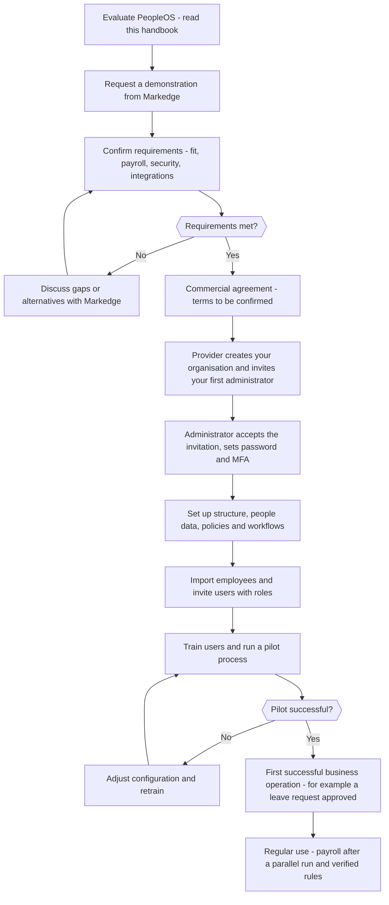

# 2. Your complete guide to buying and getting started

> **In this chapter:** everything a prospective customer should know, ask and prepare — from the first demonstration to
> the first successful day in PeopleOS. **Who should read it:** business owners, HR and finance leaders, IT and
> procurement teams.

> **Important — what this guide does not contain.** Prices, subscription plans, contract terms, service levels (SLAs),
> support hours, certifications and the hosting region are not part of the product and are not stated here. Wherever
> they matter, this guide says **"To be confirmed with the SaaS provider."** Ask Markedge for them in writing.

---

## 2.1 What PeopleOS offers

PeopleOS is one online system for the whole employee journey: people records, onboarding, attendance, leave, payroll,
statutory compliance (India), compensation, performance, learning, talent, HR requests, grievances, announcements,
surveys, exit and alumni — with analytics, an audit trail and configurable workflows on top. See
[1.2 What PeopleOS does](01-product-overview.md#12-what-peopleos-does--the-main-capabilities) for the full list and
the status of each capability.

## 2.2 The business problems it addresses

| Problem | How PeopleOS addresses it |
|---|---|
| Employee information is scattered across files and inboxes | One employee record with documents and full history |
| Approvals are slow and invisible | Requests route to the right approver; everyone sees the status; reminders and escalations are configurable |
| Leave and attendance are reconciled by hand | Punches, attendance records, exceptions and leave balances are calculated in one place |
| Payroll inputs are collected by e-mail | Payroll reads attendance, leave, salary structures and approved changes directly |
| Sensitive changes lack control | Separation of duties: the person who proposes, approves and executes payroll, pay and bank-detail changes must be different people |
| Employees keep asking HR the same questions | My HR, the knowledge base and "Ask PeopleOS" provide self-service answers |
| Nobody can prove who changed what | A tamper-evident audit trail with who, what, when, before/after and reason |
| Leaders lack timely people data | Command centre, analytics, reports and dashboards, filtered by what each person may see |

## 2.3 Features available today

| Area | Ready to use | Limitations to know |
|---|---|---|
| People records, onboarding, documents, letters, exit, alumni | Yes | Gratuity is not calculated in the final settlement; bulk employee import is affected by a known defect at the column-mapping step (confirm the fix with Markedge) |
| Attendance, shifts, holidays, leave | Yes | Device connection is set up with your device vendor; punch file imports and HR's "Apply on behalf" have known defects (workarounds exist); half-day holidays are not applied |
| Payroll and payslips | Yes | Finalising payroll needs verified statutory rules (see 2.13) |
| India statutory compliance (EPF, ESI, PT, LWF, TDS) | Yes | Rules are shipped but awaiting verification |
| Compensation (changes, cycles, budgets, ranges) | Yes | — |
| Performance, goals, feedback, calibration | Yes | — |
| Learning, skills, development, career, talent, succession | Yes | — |
| Organisation structure, workforce planning, assets | Yes | — |
| My HR, service desk, grievances, knowledge base | Yes | — |
| Announcements, notifications, surveys | Yes | E-mail delivery depends on the provider's mail service |
| Analytics, reports, dashboards, audit trail | Yes | A known defect leaves the report builder's filter and grouping field lists empty; the Executive role has no report datasets by default |
| AI assistance | Yes | Deterministic answers by default; an external AI model only if switched on |
| Security: MFA, single sign-on, IP allow-list, idle timeout | Yes | — |
| API, SCIM, webhooks, integration hub | Yes | Needs technical set-up |
| Full data export | Yes | Top administrator only |
| Online purchase, self-service sign-up, online billing | No | Switched off; handled through Markedge |

## 2.4 Types of organisations that can use it

- Companies replacing spreadsheets and disconnected tools for HR.
- Groups with several legal entities, companies, locations or establishments.
- Organisations with employees in India that need statutory processing (after rule verification).
- Organisations with strict control needs: approvals, separation of duties, audit.
- Organisations where many employees work on mobile phones (the web application adapts to small screens).

PeopleOS is less suitable today if your priority is recruitment/applicant tracking, expense claims, timesheets,
benefits administration, statutory payroll outside India, or a native mobile app (see
[1.5](01-product-overview.md#15-is-this-product-right-for-your-business)).

## 2.5 What to evaluate before purchasing

| Area | What to check | How |
|---|---|---|
| **Fit** | Do your main processes (leave, attendance, payroll, reviews, requests) work the way you need? | Ask for a demonstration of your three most frequent processes with your own rules. |
| **Data** | Can you load your employees and history? | Ask for a demonstration of the employee import with a sample file (a known defect currently stops imports at the column-mapping step). |
| **Policies** | Can PeopleOS express your leave, attendance and approval rules? | Bring your leave policy and approval matrix to the demonstration. |
| **Payroll and compliance** | Are the statutory rules you need verified? Does the payslip match yours? | Ask for the verification status and a parallel run against your current payroll. |
| **Security** | MFA, single sign-on, IP allow-list, audit, data export | Ask to see the security policy screen and the audit trail. |
| **Integrations** | Biometric devices, identity provider, recruitment, finance | Ask which connections need set-up and who does it. |
| **Adoption** | Will employees and managers find it easy? | Ask for a guided session with a manager and an employee persona. |
| **Commercials and service** | Price, term, support, SLAs, hosting, exit | **To be confirmed with the SaaS provider.** |

## 2.6 Questions to ask during a product demonstration

**Everyday use**

1. Show an employee requesting leave on a phone, and the manager approving it.
2. Show how an employee raises an HR request (for example a bank detail change) and who approves it.
3. Show the Home screen for an employee, a manager, HR and an executive.

**HR operations**

4. Show hiring an employee and starting onboarding.
5. Show an exit from resignation to final settlement and asset recovery.
6. Show how a letter (for example an experience letter) is generated, approved and issued.

**Payroll and compliance**

7. Show a payroll run from draft to payslips, including who may approve each step.
8. What is the verification status of the statutory rules we need? What happens if a rule is not verified?
9. Can we run PeopleOS in parallel with our current payroll before switching?

**Configuration**

10. Show how a leave policy, a workflow and a custom field are configured — without code.
11. Show how a configuration change is reviewed and rolled back.

**Security and data**

12. Show multi-factor sign-in, single sign-on, the IP allow-list and the audit trail.
13. Show how we would export all our data, and what happens to our data if we leave.

**Analytics**

14. Show the Workforce Command Centre and build a simple report with an export.

## 2.7 What to confirm before signing an agreement

Get written answers to each of these. None of them is defined by the product itself.

| Topic | Status |
|---|---|
| Subscription price, pricing basis, minimum term, renewal | **To be confirmed with the SaaS provider.** |
| Which modules and features are included in your plan | **To be confirmed with the SaaS provider.** |
| Trial or pilot period | **To be confirmed with the SaaS provider.** |
| Go-live date and general availability of the service | **To be confirmed with the SaaS provider.** |
| Hosting location, data residency and sub-processors | **To be confirmed with the SaaS provider.** |
| Backup frequency, recovery point and recovery time objectives | **To be confirmed with the SaaS provider.** |
| Service levels (availability, response and resolution times) | **To be confirmed with the SaaS provider.** |
| Support channels and hours | **To be confirmed with the SaaS provider.** |
| Security certifications and independent security review results | **To be confirmed with the SaaS provider.** |
| Statutory rule verification status for your countries | **To be confirmed with the SaaS provider.** |
| Data retention after the contract ends, and data deletion | **To be confirmed with the SaaS provider.** |
| Onboarding services included (data migration, configuration, training) | **To be confirmed with the SaaS provider.** |
| Data processing agreement and privacy terms | **To be confirmed with the SaaS provider.** |

## 2.8 Onboarding assistance: who does what

| Step | Available automatically | Your action | Provider (Markedge) assistance | Not currently supported |
|---|---|---|---|---|
| Purchase and agreement | — | Sign the agreement | Commercial process | Online purchase |
| Create your organisation in PeopleOS | System roles, default features and settings are created with it | Give Markedge your organisation name and first administrator's e-mail | Markedge creates the organisation and sends the invitation | Self-service sign-up (switched off) |
| First administrator account | Invitation e-mail with a one-time link (valid 72 hours) | Accept, set a password, set up MFA if required | Re-send the invitation if it expired | — |
| Organisation structure | Configuration finder and recommended order | Enter companies, locations, departments, grades… | Optional, depending on agreement | — |
| Users and roles | 14 ready-made roles | Invite users, assign roles and scopes | — | — |
| Employee data | Import with validation and duplicate detection (a known defect currently stops imports at the column-mapping step — confirm the fix with Markedge) | Prepare the file; add employees one by one if needed | Optional migration help, depending on agreement | — |
| Policies and workflows | Default settings | Configure leave/attendance policies, workflows, notifications | Optional | — |
| Payroll and statutory set-up | Statutory rules provided by the platform | Salary components, structures, registrations, establishment profiles | Statutory rule verification is done on the platform side | Statutory payroll outside India |
| Integrations | API, SCIM, webhooks, inbound events | Create API keys, connect systems | Technical help, depending on agreement | — |
| Training | This handbook and in-app guidance | Train your users | **To be confirmed with the SaaS provider.** | — |
| Support | — | — | **To be confirmed with the SaaS provider.** | In-app support portal |

## 2.9 Information you need to provide

Prepare these before set-up starts. Your first administrator will enter most of them.

- [ ] Organisation name and the **first administrator's** name and work e-mail (for Markedge).
- [ ] Legal entities and companies (names, codes, registered details).
- [ ] Locations and, for India, establishments and statutory registrations (EPF, ESI, PT, LWF, TAN).
- [ ] Business units, divisions, departments, teams, cost centres and profit centres you use.
- [ ] Levels, grades, designations, job families, employment types and employee categories.
- [ ] Work schedules, shifts and holiday calendars per location.
- [ ] Leave types and your leave policy (entitlements, accrual, carry-forward, encashment rules).
- [ ] Your approval matrix (who approves leave, attendance corrections, letters, requests).
- [ ] Employee master data for the import (one row per employee; managers, departments, joining dates).
- [ ] For payroll: salary components, salary structures, current salaries, bank details, tax declarations.
- [ ] Who gets which role, and which companies or teams each HR person and manager looks after.
- [ ] Security choices: MFA required or optional, single sign-on provider, allowed networks, idle timeout.
- [ ] Systems to connect (biometric devices, identity provider, recruitment, finance).

## 2.10 What happens after the purchase

1. **Markedge creates your organisation** and invites your first administrator by e-mail.
2. **Your administrator signs in** through the invitation link, sets a password and — if your security policy requires
   it — sets up an authenticator app (multi-factor sign-in).
3. **Your administrator configures the basics** in the recommended order: structure → people set-up data → policies →
   workflows → users and roles ([Chapter 7](07-administrator-guide.md)).
4. **HR loads employees** (import or one by one) and links user accounts to employee records.
5. **Users are invited** and sign in for the first time.
6. **Pilot**: run one process (for example leave) with a small group, then widen.
7. **Payroll**: run in parallel with your current payroll until the results match and statutory rules are verified.
8. **Go live** with all users and review adoption after a few weeks.

## 2.11 How users should be trained

| Audience | What they need | Material in this handbook | Suggested format |
|---|---|---|---|
| All employees | Sign in, Home, My HR, request leave, update details, payslips | [Chapter 3 quick start](03-getting-started.md), [Employee guide](06-role-specific-guides.md) | 30-minute session or self-study |
| Managers | Approvals in My work, My Team, reviews, one-on-ones | [Manager guide](06-role-specific-guides.md), workspace chapter | 45–60 minutes |
| HR team | People records, onboarding, leave, service desk, letters, exit | Module chapters 02, 03, 07 | Several hands-on sessions |
| Payroll team | Components, structures, runs, payslips, compliance | Module chapter 04 | Hands-on, with a parallel run |
| Administrators | Structure, users, roles, policies, workflows, security | [Administrator guide](07-administrator-guide.md), chapter 09 | Hands-on, before go-live |
| Executives | Command centre, dashboards, reports | Insights chapter 08 | 20 minutes |

Training services from Markedge: **To be confirmed with the SaaS provider.**

## 2.12 How to measure successful adoption

Use figures PeopleOS already shows you:

| Measure | Where to see it |
|---|---|
| Share of invited users who have activated their account | **Admin › Setup › Users** — compare users with status *Invited* and *Active* |
| Requests handled in PeopleOS instead of e-mail | **Services › Service Desk › Service analytics**; leave requests in **People › Time & leave** |
| Decisions waiting and how long they wait | **My work** and the Home brief ("the oldest has waited …") |
| Leave and attendance processed without manual correction | **People › Time & leave › Exception centre** (fewer open exceptions over time) |
| Policies acknowledged by employees | Knowledge base article acknowledgements |
| Survey participation | Survey results (participation is shown without revealing who answered) |
| Security adoption | Admin Home "At a glance" (multi-factor sign-in status) |

Set your own targets with your project sponsor; this handbook does not prescribe them.

## 2.13 Limitations and prerequisites

- **General availability:** PeopleOS is not yet generally released for live production use. The provider's release
  checks (hosting environment, independent security review, backup and recovery tests, statutory verification) are
  open. **To be confirmed with the SaaS provider.**
- **Statutory payroll:** the India statutory rules (EPF, ESI, Professional Tax, LWF, TDS) are provided by the platform
  but none has completed verification yet. With enforcement on — the default — payroll that relies on an unverified
  rule cannot be finalised. Payroll is blocked in countries for which PeopleOS holds no statutory rules. Gratuity is
  not calculated.
- **AI:** answers are generated from your records without an external AI model unless your administrator switches the
  language-model feature on (and the provider has configured one).
- **E-mail:** invitations, password resets and notifications are sent by e-mail through the provider's mail service.
- **Browsers:** tested on Chromium-based browsers and Firefox (desktop) and the WebKit engine at phone width; Apple
  Safari and Android Chrome not yet tested.
- **Language:** English only.
- **Purchase and billing:** no online purchase, self-service sign-up or online billing today.
- **Integrations:** devices and external systems need technical set-up.

## 2.14 How to contact Markedge

Contact details for demonstrations, commercial discussions and support: **To be confirmed with the SaaS provider.**
(No verified contact address is published in the product or its documentation.)

---

## 2.15 From purchase to first successful use

**Flowchart — From purchase to first successful use.** The real path an organisation follows today; organisation
creation and invitations are done by Markedge. *Roles:* buyer, Markedge, first administrator, HR, managers, employees.
*Starts:* evaluation. *Ends:* daily use of PeopleOS.

*Exception paths:* unmet requirements return to discussion; an unsuccessful pilot returns to configuration.
*Successful outcome:* the organisation uses PeopleOS for its daily HR processes.

## 2.16 Customer onboarding checklist

**Before set-up**
- [ ] Agreement signed and commercial items in 2.7 answered in writing.
- [ ] First administrator chosen; their e-mail sent to Markedge.
- [ ] Information in 2.9 collected.

**Week 1 — foundation**
- [ ] Invitation accepted; password and MFA set up.
- [ ] Security policy reviewed (MFA, idle timeout, allowed networks).
- [ ] Companies, locations, departments and teams entered.
- [ ] Levels, grades, designations and employment types entered.

**Week 2 — people and rules**
- [ ] Holiday calendars, shifts and work schedules set up.
- [ ] Leave types and leave policy configured.
- [ ] Approval workflows and notification rules configured.
- [ ] Employees imported and checked in the directory.

**Week 3 — users and pilot**
- [ ] HR team, managers and a pilot group invited with the right roles and scopes.
- [ ] Pilot: leave requests and approvals for two weeks.
- [ ] Knowledge base articles and key policies published.

**Before go-live**
- [ ] All employees invited; quick-start session held.
- [ ] Payroll set up and run in parallel; differences explained; statutory rule status confirmed.
- [ ] Adoption measures (2.12) agreed.

*The weekly plan is a suggestion; your pace depends on your size and data.*

## 2.17 Buyer's evaluation checklist

| # | Question | Yes / No / Notes |
|---|---|---|
| 1 | Do our top three HR processes work in PeopleOS without workarounds? | |
| 2 | Can our leave and attendance rules be configured? | |
| 3 | Is the employee self-service simple enough for all staff, including on phones? | |
| 4 | Do managers understand how to approve in My work? | |
| 5 | Are the statutory rules we need verified, or is the verification date known? | |
| 6 | Did a parallel payroll run match our current payroll? | |
| 7 | Do roles and organisation scopes match how our HR team is organised? | |
| 8 | Are MFA, single sign-on and allowed networks acceptable to our IT team? | |
| 9 | Can we connect our biometric devices and identity provider? | |
| 10 | Do we know how to export all our data? | |
| 11 | Are hosting, data residency, backups and recovery objectives acceptable? | |
| 12 | Are price, term, support and service levels agreed in writing? | |
| 13 | Are the features we need but PeopleOS lacks (1.5) acceptable or covered elsewhere? | |
| 14 | Do we have an administrator and HR owner with time for set-up? | |

## 2.18 Pre-purchase questionnaire

Answer these questions and share them with Markedge before the demonstration, so that it can show your situation.

1. How many employees do you have today, and how many in two years?
2. In which countries do your employees work? Which ones need payroll?
3. How many legal entities, companies and locations do you have?
4. Which HR processes do you want in PeopleOS first (for example leave, attendance, payroll, reviews, HR requests)?
5. How do you record attendance today (biometric devices, mobile, manual)? Which device brands?
6. How do you run payroll today? Which statutory schemes apply (EPF, ESI, PT, LWF, TDS)?
7. Who approves leave, attendance corrections, salary changes and letters?
8. Which systems must connect to PeopleOS (identity provider, recruitment, finance, learning)?
9. Do you require multi-factor sign-in or single sign-on? Which identity provider?
10. Are there data residency or regulatory requirements for where employee data is stored?
11. Who will be your PeopleOS administrator and project owner?
12. When do you want to go live, and is there a hard deadline (for example a financial year start)?
13. What would make the project a success for you in six months?

**Next:** [Chapter 3 — Getting started](03-getting-started.md).
