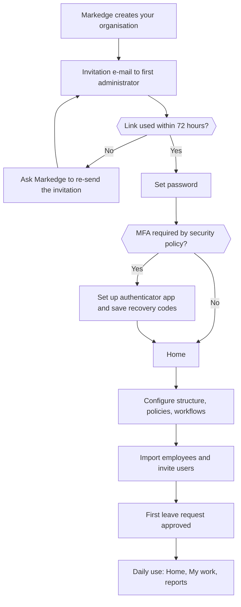
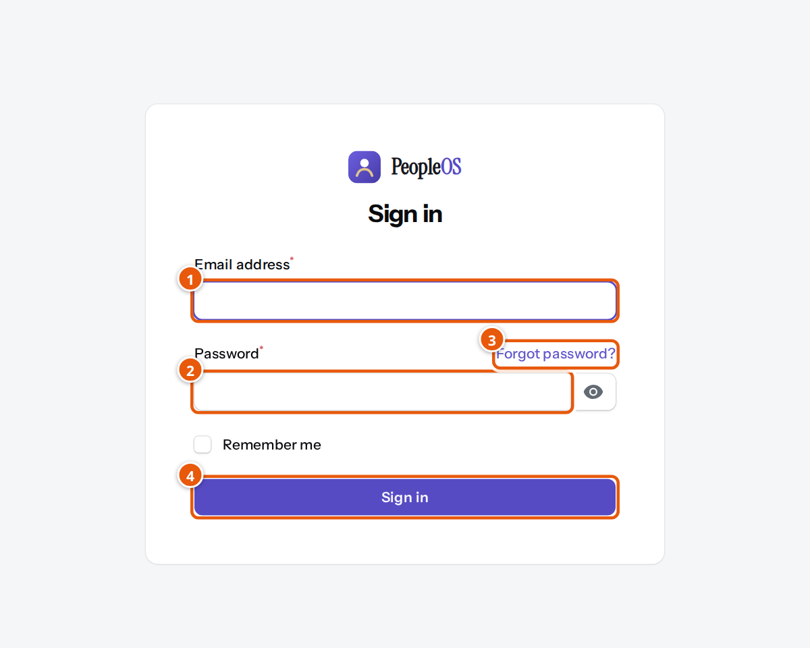
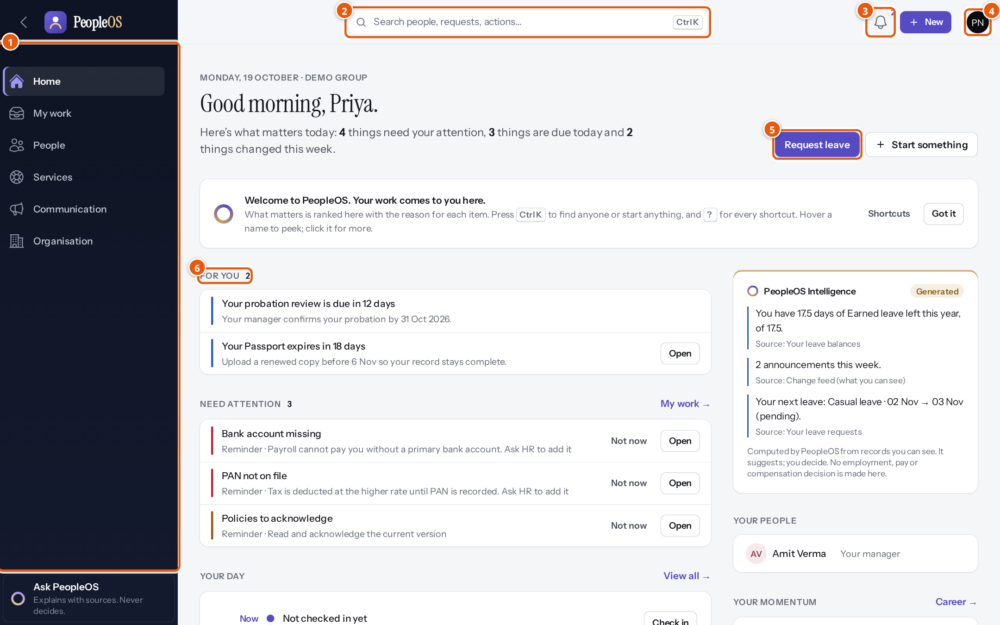
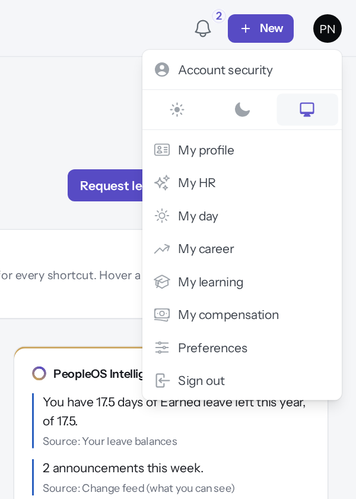
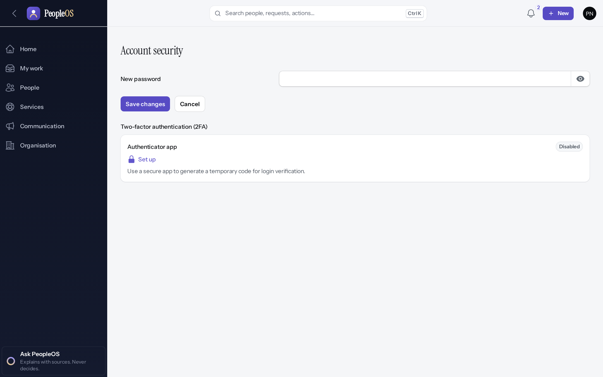
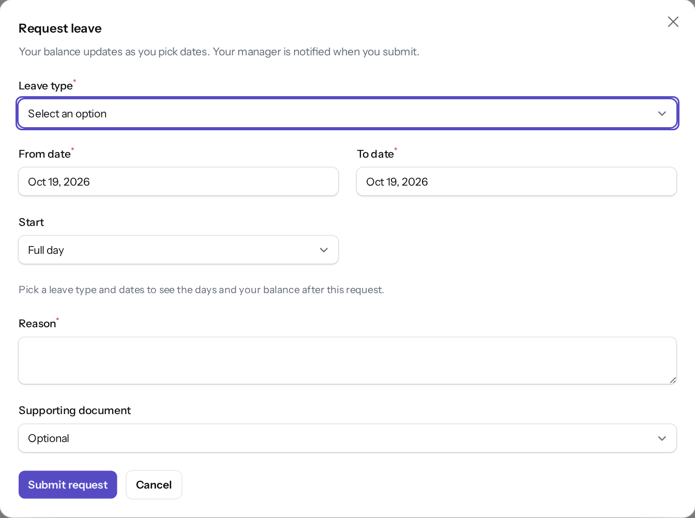
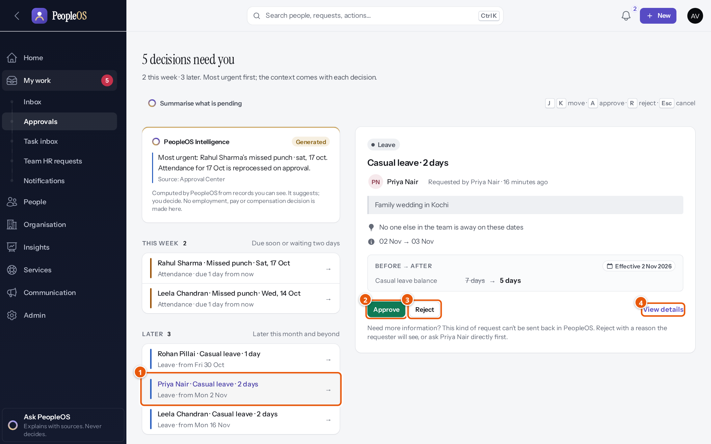

# 3. Getting started

> **In this chapter:** the complete journey from evaluating PeopleOS to using it every day, and a 30-minute
> quick start for every new user. **Who should read it:** everyone; administrators should also read
> [Chapter 7](07-administrator-guide.md).

---

## 3.1 The complete customer journey

The table shows who does each part of the journey today. "Automatic" means PeopleOS does it for you.

| # | Journey | Available automatically | Requires your action | Requires Markedge (provider) | Not currently supported |
|---|---|---|---|---|---|
| 1 | Evaluating the product | This handbook | Read, prepare questions (2.17, 2.18) | Demonstration | Public trial or sandbox — **to be confirmed with the SaaS provider** |
| 2 | Purchasing or subscribing | — | Agree terms | Commercial process; plans are managed by Markedge | Online purchase, self-service sign-up, online billing |
| 3 | Company onboarding | System roles, default features and default settings are created with your organisation | Provide organisation name and first administrator | Creates your organisation | — |
| 4 | Initial organisation set-up | "What do you want to configure?" finder, Packs & Blueprints | Enter structure and reference data | Optional, per agreement | — |
| 5 | First administrator account | Invitation e-mail with a one-time link (valid 72 hours) | Accept, set password, set up MFA if required | Re-send an expired invitation | — |
| 6 | Company settings | Sensible default settings | Review settings, security policy and feature flags | — | — |
| 7 | Users and roles | 14 ready-made roles; optional automatic accounts via single sign-on or SCIM | Invite users, give roles and scopes | — | — |
| 8 | Permissions | Role-grant limits (nobody can give a role more powerful than their own) | Adjust or create roles | — | — |
| 9 | First essential business task | Balance checks, routing to approvers, notifications | Import employees; run a first leave request | — | — |
| 10 | Daily operations | Home ranks what matters; My work collects decisions | Act on requests and tasks | — | — |
| 11 | Reports and performance | Command centre, analytics, starter reports | Build reports and dashboards | — | — |
| 12 | Exceptions and errors | Exception centre, validation messages, audit trail | Resolve exceptions; see [Chapter 9](09-troubleshooting.md) | Platform incidents | — |
| 13 | Changing settings | Governed changes with history and rollback (Change Centre) | Make and approve changes | — | — |
| 14 | Subscription and billing | — | — | All subscription changes | Billing and invoices inside PeopleOS for customers |
| 15 | Support | Ask PeopleOS (answers from your records); HR service desk (employee → your HR team) | Gather details before contacting support | Support channels — **to be confirmed with the SaaS provider** | In-app support portal to Markedge |

> **Note on provider access.** If Markedge staff ever need to look inside your organisation (for example to help with
> a problem), the platform requires a written reason, limits the access to 60 minutes and records it in your own audit
> trail as well as the platform's.

### Journeys in detail

**Journey 5 — the first administrator signs in.**
1. Open the invitation e-mail from PeopleOS and click the link (it works once and expires after 72 hours).
2. Choose a password.
3. If your organisation requires multi-factor sign-in, scan the QR code with an authenticator app (for example
   Microsoft Authenticator or Google Authenticator) and enter the six-digit code. Store the recovery codes safely.
4. You arrive on **Home**. Continue with [Chapter 7 — Administrator guide](07-administrator-guide.md).

**Journey 9 — the first essential business task.** A good first task is a leave request, because it touches
employees, managers, policies and balances:
1. The administrator sets up leave types and the leave policy (People › Time & leave and Workflows › Policies).
2. HR imports employees and checks that each has a manager.
3. An employee requests leave (3.2, step 5).
4. The manager approves it in **My work › Approvals** (3.2, step 6).
5. Both see the new status and the updated balance.

**Journey 12 — exceptions and errors.** PeopleOS tells you why something cannot be saved, in plain words, next to
the field. Attendance problems appear in the **Exception centre**; workflow steps waiting for someone appear in the
**Task inbox**; every change can be traced in **Insights › Audit › Change history**. See
[Chapter 9 — Troubleshooting](09-troubleshooting.md).

**Journey 14 — subscription and billing.** Your subscription is managed by Markedge outside your organisation's
workspace. There is no subscription or billing screen for customers. **To be confirmed with the SaaS provider.**

**Flowchart — From organisation creation to daily use.** How a new organisation goes from creation to its first
approved request. *Roles:* Markedge, first administrator, HR, employees, managers. *Starts:* Markedge creates the
organisation. *Ends:* daily use. *Exception path:* an expired invitation is re-sent.

---

## 3.2 Start using PeopleOS in 30 minutes

This walkthrough is for **every new user** — employee, manager or HR. It takes about 30 minutes, including reading.
Organisation-wide set-up (structure, policies, payroll) is separate and is done by your administrator
([Chapter 7](07-administrator-guide.md)).

**You need:** your work e-mail address, the invitation e-mail or your password, and — if your organisation requires
it — a phone with an authenticator app.

### Step 1 — Sign in (3 minutes)

*Figure 3.1 — The sign-in page. Demonstration environment.*

1. **Email address** — your work e-mail.
2. **Password** — the password you chose when you accepted your invitation.
3. **Forgot password?** — sends a reset link to your e-mail (see [Troubleshooting](09-troubleshooting.md#91-i-cannot-sign-in)).
4. **Sign in**.

If your organisation requires multi-factor sign-in, PeopleOS then asks for the six-digit code from your authenticator
app. If your organisation uses single sign-on (signing in with your company account, for example Microsoft Entra,
Google or Okta), your administrator gives you a dedicated sign-in link; the normal sign-in page has no single sign-on
button.

> **Tip.** After five failed attempts in a minute, PeopleOS asks you to wait before trying again ("Too many login
> attempts"). Wait for the time shown, then try again or use **Forgot password?**.

### Step 2 — Understand your Home screen (5 minutes)

*Figure 3.2 — Home for an employee (Priya Nair). Demonstration data (fictional).*

1. **The menu** — the areas you can use. An employee typically sees Home, My work, People, Services, Communication and
   Organisation. Managers, HR and administrators see more.
2. **Search (Ctrl K)** — type a person's name, a request or an action ("leave", "payslip") and jump straight there.
3. **Notifications** — the bell shows how many unread notifications you have.
4. **Your avatar** — opens your personal pages (see step 3).
5. **The main action for you** — for an employee, **Request leave**. **Start something** lists other common actions
   (Fix my attendance, Raise an HR request, Browse HR services).
6. **What matters today** — items are grouped as *For you*, *Need attention*, *Your day*, *My requests* and *What
   changed*, each with the reason it is shown and an **Open** button. **Not now** hides a reminder for the moment.

On the right, **PeopleOS Intelligence** summarises a few facts with their source (for example your leave balance).
It only uses records you are allowed to see and never makes decisions. The first time, a welcome tip explains the
keyboard shortcuts; click **Got it** to hide it.

### Step 3 — Find your personal pages (3 minutes)

*Figure 3.3 — The avatar menu. Demonstration environment.*

Click your initials at the top right:

| Menu item | What it is for |
|---|---|
| **Account security** | Change your password and set up the authenticator app (two-factor authentication). |
| Light / dark / system icons | Choose the colour theme. |
| **My profile** | Your own employee record (read-only). |
| **My HR** | Requests to HR, policies to acknowledge, documents, surveys, communications. |
| **My day** | Today's attendance, leave and tasks. |
| **My career** | Your career profile, skills and interests. |
| **My learning** | Courses and learning assigned to you. |
| **My compensation** | Your pay information. |
| **Preferences** | How Home opens, display density and notification choices. |
| **Sign out** | Ends your session. |

### Step 4 — Secure your account (4 minutes)

*Figure 3.4 — Account security. Demonstration environment.*

1. Open **avatar › Account security**.
2. Under **Two-factor authentication (2FA)**, next to **Authenticator app**, click **Set up**.
3. Scan the QR code with your authenticator app, enter the code, and keep the recovery codes somewhere safe.
4. To change your password, type it in **New password** and click **Save changes**.

Your organisation may make this step compulsory. If so, PeopleOS takes you to the set-up page right after sign-in.

### Step 5 — Make your first request: leave (5 minutes)

*Figure 3.5 — The Request leave form. Demonstration data (fictional).*

1. On **Home**, click **Request leave**.
2. **Leave type** — the list shows how many days of each type you have available.
3. **From date** and **To date**, and **Start** (Full day, First half or Second half).
4. PeopleOS shows the number of days and your balance after the request as soon as you pick dates.
5. **Reason** — required.
6. **Supporting document** — optional; choose one of your documents if your policy asks for proof.
7. Click **Submit request**. Your manager is notified.

**How to verify:** on Home, the request appears under **My requests** as *Waiting for approval*, and the "Your day"
section shows your next leave as *pending*.

### Step 6 — If you are a manager: decide a request (5 minutes)

*Figure 3.6 — The Approval Center for a manager (Amit Verma). Demonstration data (fictional).*

1. Open **My work › Approvals** (the number on **My work** shows how many decisions wait for you).
   Decisions are grouped **This week** and **Later**, most urgent first.
2. Click a request. The panel shows who asked, the reason, whether anyone else in the team is away, and the
   **Before → After** effect (for example the leave balance going from 7 to 5 days).
3. Click **Approve**, or **Reject** with a reason the requester will see.
4. **View details** opens the full record.

Keyboard users can press **J/K** to move, **A** to approve, **R** to reject and **Esc** to cancel.

> **Note.** Some requests cannot be "sent back" for changes. If you need more information, reject with a clear
> reason or ask the person first — the panel tells you when this applies.

### Step 7 — Check the result (2 minutes)

- The employee sees the new status under **My requests** on Home and in **My HR › Requests**.
- The leave balance on Home and in the Request leave form reflects the approved days.
- Notifications arrive in the bell (and by e-mail, depending on your preferences).

### Step 8 — Explore what else you can see (3 minutes)

- **Services › My HR** — ask HR a question, request a letter or a change to your details, acknowledge policies.
- **Communication** — announcements from your organisation.
- **Managers:** **People › My team** for your team's attendance, leave and reviews.
- **HR and executives:** **Insights** for analytics, reports and dashboards.

### Quick-start checklist

- [ ] I can sign in (and I know how to reset my password).
- [ ] I set up the authenticator app (or know it is not required).
- [ ] I know where Home, My work, search and the avatar menu are.
- [ ] I checked my details in **My profile** and told HR about anything wrong.
- [ ] I acknowledged the policies waiting in **My HR**.
- [ ] I submitted a test or real leave request, or (managers) decided one.
- [ ] I know where to find my notifications.

**Quick reference:** the most frequent tasks and where to find them are on one page in
[Chapter 11](11-quick-reference.md).
