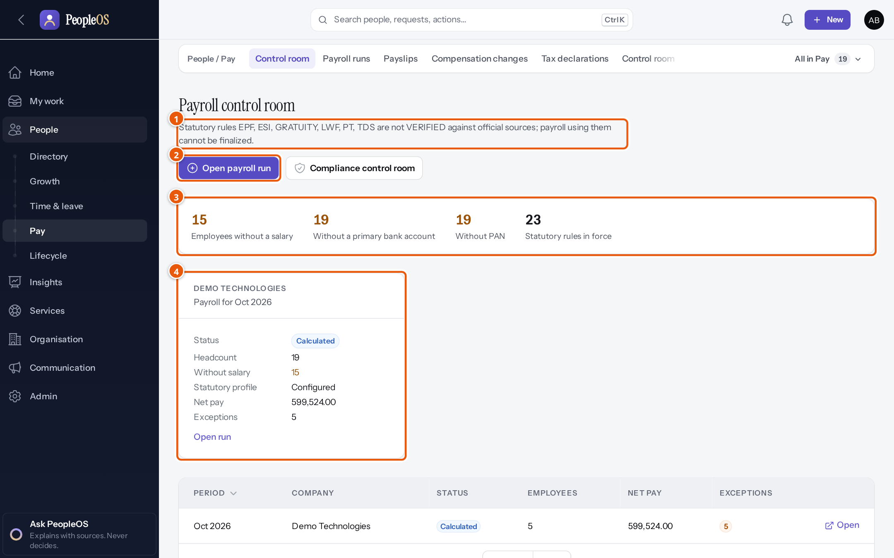
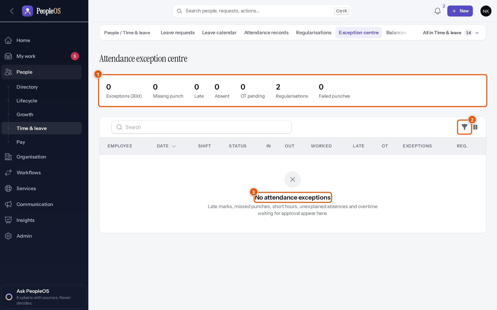
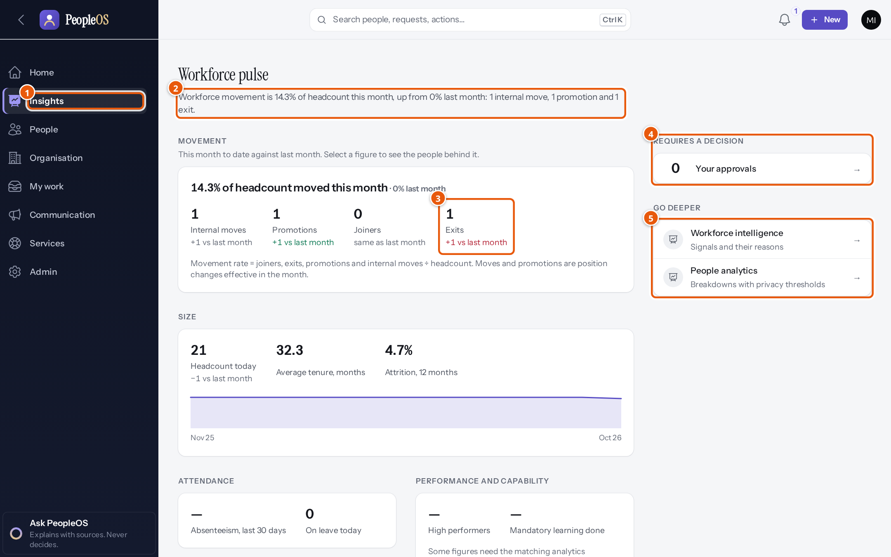
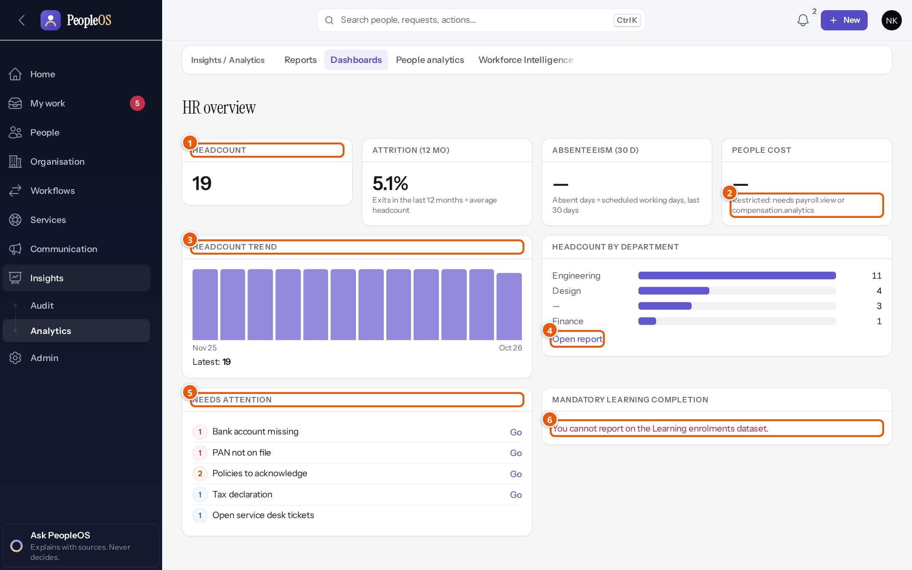

# 4. Home and dashboards

> **In this chapter:** the screens that summarise your work and your organisation — Home, the Approval Center, the
> control rooms and the analytics dashboards — and which ones to check for your role. **Who should read it:** everyone.

PeopleOS has one personal start page (**Home**) and several summary screens for specialists. They all follow three
rules:

1. **You only see your scope.** Every figure counts only records you are allowed to see. The same dashboard can show
   a headcount of 21 to the CEO and 19 to an HR manager who looks after one company.
2. **Small groups are hidden.** Figures about fewer than five people are shown as "fewer than 5" (Markedge can set a
   different threshold for your organisation), so nobody can work out a colleague's details.
3. **Facts, not predictions.** Dashboards show counts, shares and trends. PeopleOS never scores, ranks or predicts
   whether a person will leave or be promoted.

---

## 4.1 Which screen to check, by role

| Role | Start of the day | Specialist screens | Analytics |
|---|---|---|---|
| **Employee** | **Home** (For you), **My day** | **My HR** | — |
| **Manager** | **Home** (Your team), **My work › Approvals** | **People › My team**, **Leave calendar**, **Exception centre** | People analytics |
| **HR Manager / HR Executive** | **Home** (People operations), **My work** | **Services › Service Desk › HR queue**, onboarding plans, exit cases | People analytics, Service analytics, Exit insights, Survey results |
| **Payroll Admin** | **Home** (Payroll) | **People › Pay › Control room** (payroll and compliance), Payroll Auditor | Compensation analytics |
| **Attendance Admin** | **Home** | **Exception centre**, Regularisations | People analytics |
| **Executive** | **Home** (Company) | — | **Workforce Command Centre**, **Dashboards**, Workforce analytics, Compensation analytics |
| **Tenant HR Admin / Super Admin** | **Home** (Administration) | **Admin › All modules**, Change Centre | Change intelligence, all analytics |
| **Auditor** | **Home** | — | **Change history**, Change intelligence, AI interactions |

---

## 4.2 Home

Home answers *what matters to me now?* It starts with one sentence that counts what is waiting for you, then lists
each item with its reason and an **Open** button. If you hold several roles, **View as** switches between views:
**For you**, **Your team**, **People operations**, **Payroll**, **Company** and **Administration**. A view never
gives you extra access.

| View | Leads with |
|---|---|
| For you | Your own dates, reminders, day, requests and leave balance |
| Your team | Decisions waiting, team exceptions, team pulse (in today, on leave, approvals pending) |
| People operations | Probation, onboarding, documents and HR requests at risk; joiners in 14 days; on leave today |
| Payroll | The latest payroll run, its employees and exceptions; a link to the control room |
| Company | The workforce pulse: joiners, exits, promotions and internal moves against last month |
| Administration | Governance items (for example "Multi-factor sign-in is not required"), active users, roles, configuration changes |

Every view has **PeopleOS Intelligence** on the right: a few statements computed from your records, each with its
source, ending with "It suggests; you decide." Home is explained screen by screen, with a figure for each view, in
[5.1 Your workspace — Home](modules/01-workspace-and-self-service.md#home).

## 4.3 My work and the Approval Center

**My work** is your inbox of everything to do, decide or follow up; the number next to it in the menu counts what
waits for you. **My work › Approvals** (the Approval Center) lists decisions *This week* and *Later*, and shows the
context and the **Before → After** effect of each one beside **Approve** and **Reject**. See
[5.1 — My work](modules/01-workspace-and-self-service.md#my-work-inbox) and
[Approvals](modules/01-workspace-and-self-service.md#approvals-approval-center).

---

## 4.4 Operational dashboards

These screens help specialists run a process. Each is explained in its module chapter.

| Screen | What it shows | Where | Who | Chapter |
|---|---|---|---|---|
| **Payroll control room** | Readiness of the current payroll: employees, exceptions, the latest runs and their status | People › Pay › Control room | Payroll Admin, Tenant HR Admin, Auditor | [5.4](modules/04-payroll-compensation-and-compliance.md) |
| **Compliance control room** | Statutory rule verification, open regulatory notices, establishments and registrations, every return with its production gate | People › Pay › Control room (compliance) | Tenant HR Admin, Payroll Admin, Auditor | [5.4](modules/04-payroll-compensation-and-compliance.md) |
| **Exception centre** | Attendance days that need attention (missed punches, absences, late arrivals) | People › Time & leave › Exception centre | Managers, Attendance Admin, HR | [5.3](modules/03-time-and-leave.md) |
| **Leave calendar** | Who is away and when | People › Time & leave › Leave calendar | Managers, HR | [5.3](modules/03-time-and-leave.md) |
| **My team** | Your reports: in today, on leave, needing attention | People › My team | Managers | [5.5](modules/05-performance-learning-and-talent.md) |
| **Calibration board** | Ratings across teams in a performance cycle, for fair calibration | People › Growth › Calibration | Tenant HR Admin | [5.5](modules/05-performance-learning-and-talent.md) |
| **Learning dashboard** | Enrolments, completion, mandatory learning, hours | People › Growth › Dashboard (Learning) | Tenant HR Admin, Auditor | [5.5](modules/05-performance-learning-and-talent.md) |
| **Talent dashboard** | Talent pools, reviews and succession cover | People › Growth › Dashboard (Talent) | Tenant HR Admin | [5.5](modules/05-performance-learning-and-talent.md) |
| **Workforce dashboard** | Seats, FTE, occupied and vacant positions, plans awaiting approval | Organisation › Workforce › Dashboard | Executive, Tenant HR Admin | [5.6](modules/06-organisation-workforce-and-assets.md) |
| **Admin Centre** | Every module you can open, grouped by area | Admin › All modules | Administrators, HR | [5.9](modules/09-administration-and-security.md) |

*Figure 4.1 — The payroll control room for a Payroll Admin (Arjun Bose). Demonstration data (fictional).*

*Figure 4.2 — The attendance exception centre. Demonstration data (fictional).*

---

## 4.5 Analytics and executive dashboards

| Screen | What it shows | Where | Who | Chapter |
|---|---|---|---|---|
| **Workforce Command Centre** (Workforce pulse) | Joiners, exits, promotions and moves against last month; headcount, attrition, on leave today; drill-down to the people behind each figure | Insights › Analytics › Workforce Command Centre | Executive, Tenant HR Admin, Auditor | [5.8](modules/08-insights-analytics-and-ai.md) |
| **Dashboards** | Dashboards made of report and figure tiles, such as the HR overview | Insights › Analytics › Dashboards | Executive, HR, Auditor | [5.8](modules/08-insights-analytics-and-ai.md) |
| **People analytics** | Headcount and movement by company, department and location | Insights › Analytics › People analytics | Managers, HR, Executive, Payroll, Auditor | [5.8](modules/08-insights-analytics-and-ai.md) |
| **Workforce Intelligence** | Aggregate workforce trends and a narrative (no individual prediction) | Insights › Analytics › Workforce Intelligence | Executive, Tenant HR Admin | [5.8](modules/08-insights-analytics-and-ai.md) |
| **Reports** | Your own and starter reports with filters, grouping, charts and CSV export | Insights › Analytics › Reports | HR, administrators, Auditor | [5.8](modules/08-insights-analytics-and-ai.md) |
| **Change intelligence** | Patterns in configuration and data changes | Insights › Audit › Change intelligence | Administrators, Auditor | [5.8](modules/08-insights-analytics-and-ai.md) |
| Performance, Talent, Compensation and Workforce analytics; Service analytics; Exit insights; Survey results | Area-specific figures | In each area's "All in …" menu | See chapter 5.8, "Other analytics pages" | [5.8](modules/08-insights-analytics-and-ai.md#other-analytics-pages) |

*Figure 4.3 — The Workforce Command Centre for an executive (Meera Iyer). Demonstration data (fictional).*

*Figure 4.4 — The HR overview dashboard. Demonstration data (fictional).*

> **Note.** As shipped, the Executive role has no permission on the report datasets, so report tiles on dashboards
> show "You cannot report on the … dataset." Your administrator can add the dataset permissions. A known defect also
> leaves the report builder's filter and grouping field lists empty when you create or edit a report; running
> existing reports is not affected.

---

## 4.6 Tips for using dashboards well

- **Click the figure.** Most figures open the list of records behind them, so you can act on them.
- **Check the date and scope.** Figures are "as of" a date and limited to your scope; compare like with like.
- **Use "View as" deliberately.** Switch Home to the view that matches the task you are about to do.
- **Don't export more than you need.** Exports are recorded in the audit trail and personal data leaves PeopleOS.
- **New organisations have little data.** Trends become meaningful after a few months of use.
