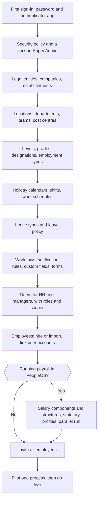

# 7. Administrator guide

> **In this chapter:** how to set up and run PeopleOS for your organisation — the order to configure things in, the
> settings that matter most, security recommendations, routine checks, and what Markedge handles for you.
> **Who should read it:** Tenant Super Admins, Account Owners and Tenant HR Admins.

This chapter is your manual. The detailed screens, fields and step-by-step tasks are in the module chapters, mostly
[5.9 Administration](modules/09-administration-and-security.md), which also holds the complete **settings**, **feature
flag** and **security policy** reference tables.

---

## 7.1 Who administers PeopleOS

| Role | Typical holder | What only this role can do |
|---|---|---|
| **Tenant Super Admin** | One or two trusted people (Markedge invites the first) | Edit role permissions; give the Tenant Super Admin role; change feature flags; request the full data export |
| **Account Owner** | First administrator of a self-service organisation (sign-up is switched off today) | Set-up, users and roles, security policy, data export — without payroll, statutory or sensitive data |
| **Tenant HR Admin** | The HR systems owner | Configure structure, people set-up data, policies, workflows, forms, custom fields, notifications, integrations and security; operate any HR area |

> **Tip.** Always keep **two** Tenant Super Admins, so that one person's absence or lost phone never locks your
> organisation out of the most important settings.

### You and Markedge

| You do (with the right role) | Markedge does |
|---|---|
| Users, roles, access scopes, settings, feature flags, security policy | Creates your organisation and invites the first administrator |
| Structure, people set-up data, policies, workflows, forms, custom fields | Your organisation profile: name, address, country, time zone, language, base currency, data region |
| Notification rules and templates (edit), knowledge base, announcements | E-mail delivery, the AI language-model provider and other platform services |
| Single sign-on, API keys, webhooks, integrations, exchange rates | Statutory rules, their verification, country pack data |
| Data export, audit trail review | Subscriptions, plans, billing; suspension and closing of an organisation; backups and recovery |

The complete table, including how Markedge support access works, is in
[5.9 — What you can do yourself and what Markedge does](modules/09-administration-and-security.md#what-you-can-do-yourself-and-what-markedge-does).

---

## 7.2 Setting up a new organisation

Configure PeopleOS in this order: each step uses what the previous steps created. Plan several working sessions; the
time depends on the size of your organisation and the state of your data.

**Flowchart — Setting up a new organisation.** The recommended order for an administrator's first configuration.
*Roles:* first administrator (Tenant Super Admin), Tenant HR Admin, HR, payroll. *Starts:* the first administrator
signs in. *Ends:* employees are invited and a first process runs.

| Step | What to do | Where | Details |
|---|---|---|---|
| 1 | Secure your own account; set the security policy; invite a second Tenant Super Admin | avatar › Account security; **Admin › Platform › Security policy**; **Admin › Setup › Users** | [5.1](modules/01-workspace-and-self-service.md), [5.9](modules/09-administration-and-security.md#security-policy) |
| 2 | Legal entities, companies and (India) establishments | **Organisation › Organisation** | [5.6](modules/06-organisation-workforce-and-assets.md) |
| 3 | Locations, business units, divisions, departments, teams, cost and profit centres | **Organisation › Organisation**, or the Organisation Designer | [5.6](modules/06-organisation-workforce-and-assets.md) |
| 4 | Levels, grades, designations, job families, employment types, employee categories, work modes, document types | **Admin › Setup › All in Setup** (People Setup) | [5.6](modules/06-organisation-workforce-and-assets.md) |
| 5 | Holiday calendars, shifts, work schedules, attendance devices | **People › Time & leave** | [5.3](modules/03-time-and-leave.md) |
| 6 | Leave types and the leave policy (entitlements, accrual, carry-forward, encashment) | **People › Time & leave**; **Workflows › Policies** | [5.3](modules/03-time-and-leave.md), [5.9](modules/09-administration-and-security.md#policies) |
| 7 | Approval workflows, notification rules and templates, custom fields, forms | **Workflows › Workflows**; **Communication › Communication**; **Admin › Setup** | [5.9](modules/09-administration-and-security.md), [5.7](modules/07-services-and-communication.md) |
| 8 | HR team and managers: invite users, give roles, set organisation scopes | **Admin › Setup › Users** | [5.9](modules/09-administration-and-security.md#users-and-access) |
| 9 | Employees: hire one by one or import; link each user account to its employee record | **People › Lifecycle › Employees**; **Employee imports** | [5.2](modules/02-people-and-employee-lifecycle.md) |
| 10 | Payroll (optional): salary components, structures, statutory registrations and profiles; run in parallel | **People › Pay** | [5.4](modules/04-payroll-compensation-and-compliance.md) |
| 11 | Knowledge base, policies to acknowledge, a welcome announcement | **Services › Knowledge**; **Communication** | [5.7](modules/07-services-and-communication.md) |
| 12 | Invite all employees; run a pilot (for example leave for two weeks) | **Admin › Setup › Users** | [Chapter 3](03-getting-started.md) |

> **Shortcuts.** **Admin › Setup › What do you want to configure?** finds any setting or screen by name.
> **Admin › Setup › Packs & Blueprints** applies a ready-made configuration pack, and lets you export and import
> blueprints — a useful way to copy a tested configuration.

> **Important — bulk import.** A known defect currently stops employee and punch imports at the **Map columns** step.
> Until Markedge confirms the fix, add employees one by one (**Hire employee**) or ask Markedge about migration help.

---

## 7.3 Settings that matter most

PeopleOS ships with sensible defaults. Review these before go-live. Each row summarises the full reference in
[5.9 Settings reference](modules/09-administration-and-security.md#settings-reference).

| Setting | What it controls | Why it matters | When you change it | Who is affected | Reversible? | Risk |
|---|---|---|---|---|---|---|
| Require authenticator-app MFA (Security policy) | Multi-factor sign-in for everyone | The single most effective protection against stolen passwords | Users without an authenticator must set one up at their next page | Everyone | Yes | Warn users first; plan for lost phones |
| IP allowlist (Security policy) | Networks allowed to reach PeopleOS | Limits access to office or VPN | Others see "Your network is not allowed to access this tenant." | Everyone, including you | Yes, from an allowed network | You can lock yourself out; remote staff are blocked |
| Sign out after idle minutes (Security policy) | Automatic sign-out | Shared or unattended computers | Idle users are signed out at their next click, without being told why | Everyone | Yes | Tell users the limit |
| Minimum password length (Security policy) | Shortest password (8–64, default 10) | Password strength | Applies the next time people choose a password | Everyone | Yes | Existing passwords are not re-checked |
| `leave.year_start_month` | Month the leave year starts | Balances, accruals and carry-forward follow it | Balances are counted in the new leave year | Everyone who takes leave | Avoid | Change only at a year boundary, with HR |
| `attendance.regularisation.window_days` | How far back attendance can be corrected | Controls late corrections | Older requests are refused | Employees, managers | Yes | — |
| `payroll.lop_from_attendance`, `payroll.proration_basis` | Loss of pay and proration method | Directly changes pay | New calculations use the new value | Payroll, every paid employee | Yes, before calculation | Mid-cycle changes cause over- or under-payment |
| `payroll.adjustments.require_approval` | Approval of one-off payroll adjustments | Control over manual pay lines | New adjustments start as pending | Payroll | Yes | — |
| `exit.*_clearance_role` | Which role receives exit clearance tasks | Clearance must reach the right team | New exits use the new role | Clearance teams | Yes | A misspelt role slug leaves tasks unassigned |
| `ai.external_data_policy` + flag `ai.llm` | Whether facts may be sent to an external AI provider | Data protection | With the flag on, permitted facts go to the provider configured by Markedge | Everyone using Ask PeopleOS | Yes | "restricted" sends personal data to the provider |
| Flag `audit.sensitive_access` | Audit entries for views of sensitive fields | Auditors and data-protection officers rely on it | Off: views are no longer recorded | Auditors | Yes | Agree with your DPO before switching off |
| Flag `configuration.approval` | Approval of risky configuration edits in the Change Centre | Four-eyes control on configuration | Some edits wait for approval | Administrators | Yes | Covers only some edits; settings and flags apply immediately |

> **Note — settings with no effect today.** Some stored settings are not used yet: password expiry, branding,
> locale and date formats, base currency, two leave keys and two older security keys. Changing them does nothing; the
> reference marks each one.

---

## 7.4 Security recommendations

- [ ] Two Tenant Super Admins, each with an authenticator app.
- [ ] **Require authenticator-app MFA** switched on before go-live (or single sign-on with MFA at your identity provider).
- [ ] Organisation scopes set for every HR person and manager (no scope = whole organisation). Home's Administration
      view lists people who "approve or edit employees across the whole tenant".
- [ ] Roles reviewed: give specialist roles (Payroll Admin, Attendance Admin…) only to those who need them; remove
      the webhook permission from the Auditor role if auditors must be read-only; add performance permissions to
      Performance Admin if you use it.
- [ ] Idle sign-out set to a value that suits shared devices.
- [ ] IP allow-list only if every user works from known networks — test from home first.
- [ ] API keys issued with the fewest scopes needed and an expiry date; PeopleOS does not limit a key's scopes to its
      issuer's own permissions, so review keys regularly.
- [ ] `audit.sensitive_access` left on.
- [ ] Leavers' accounts: completing an exit suspends sign-in; check **Users** for anyone still Active who has left.

---

## 7.5 Managing users and access day to day

| Task | How | Notes |
|---|---|---|
| Invite a user | **Admin › Setup › Users** › invite; give roles and scope | Administrators never set passwords; the invitation link is valid for 72 hours |
| Re-send or revoke an invitation | Open the user › **Account › Send a new invitation / Revoke invitation** | Each action asks for a reason |
| Change roles or scope | Edit the user | Role changes are audited; you cannot give a role above your own |
| Suspend / reactivate | Edit the user's status | Suspension signs the person out everywhere |
| Lost phone | **Account › Reset multi-factor authentication** | The person sets up a new authenticator at next sign-in |
| Forgotten password | **Account › Send password reset link** | The link is valid for 60 minutes |
| Force sign-out | **Account › Sign out everywhere** | The person is not told why on the sign-in page |
| Custom role | **Admin › Setup › Roles** (Tenant Super Admin edits permissions) | Start from the closest ready-made role |

Details: [5.9 Users and access](modules/09-administration-and-security.md#users-and-access) and
[Roles and permissions](modules/09-administration-and-security.md#roles-and-permissions).

---

## 7.6 Master data, business rules and workflows

- **Master data** (companies, departments, locations, designations, grades…) — keep codes stable; deactivate rather
  than delete records that history refers to. See [5.6](modules/06-organisation-workforce-and-assets.md).
- **Policies** (for example leave) are versioned: publish a new version with an effective date instead of editing the
  live one, and decide who gets each policy with assignment rules. See
  [5.9 Policies](modules/09-administration-and-security.md#policies).
- **Workflows** route requests through approval and task steps; test a new workflow on a small group before
  publishing it widely. The "Generate document" step is skipped today. See
  [5.9 Workflows and runs](modules/09-administration-and-security.md#workflows-and-runs).
- **Custom fields and forms** extend records without code. The "Visible to employee/manager/HR" switches on custom
  fields do not hide anything yet — do not store confidential data in a custom field expecting it to be hidden.
- **Change Centre** — with `configuration.approval` on, some configuration edits wait for a second person; keep in
  mind that settings, feature flags, creating and deleting records apply immediately and that self-approval is not
  blocked. Roll back a published change from the Change Centre.

## 7.7 Notifications

Most modules notify the right people automatically (in-app immediately, e-mail shortly after). Notification rules let
you add messages for chosen events; templates hold the wording. Today you can **edit** the rules and templates your
organisation has, but no role can create or delete them, and only e-mail and in-app messages are delivered (SMS,
WhatsApp and push are listed but send nothing). Check deliveries in **Communication › Communication › Delivery log**
and use **Send again** only when a person confirms they did not receive a message. See
[5.7](modules/07-services-and-communication.md).

## 7.8 Reports and analytics

Reports and dashboards only show what each viewer may see, and small groups are suppressed to protect privacy.
Administrators decide who can build and export reports through roles. See [5.8](modules/08-insights-analytics-and-ai.md).

## 7.9 Integrations

| Integration | Where | Notes |
|---|---|---|
| Single sign-on (OpenID Connect: Microsoft Entra, Google, Okta presets) | **Admin › Platform › All in Platform › Single sign-on** | SAML is not supported. Share the organisation's sign-in link with users |
| User provisioning (SCIM) and the REST API | **Admin › Platform › API keys** | Give each key the fewest scopes and an expiry |
| Webhooks (signed, retried) | **Admin › Platform › All in Platform › Webhooks** | HTTPS endpoints only |
| Inbound events (other systems → PeopleOS) | **Admin › Platform › Integration hub / Inbound events** | Signed, idempotent events |
| Attendance devices | **People › Time & leave › Devices** | Set up with your device vendor |

See [5.9](modules/09-administration-and-security.md#api-keys-scim-and-the-peopleos-api).

## 7.10 Data imports and exports

- **Imports:** employee and punch imports stage, validate and detect duplicates before anything is created — but see
  the known defect at the **Map columns** step (7.2).
- **Exports from lists and reports:** CSV exports are available where your role allows; exports are audited.
- **Full data export:** **Admin › Platform › All in Platform › Data export** (Tenant Super Admin, Account Owner). One
  export at a time; an encrypted ZIP with a signed manifest; the passphrase is shown only to an authorised person;
  personal download links work for a few minutes; the package is deleted after its availability period (seven days by
  default). See [5.9 Data export](modules/09-administration-and-security.md#data-export).

## 7.11 Audit logs

Every material change records who, what, when, before/after and the reason, on a tamper-evident trail that is never
purged. Review it in **Insights › Audit › Change history** and **Change intelligence**; Markedge support access also
appears there. Use the Auditor role for independent reviewers. See [5.8](modules/08-insights-analytics-and-ai.md).

## 7.12 Backup and recovery considerations

- Backups, restore tests and recovery objectives (how much data could be lost and how quickly service returns) are
  the provider's responsibility. **To be confirmed with the SaaS provider** — ask for the backup frequency, recovery
  point objective, recovery time objective and the date of the last successful restore test.
- What you can do yourself: request a **full data export** periodically and keep it securely as your own copy;
  export **blueprints** of your configuration after major changes.
- Retention: AI interactions (365 days), notification deliveries (180 days) and report runs (90 days) are deleted by
  a nightly clean-up unless you change the periods in the Security policy; audit events are never deleted.

## 7.13 Account and subscription

Your subscription, plan, trial and billing are managed by Markedge; there is no subscription or billing screen in your
workspace. Organisation-level changes (name, web address, country, time zone, base currency, data region, suspension,
closing) are requested from Markedge. **To be confirmed with the SaaS provider.**

---

## 7.14 Routine administration checklist

**Daily (5 minutes)**
- [ ] Home in the **Administration** view: governance items and decisions waiting.
- [ ] **My work**: approvals and tasks addressed to you.

**Weekly**
- [ ] **Change Centre**: pending and recent configuration changes.
- [ ] **Users**: invitations not yet accepted (re-send), leavers still Active.
- [ ] **Delivery log**: failed notifications.
- [ ] **Inbound events** and **Webhooks**: failures (if you use integrations).
- [ ] **Exception centre** with the attendance team.

**Monthly**
- [ ] Roles and organisation scopes still right after joiners, moves and leavers.
- [ ] API keys: still needed, scopes minimal, expiry set.
- [ ] **Compliance control room** and regulatory notices (if you run payroll).
- [ ] Change intelligence: unusual patterns of change.

**Yearly or at a leave-year boundary**
- [ ] Holiday calendars for the new year.
- [ ] Leave policy versions for the new leave year.
- [ ] Full data export kept as an archive copy.

---

## 7.15 Administrator troubleshooting

| Situation | What to check |
|---|---|
| A user cannot sign in | Status in **Users** (Invited, Active, Suspended); re-send the invitation; reset MFA; check the IP allow-list. See [9.1](09-troubleshooting.md#91-i-cannot-sign-in). |
| A user cannot see a module | Roles, organisation scope, employee-record link, feature flag. See [9.5](09-troubleshooting.md#95-a-page-or-menu-item-is-not-visible). |
| You are locked out by the IP allow-list | Ask another administrator on an allowed network to correct it; otherwise contact Markedge. |
| A configuration change had unexpected effects | Change Centre → roll back; Change history for who changed what. |
| Workflow steps stuck | **Workflows › Runs** — see which step waits and for whom. |
| Payroll cannot be finalised | Statutory rule verification — see [9.20](09-troubleshooting.md#920-payroll-cannot-be-finalised). |
| Import stops at Map columns | Known defect — see 7.2. |
| "Give feedback" shows an error to employees | Known defect: the feedback is saved but HR is not notified — check the **Feedback inbox** regularly until Markedge confirms a fix. |
