# Your workspace: signing in, Home, My work and approvals

> **In this chapter:** how to sign in safely, how PeopleOS shows each person what matters to them, and how to handle your work, decisions and notifications in one place. **Who should read it:** everyone — employees, managers, HR, payroll, executives and administrators.

PeopleOS is built so that work comes to people, rather than people hunting through menus. After you sign in, **Home** tells you in one sentence what needs you today, and why. **My work** collects everything you must do, decide or follow up. The **Approval Center** shows each decision with the facts you need beside it. A search bar finds people, requests and actions in a few keystrokes. What you see depends on your role: an employee sees their own leave, tasks and requests; a manager also sees their team; HR, payroll, executives and administrators each get a view of their own responsibilities. Nobody sees more than their access allows.

| Module | What it is for | Where to find it | Who uses it | Status |
|---|---|---|---|---|
| Sign in, Forgot password, invitation | Getting into PeopleOS safely | The sign-in page; the invitation e-mail | Everyone | Available |
| Multi-factor sign-in (authenticator app) | A second check at sign-in, with a code from your phone | Avatar menu › Account security | Everyone; required only if your organisation turns it on | Available |
| Account security | Change your password; set up or renew your authenticator app | Avatar menu › Account security | Everyone | Available |
| Home | "What matters to me now", per role | Sidebar › Home | Everyone | Available |
| Navigation, search and quick actions | Finding any screen, person or action | Sidebar, top bar, Ctrl K | Everyone | Available |
| Ask PeopleOS | Asking a question in plain words | Sidebar › Ask PeopleOS | Most roles (see below) | Available with limitations |
| My work (Inbox) | One list of everything you must do, decide or follow up | My work › Inbox | Everyone | Available |
| Approvals (Approval Center) | Deciding requests with their context | My work › Approvals | Managers, HR, payroll, administrators; employees who are given tasks | Available with limitations |
| Task inbox | Workflow and onboarding tasks given to you or your role | My work › Task inbox | Most roles | Available |
| Team HR requests | Status of your team's HR requests | My work › Team HR requests | Managers and HR | Available with limitations |
| Notifications | Everything PeopleOS told you, grouped | My work › Notifications; the bell | Everyone | Available |
| My day | A personal one-page summary of today | Avatar menu › My day | Anyone with an employee record | Available |
| Preferences | How PeopleOS looks and opens for you | Avatar menu › Preferences | Everyone | Available |
| Phone, tablet and dark mode | The same workspace on smaller screens and in a dark theme | Automatic; theme in the avatar menu | Everyone | Available with limitations |

> **Note:** PeopleOS is not yet generally released. The screens in this chapter come from a demonstration organisation ("Demo Group") with fictional people. Commercial terms, hosting region and support channels are to be confirmed with the SaaS provider, Markedge.

---

## Signing in and keeping your account secure

**Status:** Available

### Overview

You sign in with your work e-mail address and a password that only you know. Your administrator never chooses or sees your password: new users receive an **invitation** by e-mail and choose their own. If you forget your password, you can ask for a reset link yourself.

Your organisation can also require **multi-factor sign-in** (PeopleOS also calls it two-factor authentication, or 2FA). This means that, after your password, you type a 6-digit code from an authenticator app on your phone. Whether it is required is a decision your organisation makes in its security policy; in the demonstration organisation it is optional.

Before you can use PeopleOS, three checks must be complete, in this order: your authenticator code (if you use one), setting up an authenticator (if your organisation requires one and you have none), and confirming your e-mail address (if it has not been confirmed yet). Until they are done, PeopleOS shows only the page for the next step, and sign out.

### Where to find it

- **Menu path:** the sign-in page of your organisation's PeopleOS address; afterwards, **avatar menu (top right) › Account security**.
- **Who can open it:** anyone with an active account in an organisation that is not suspended.
- **Set-up needed first:** your administrator creates your user and assigns your roles. E-mail delivery for invitations and reset links is set up by Markedge (your provider).

### The screen at a glance

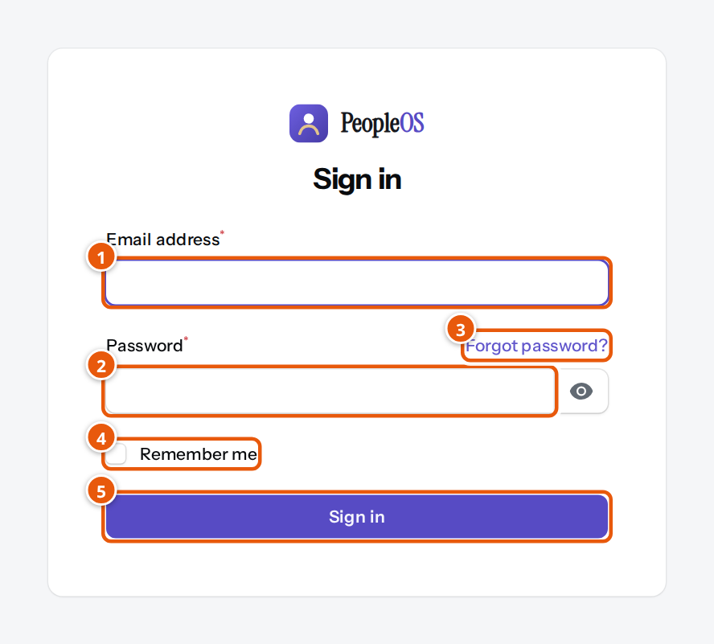
*Figure 1.1 — The sign-in page. Demonstration data (fictional).*

1. **Email address** — your work e-mail address.
2. **Password** — your password. The eye icon shows what you typed.
3. **Forgot password?** — opens the page where you ask for a reset link.
4. **Remember me** — keeps you signed in on this device. Use it only on a device that is yours.
5. **Sign in** — signs you in.

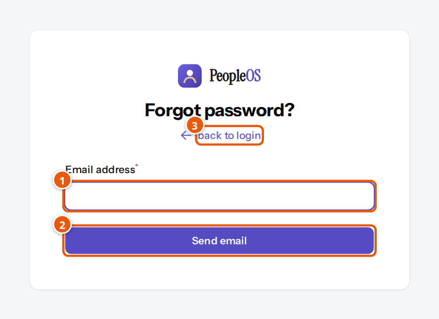
*Figure 1.2 — The Forgot password page. Demonstration data (fictional).*

1. **Email address** — the address you sign in with.
2. **Send email** — asks for a reset link.
3. **back to login** — returns to the sign-in page.

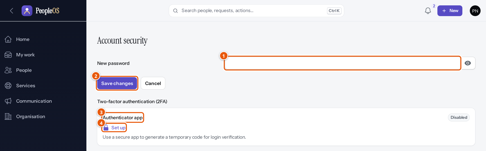
*Figure 1.3 — Account security: your password and your authenticator app. Demonstration data (fictional).*

1. **New password** — type a new password here. Two more fields then appear: **Confirm new password** and **Current password**.
2. **Save changes** — saves the new password. **Cancel** leaves without changing anything.
3. **Authenticator app** — shows **Enabled** or **Disabled** on the right.
4. **Set up** — starts setting up an authenticator app. Once it is set up, you will see **Regenerate recovery codes** and **Turn off** instead.

Your name and e-mail address are not on this page. They are managed by your administrator.

**Flowchart — Signing in and what you can see.** What happens between the sign-in page and Home. *Roles:* everyone. *Starts:* you open the sign-in page. *Ends:* Home opens, composed for your role.

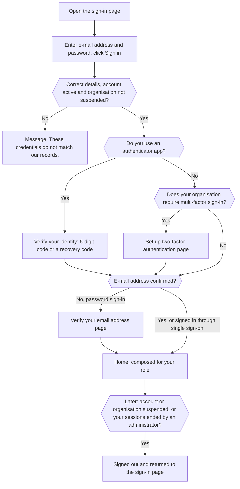

> **Important:** a suspended account and a suspended organisation are kept out at the password step, with the same message as a wrong password. If you are sure your details are right, contact your administrator.

### Tasks

#### Task: Sign in

**Purpose:** open your PeopleOS workspace.
**Before you start:** you need an active account (you accepted your invitation) and your organisation's PeopleOS address.

1. Open your organisation's PeopleOS address. The **Sign in** page appears.
2. Enter your **Email address** and **Password** (both required).
3. Tick **Remember me** only on your own device.
4. Click **Sign in**.
5. If you use an authenticator app, the page asks you to **Verify your identity**. Enter the code under **Enter the 6-digit code from the authenticator app** and click **Confirm sign in**.

**Expected result:** Home opens with a greeting such as "Good morning, Priya." and a one-sentence summary of your day.
**How to verify:** your initials appear in the round avatar at the top right.
**Common mistakes:** typing a personal e-mail address instead of your work address; leaving Caps Lock on.
**If it fails:** "These credentials do not match our records." means the address or password is wrong, or your account or organisation is not active. After several failed attempts PeopleOS shows **Too many login attempts** and asks you to wait. Use **Forgot password?** or contact your administrator.

> **Tip:** if you ticked **Remember me** and you use an authenticator app, PeopleOS asks you to **Confirm it is you** the next time you come back: enter a code and click **Verify**, or click **Sign out**.

#### Task: Activate your account from an invitation (first sign-in)

**Purpose:** choose your own password and start using PeopleOS.
**Before you start:** your administrator has created your user. You receive an e-mail titled "You have been invited to *your organisation* on PeopleOS".

1. Open the e-mail and click **Accept the invitation**. The page **Accept your invitation** opens and says "Choose a password for *your address*."
2. Enter a **Password** and the same password again in **Confirm password** (both required).
3. Click **Activate my account**.
4. PeopleOS shows "Your account is ready. Sign in with your new password." and opens the sign-in page.
5. Sign in. If your organisation requires multi-factor sign-in, PeopleOS now asks you to set up your authenticator app (see the next tasks).

**Expected result:** your account is active and your e-mail address counts as confirmed.
**How to verify:** you can sign in with the new password.
**Common mistakes:** opening the link while someone else is signed in on the same browser. PeopleOS then says "You are signed in to PeopleOS. Sign out, then open the invitation link again."
**If it fails:**
- "This invitation link is invalid or has expired. Ask your administrator to send a new one." appears for every reason a link cannot be used: it was already used, it expired (by default after 72 hours), a newer invitation replaced it, it was revoked, or the organisation is suspended. Ask your administrator to use **Send a new invitation**.
- If the password does not meet your organisation's rules, the form tells you what to fix, for example "Use at least 10 characters.", "Mix upper- and lower-case letters." or "Include a number." (the minimum length is set by your organisation).
- After five attempts in a minute, PeopleOS asks you to wait ("Too many attempts. Try again in … seconds.").

**Flowchart — First sign-in from an invitation.** *Roles:* administrator, new user. *Starts:* the administrator creates the user. *Ends:* the new user reaches Home.

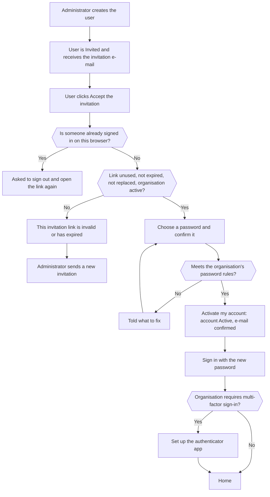

#### Task: Reset a forgotten password

**Purpose:** choose a new password without help from your administrator.
**Before you start:** your account must be active. An invited user who has not yet activated the account must use the invitation instead.

1. On the sign-in page, click **Forgot password?**.
2. Enter your **Email address** (required) and click **Send email**.
3. PeopleOS always answers: "If an account uses that address, we have sent it a link to choose a new password." and "The link expires in 60 minutes."
4. Open the e-mail "Reset your PeopleOS password" and click **Choose a new password**.
5. On **Reset your password**, enter your **Email address**, a new **Password** and **Confirm password**, then click **Reset password**.
6. PeopleOS shows "Your password has been changed. Sign in with it now." and signs you out of every other device.

**Expected result:** you can sign in with the new password.
**How to verify:** sign in. If you use an authenticator app, you are still asked for a code: resetting a password never switches multi-factor sign-in off.
**Common mistakes:** waiting longer than the link's lifetime; using an old e-mail after asking for a newer link.
**If it fails:** "This password reset link is invalid or has expired. Request a new one." appears for any link that cannot be used. If your new password breaks a rule, you are told what to fix and the same link still works. If no e-mail arrives at all, your account may be suspended or still waiting for its invitation: contact your administrator, who can also send you a reset link (**Send password reset link**).

> **Note:** the answer on screen is identical whether or not the address belongs to an account. This is deliberate: it stops anyone from discovering which addresses exist.

**Flowchart — Resetting a forgotten password.** *Roles:* any user. *Starts:* Forgot password? on the sign-in page. *Ends:* the user signs in with the new password.

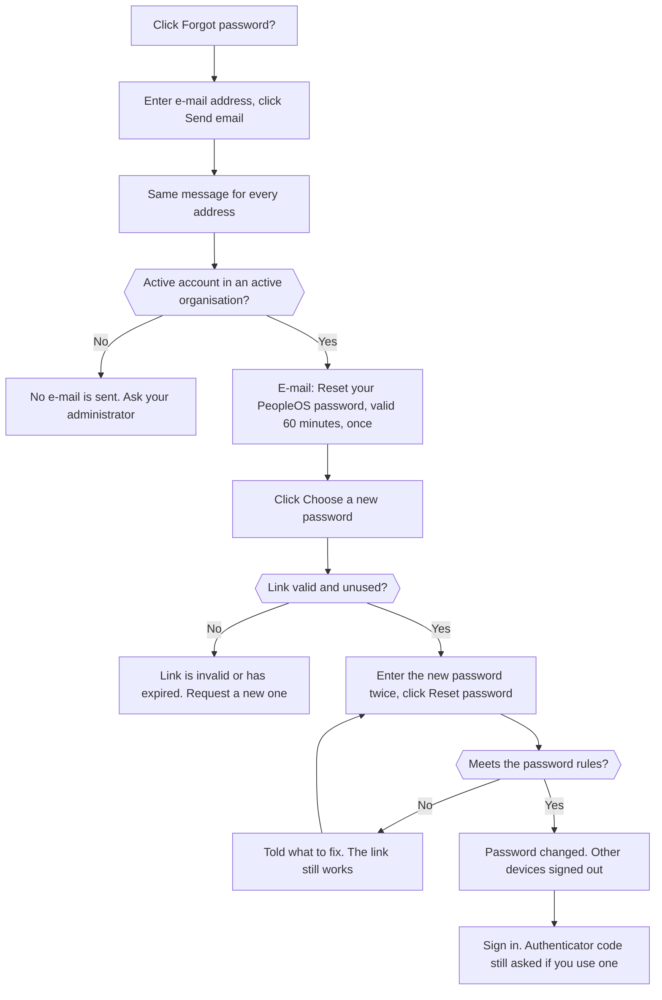

#### Task: Set up your authenticator app

**Purpose:** add a second check to your sign-in.
**Before you start:** install an authenticator app (for example Google Authenticator) on your phone.

1. Open **avatar menu › Account security**. (If your organisation requires it, PeopleOS opens the page **Set up two-factor authentication (2FA)** for you.)
2. Under **Authenticator app**, click **Set up**.
3. In **Set up authenticator app**, scan the QR code with your phone, or type the code shown under "Or enter this code manually:".
4. Save the **recovery codes** in a safe place. They are shown only once. You can copy or download them all at once.
5. Enter the code under **Enter the 6-digit code from the authenticator app** and click **Enable authenticator app**.
6. On the required set-up page, click **Continue**.

**Expected result:** "Authenticator app has been enabled". The page now shows **Enabled**.
**How to verify:** sign out and sign in again: PeopleOS asks for a code.
**Common mistakes:** not saving the recovery codes; letting the phone's clock drift (codes are time-based).
**If it fails:** "The code you entered is invalid." — wait for the next code and try again. After several wrong codes PeopleOS asks you to wait.

#### Task: Sign in without your phone, or after losing it

**Purpose:** get in when your authenticator app is not available.

1. At **Verify your identity** (or **Confirm it is you**), click **Use a recovery code instead**.
2. Enter one of your saved recovery codes and confirm. Each code works once.
3. Once signed in, open **Account security** and click **Regenerate recovery codes** if you have used several. The old codes stop working immediately.

**If it fails:** if you have neither your phone nor a recovery code, ask your administrator. They can use **Reset multi-factor authentication** on your user, with a reason. This removes your authenticator, signs you out everywhere, and you set up a new one at your next sign-in if your organisation requires it. Administrators cannot do this for their own account.

#### Task: Change your password

**Purpose:** replace your password while signed in.

1. Open **avatar menu › Account security**.
2. Type your new password in **New password**.
3. Fill in **Confirm new password** and **Current password** (both appear once you start typing).
4. Click **Save changes**.

**Expected result:** "Saved". PeopleOS signs you out on your other devices; this device stays signed in.
**If it fails:** the form lists the rule your new password breaks (length, upper- and lower-case letters, a number), or says your current password is wrong.

#### Task: Confirm your e-mail address

**Purpose:** prove that your mailbox is yours. PeopleOS asks for this when your address has not been confirmed — for example after an administrator changes it.

1. After signing in, the page **Verify your email address** says it has sent an e-mail to your address.
2. Open that e-mail and click the confirmation link while signed in as yourself.
3. If nothing arrived, click **Resend it** under "Not received the email we sent?".

**Expected result:** you continue to Home. Accepting an invitation or resetting your password also confirms your address, so most people never see this page. People who sign in through single sign-on are not asked.

### Statuses explained

| Account status | What it means | What happens next |
|---|---|---|
| **Invited** | Your user exists but you have not chosen a password yet | Use the invitation link. A password reset is not sent to invited users |
| **Active** | You can sign in | — |
| **Suspended** | Your administrator has stopped your access | You cannot sign in, and any open session ends. Contact your administrator |

### Example from everyday work

*Illustrative scenario.* Kavya Menon, Head of People at Demo Group, adds a new joiner as a user. The new joiner receives the invitation e-mail, chooses a password that meets Demo Group's rules and signs in. Months later she changes phones without moving her authenticator app. She signs in with one of her recovery codes, then uses **Regenerate recovery codes** and sets up the app again on the new phone.

### Related modules

- **Users and Security policy (Admin chapter)** — where administrators invite users, send a new invitation or reset link, reset multi-factor sign-in, and decide whether multi-factor sign-in is required.
- **Single sign-on (Admin chapter)** — if your organisation uses it, your administrator gives you the sign-in link.

---

## Home

**Status:** Available

### Overview

Home answers one question: *what matters to me now?* At the top, a one-sentence brief counts what is waiting for you — decisions, things that need attention, things due today, and things that changed since your last visit. Below it, each item comes with its reason ("Payroll cannot pay you without a primary bank account", "3 already past the end date").

Home is composed for your role. If you hold more than one role (for example, a manager is also an employee), **View as** chips let you switch between views. The views are:

| View (chip label) | Who has it | What Home leads with |
|---|---|---|
| **For you** | Everyone with an employee record | Your own dates, reminders, day, requests and leave |
| **Your team** | People with direct reports | Decisions, team exceptions, team pulse |
| **People operations** | HR roles | Probation, onboarding, documents and HR requests at risk |
| **Payroll** | Payroll roles | The latest payroll run and its exceptions |
| **Company** | Executives | The workforce pulse: joiners, exits, moves and promotions |
| **Administration** | Tenant HR Admin, Tenant Super Admin | Governance items and figures about access and configuration |

Every number on Home comes from records you are allowed to see. A view never gives you more access: each screen it links to checks your permissions again.

### Where to find it

- **Menu path:** **Home** (first item in the sidebar). PeopleOS also opens Home after you sign in.
- **Who can open it:** every role (Account Owner, Alumni, Asset Admin, Attendance Admin, Auditor, Employee, Executive, HR Executive, HR Manager, Manager, Payroll Admin, Performance Admin, Tenant HR Admin, Tenant Super Admin).
- **Set-up needed first:** none. Personal parts (your day, leave, momentum) need your user to be linked to an employee record by HR.

### The screen at a glance

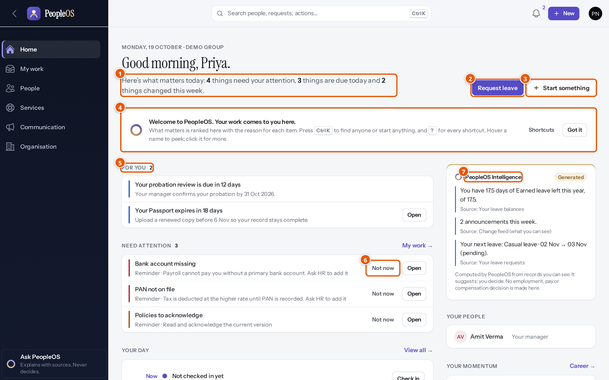
*Figure 1.4 — Home for an employee (Priya Nair). Demonstration data (fictional).*

1. **The brief** — one sentence counting what needs you, with the numbers in bold. "You're all caught up. Nothing needs you right now." when there is nothing.
2. **Primary button** — the most useful action for your view. Employees see **Request leave**; people with decisions waiting see **Review *N* decisions**; executives see **Open Workforce pulse**; administrators see **Open Admin Centre**.
3. **Start something** — opens the list of actions you can start (the same list as **+ New**).
4. **Welcome note** — shown on your first visits. **Shortcuts** lists the keyboard shortcuts; **Got it** hides the note for good.
5. **For you** — dates and changes on your own record, such as "Your probation review is due in 12 days" or "Your Passport expires in 18 days".
6. **Need attention** — up to three next actions, most urgent first. **Open** takes you to the right screen; **Not now** hides the item until tomorrow (the item itself is not changed). **My work →** shows them all.
7. **PeopleOS Intelligence** — short statements computed from your records, each with its source ("Source: Your leave balances"). It ends with "It suggests; you decide. No employment, pay or compensation decision is made here."

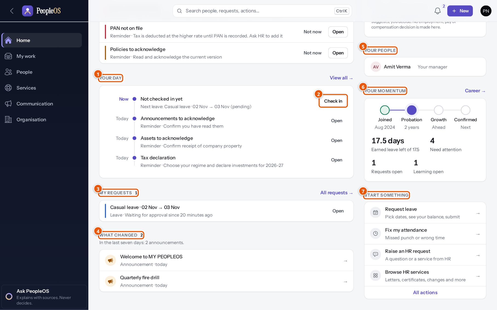
*Figure 1.5 — Further down the employee Home. Demonstration data (fictional).*

1. **Your day** — your attendance today ("Not checked in yet"), your next leave, and what is due today. **View all →** opens My work.
2. **Check in** / **Check out** — records your attendance from the web, if your organisation allows it.
3. **My requests** — your own requests that are with someone else, for example "Casual leave · 02 Nov → 03 Nov — Waiting for approval". **All requests →** opens My work.
4. **What changed** — joiners, moves, reporting changes, exits and announcements you can see, "Since your last visit" (or "In the last seven days" on your first visit). Click a row for details.
5. **Your people** — your manager and anyone who reports to you. Click a name to preview the person.
6. **Your momentum** — your journey (Joined, Probation, Growth, Confirmed) and a few figures: leave left, things needing attention, open requests, open learning. **Career →** opens My career.
7. **Start something** — your most frequent actions (**Request leave**, **Fix my attendance**, **Raise an HR request**, **Browse HR services**) and **All actions**.

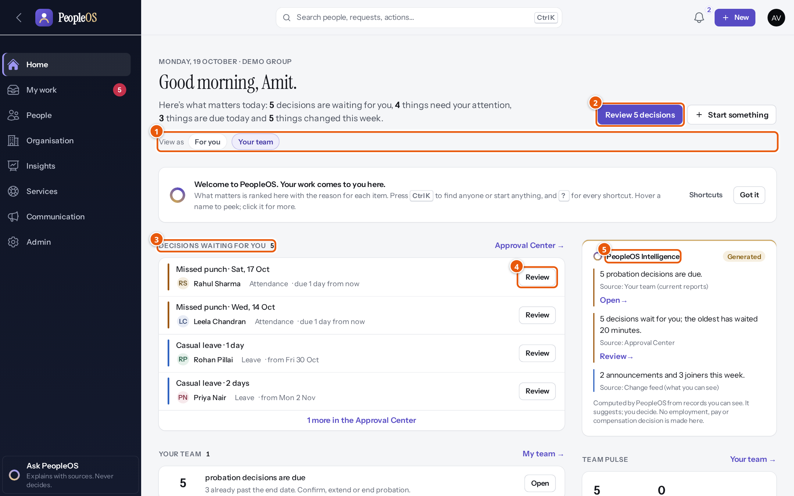
*Figure 1.6 — Home for a manager (Amit Verma), in the Your team view. Demonstration data (fictional).*

1. **View as** — one chip per view you hold. Click one to switch the whole Home; PeopleOS remembers your choice.
2. **Review 5 decisions** — opens the Approval Center.
3. **Decisions waiting for you** — up to four decisions with the person, the kind of request and when it is due. "1 more in the Approval Center" links to the rest.
4. **Review** — opens the decision in a side panel, with the same buttons as the Approval Center.
5. **PeopleOS Intelligence** — for managers, for example "5 probation decisions are due" with an **Open →** link.

Further down, a manager also sees **Your team** (team exceptions such as probation decisions), **Your day**, **What changed**, **For you**, and on the right **Team pulse** (team in today, on leave, approvals pending, needing attention).

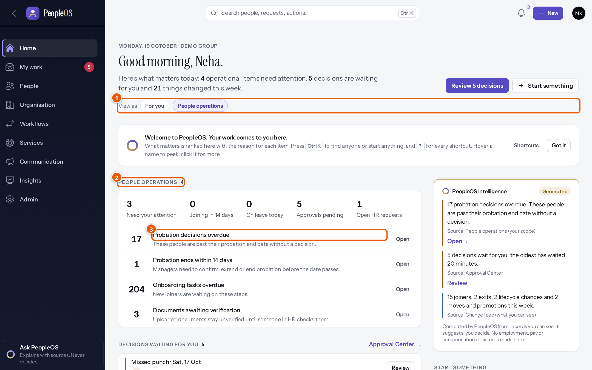
*Figure 1.7 — Home for an HR Manager (Neha Kapoor), People operations view. Demonstration data (fictional).*

1. **View as** — For you and People operations.
2. **People operations** — figures (**Need your attention**, **Joining in 14 days**, **On leave today**, **Approvals pending**, **Open HR requests**) and the items at risk in your scope.
3. **Items at risk** — for example "Probation decisions overdue", "Probation ends within 14 days", "Onboarding tasks overdue", "Documents awaiting verification". Each has **Open**.

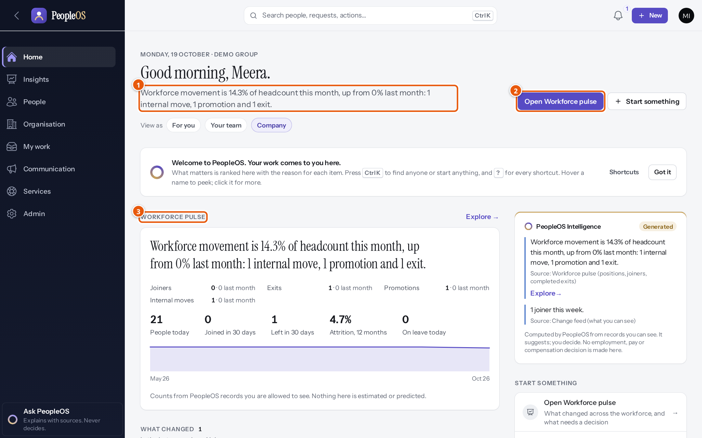
*Figure 1.8 — Home for an executive (Meera Iyer), Company view. Demonstration data (fictional).*

1. **Workforce headline** — for executives the brief starts with movement this month against last month.
2. **Open Workforce pulse** — opens the Workforce Command Centre (see the Insights chapter).
3. **Workforce pulse** — joiners, exits, promotions and internal moves against last month; people today, joined and left in 30 days, attrition over 12 months, on leave today; a trend chart. The card states: "Counts from PeopleOS records you are allowed to see. Nothing here is estimated or predicted."

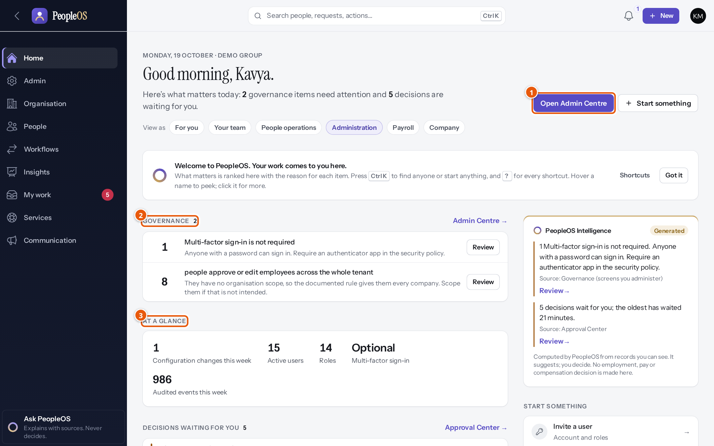
*Figure 1.9 — Home for a Tenant HR Admin (Kavya Menon), Administration view. Demonstration data (fictional).*

1. **Open Admin Centre** — opens **Admin › All modules**.
2. **Governance** — settings that need an administrator, each with **Review**. In the demo: "Multi-factor sign-in is not required" and "people approve or edit employees across the whole tenant".
3. **At a glance** — **Configuration changes this week**, **Active users**, **Roles**, **Multi-factor sign-in** (Optional or Required), **Audited events this week**.

The **Payroll** view (for Payroll Admins) leads with a **Payroll** card: the latest run (period and status), the number of employees and exceptions ("Resolve before sign-off"), and a **Control room →** link. Its **Start something** list offers **Payroll control room** and **Open a payroll run**.

### Tasks

#### Task: Switch your Home view

**Purpose:** see Home from another of your roles.
**Before you start:** you hold more than one view (the **View as** chips are shown only then).

1. Open **Home**.
2. Click a chip after **View as**, for example **Your team**.

**Expected result:** the whole Home changes: the brief, the primary button, the sections and the **Start something** list. The phone bottom bar changes too.
**How to verify:** the chosen chip is highlighted. Next time, Home opens in that view.
**Common mistakes:** expecting a view to give extra access. It does not; it only changes what Home shows first.
**If it fails:** to go back to automatic choice, open **Preferences** and choose **Automatic** under **Home opens as**.

#### Task: Put a reminder aside until tomorrow

**Purpose:** clear your list without losing the item.

1. On **Home**, under **Need attention**, click **Not now** on the item.

**Expected result:** the item disappears from Home until tomorrow. The reminder itself is unchanged and still shows in **My work**.

### Example from everyday work

*Illustrative scenario.* On Monday morning Amit Verma opens PeopleOS. The brief says five decisions are waiting. He clicks **Review 5 decisions**, deals with Rahul Sharma's missed punch first because it is due tomorrow, then switches to **For you** to request his own leave.

### Related modules

- **My work** and **Approvals** — where every item on Home is listed in full.
- **Insights chapter** — Workforce pulse and People analytics behind the executive view.
- **Admin chapter** — the Admin Centre behind the administration view.

---

## Finding your way: navigation, search and quick actions

**Status:** Available

### Overview

The workspace has the same frame on every page: a **sidebar** on the left, a **top bar** with search, notifications and your avatar, and, on module pages, an **area bar** that shows where you are. The sidebar has up to nine sections — **Home, My work, People, Organisation, Insights, Workflows, Services, Communication, Admin** — and shows only those where you may open at least one screen. Their order follows your role: an employee's sidebar starts Home, My work, People, Services; an administrator's starts Home, Admin, Organisation.

### Where to find it

- **Menu path:** always visible. Search: the bar at the top or **Ctrl K** (⌘K on a Mac) or **/**.
- **Who can open it:** everyone.
- **Set-up needed first:** none.

### The screen at a glance

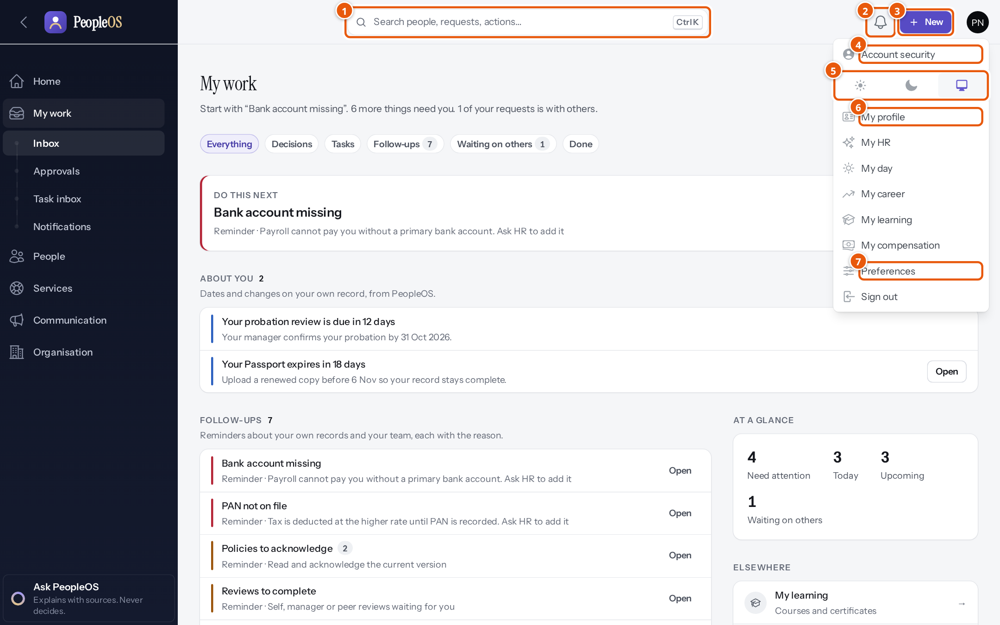
*Figure 1.10 — The top bar with the avatar menu open. Demonstration data (fictional).*

1. **Search people, requests, actions…** — opens search and commands (also **Ctrl K**).
2. **Bell** — your notifications. The small number is how many are unread. The panel has **Mark all as read** and **Clear**.
3. **+ New** — starts something new: leave, an HR request, an approval and more (also the **N** key).
4. **Account security** — your password and authenticator app.
5. **Theme switcher** — light, dark or follow your device ("system").
6. **Personal pages** — **My profile**, **My HR**, **My day**, **My career**, **My learning**, **My compensation**. You see only those that apply to you.
7. **Preferences** — how PeopleOS looks and opens for you. **Sign out** is at the bottom of the menu.

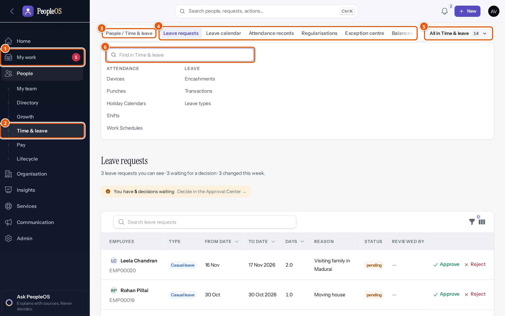
*Figure 1.11 — A manager on People › Time & leave › Leave requests, with the "All in" menu open. Demonstration data (fictional).*

1. **Sidebar section with a count** — **My work** shows how many decisions wait for you.
2. **Sub-menu** — clicking a section opens its areas (here People: My team, Directory, Growth, Time & leave, Pay, Lifecycle).
3. **Where you are** — "People / Time & leave" (section / area).
4. **Everyday modules** — the most-used screens of the area, one click away.
5. **All in Time & leave** — the rest of the area (set-up and reference screens), with how many there are.
6. **Find in Time & leave** — type to filter that list.

In this handbook, a path such as **People › Time & leave › Leave requests** means: click **People** in the sidebar, then **Time & leave**, then **Leave requests** in the area bar. A path with **All in …** means the screen is in that menu. Administrators can also open **Admin › All modules** to see every screen they may open.

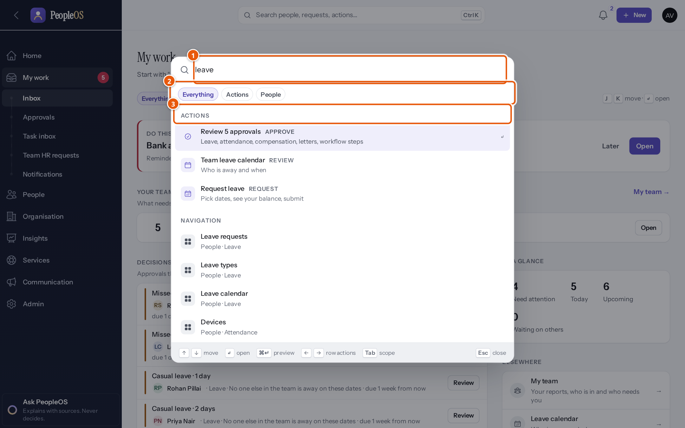
*Figure 1.12 — Search after typing "leave". Demonstration data (fictional).*

1. **Search box** — type a name, a request number, a word from a policy, or what you want to do.
2. **Everything / Actions / People** — narrow the search (the **Tab** key switches).
3. **Result groups** — for example **Actions** (things you can start), **Navigation** (screens), **People**, **Requests**, **Knowledge**, **Documents**, **HR services**, **Intelligence** (short answers such as "On leave today"). Before you type, you see **Recent** items and **Suggested** actions.

Use the arrow keys to move, **Enter** to open, **→** for a result's own actions (for a person: **Open profile**, **Preview**, **Journey**, **In org map**, and **Start a change** if you may), and **Esc** to close. Results only include what you have access to.

### Keyboard shortcuts

Press **?** anywhere (or **Shortcuts** in the welcome note) for the list:

| Keys | What they do |
|---|---|
| **Ctrl K** or **/** | Search and commands |
| **N** | Start something new |
| **G** then **H** / **W** / **A** / **P** / **O** | Go to Home / My work / Approvals / People / the org map |
| **J** / **K** | Move through a list |
| **A** / **R** | Approve / reject the selected item (opens the confirmation; nothing is decided until you confirm) |
| **Esc** | Close a panel or dialog |

### Tasks

#### Task: Find a person or a screen

1. Click the search bar or press **Ctrl K**.
2. Type at least two letters of a name (for a person) or a word such as "payslip" (for a screen).
3. Use the arrow keys and press **Enter**, or click the result.

**Expected result:** the person's preview or profile, or the screen, opens.
**Common mistakes:** expecting to find people outside your access. An employee finds their own circle (for example their manager); HR finds the people in their scope.
**If it fails:** "No results for …" — try another spelling, a surname, or an action word such as "leave" or "approve".

#### Task: Start something new

1. Click **+ New** in the top bar (or press **N**, or click **Start something** on Home).
2. Choose an action under **Start something**, for example **Request leave**, **Fix my attendance**, **Raise an HR request** or **Update bank details**.

**Expected result:** the right form or screen opens. The list contains only actions your role allows.

### Ask PeopleOS

**Status:** Available with limitations

**Ask PeopleOS** (bottom of the sidebar: "Explains with sources. Never decides.") opens the **PeopleOS Assistant** panel. The same assistant has its own page, **Assistant**, in the "You / Your pages" area bar. It is available to the Employee, Executive, HR Manager, Manager, Payroll Admin, Tenant HR Admin and Tenant Super Admin roles, when your organisation has the assistant switched on.

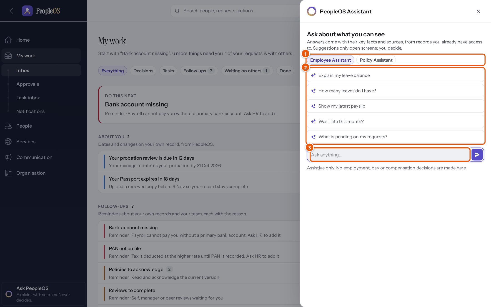
*Figure 1.13 — The PeopleOS Assistant panel for an employee. Demonstration data (fictional).*

1. **Assistant tabs** — for example **Employee Assistant** and **Policy Assistant**; you see those your role allows.
2. **Suggested questions** — for example "Explain my leave balance", "Show my latest payslip", "What is pending on my requests?".
3. **Ask anything…** — type your own question and send it.

#### Task: Ask a question

1. Click **Ask PeopleOS** in the sidebar.
2. Click a suggested question, or type your own in **Ask anything…** and press the send button.
3. Read the answer, its key facts and its sources. A suggestion only opens a screen; you decide what to do.

> **Note:** answers are computed from records you may already see. By default no external AI model is used; text marked as AI-generated appears only if your organisation switches that feature on, and should be checked before you act. The assistant never changes records, scores people or makes employment, pay or compensation decisions. More about AI is in the Insights chapter.

### Related modules

- **Admin › All modules** — the full list of screens you may open (Admin chapter).
- **Insights chapter** — assistants and PeopleOS Intelligence in depth.

---

## My work (Inbox)

**Status:** Available

### Overview

**My work** is your single to-do list. It gathers decisions waiting for you, tasks given to you, reminders about your own record (and your team, if you manage people), your own requests that are with someone else, and what you finished recently. Every row opens the screen that owns the action, so you never have to remember where something lives. My work only lists; it does not change anything by itself.

### Where to find it

- **Menu path:** **My work › Inbox** (the **My work** section opens it). Keyboard: **G** then **W**.
- **Who can open it:** every role.
- **Set-up needed first:** none.

### The screen at a glance

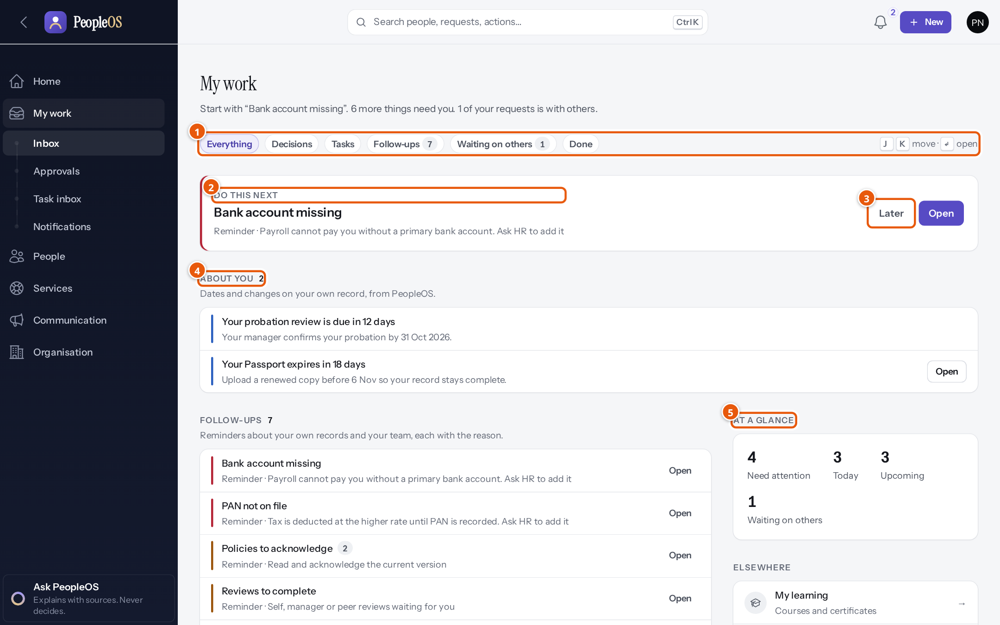
*Figure 1.14 — My work for an employee. Demonstration data (fictional).*

1. **Filters** — **Everything**, **Decisions**, **Tasks**, **Follow-ups**, **Waiting on others**, **Done**, each with a count. **J** / **K** move through the list; **Enter** opens.
2. **Do this next** — the single most urgent item, with its reason.
3. **Later** — hides that item until tomorrow; **Open** takes you to it.
4. **Your own block** — what your role is here for: **About you** for employees ("Dates and changes on your own record"), **Your team** for managers, **People operations** for HR, **Payroll**, **Workforce** for executives, **Governance** for administrators.
5. **At a glance** — counts of **Need attention**, **Today**, **Upcoming** and **Waiting on others**.

Further down: **Decisions** (with **Review**), **Follow-ups** ("Reminders about your own records and your team, each with the reason"), **My requests** ("Your requests and where each one stands"), **Coming up** ("Due later. Nothing to do yet." with **Continue**), and **Elsewhere** (links such as My learning, My career, Approval Center, Notifications, My HR).

> **Tip:** in the demonstration, Priya Nair (an employee) sees 4 items needing attention (missing bank account, missing PAN, policies to acknowledge, reviews to complete), 3 for today (announcements and assets to acknowledge, tax declaration), 3 coming up (policy and announcement acknowledgements) and 1 request waiting on others (her casual leave, waiting for her manager). She has no decisions, because no one reports to her and her role approves nothing.

### Tasks

#### Task: Work through your list

1. Open **My work › Inbox**.
2. Start with **Do this next** and click **Open**.
3. Complete the action on the screen that opens (for example upload a document, acknowledge a policy).
4. Return to **My work**; the item has gone once the underlying record is done.

**Expected result:** counts go down as you finish items.
**How to verify:** the brief at the top says "You're all caught up. No decisions require your attention right now." when nothing is left.
**If it fails:** if **Open** takes you to a screen where you cannot act, the action may belong to HR (for example "Bank account missing — Ask HR to add it"). Raise an HR request from **+ New**.

#### Task: Check where your own requests stand

1. Open **My work › Inbox** and click **Waiting on others**.
2. Read each row: the request, who it is with, and since when ("Waiting for approval since …").

**Expected result:** your pending leave, attendance corrections, HR requests and letters are listed until someone decides them.

### Related modules

- **Approvals** — where decisions listed here are made.
- **Time & leave**, **Services (My HR)** chapters — where most of your requests come from.

---

## Approvals (Approval Center)

**Status:** Available with limitations (see the notes below)

### Overview

The **Approval Center** shows every decision waiting for you — leave requests and leave cancellations, attendance corrections, compensation changes, letters and workflow steps — in one list, most urgent first. When you select an item, PeopleOS shows what is being asked, by whom, why, the impact (for example "No one else in the team is away on these dates"), the effective date and, where it applies, a **Before → After** comparison such as the leave balance before and after.

The Approval Center does not decide anything by itself. Your decision is sent to the module that owns the request, which checks its own rules again: whether the item is still waiting, whether you are allowed to decide it, whether the balance is still enough, and separation of duties (for example, the person who proposed a pay change never decides it).

### Where to find it

- **Menu path:** **My work › Approvals**. Also **Review *N* decisions** on Home. Keyboard: **G** then **A**.
- **Who can open it:** Account Owner, Asset Admin, Attendance Admin, Employee, HR Executive, HR Manager, Manager, Payroll Admin, Tenant HR Admin, Tenant Super Admin. What each person sees in the list depends on what they may decide: a manager sees their team's requests; HR sees requests in their scope.
- **Set-up needed first:** reporting lines (who manages whom) and roles. Approval chains for workflows are set up in **Workflows** (Workflows chapter).

### The screen at a glance

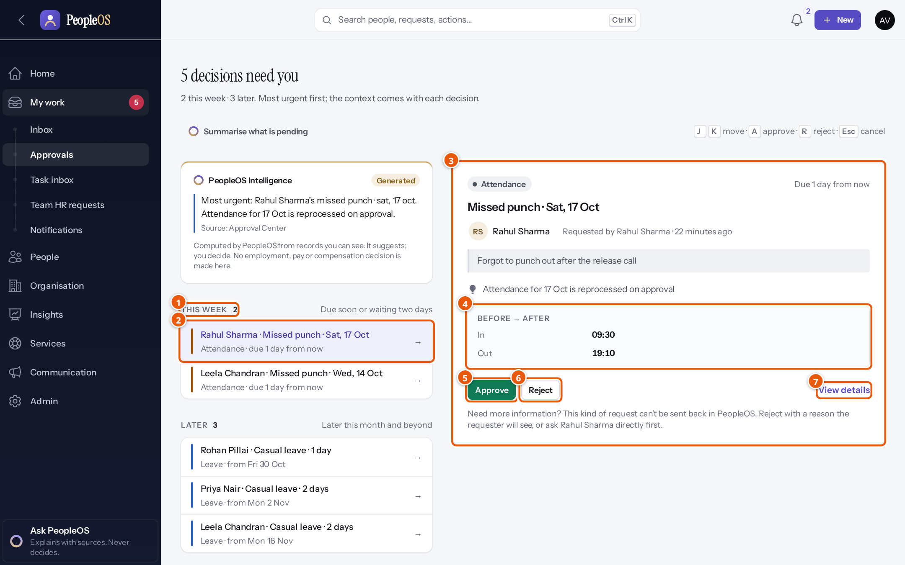
*Figure 1.15 — The Approval Center for a manager. Demonstration data (fictional).*

1. **Groups** — **Urgent** ("Overdue, starting within a day, or flagged"), **This week** ("Due soon or waiting two days") and **Later** ("Later this month and beyond"), each with a count.
2. **A row in the list** — the person, the request and when it is due or starts. Click it to see the decision.
3. **Decision card** — the kind of request, the person, "Requested by … · … ago", the requester's reason, and the impact.
4. **Before → After** — what changes if you approve (here, the corrected in and out times).
5. **Approve** — the label depends on the item: **Approve**, **Mark done** (a workflow task), **Mark reviewed** (first step of a pay change) or **Approve cancellation** (a leave cancellation).
6. **Reject** — or **Keep leave** for a cancellation request. Pay changes also offer **Return to proposer**.
7. **View details** — opens the full record in its own module.

Above the list, managers may see **Summarise what is pending** (opens the assistant) and the **PeopleOS Intelligence** card. The heading says how many decisions need you; at the bottom, **Completed** lists the decisions you took in the last two weeks (**Show your last two weeks**). On narrower screens, the decision opens in a side panel instead of beside the list.

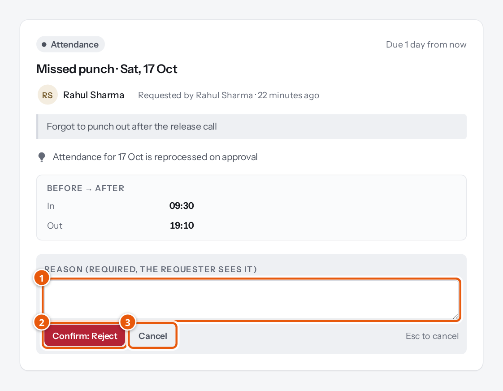
*Figure 1.16 — After clicking Reject: the reason box (nothing is sent until you confirm). Demonstration data (fictional).*

1. **Reason (required, the requester sees it)** — for Approve the box is **Note (optional)**.
2. **Confirm: Reject** — sends the decision. For approve it reads **Confirm: Approve**.
3. **Cancel** — goes back without deciding (or press **Esc**).

### Tasks

#### Task: Approve a request

**Purpose:** agree to a request with its context in front of you.
**Before you start:** the item is in your Approval Center.

1. Open **My work › Approvals**.
2. Click the item in the list. Read the reason, the impact and the **Before → After**.
3. Click **Approve** (or the item's own label, such as **Mark done**).
4. Optionally type a **Note (optional)**.
5. Click **Confirm: Approve**.

**Expected result:** a short confirmation such as "Leave approved" or "Approved and attendance reprocessed". The item leaves the list and the next one is selected. The decision appears under **Completed**.
**How to verify:** the requester's request shows the new status in their own My work and in the owning module. The decision is recorded with who, what and when.
**Common mistakes:** approving without opening **View details** when the context is not enough.
**If it fails:** a **Not done** message explains why. "This item is no longer waiting for your decision." means someone else decided it first, it was withdrawn, or it is no longer yours. "This request has already been decided." means the same. A leave approval can also stop with "Insufficient … balance" if another approval used the balance meanwhile.

#### Task: Reject a request

1. Select the item and click **Reject**.
2. Type a reason in **Reason (required, the requester sees it)**. It is required.
3. Click **Confirm: Reject**.

**Expected result:** "Leave rejected", "Correction rejected" or similar.
**If it fails:** "Add a reason so the requester knows what to do next." means the reason box is empty.

> **Note:** most requests cannot be "sent back" for changes. PeopleOS says so on the card: "Need more information? This kind of request can't be sent back in PeopleOS. Reject with a reason the requester will see, or ask … directly first." Only pay changes have **Return to proposer**.

#### Task: Decide from Home without leaving it

1. On **Home**, under **Decisions waiting for you**, click **Review**.
2. Decide in the side panel exactly as in the Approval Center.

**Expected result:** the panel shows the confirmation. Click **Close**.

**Flowchart — Deciding an item in the Approval Center.** *Roles:* manager, HR, payroll or administrator (approver); employee (requester). *Starts:* a request needs your decision. *Ends:* the decision is applied by the owning module and the requester can see it.

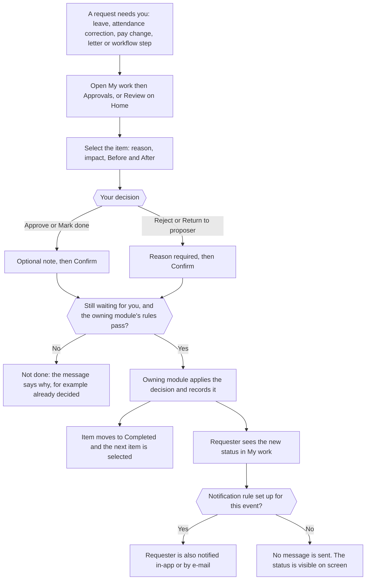

> **Important:** a request can appear in several people's Approval Centers at once (for example the manager's and HR's). The first decision counts; for everyone else the item disappears. Whether the requester receives a notification depends on your organisation's **Notification rules** (Communication chapter); the status itself is always visible to them.

> **Note:** when very many decisions are waiting, PeopleOS lists the first 200 items of each kind (earliest first) and shows "200+" so it never under-counts. **Show … more** at the bottom loads the next items, 25 at a time.

### Statuses explained

| Group | What it means | What happens next |
|---|---|---|
| **Urgent** | Overdue, starting within a day, or flagged (for example "The leave has already started", "Several people in the team are away", "Close to the payroll cut-off", "Effective date already passed", or escalated) | Decide first |
| **This week** | Due within two days, taking effect within a week, or waiting for two days already. Attendance corrections are due two days after they are raised | Decide soon |
| **Later** | Everything else | Decide when convenient |
| **Completed** | Decisions you took in the last two weeks | Open them to review |

### Example from everyday work

*Illustrative scenario.* Amit Verma opens **My work › Approvals**. Rahul Sharma's missed punch is at the top: "Forgot to punch out after the release call", with In 09:30 and Out 19:10. Amit approves it, and PeopleOS confirms that attendance is reprocessed. He then looks at Priya Nair's two days of casual leave, sees that no one else in the team is away, and approves it.

### Related modules

- **Time & leave chapter** — leave and attendance correction rules.
- **Compensation**, **Letters** and **Workflows** chapters — the other kinds of decision.
- **Communication chapter** — Notification rules that tell requesters about decisions.

---

## Task inbox

**Status:** Available

### Overview

The **Task inbox** (page title **My tasks**) lists workflow steps and onboarding tasks assigned to you, or to one of your roles. Workflow approvals also appear in the Approval Center; the Task inbox adds onboarding tasks and your history.

### Where to find it

- **Menu path:** **My work › Task inbox**.
- **Who can open it:** Account Owner, Asset Admin, Auditor, Employee, HR Executive, HR Manager, Manager, Payroll Admin, Tenant HR Admin, Tenant Super Admin.
- **Set-up needed first:** workflows or onboarding plans that create tasks (Workflows and Lifecycle chapters).

### The screen at a glance

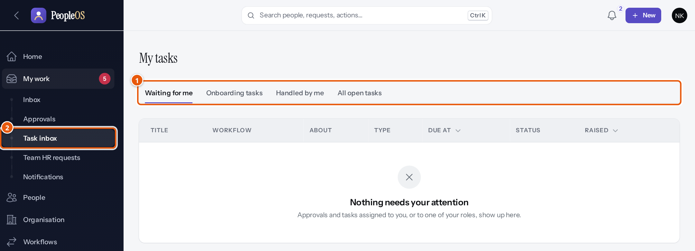
*Figure 1.17 — The Task inbox for an HR Manager (no open tasks in the demonstration). Demonstration data (fictional).*

1. **Tabs** — **Waiting for me**, **Onboarding tasks**, **Handled by me**, and **All open tasks** (only for roles allowed to see everyone's tasks). Columns: **Title**, **Workflow**, **About**, **Type**, **Due at** (red when overdue), **Status**, **Raised**; **Assigned to** in All open tasks. The onboarding tab shows **For**, **Phase**, **Type** and **Due on**.
2. **Task inbox** in the sidebar — shows a count when tasks are waiting.

#### Task: Complete a task

1. Open **My work › Task inbox**.
2. On a workflow approval, click **Approve** (note optional) or **Reject** (note required). On a workflow task, click **Mark done**. **Open run** shows the whole workflow, if you may view workflows.
3. On the **Onboarding tasks** tab, click **Done**. A document task asks you to choose **Attach uploaded document** (upload it on the person's Documents tab first). HR can click **Skip** with a note.

**Expected result:** a confirmation such as "Approved" with the run's new status, or "Task completed".
**If it fails:** "Not allowed" with a reason, for example when the task is no longer yours.

---

## Team HR requests

**Status:** Available with limitations (status only)

### Overview

Managers can follow the HR requests raised by people who report to them, without seeing their content. The page shows only the number, the team member, the service, the status and the dates. Sensitive and confidential requests, request details and HR conversations are never shown here. If your organisation offers services that managers may raise for a team member, they appear as buttons under **Raise for a team member**.

### Where to find it

- **Menu path:** **My work › Team HR requests**.
- **Who can open it:** Manager, HR Manager, Tenant HR Admin, Tenant Super Admin. It covers your direct reporting lines only.
- **Set-up needed first:** HR services marked as visible to managers (Services chapter).

The table columns are **Number**, **Team member**, **Service**, **Status**, **Raised** and **Resolved**. When there is nothing to show, the page says "No HR requests from your team that you may see."

---

## Notifications

**Status:** Available

### Overview

PeopleOS keeps every in-app notification you receive. The **bell** in the top bar shows the latest ones; the **Notifications** page shows them all, grouped, with unread items first in the order that matters for your role. Opening a notification takes you straight to its context — but only if you may open that record.

### Where to find it

- **Menu path:** **My work › Notifications**, or the bell in the top bar.
- **Who can open it:** every role.
- **Set-up needed first:** none. Which events send notifications is set by your administrator in **Notification rules** (Communication chapter). Task assignments always reach the assignee in-app.

### The screen at a glance

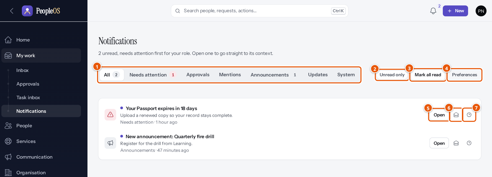
*Figure 1.18 — The Notifications page for an employee. Demonstration data (fictional).*

1. **Groups** — **All**, **Needs attention**, **Approvals**, **Mentions**, **Announcements**, **Updates**, **System**, with unread counts.
2. **Unread only** — hides what you have read. **Snoozed** appears when you have snoozed something.
3. **Mark all read** — marks every notification as read.
4. **Preferences** — opens **My HR › Preferences**, where you choose how optional communication reaches you.
5. **Open** — marks the notification read and opens its context.
6. **Mark read / Mark unread** — the envelope icon.
7. **Snooze** — **For an hour**, **Until tomorrow 9:00** or **For a week**. Snoozed notifications come back on their own; **Bring back now** returns one early.

#### Task: Choose how announcements reach you

1. Open **My work › Notifications** and click **Preferences** (or **Preferences › Notification preferences**).
2. Under **Communication preferences**, tick **In-app** and/or **Email** for **Announcement**, **Circular**, **Newsletter** and **Survey invitations and reminders**.

**Expected result:** optional communication follows your choice. **Policy publication** and **Instruction** are always delivered (mandatory). Notifications about your own requests, leave, tasks and cases are not affected by these choices.

---

## My day

**Status:** Available

### Overview

**My day** is a compact personal page for today: your attendance, leave balances, latest payslip, a few counters for this period, and the reminders that need you. It is meant for employees who want one page instead of Home's fuller view.

### Where to find it

- **Menu path:** **avatar menu › My day**. It also appears in the "You / Your pages" area bar with your other personal pages.
- **Who can open it:** anyone whose user is linked to an employee record.
- **Set-up needed first:** your employee record (HR).

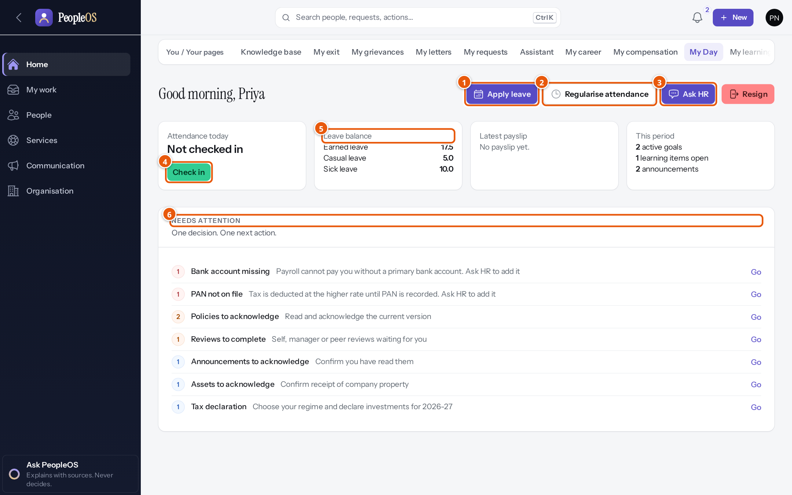
*Figure 1.19 — My day for an employee. Demonstration data (fictional).*

1. **Apply leave** — opens the leave form (Time & leave chapter).
2. **Regularise attendance** — asks your manager to correct a day's attendance (date, type, actual in and out, reason).
3. **Ask HR** — raises an HR request. **Resign** starts a resignation (Exit chapter); **View payslip** appears when a payslip exists.
4. **Check in** — records your attendance from the web, if allowed.
5. **Leave balance** — what you have left of each leave type.
6. **Needs attention** — your reminders, each with **Go**.

---

## Preferences

**Status:** Available

### Overview

Preferences change how PeopleOS looks and opens for you alone. Nobody else is affected.

### Where to find it

- **Menu path:** **avatar menu › Preferences**.
- **Who can open it:** every signed-in user.

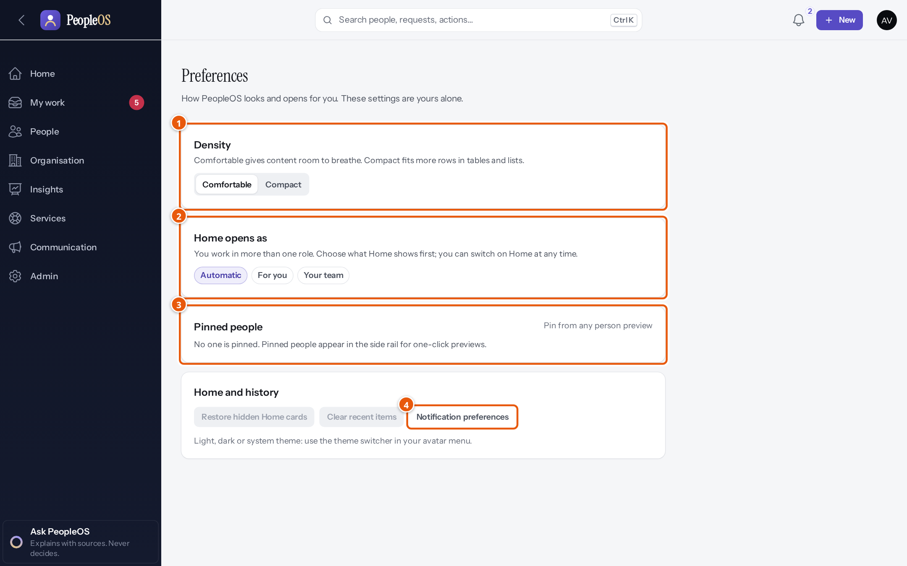
*Figure 1.20 — Preferences for a manager, who has two Home views. Demonstration data (fictional).*

1. **Density** — **Comfortable** gives content room to breathe; **Compact** fits more rows in tables and lists.
2. **Home opens as** — shown only if you have more than one view. **Automatic** opens the view for your most specific responsibility (administration first, then HR, payroll, company, your team, for you). Or choose a view.
3. **Pinned people** — people you pinned from a person preview appear in the sidebar for one-click previews; **Unpin** removes them.
4. **Notification preferences** — opens **My HR › Preferences**.

Also under **Home and history**: **Restore hidden Home cards** and **Clear recent items** (the recent items shown in the sidebar and in search). Each is greyed out when there is nothing to restore or clear. The theme (light, dark or system) is in the avatar menu.

#### Task: Make lists more compact

1. Open **avatar menu › Preferences**.
2. Under **Density**, click **Compact**.

**Expected result:** "Density updated". Tables and lists show more rows at once.

#### Task: Choose which view Home opens with

1. Open **avatar menu › Preferences**.
2. Under **Home opens as**, click a view, or **Automatic**.

**Expected result:** "Home lens updated". Next time you open Home, it starts in that view. Clicking a **View as** chip on Home also changes this choice.

---

## Phone, tablet and dark mode

**Status:** Available with limitations (tested browsers only)

### Overview

The same workspace adapts to smaller screens. On a phone, the sidebar becomes a menu button, the search bar becomes a search icon, and a **bottom bar** gives you the places you use most, with **Actions** in the centre. The bottom bar follows your Home view. For an employee it shows **Home**, **Work**, **Actions**, **Services** and **People**; for a manager **Home**, **Approvals**, **Actions**, **Team** and **Work**. The decision count appears on Approvals or Work. The welcome note's instructions change to tapping instead of keyboard shortcuts.

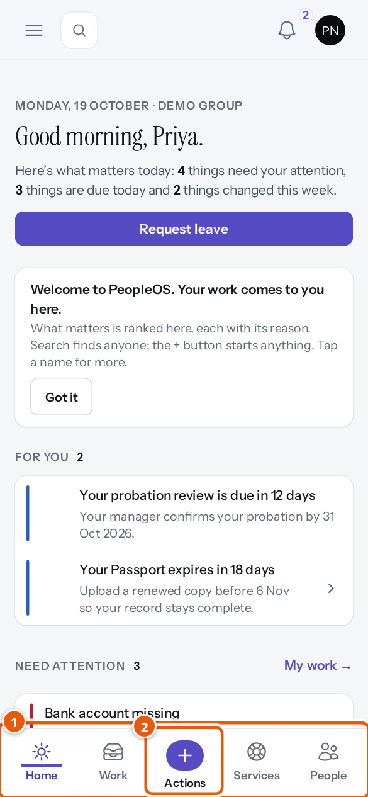
*Figure 1.21 — Home at phone width for an employee. Demonstration data (fictional).*

1. **Bottom bar** — your most-used places.
2. **Actions** — the same list as **+ New**: leave, requests, approvals and more.

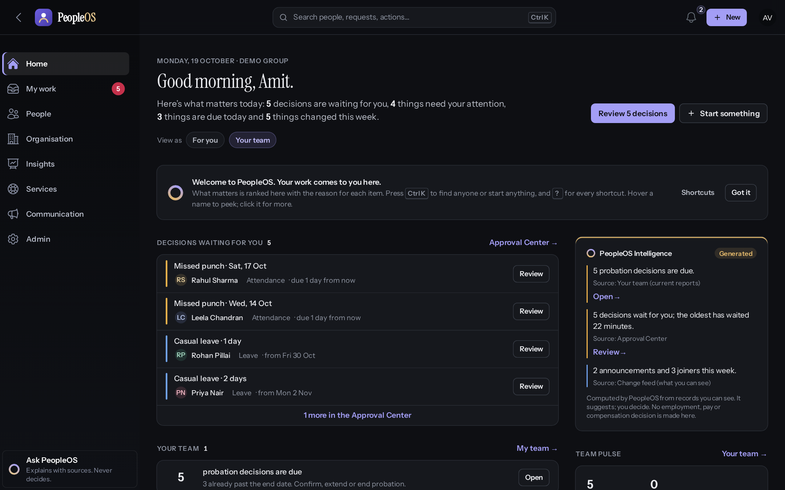
*Figure 1.22 — Home in dark mode for a manager. Demonstration data (fictional).*

To switch theme, open the avatar menu and choose light, dark or system (follows your device's setting).

> **Note:** the PeopleOS team tested Chromium-based browsers and Firefox on desktop, and the WebKit engine at phone width. Apple Safari (iPhone, iPad, Mac) and Chrome on Android devices have not been tested yet.

---

## Questions people often ask

- **Why do I not see the same menu as my colleague?** The sidebar shows only sections where you may open something, in an order that suits your role.
- **Why is an item still on my list after I opened it?** My work lists the underlying record. It disappears when the action is completed on its own screen, or until tomorrow if you clicked **Not now** or **Later**.
- **Can a Home view or the assistant give me access to more data?** No. Every screen and answer checks your own permissions.
- **I was suddenly returned to the sign-in page.** Your session ends if your account or organisation is suspended, if an administrator signed you out everywhere or reset your authenticator, after a password reset, or after a period of inactivity when your organisation's security policy sets one. Sign in again; if you cannot, contact your administrator.
