# People and the employee lifecycle

> **In this chapter:** how PeopleOS keeps one record for every person you employ, and how that record moves from hiring to onboarding, changes at work, leaving, and alumni. **Who should read it:** HR administrators and HR managers, line managers, and employees who want to see their own record.

Every HR process starts with an accurate record of who works for you. PeopleOS keeps one record per person for their whole working life with you. The record shows where they sit in the organisation, who they report to, and what stage of employment they are in. HR hires people, records transfers and promotions, collects and checks documents, runs background checks and onboarding checklists, and issues letters. When someone leaves, PeopleOS runs the exit: notice, clearance, full and final settlement and the exit interview. Afterwards it keeps the person as an alumnus, so former employees can still ask for letters. Every change is dated and recorded, and earlier history is kept.

| Module | What it is for | Where to find it | Who uses it | Status |
|---|---|---|---|---|
| Directory | Find colleagues, see their role and manager, preview them | People › Directory | Everyone linked to an employee record; HR; managers | Available |
| Employees (register) | The full list of employment records, with filters | People › Lifecycle › Employees | HR roles; managers (their own team, view only) | Available |
| Hire employee | Create a new employee in four guided steps | People › Lifecycle › Employees › **Hire employee** | Tenant HR Admin, HR Manager, HR Executive, Account Owner | Available |
| Employee 360 | One page for everything about a person | Open any employee from the register, the Directory or the search bar | HR roles; managers; Auditor (read only) | Available |
| Your record | An employee's own record, read only | Avatar menu › **My profile**, or My HR › **Your record** | Employees | Available |
| Lifecycle states and employment changes | Confirm, transfer, promote, change manager, change status | Employee 360 › **Action** menu | Tenant HR Admin, HR Manager | Available |
| Employee documents | Upload, verify and download personal documents | Employee 360 › Records › **Operations** | HR roles | Available |
| Employee imports | Bring many employees in from a CSV file | People › Lifecycle › All in Lifecycle › Employee imports | Tenant HR Admin, Account Owner, Tenant Super Admin | Available with limitations (see the section) |
| Background checks | Record checks on identity, address, education and more | People › Lifecycle › Background checks | Tenant HR Admin, HR Manager; HR Executive and Auditor (view) | Available with limitations (in-house checks only) |
| Onboarding | Track each new joiner's checklist | People › Lifecycle › Onboarding | HR roles; managers (their team) | Available |
| Onboarding templates | Define the checklist new joiners receive | People › Lifecycle › All in Lifecycle › Onboarding templates | Tenant HR Admin, HR Manager | Available |
| Letters | Generate, approve, issue and download letters | People › Lifecycle › Letters | Tenant HR Admin, HR Manager; employees see their own issued letters | Available with limitations (HTML documents only) |
| Letter templates | The wording and variables of each letter | People › Lifecycle › All in Lifecycle › Templates | Tenant HR Admin, HR Manager | Available |
| Exit cases | Resignations and other exits, with clearance | People › Lifecycle › Exit cases (employees: **My exit**) | HR; managers and clearance owners; the leaver | Available |
| Full and final settlement | The last payment or recovery when someone leaves | Exit case › **Full & final** tab | Tenant HR Admin, HR Manager | Available with limitations (no gratuity) |
| Exit insights | Why people leave, from exit interviews | People › Lifecycle › All in Lifecycle › Exit insights | Tenant HR Admin, HR Manager, Auditor | Available |
| Alumni | Former employees and their requests | People › Lifecycle › Alumni | Tenant HR Admin, HR Manager, Auditor | Available |
| Alumni portal | A former employee's own page for letters and payslips | **Alumni portal**, a personal page after an alumni sign-in | Former employees | Available (not shown in the demonstration) |

## Three ideas that make the rest easy

**One person, one lifetime record.** PeopleOS separates the *person* (name, date of birth, contact details, family) from their *employment* (employee ID, joining date, position, status). A person is never entered twice. The Employee 360 header says **One lifetime record**, and PeopleOS checks for duplicates whenever someone is hired or imported.

**Effective dates.** An effective date is the date from which a change applies. A transfer that starts on 1 November is recorded with that date, even if you enter it today. PeopleOS closes the old position the day before and opens the new one on the effective date.

**History is never overwritten.** When something changes, PeopleOS adds a new dated entry and keeps the old one. You can always see who someone reported to last year, or which department they were in. Every change is recorded in the audit trail with who made it, when, the value before and after, and the reason you typed. You can read this in **Timeline** and **History** on each record.

> **Note:** What you see depends on your role and your *organisation scope* (the companies, departments or locations your administrator allows you to see). For example, an HR Manager scoped to Demo Technologies sees only Demo Technologies people. Two people with the same role can see different lists.

---

## Directory

**Status:** Available

### Overview
The Directory is the quickest way to find a colleague. It shows each person's role, department, location, manager and status. You can switch between cards and a table, filter, group and preview someone without leaving the page. Anyone who is linked to an employee record can open it, and each person sees the people their role allows:
- HR, payroll and administrator roles see everyone in their organisation scope.
- A manager sees their own team and themselves, with the team listed first.
- An employee sees "Your manager, your team and you".

Former employees (alumni) are not listed.

### Where to find it
- **Menu path:** People › Directory
- **Who can open it:** Tenant HR Admin, Tenant Super Admin, Account Owner, HR Manager, HR Executive, Payroll Admin, Attendance Admin, Asset Admin, Auditor, Manager, and any user linked to an employee record (with the Employee role they see their own circle).
- **Set-up needed first:** employees must exist (hire or import them). Departments and locations come from your organisation set-up.

### The screen at a glance
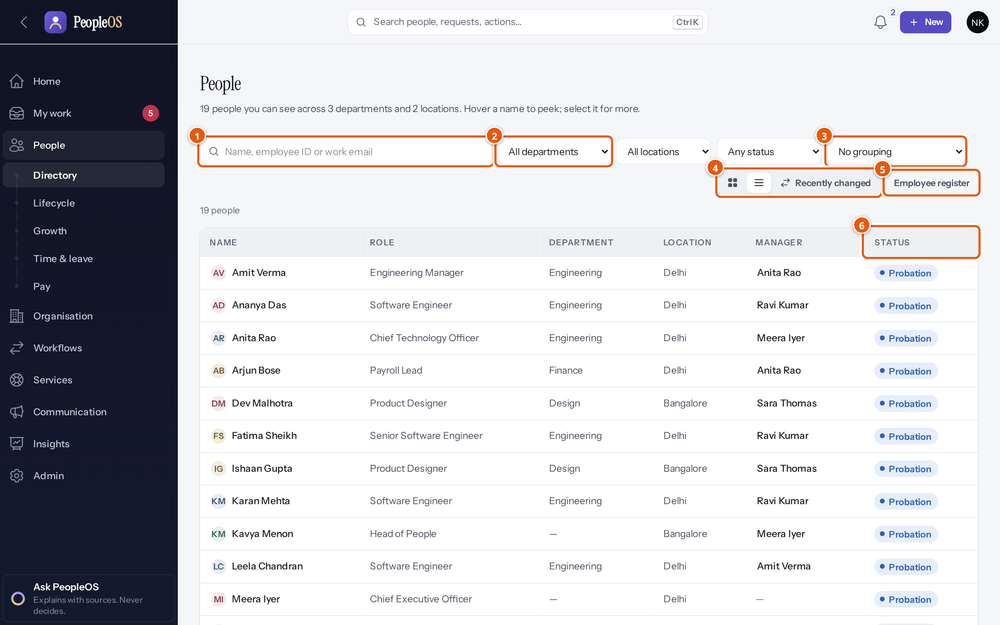
*Figure 2.1 — The Directory in table view, as an HR Manager. Demonstration data (fictional).*

1. **Search** — type a name, employee ID or work email ("Name, employee ID or work email").
2. **Filters** — **All departments**, **All locations** and **Any status** narrow the list. Filters appear when you can see more than eight people. On a phone they sit behind a **Filters** button.
3. **Grouping** — **No grouping**, **Group by department**, **Group by location** or **Group by manager**.
4. **View** — **Cards**, **Table** or **Recently changed**. Recently changed lists joiners, moves, reporting changes and exits from the last 30 days that you may see, each with a **What changed** button.
5. **Employee register** — opens the full Employees list (only if your role can open it).
6. **Status** — the person's lifecycle state, for example Probation or Notice Period.

When more people match than fit on the page, click **Show more** at the bottom. **Clear filters** resets everything.

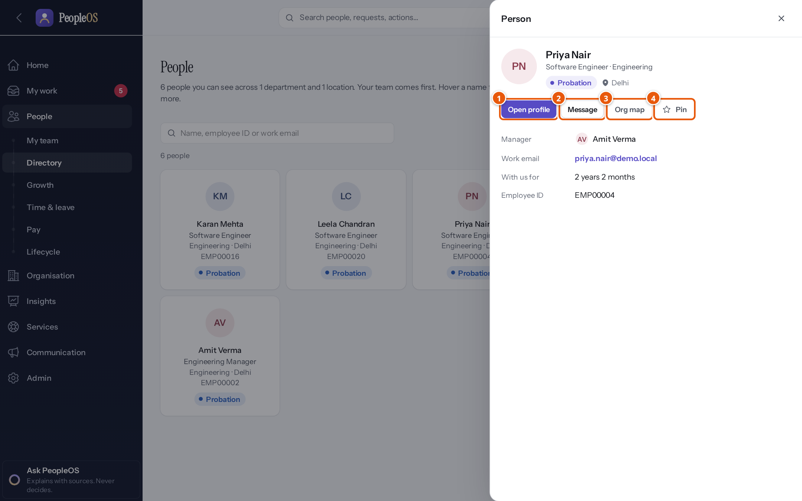
*Figure 2.2 — A manager's Directory in card view, with a person preview open. Demonstration data (fictional).*

1. **Open profile** — opens the person's Employee 360.
2. **Message** — writes an email to their work address.
3. **Org map** — shows the person on the organisation map.
4. **Pin** — keeps the person in your pinned list. Only you see your pins.

HR users also see **Start a change for …** in the preview. It lists the changes you may start for that person.

### Tasks

#### Task: Find a person and preview them
**Purpose:** look someone up quickly.
**Before you start:** none.
1. Open **People › Directory**.
2. Type part of the name, the employee ID or the work email in the search box.
3. Optionally choose a department, location or status, or a grouping.
4. With a mouse, hover over a name to peek. On a touch screen, tap it. In card view, click a card to open the preview.
5. Click **Open profile** to see the full record.

**Expected result:** the list shows only matching people, and the preview shows their manager, work email, length of service and employee ID.
**How to verify:** the count above the list ("N people") changes as you type.
**Common mistakes:** searching for a former employee. Alumni are not in the Directory; HR finds them under **Alumni**.
**If it fails:** "No one matches these filters" means your filters are too narrow. Click **Clear filters**. If someone you expect is missing, they may be outside your organisation scope. Ask your administrator.

### Example from everyday work
*Illustrative scenario.* Priya Nair needs to send a document to her manager's manager. She opens **People › Directory**, sees Amit Verma (her manager) and herself, and opens Amit's preview to see who he reports to. Neha Kapoor in HR uses the same page in table view, grouped by department, to check who is still in probation.

### Related modules
- **Employees** — the full register with more filters and the **Hire employee** button.
- **Org map** (Organisation chapter) — the same people shown as a chart.

---

## Employees and hiring

**Status:** Available

### Overview
The Employees register lists every employment record you may see, with its ID, name, designation, department, company, location, manager, status and joining date. HR uses it to hire people, find records with detailed filters and open or edit a record. Managers can open it too. They see only their own team, and only the **View** button.

Hiring uses a four-step wizard: Person, Employment, Position, Manager. PeopleOS creates the person (or reuses one already on record), gives them an employee ID, records their first position and line manager, and sets their lifecycle state. Everything happens together and is audited, so a hire is never half-saved.

### Where to find it
- **Menu path:** People › Lifecycle › Employees
- **Who can open it:** Tenant HR Admin, Tenant Super Admin, Account Owner, HR Manager, HR Executive, Payroll Admin, Attendance Admin, Asset Admin, Auditor, Manager (own team).
- **Who can hire:** Tenant HR Admin, Tenant Super Admin, HR Manager, HR Executive, Account Owner.
- **Set-up needed first:** at least one company. Locations, departments, designations, grades and the other organisation lists make the hire richer (see the Organisation chapter). Your administrator can change the employee ID prefix and the default probation length in Settings. The defaults are prefix **EMP** with five digits, and six months of probation.

### The screen at a glance
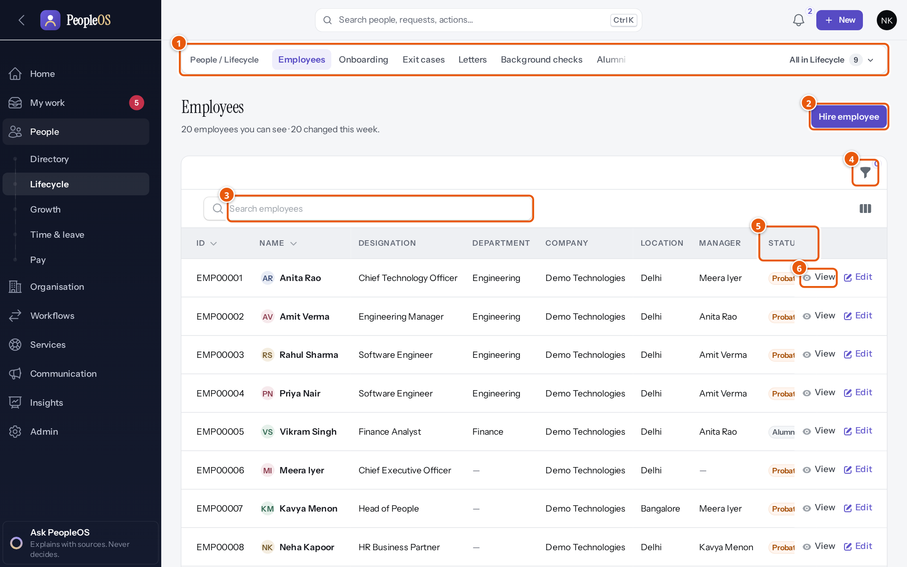
*Figure 2.3 — The Employees register. Demonstration data (fictional).*

1. **Area bar** — "People / Lifecycle" with the everyday modules (Employees, Onboarding, Exit cases, Letters, Background checks, Alumni). **All in Lifecycle** lists the rest: Templates, Onboarding templates, Exit insights and, for administrators, Employee imports.
2. **Hire employee** — starts the hire wizard.
3. **Search employees** — searches ID, name and work email.
4. **Filter** — Status (several at once), Company, Department, Location, Designation, Grade, Employment type, Category, Work mode and Manager. Your filters are remembered while you are signed in.
5. **Status** — the lifecycle state. On narrower screens the table scrolls sideways to show Status and Joining date.
6. **View** and **Edit** — open the Employee 360, or edit personal and contact details.

The column button next to the search box shows or hides columns such as Type and Work email.

### Flowchart

**Flowchart — Hiring a new employee and onboarding.** What happens from the hire wizard to a finished onboarding checklist. *Roles:* HR (Tenant HR Admin, HR Manager, HR Executive), the new employee, their manager. *Starts:* HR clicks **Hire employee**. *Ends:* the onboarding plan is Completed.

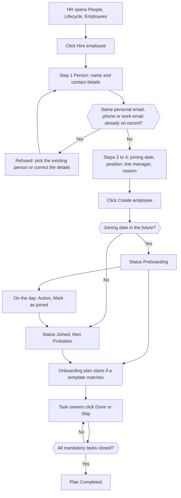

### Tasks

#### Task: Hire a new employee
**Purpose:** create the employment record for someone joining.
**Before you start:** know the joining date, the company, and ideally the department, designation and line manager.

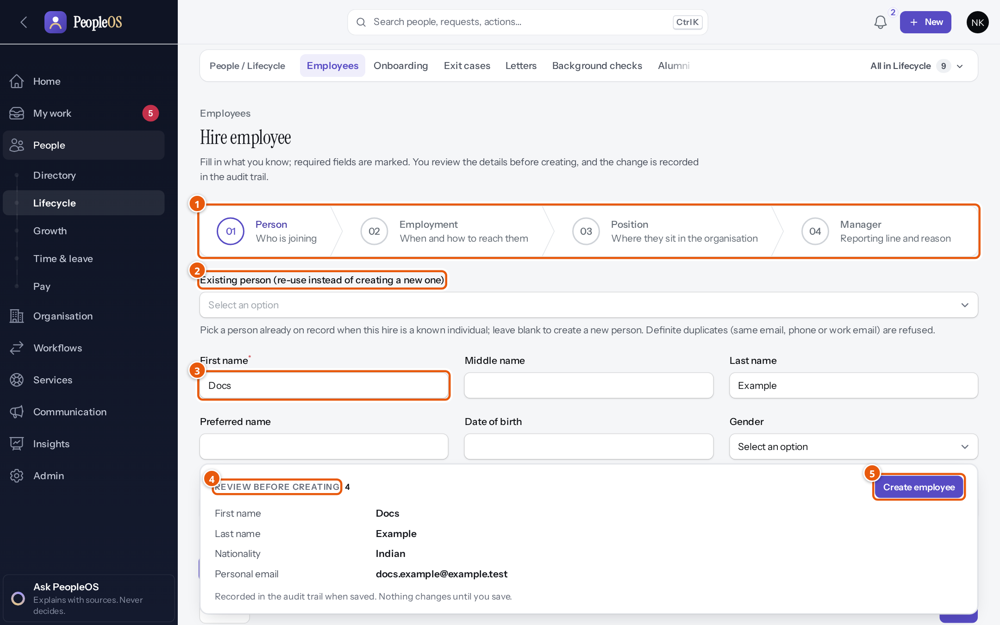
*Figure 2.4 — Step 1 of the Hire employee wizard, filled with fictional values (not saved). Demonstration data (fictional).*

1. **Steps** — Person, Employment, Position, Manager. A tick shows a completed step.
2. **Existing person (re-use instead of creating a new one)** — pick someone already on record, for example a former employee you are rehiring.
3. **First name** — required. All other person fields are optional.
4. **Review before creating** — lists everything you have filled in. Nothing is saved until you create.
5. **Create employee** — saves the hire once the steps are complete.

**Steps:**

1. Open **People › Lifecycle › Employees** and click **Hire employee**.
2. **Person:** leave **Existing person** blank for a new person. Enter **First name** (required) and any of **Middle name**, **Last name**, **Preferred name**, **Date of birth**, **Gender**, **Marital status**, **Nationality** (pre-filled "Indian"), **Blood group**, **Personal email** and **Personal phone**. Click **Next**.
3. **Employment:** check **Joining date** (required, today by default). Optionally enter **Probation end date** (blank uses the default probation length), **Employee code** (blank generates the next code), **Work email** and **Work phone**. Click **Next**.
4. **Position:** choose the **Company** (required). Optionally choose Location, Business unit, Division, Department, Team, Designation, Level, Grade, Employment type, Employee category, Work mode and Cost centre. Click **Next**.
5. **Manager:** choose the **Line manager** and type a **Reason for change** (it is kept in the audit trail).
6. Click **Create employee**.

**Expected result:** PeopleOS opens the new person's Employee 360. If the joining date is today or earlier, the status is **Probation**. If it is in the future, the status is **Preboarding**. If an onboarding template matches the person, their onboarding plan starts by itself.
**How to verify:** the Timeline tab shows "Position assigned", "Line manager assigned" and "Joined company" / "Started probation" (or Preboarding).
**Common mistakes:** creating a second person for someone who already exists, for example a rehire. Use **Existing person** instead.
**If it fails:**
- "This person already exists" (red) means the personal email, personal phone or work email matches someone on record. Select that person in **Existing person**, or correct the details.
- "Possible duplicate person" (amber) is a warning only. Review it before you continue.
- An employee code that is already used is refused. Leave it blank to generate one.

#### Task: Edit an employee's personal or contact details
**Purpose:** correct a name, contact detail or probation end date, or link a sign-in account.
**Before you start:** you need permission to update employees (Tenant HR Admin, HR Manager, HR Executive, Account Owner).
1. Open the employee, then **More › Edit profile**. Or click **Edit** in the register.
2. Change fields in **Person** or **Employment**: **Employee code** (required), **Work email**, **Work phone**, **Probation end date**, **Login user** ("Link the employee to a portal login"). **Joining date** cannot be edited here ("Set at hire; change via lifecycle actions").
3. Fill in any **Additional information** fields your organisation has added.
4. Type a **Reason for change** and click **Save changes**. The **Your changes** panel lists each change as before and after.

**Expected result:** the record shows the new values and the change appears in **History**.
**How to verify:** open **More › All changes** (if your role includes the audit trail) to see the before and after values.
**Common mistakes:** trying to change department or manager here. Placement and reporting have their own guided actions (see *Lifecycle states and employment changes*).
**If it fails:** an employee code already in use is refused. If you do not see **Edit**, your role cannot update employees.

### Example from everyday work
*Illustrative scenario.* Demo Technologies is hiring a designer who starts in two weeks. Neha Kapoor hires her with the joining date in the future, so the record starts in **Preboarding**, and the standard onboarding checklist appears at once. On the first day Neha opens the record and clicks **Action › Mark as joined**.

### Related modules
- **Onboarding** — the checklist that starts after the hire.
- **Organisation** (separate chapter) — companies, departments and designations you choose from.
- **Users** (Admin chapter) — sign-in accounts you link with **Login user**.

---

## Employee 360

**Status:** Available

### Overview
The Employee 360 is one page for everything about a person: who they are, where they sit, what is happening now, their history and their records. The same page adapts to the viewer. HR sees a *People operations* panel and the change actions. A line manager sees a *Your team* panel and no change actions. The employee sees *Your record*. Each part of the page follows its own access rule. For example, bank and statutory details appear only for roles allowed to see sensitive data, and viewing them is recorded.

### Where to find it
- **Menu path:** People › Lifecycle › Employees › **View**, or **Open profile** in the Directory, or the search bar (search by name, employee ID or work email).
- **Who can open it:** anyone allowed to see employees (within their organisation scope); managers for their team; every employee for their own record (read only).
- **Set-up needed first:** none.

### The screen at a glance
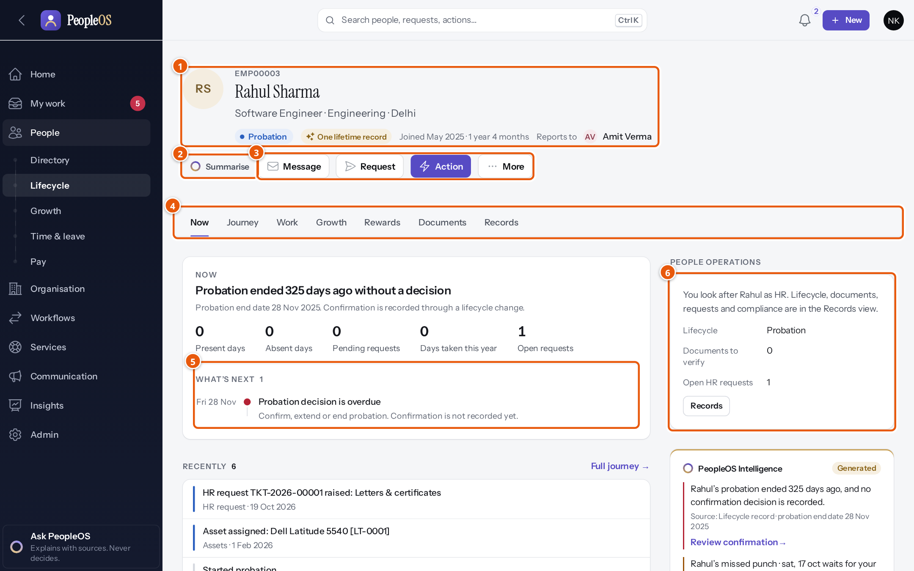
*Figure 2.5 — The Employee 360 of Rahul Sharma, seen by an HR Manager. Demonstration data (fictional).*

1. **Header** — employee ID, name, designation, department and location, then the status, **One lifetime record**, joining month and length of service, and **Reports to**.
2. **Summarise** — asks the HR assistant (Ask PeopleOS) for a summary of the person. It appears only when the assistant is available to you. It explains; it never decides.
3. **Action groups** — **Message** (email), **Request**, **Action** and **More** (described below).
4. **Views** — **Now**, **Journey**, **Work**, **Growth**, **Rewards**, **Documents** and **Records**.
5. **What's next** — upcoming dates such as probation ending, approved leave, onboarding steps, learning due dates or a last working day.
6. **Viewer panel** — for HR, *People operations*: lifecycle, documents to verify, open HR requests and the latest background check.

The menus contain only what your role allows:
- **Request:** **Raise an HR request**, **Generate a letter**.
- **Action:** **Transfer / promote**, **Change manager**, **Change lifecycle state**, **Mark as joined** (only before joining), **Start onboarding** (only when no plan is running), **Initiate background check** (only when no check is open), **Assign work schedule** (attendance administrators), **Start workflow**.
- **More:** **Edit profile**, **All changes** (opens Change intelligence for this person), **Statutory details** and **Edit statutory details** (only for roles with sensitive data access, such as Tenant HR Admin and Payroll Admin; every view is audited).

The **Now** view also shows today's figures (present and absent days, pending requests, leave taken), **PeopleOS Intelligence** (suggestions with their source; you decide), a **People snapshot** and **Recently**, the latest changes.

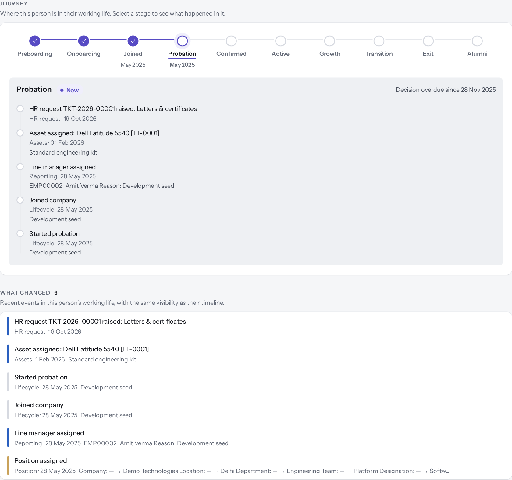
*Figure 2.6 — The Journey view: stages of working life and the events in the current stage. Demonstration data (fictional).*

**Journey** draws the stages of working life: Preboarding, Onboarding, Joined, Probation, Confirmed, Active, Growth, Transition, Exit and Alumni. Select a stage to see what happened in it. **What changed** lists recent events with the same visibility as the timeline.

**Work** shows the current position (designation, department, location, grade, employment type, work mode), the organisation path, and all relationships in effect today. These can be line manager, functional, dotted line, project, mentor, buddy or HR partner, plus the person's direct reports.

**Growth**, **Rewards** and **Documents** show a short summary per area. If your role does not cover an area, you see "Nothing here you can see".

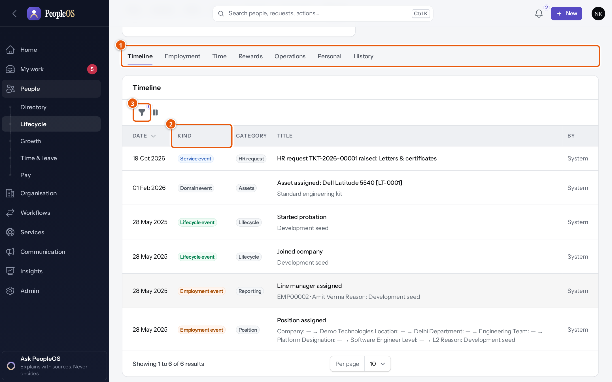
*Figure 2.7 — The Records view: tab groups and the Timeline tab. Demonstration data (fictional).*

1. **Record tabs** — **Timeline**, **Employment**, **Time**, **Growth**, **Rewards**, **Operations**, **Personal** (called **Bank & personal** for roles that can see bank details) and **History**. Tabs you cannot use are hidden.
2. **Kind** — each timeline entry is a Lifecycle event, Employment event, Service event, Communication event or Domain event, with a category such as Position, Reporting or Assets.
3. **Filter** — filter the timeline by category or kind.

Above the tabs, **Records** also holds **All details** (every field on the record), **Additional information** (fields your organisation added) and **Applicable policies** (the policies that apply to this person today).

What the tabs hold:
- **Employment:** position history (From, To, Change type, Company, Designation, Position, FTE, Department, Location, Level, Grade, Type, Reason), **Organisation** (reporting lines with effective dates), **Onboarding**, **Exit** and workflow runs.
- **Time:** attendance and leave.
- **Growth:** performance, goals, learning, skills, career, talent, succession, certifications and development (see the Growth chapter).
- **Rewards:** compensation, compensation changes and payslips (see the Pay chapter).
- **Operations:** **Documents**, **Letters**, requests, assets, **Verification** (background checks) and communications.
- **Personal:** addresses, **Family & nominees**, emergency contacts, **Education**, **Previous employment**, and **Bank** for roles with sensitive data access.
- **History:** the audit trail for this record.

### Tasks

#### Task: Look up someone's history
**Purpose:** answer questions such as "when did she move to Design?" or "who was his manager last year?".
**Before you start:** none.
1. Open the employee and click **Records**.
2. Click **Timeline** for a dated story of the person's working life, newest first. Use the filter to show only one category.
3. Click **Employment** to see each position with its **From** and **To** dates (the current one shows "Current") and each reporting line with **Effective from** and **Effective to**.
4. Click **History** for the full audit trail.

**Expected result:** you see every past position and manager. Nothing is overwritten.
**How to verify:** the row marked "Current" matches the header.
**Common mistakes:** looking for an exit reason in the timeline. The timeline carries only the fact of an exit. The reason stays on the exit case, visible to HR.
**If it fails:** if a tab is missing, your role does not include that area.

### Example from everyday work
*Illustrative scenario.* Amit Verma opens Rahul Sharma's record before a one-to-one. The *Your team* panel shows one decision waiting and that Rahul's probation end date has passed. **What's next** shows the overdue probation decision. Amit asks Neha in HR to record the confirmation.

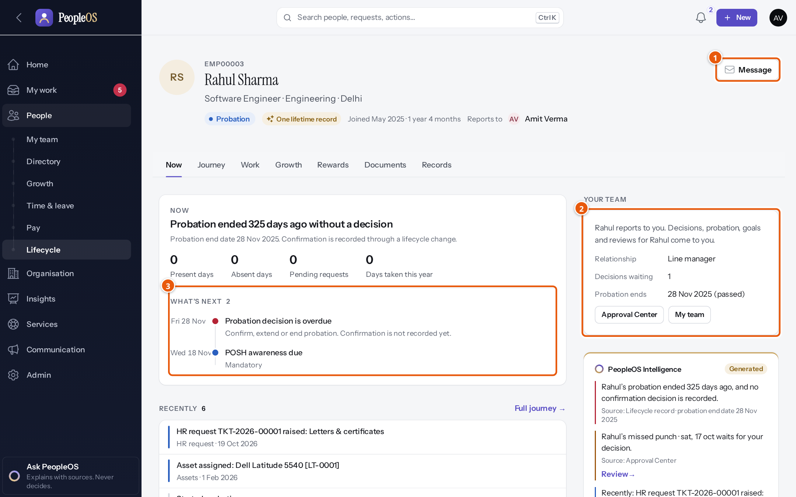
*Figure 2.8 — The same record seen by the line manager. Demonstration data (fictional).*

1. **Message** is the only button. Managers do not get change actions on the record.
2. **Your team** — the relationship, decisions waiting for you, and the probation end date, with links to the **Approval Center** and **My team**.
3. **What's next** — upcoming dates for this person.

### Related modules
- **Lifecycle states and employment changes** — the actions in the **Action** menu.
- **Employee documents** — in the **Operations** tab.
- **Change intelligence** (Insights chapter) — opened by **More › All changes**.

---

## Your own record (employees)

**Status:** Available

### Overview
Every employee can open their own Employee 360, read only. It is the same page HR uses, without the action menus. Each area still follows its own rule, so you see your own leave, goals and payslips where your role allows. To change something about yourself (for example a new address or bank account), request it through **My HR**. HR applies the change after any approval the service needs.

### Where to find it
- **Menu path:** avatar menu (top right) › **My profile**, or avatar menu › **My HR** › **Your record**.
- **Who can open it:** any employee with the Employee role, for their own record only.
- **Set-up needed first:** your sign-in must be linked to your employee record (HR does this with **Login user**).

### The screen at a glance
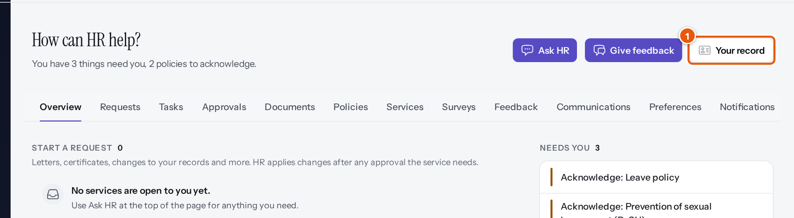
*Figure 2.9 — My HR, with the Your record button. Demonstration data (fictional).*

1. **Your record** — opens your own Employee 360.

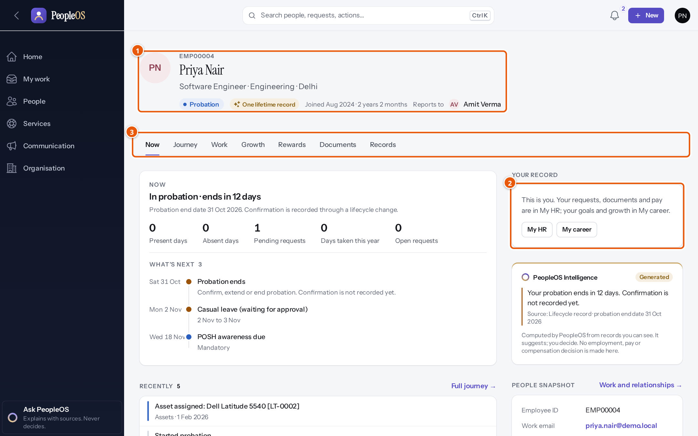
*Figure 2.10 — Priya Nair viewing her own record. Demonstration data (fictional).*

1. **Header** — your status, joining date, length of service and manager. There are no action buttons.
2. **Your record** — "This is you", with links to **My HR** and **My career**.
3. **Views** — the same Now, Journey, Work, Growth, Rewards, Documents and Records views, limited to what you may see.

### Tasks

#### Task: View your own record
**Purpose:** check what HR holds about you and what is coming up, for example the end of your probation.
**Before you start:** none.
1. Click your avatar (top right) and choose **My profile**. Or open **My HR** and click **Your record**.
2. Read **Now** and **What's next**.
3. Click **Journey** or **Records** for your history.

**Expected result:** your own record opens, without Request, Action or More menus.
**How to verify:** the panel on the right is titled **Your record**.
**Common mistakes:** looking for an edit button. Your record is read only. Ask HR through **My HR**.
**If it fails:** if **My profile** is missing from the avatar menu, your sign-in is not linked to an employee record. Contact HR.

> **Note:** Employees cannot upload their own documents. HR uploads them, and employees download their own documents from **My HR › Documents**.

---

## Lifecycle states and employment changes

**Status:** Available

### Overview
Every employee has a *lifecycle state*: the stage of employment they are in, such as Probation or Notice Period. PeopleOS allows only sensible moves between states. For example, someone in Probation can be confirmed, made active, put on notice, exited or suspended, but cannot jump back to Preboarding. Each move records an effective date and a reason, adds a timeline entry and an audit entry, and stamps key dates (joining date, confirmation date, exit date). Some moves happen automatically: hiring, completing an exit and creating an alumni profile.

Employment changes are separate from the state. A *transfer or promotion* changes the position. A *manager change* changes the reporting line. Both are guided in three steps (Context, Change, Review) and show the Before → After before you confirm.

### Where to find it
- **Menu path:** Employee 360 › **Action** › **Change lifecycle state**, **Mark as joined**, **Transfer / promote** or **Change manager**.
- **Who can use it:** Tenant HR Admin, HR Manager and Tenant Super Admin. HR Executives and Account Owners can hire and edit, but cannot move states or change positions.
- **Set-up needed first:** none.

### Flowchart

**Flowchart — Employee lifecycle states.** The main moves PeopleOS allows. The table below lists every allowed move. *Roles:* Tenant HR Admin, HR Manager; some moves are made by PeopleOS itself. *Starts:* a hire or a pre-employee record. *Ends:* Alumni (a former employee can return to Active).

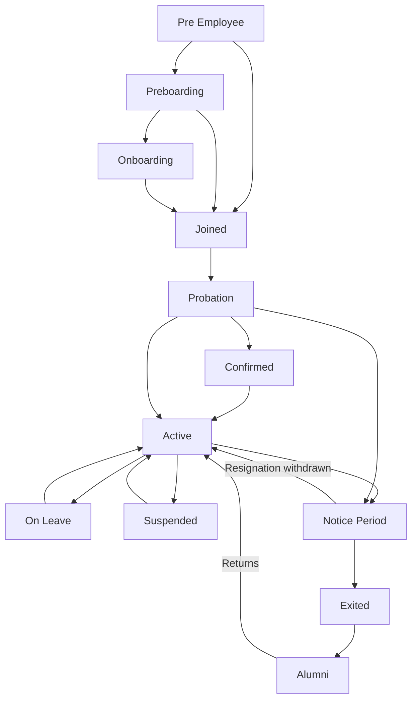

### Statuses explained

| State | Meaning | Allowed next states |
|---|---|---|
| Pre Employee | A future joiner, for example sent from a recruitment system | Preboarding, Onboarding, Joined |
| Preboarding | Hired with a future joining date | Onboarding, Joined, Pre Employee |
| Onboarding | Going through onboarding before being counted as joined | Joined, Probation, Active |
| Joined | Has joined (a short step before probation) | Probation, Active, Notice Period, Exited |
| Probation | In the probation period | Confirmed, Active, Notice Period, Exited, Suspended |
| Confirmed | Probation completed; the confirmation date is stamped | Active, On Leave, Suspended, Notice Period, Exited |
| Active | Working normally | On Leave, Suspended, Notice Period, Exited, Probation |
| On Leave | On long leave | Active, Notice Period, Exited |
| Suspended | Suspended from work | Active, Exited |
| Notice Period | Serving notice after a resignation or another exit | Active (if withdrawn), Exited |
| Exited | Has left; the exit date is stamped | Alumni, Active |
| Alumni | A former employee with an alumni profile | Active |

> **Tip:** PeopleOS reminds people before key dates: joining due (3 days before by default), probation ending (14 days before by default), and probation overdue. Your administrator can change these windows in Settings and connect them to notification rules or workflows.

### Tasks

#### Task: Confirm an employee after probation
**Purpose:** record that probation is complete.
**Before you start:** the employee is in **Probation** and the decision has been made, for example by the manager.
1. Open the employee and click **Action › Change lifecycle state**.
2. In **New state**, choose **Confirmed**. Only the states allowed from the current state are listed.
3. Check the **Effective date** (today by default).
4. Type a **Reason for change** (required) and click **Submit**.

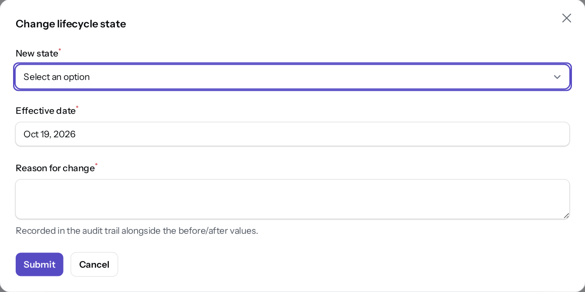
*Figure 2.11 — Change lifecycle state: New state, Effective date and Reason for change. Demonstration data (fictional).*

**Expected result:** the notice "Lifecycle updated". The status becomes **Confirmed** and the confirmation date is set to the effective date.
**How to verify:** **Now** shows "Confirmed · confirmed [date]", and the Timeline shows "Confirmed".
**Common mistakes:** choosing **Active** when you meant **Confirmed**. Only Confirmed stamps a confirmation date.
**If it fails:** "Not allowed — An employee cannot move from X to Y" means that move is not permitted. Choose one of the listed states. If you do not see the action, your role cannot change lifecycle states.

#### Task: Transfer or promote an employee
**Purpose:** record a new department, location, designation, grade or other placement, from a given date.
**Before you start:** know what changes and from when.
1. Open the employee and click **Action › Transfer / promote**.
2. **Context:** read *Today* (what is recorded now). Choose the **Change type**: Hire, Transfer, Promotion, Demotion, Reassignment or Data correction. Set **Effective from**. Click **Next**.
3. **Change:** fill in only what is different, for example a new **Department** or **Designation**. Blank fields stay as they are. Optionally choose a **Position (seat)**, an **FTE**, or **Vacate current position**. Click **Next**.
4. **Review:** check the Before → After list and the date it takes effect. Type a **Reason for change** (required).
5. Click **Confirm change**.

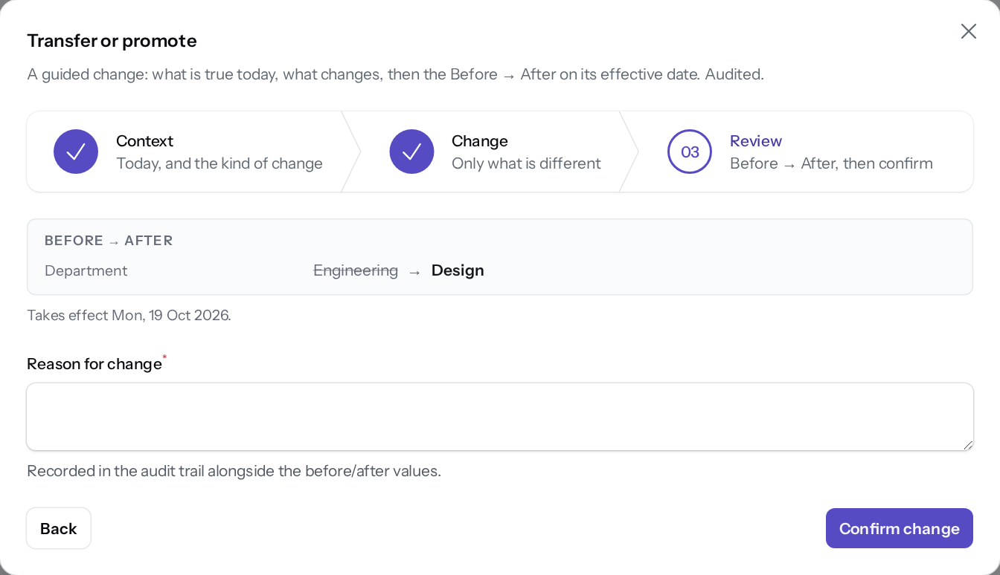
*Figure 2.12 — The Review step of Transfer or promote: Department changes from Engineering to Design (not confirmed). Demonstration data (fictional).*

**Expected result:** "Position assigned". The old position ends the day before the effective date and the new one starts on it.
**How to verify:** **Records › Employment** shows a new row from the effective date, and the previous row now has a **To** date.
**Common mistakes:** re-entering fields that did not change. Leave them blank.
**If it fails:**
- "The new position must start after the current one (date)" means you need a later effective date.
- "A position already starts on [date]; positions cannot overlap" means a future change already exists. Use a later date, or correct that one first.
- A seat that is not open or is full is refused.

#### Task: Change an employee's manager
**Purpose:** record a new line manager or another reporting relationship.
**Before you start:** the new manager must be a current employee.
1. Open the employee and click **Action › Change manager**.
2. **Context:** choose the **Relationship**: Line manager, Functional manager, Dotted line, HR business partner, Mentor, Buddy, Project manager or Secondary manager. Click **Next**.
3. **Change:** choose the **Manager** and **Effective from**. Click **Next**.
4. **Review:** check Before → After. Optionally add a **Reason for change**.
5. Click **Confirm reporting change**.

**Expected result:** "Reporting line updated". The previous relationship of the same type ends and the new one starts.
**How to verify:** **Records › Employment › Organisation** shows the new line as current. The header shows the new **Reports to**.
**Common mistakes:** choosing the wrong relationship type, which adds a dotted line instead of replacing the line manager.
**If it fails:** "An employee cannot report to themselves." "[Manager] already reports to this employee; that would create a loop." "That employee or manager is outside your organisation scope." All three are refused by design.

#### Task: Mark a future joiner as joined
**Purpose:** confirm that a person in Pre Employee, Preboarding or Onboarding has started work.
**Before you start:** the person has actually started.
1. Open the employee and click **Action › Mark as joined**. It appears only before joining.
2. Check the **Joining date** (it starts as the expected joining date or today).
3. Optionally add a **Reason for change**, then submit.

**Expected result:** "Joined — Now in probation." The status moves to Joined, then Probation.
**How to verify:** the Timeline shows "Joined company" and "Started probation".
**Common mistakes:** using **Change lifecycle state** instead. **Mark as joined** also sets the joining date.
**If it fails:** if the button is missing, the person has already joined.

> **Note:** A former employee can be returned to **Active** through **Change lifecycle state** (from Exited or Alumni). PeopleOS keeps the same person and history. A separate, guided "rehire" screen is not part of this release.

### Example from everyday work
*Illustrative scenario.* Rahul Sharma moves from Engineering to Design from the first of next month. Neha opens his record, chooses **Transfer / promote**, picks **Transfer**, sets the date, changes only **Department**, and confirms with the reason "Internal move approved by Anita Rao". Next year the Employment tab still shows both rows.

### Related modules
- **Exit cases** — move people to Notice Period and Exited for you.
- **Workflows** — **Action › Start workflow** runs a manual workflow your organisation has published, such as a probation review.

---

## Employee documents

**Status:** Available

### Overview
HR keeps each person's documents (PAN, Aadhaar, passport, address proof, degree, previous relieving letter and payslips, bank proof, signed offer, background check consent, and any other types you add) on their record. Files are stored privately. Downloads use a link that expires after 10 minutes, and downloads of sensitive categories (identity, tax, statutory, medical) are recorded. A document stays **Pending verification** until someone checks it. The person who uploaded a document cannot verify it. Uploading a new file of the same type creates a new version and archives the old one. Letters issued from PeopleOS are added here automatically.

### Where to find it
- **Menu path:** Employee 360 › **Records** › **Operations** › **Documents**.
- **Who can use it:** view: Tenant HR Admin, HR Manager, HR Executive, Auditor. Upload: Tenant HR Admin, HR Manager, HR Executive. Verify or reject: Tenant HR Admin, HR Manager. Delete: Tenant HR Admin.
- **Set-up needed first:** document types (Admin › Setup › Document types) decide which types exist and which need an expiry date.

### The screen at a glance
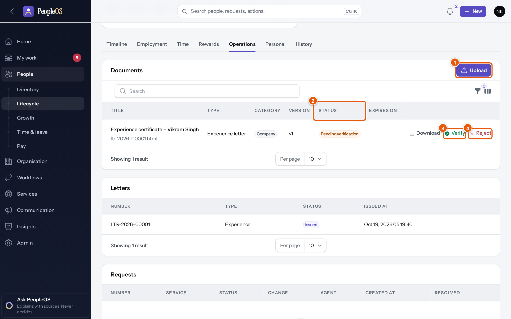
*Figure 2.13 — Documents on an Employee 360, with a letter waiting for verification. Demonstration data (fictional).*

1. **Upload** — adds a document.
2. **Status** — Pending verification, Verified, Rejected or Archived. Use the filter to show one status.
3. **Verify** — confirms the document is correct.
4. **Reject** — marks it wrong, with a note.

**Download** opens the file through a short-lived link. Columns also show Type, Category, Version, Expires on, Uploaded by and Uploaded.

### Tasks

#### Task: Upload a document
**Purpose:** keep a copy of an employee's document.
**Before you start:** have the file as PDF, JPEG, PNG or Word, up to 10 MB.
1. Open the employee, then **Records › Operations**.
2. In **Documents**, click **Upload**.
3. Choose the **Document type**. Optionally change the **Title** (it defaults to the type name).
4. Attach the **File** (required). Add **Issued on**, and **Expires on** (required for types that expire, such as a passport).
5. Optionally add a **Reason for change**, then submit.

**Expected result:** "Document uploaded". It appears as **Pending verification**, version v1 (or the next version).
**How to verify:** the document is at the top of the list.
**Common mistakes:** uploading a passport without an expiry date. The form will not accept it.
**If it fails:** files that are not PDF, JPEG, PNG or Word, or are larger than 10 MB, are refused.

#### Task: Verify or reject a document
**Purpose:** confirm a document is genuine and correct.
**Before you start:** you did not upload this document yourself.
1. Open the employee, then **Records › Operations › Documents**.
2. Click **Download** to check the file.
3. Click **Verify** (optionally add a **Note**), or **Reject** (a **Note** is required).

**Expected result:** the status becomes **Verified** or **Rejected**. A verified document adds a timeline entry, and the employee can be notified according to your notification rules.
**How to verify:** the *People operations* panel shows one fewer "Documents to verify".
**Common mistakes:** verifying your own upload. Ask a colleague.
**If it fails:** PeopleOS refuses with "The person who uploaded a document cannot verify it."

---

## Employee imports

**Status:** Available with limitations. In the build tested for this guide, saving the **Map columns** step fails ("Failed"), so a file cannot yet be taken past the inspection step from the screen. Ask Markedge (your provider) before planning a bulk import.

### Overview
Employee imports bring many employees in from a CSV file (a spreadsheet saved as comma-separated values) without typing each one. Nothing is written to employee records until the file has been inspected, mapped, validated, approved and run. Every row is checked: required fields, valid dates and emails, organisation codes that exist, and duplicates within the file. PeopleOS also matches each row against people already on record:
- the same personal email, personal phone, work email, employee code or external reference is a **definite** match, and the row updates (or skips) that employee;
- the same first name, last name and date of birth is a **possible** match, and a person must review the row.

The whole run is recorded as one audit operation.

### Where to find it
- **Menu path:** People › Lifecycle › **All in Lifecycle** › Employee imports
- **Who can open it:** Tenant HR Admin, Tenant Super Admin, Account Owner. HR Managers cannot open it.
- **Set-up needed first:** organisation codes (company, location, department and so on) must exist, because the file refers to them by code.

### The screen at a glance
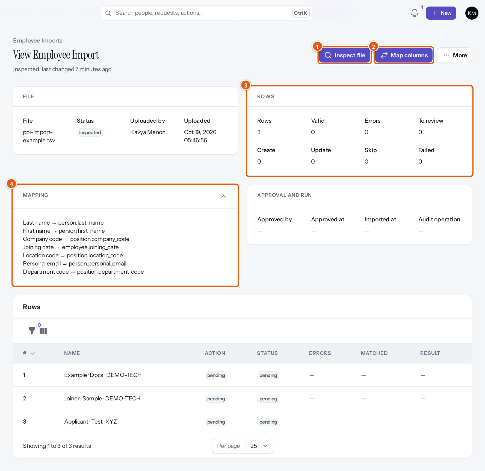
*Figure 2.14 — A fictional file after Inspect file: rows staged and columns suggested; nothing is written to employees. Demonstration data (fictional).*

1. **Inspect file** — reads the header row and stages each row.
2. **Map columns** — choose the PeopleOS field for each column, and what to do "When the person already exists" (**Update person details** or **Skip the row**).
3. **Rows** counts — Rows, Valid, Errors, To review, Create, Update, Skip, Failed.
4. **Mapping** — the column-to-field mapping, suggested automatically from your column names.

**Discard** is in the **More** menu. Below, the **Rows** table shows each row's **Action** (create, update, review, skip, error), **Errors**, **Matched** person and **Result**.

### Flowchart

**Flowchart — Bulk import of employees.** The designed steps of an import. *Roles:* Tenant HR Admin or Account Owner. *Starts:* **Upload CSV**. *Ends:* the import is **imported**, or **discarded**.

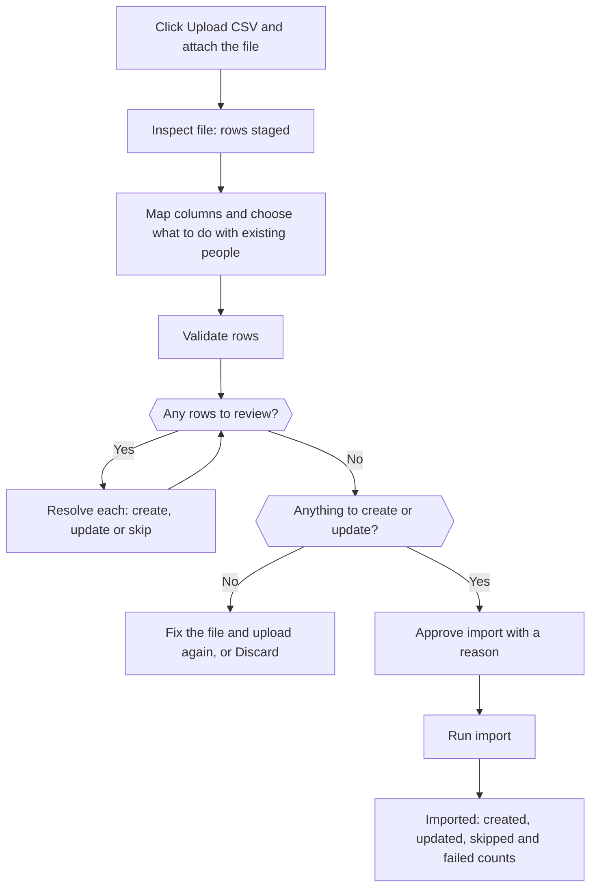

> **Important:** In the tested build, step C (**Map columns**) shows "Failed" when saved. Steps D to K could not be checked on screen for this guide. They are described from the product's design and its automated tests.

### Tasks

#### Task: Import employees from a file
**Purpose:** create or update many employees at once.
**Before you start:**
- Prepare a CSV with a header row and at most 5,000 rows.
- Required fields are **First name**, **Last name**, **Joining date** and **Company code**.
- Optional fields include Middle name, Preferred name, Date of birth, Gender, Marital status, Nationality, Personal email, Personal phone, Employee code, Probation end date, Work email, Work phone, External reference, the organisation codes (Location, Business unit, Division, Department, Team, Designation, Level, Grade, Employment type, Employee category, Work mode, Cost centre) and **Manager employee code**.

1. Open **Employee imports** and click **Upload CSV**. In "Upload an employee file", attach the **CSV file** and click **Create**.
2. On the import page, click **Inspect file**.
3. Click **Map columns**. Choose a field for each column (or leave "Ignore column"), choose what to do **When the person already exists**, and submit.
4. Click **Validate rows**. Read the counts and the **Errors** column.
5. For each row marked **review**, click **Resolve** and choose **Create as a new person**, **Update the matched employee** or **Skip this row**.
6. Click **Approve import**, read the summary ("This will create N and update N employee(s)…"), type a **Reason**, and confirm.
7. Click **Run import** and confirm.

**Expected result:** "Created N, updated N, skipped N, failed N". The status becomes **imported** and each row shows its result, for example "Created EMP00021".
**How to verify:** the new people appear in the Employees register. **Approval and run** shows who approved and the audit operation.
**Common mistakes:** using names instead of codes for company or department; leaving duplicate emails in the file.
**If it fails:**
- "Required fields are not mapped: …"
- "Each field can be mapped from one column only."
- "[Field] is not a valid date."
- "Company code 'XYZ' does not exist."
- "N row(s) still need review before approval."
- "Nothing to import: no row would create or update an employee."
- "The file has more than 5000 rows; split it."

A completed import cannot be discarded: "it is part of the audit trail". If **Map columns** shows "Failed", contact Markedge.

---

## Background checks

**Status:** Available with limitations. Checks are recorded in-house ("Manual (in-house)" provider). Connections to external verification agencies are not part of this release.

### Overview
A background check (also called background verification, or BGV) records checks on identity, address, education, previous employment, references, criminal record (where lawful) and documents. PeopleOS insists on the employee's written consent before a check starts, and allows only one open case per person. When every check is closed, the case is **Completed**. Its overall result is the worst individual result: one failed check makes the case Failed.

### Where to find it
- **Menu path:** People › Lifecycle › Background checks (the list, titled "BGV cases"). Start a check from Employee 360 › **Action** › **Initiate background check**.
- **Who can open it:** Tenant HR Admin, Tenant Super Admin, HR Manager, HR Executive, Auditor. Starting checks and recording results needs Tenant HR Admin, HR Manager or Tenant Super Admin.
- **Set-up needed first:** ideally upload the signed consent as a document (type "BGV consent") so you can attach it.

### The screen at a glance
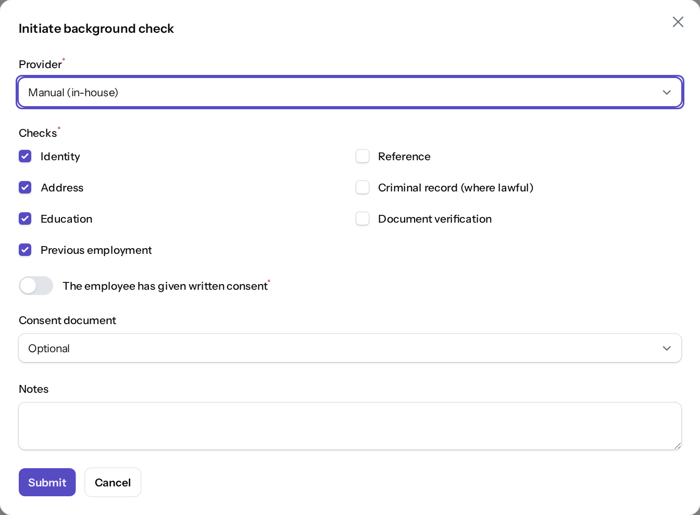
*Figure 2.15 — The Initiate background check form (not submitted). Demonstration data (fictional).*

The form asks for the **Provider**, the **Checks** to run (Identity, Address, Education and Previous employment are ticked by default; Reference, Criminal record (where lawful) and Document verification are optional), the consent switch **The employee has given written consent** (required), an optional **Consent document**, and **Notes**.

The **BGV cases** list shows #, Employee, Provider, Status, Result, Initiated at and Completed at, with filters for status and overall result. Open a case to see its details and the **Checks** tab.

### Statuses explained

| Item | Values | What happens next |
|---|---|---|
| Case status | Initiated, In progress, Completed, Closed | Completed when every check is closed. Closed when HR uses **Close case** with a reason. |
| Overall result | Pending, Clear, Discrepancy, Failed | Set when the case completes, using the worst check result. |
| Check status | Pending, In progress, Clear, Discrepancy, Failed, Skipped | Recorded with **Record result**. |

### Tasks

#### Task: Start a background check
**Purpose:** begin verification for a new joiner.
**Before you start:** you hold the employee's written consent.
1. Open the employee and click **Action › Initiate background check**.
2. Keep **Manual (in-house)** as the **Provider**. Tick the **Checks** you need.
3. Turn on **The employee has given written consent**. Optionally pick the **Consent document** and add **Notes**.
4. Click **Submit**.

**Expected result:** "BGV case #N initiated". The case appears in **Background checks** and in the person's **Operations › Verification** tab.
**How to verify:** the *People operations* panel shows "Background check: Initiated".
**Common mistakes:** starting without consent. The form will not submit.
**If it fails:** "Background verification needs the employee's consent first." "A verification case is already open for this employee." (finish or close the open case first).

#### Task: Record a check result
**Purpose:** record the outcome of one check.
1. Open **Background checks** and open the case.
2. In the **Checks** tab, click **Record result** on a check.
3. Choose the **Status** (In progress, Clear, Discrepancy, Failed or Skipped). Add **Notes** and, optionally, an **Evidence document**. Submit.

**Expected result:** "Result recorded". When the last check is closed, the case becomes **Completed** with an overall result.
**How to verify:** the case shows **Completed at**.
**Common mistakes:** marking a check Clear before the evidence is uploaded. Upload it first so you can attach it.
**If it fails:** **Record result** disappears once a check or the case is closed. To stop a case early, use **Close case** and give a reason.

---

## Onboarding and onboarding templates

**Status:** Available

### Overview
Onboarding gives every new joiner a checklist, split into phases: Preboarding, Day 1, First week, 30 days, 60 days and 90 days. Each task has an owner: the employee, the line manager, a buddy, the HR business partner, a role, or a specific user. Each task also has a due date counted from the joining date. Tasks can be simple checklist items, documents to collect, forms to fill in, or policy acknowledgements. The plan starts by itself when someone enters Preboarding, Onboarding or Joined, if a template matches them. HR can also start it by hand. The plan completes when no mandatory task is open.

*Templates* define the checklist. A template can apply to everyone, or only to people who meet conditions (for example a location or department). When several templates match, the one with the lowest **Priority** number wins.

### Where to find it
- **Menu path:** People › Lifecycle › Onboarding (the plans). Templates: People › Lifecycle › **All in Lifecycle** › Onboarding templates. A person's tasks: Employee 360 › Records › **Employment** › **Onboarding**. Your own tasks: **My work › Task inbox** › **Onboarding tasks**.
- **Who can open it:** Tenant HR Admin, Tenant Super Admin, HR Manager, HR Executive, Auditor, Manager (their team). Templates and manual starts need Tenant HR Admin, HR Manager or Tenant Super Admin. Employees complete their own tasks.
- **Set-up needed first:** at least one active template. A "Standard onboarding" template is provided.

### The screen at a glance
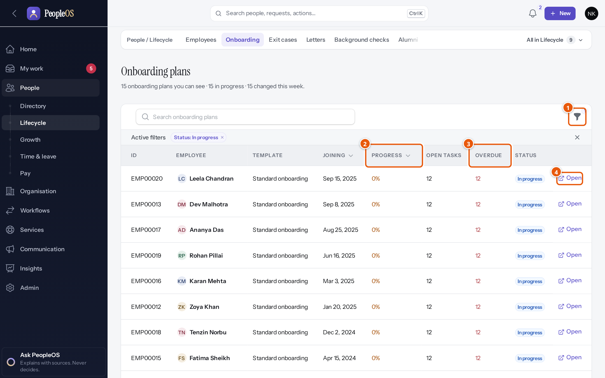
*Figure 2.16 — Onboarding plans in progress. Demonstration data (fictional).*

1. **Filter** — status: In progress (the default), Completed or Cancelled.
2. **Progress** — the percentage of tasks closed.
3. **Overdue** — open tasks past their due date (shown in red).
4. **Open** — opens the person's Employee 360, where the checklist is in **Employment › Onboarding**.

On the Employee 360, the onboarding table heading shows the template, the percentage complete and the status. Each task shows Phase, Title, Type, Owner, Due on, Status (Pending, Completed or Skipped), Note and By, with the buttons **Done** and **Skip**.

### Tasks

#### Task: Start onboarding manually
**Purpose:** give someone a checklist when none started by itself.
**Before you start:** the person has no onboarding plan in progress.
1. Open the employee and click **Action › Start onboarding**.
2. Leave **Template** on "Best match by rules", or choose a template.
3. Optionally add a **Reason for change**, then submit.

**Expected result:** "Onboarding started — N tasks created." Task owners are notified.
**How to verify:** the plan appears in **Onboarding** with 0% progress.
**Common mistakes:** looking for the action while a plan is still in progress. It is hidden then.
**If it fails:** "No onboarding template matches this employee." Add a template or widen its conditions.

#### Task: Complete an onboarding task
**Purpose:** close a checklist item you own.
1. Open **My work › Task inbox** and choose the **Onboarding tasks** tab. HR can also open the person's **Employment › Onboarding** tab.
2. Click **Done**. For a document task, choose the uploaded document under **Attach uploaded document**. Optionally add a **Note**.
3. To skip a task, click **Skip** and give a **Note** (required).

**Expected result:** "Task completed" or "Task skipped". Progress goes up. When no mandatory task is open, the plan becomes **Completed**.
**How to verify:** the task shows **Completed** or **Skipped**, and your name under **By**.
**Common mistakes:** trying to close someone else's task.
**If it fails:** "This task is not assigned to you." "This task is already closed." HR (Tenant HR Admin, HR Manager) can close any task.

#### Task: Create or change an onboarding template
**Purpose:** decide what every new joiner (or a group of joiners) must do.
1. Open **Onboarding templates** and click **New onboarding template**, or **Edit** on an existing one.
2. Enter **Name** (the **Key** is filled in for you), **Description**, **Priority** ("Lower wins when several templates match an employee") and **Status** (Active or Inactive).
3. Under **Applies to**, add **Conditions**, or leave them empty for everyone.
4. Save. When editing, give a **Reason for change**.
5. In the **Checklist items** tab, add items:
   - **Phase**, **Type** (Checklist item, Collect a document, Fill a form, Policy acknowledgement), **Title**;
   - **Due (days from joining)** — blank uses the phase default;
   - **Owner type**, plus the **Role** or **User** when needed;
   - **Document type** or **Form** for those item types;
   - **Mandatory** (on by default).

**Expected result:** new plans use the template. Plans that already exist keep their tasks.
**How to verify:** the template list shows the number of **Items** and **Plans**, and **Applies to** (for example "Everyone").
**Common mistakes:** two templates with the same priority for the same people. Set clear priorities.
**If it fails:** a key must start with a letter and use lower-case letters, numbers and underscores.

> **Note:** New joiners cannot yet fill in their own details before joining (candidate self-service preboarding). HR captures the details and the checklist tracks them.

---

## Letters and letter templates

**Status:** Available with limitations. Letters are produced as HTML documents (web pages you can download and print). PDF output and electronic signatures are not part of this release.

### Overview
PeopleOS writes letters from templates. Each template has a subject and body with variables such as `{{ employee.name }}`, which PeopleOS fills in from the record when the letter is generated. The wording is frozen at that moment. Nine starter templates are provided: Experience, Relieving, Salary certificate, Employment certificate, No objection certificate, Appointment, Confirmation, Warning and Appreciation. A template can require approval. Then the person who asked for the letter cannot approve it. Issuing a letter stores it in the employee's documents and notifies them. Employees see their issued letters under **My letters** and in **My HR**.

### Where to find it
- **Menu path:** People › Lifecycle › Letters. Templates: People › Lifecycle › **All in Lifecycle** › Templates. You can also generate a letter from Employee 360 › **Request › Generate a letter**, or from an exit case (**Generate letter**). Employees: avatar menu › **My day**, then **My letters** in the *You / Your pages* bar.
- **Who can open it:** Tenant HR Admin, Tenant Super Admin, HR Manager (generate, approve, issue, manage templates); Auditor (view letters). Employees see only their own issued letters.
- **Set-up needed first:** review the starter templates. Check your company's legal name in the organisation set-up, because it appears on letters.

### The screen at a glance
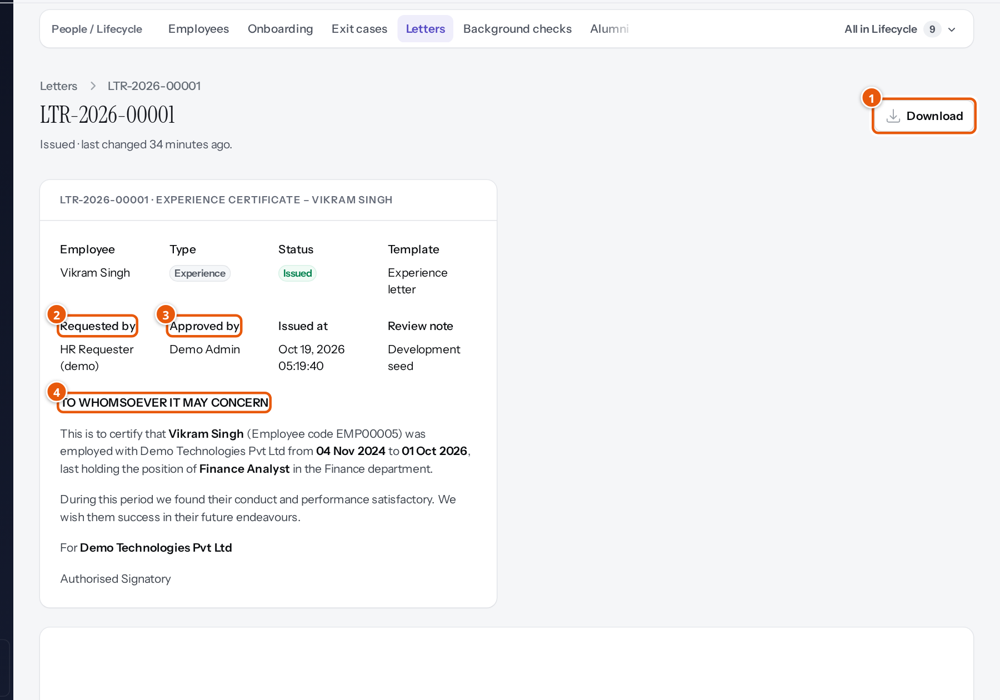
*Figure 2.17 — An issued experience letter. Demonstration data (fictional).*

1. **Download** — saves the issued letter as an HTML file. Downloads are recorded.
2. **Requested by** — who generated the letter.
3. **Approved by** — a different person. Requester and approver cannot be the same.
4. **Body** — the letter text as frozen at generation.

The **Letters** list shows Number (LTR-year-number), Employee, Type, Subject, Status, Created at and Issued at, with filters for status and type, and **Open**. **Generate letter** at the top asks for the **Employee**, the **Template** and any **Extra variables** (Variable and Value pairs, for example a purpose).

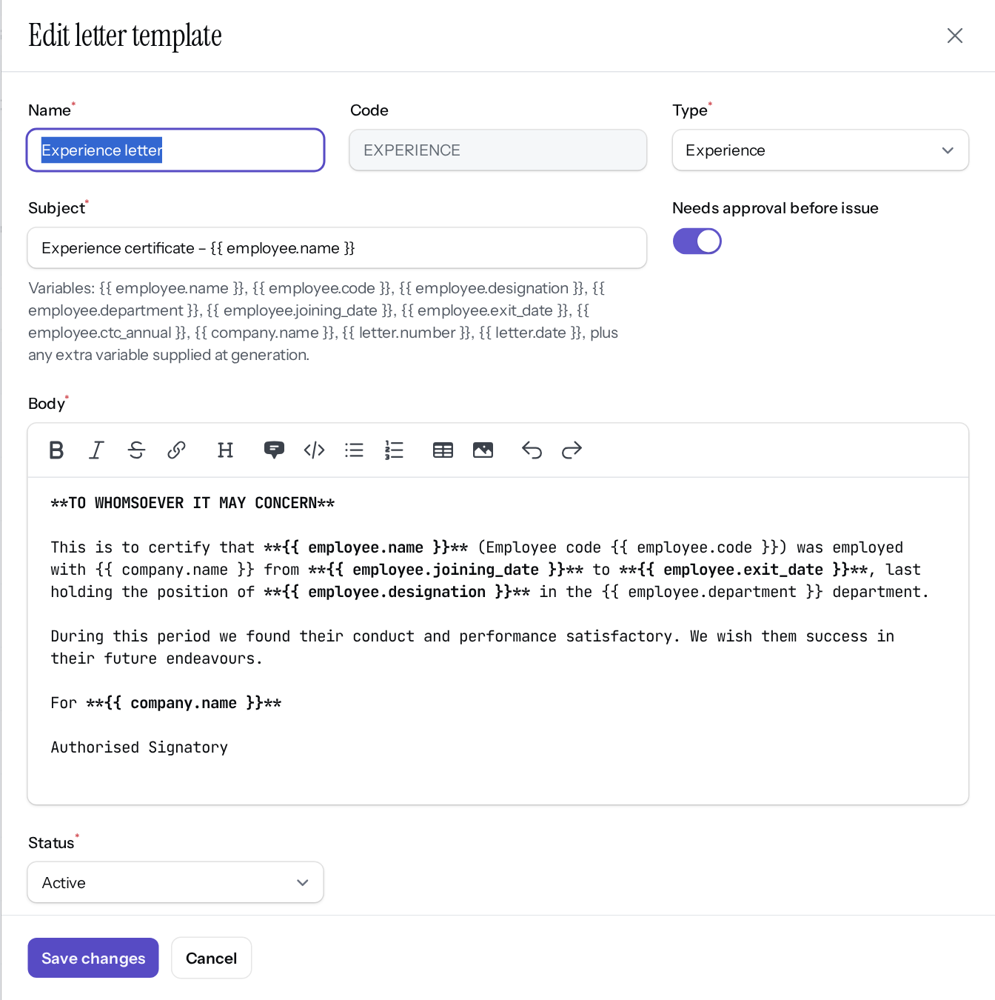
*Figure 2.18 — Editing a letter template (not saved). Demonstration data (fictional).*

A template has **Name**, **Code**, **Type**, **Subject** (the helper lists the variables), **Needs approval before issue**, **Body** and **Status**. Changing the wording creates a new version (v1, v2 and so on).

### Flowchart

**Flowchart — Issuing a letter.** *Roles:* HR (Tenant HR Admin, HR Manager); a second HR person approves. *Starts:* **Generate letter**. *Ends:* the letter is **Issued** (or **Rejected**).

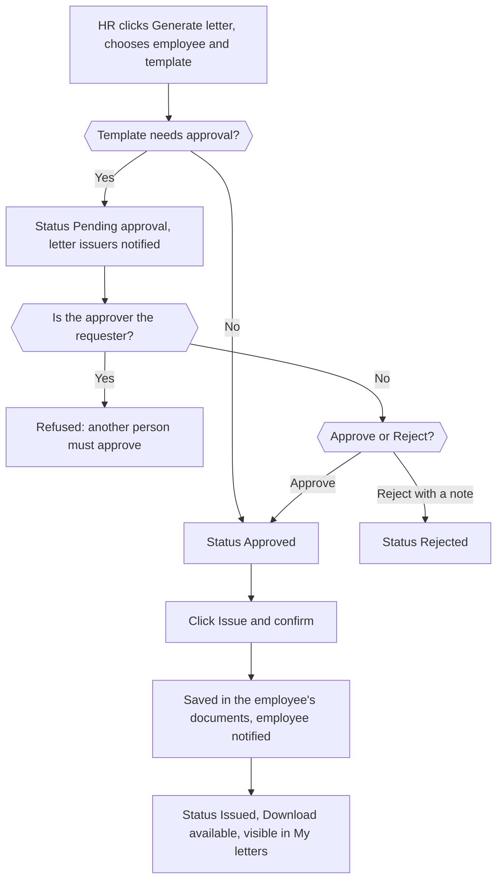

### Statuses explained

| Status | Meaning | What happens next |
|---|---|---|
| Pending approval | Generated from a template that needs approval | Another person with letter rights approves or rejects it |
| Approved | Ready to issue (or generated from a template without approval) | **Issue**, or **Reject** |
| Issued | Stored in the employee's documents; the employee is notified | **Download** |
| Rejected | Not issued; the note explains why | Generate a new letter if needed |
| Draft | A listed status; letters generated from the screen start at Pending approval or Approved | — |

### Tasks

#### Task: Generate a letter
**Purpose:** prepare a letter for an employee.
1. Open **Letters** and click **Generate letter**. Or, on the Employee 360, use **Request › Generate a letter**.
2. Choose the **Employee** and the **Template**. Add **Extra variables** if the template uses them.
3. Click **Submit**.

**Expected result:** "Letter LTR-… sent for approval" or "Letter LTR-… ready to issue".
**How to verify:** the letter appears at the top of the list with its status.
**Common mistakes:** choosing an inactive template. Only active templates are offered.
**If it fails:** if **Generate letter** is missing, your role cannot issue letters.

#### Task: Approve and issue a letter
**Purpose:** check a letter and send it to the employee.
**Before you start:** you did not generate this letter yourself.
1. Open **Letters** and click **Open** on the letter.
2. Read the body. Click **Approve** (optionally add a **Note**), or **Reject** (a **Note** is required).
3. On an approved letter, click **Issue**. Confirm the message "Stores the letter in the employee's documents and notifies them."

**Expected result:** "Approved", then "Letter issued". The status becomes **Issued** and **Download** appears.
**How to verify:** the letter is in the employee's **Operations › Documents**, and the employee sees it under **My letters**.
**Common mistakes:** trying to approve a letter you generated.
**If it fails:** "The person who requested a letter cannot approve it." "The letter is not waiting for approval." "Only an approved letter can be issued."

#### Task: Create or edit a letter template
**Purpose:** set the wording of a letter.
1. Open **Templates** and click **New letter template**, or **Edit** on a template.
2. Enter **Name**, **Code** (fixed once created), **Type**, **Subject** and **Body**. Use the variables shown under **Subject**, for example `{{ employee.name }}`, `{{ employee.designation }}`, `{{ company.name }}`, `{{ letter.number }}`.
3. Turn on **Needs approval before issue** if a second person must check each letter.
4. Set **Status** to Active. When editing, give a **Reason for change**. Save.

**Expected result:** the template is offered when letters are generated. A change to the wording increases the **Version**.
**How to verify:** the Templates list shows the new version and whether approval is needed.
**Common mistakes:** misspelling a variable. It will not be filled in.
**If it fails:** **Code** must be unique and may use letters, numbers, dashes and underscores only.

---

## Exit cases, clearance and full and final settlement

**Status:** Available. Full and final settlement has limitations: gratuity is not calculated, and statutory deductions rely on payroll rules that are not yet verified (see the Pay chapter).

### Overview
An exit case manages someone's departure from start to finish. HR can start any type of exit: Resignation, Termination, Retirement, Contract expiry, Absconding, Death, Mutual separation or Other. Employees can resign themselves. Starting an exit moves the employee to **Notice Period** and records the planned last working day. Payroll then pays the final month up to that day.

Each exit has five *clearance* stages, each with its own owner and checklist:
- **Manager clearance** — the line manager;
- **IT clearance** — by default the Asset Admin role;
- **Finance clearance** — by default the Payroll Admin role;
- **Asset clearance** — its checklist lists the company assets still with the person;
- **HR clearance** — by default the Tenant HR Admin role.

Clearance starts at once for immediate exits (termination, absconding, death), and otherwise within seven days of the last working day (HR can start it earlier). When every stage is cleared or not applicable, PeopleOS prepares the *full and final settlement* (F&F): the last payment or recovery. HR then completes the exit. The employee becomes **Exited** on the last working day and their sign-in is suspended. Creating the alumni profile re-opens the sign-in with alumni access only.

### Where to find it
- **Menu path:** People › Lifecycle › Exit cases. Employees: avatar menu › **My day** › **Resign**, or **My exit** in the *You / Your pages* bar.
- **Who can open it:** Tenant HR Admin, Tenant Super Admin and HR Manager (all cases, all actions); Auditor (read only); Manager (cases of their team, and stages they own); Employee (their own case, **Resign**).
- **Set-up needed first:** your administrator can change the default notice period (30 days), the clearance lead time (7 days), the leave encashment basis (basic or gross), notice shortfall recovery (on by default) and the clearance owner roles in Settings.

> **Note:** By default, the Asset Admin and Payroll Admin roles cannot act on clearance stages. HR clears the IT, Finance and Asset stages unless your administrator adds that permission to those roles.

### The screen at a glance
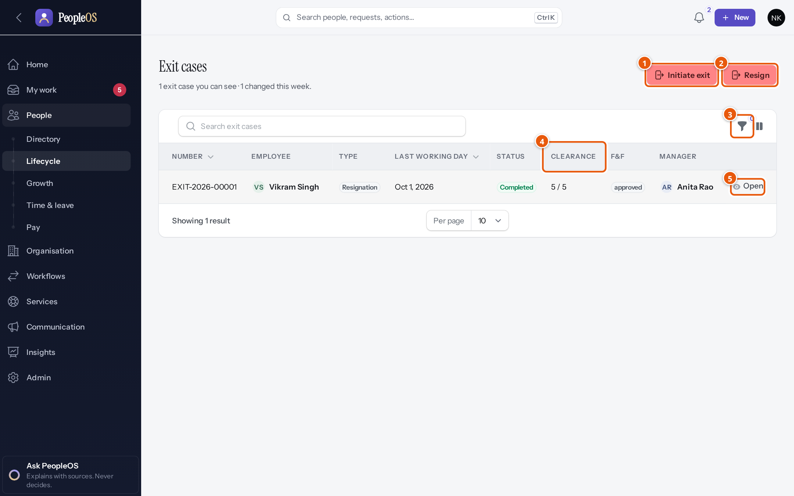
*Figure 2.19 — Exit cases, with the status filter cleared to show a completed case. Demonstration data (fictional).*

1. **Initiate exit** — HR starts an exit for an employee.
2. **Resign** — your own resignation (shown when you may resign).
3. **Filter** — by default only open cases (Initiated, Serving notice, Clearance, Settlement). Remove the filter to see completed and withdrawn cases.
4. **Clearance** — stages done out of five.
5. **Open** — opens the case.

The **Last working day** turns red when it is within seven days. **F&F** shows the settlement status.

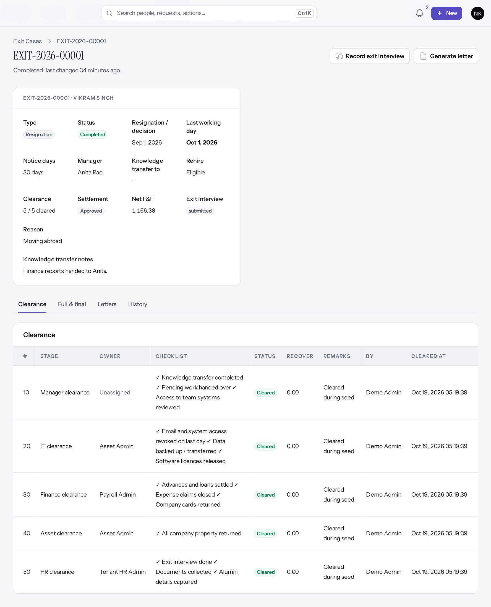
*Figure 2.20 — A completed exit case with its five clearance stages. Demonstration data (fictional).*

The case page shows Type, Status, Resignation / decision date, Last working day, Notice days, Manager, Knowledge transfer to, Rehire, Clearance, Settlement, Net F&F and Exit interview, the reason (visible to HR and to the leaver), and knowledge transfer notes. The header holds the actions the case allows: **Start clearance**, **Record exit interview**, **Generate letter**, **Withdraw resignation**, **Complete exit** and **Create alumni profile**. The tabs are **Clearance**, **Full & final**, **Letters** and **History**. Each clearance row shows #, Stage, Owner, Checklist, Status, Recover (amount to recover), Remarks, By and Cleared at.

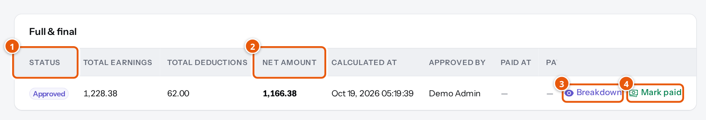
*Figure 2.21 — The Full & final tab of an exit case: approved, not yet paid. Demonstration data (fictional).*

1. **Status** — Draft, Calculated, Approved or Paid.
2. **Net amount** — total earnings minus total deductions.
3. **Breakdown** — every line with its amount and how it was worked out.
4. **Mark paid** — records the payment reference after payment.

### Flowchart

**Flowchart — Exit and full and final settlement.** *Roles:* HR (Tenant HR Admin, HR Manager), the employee, the line manager and the clearance owners. *Starts:* **Initiate exit** or **Resign**. *Ends:* the employee is Exited, or Alumni once the profile is created.

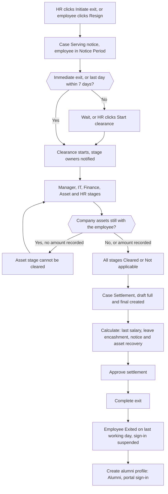

A resignation can be withdrawn while the case is open (Initiated, Serving notice or Clearance). The case becomes **Withdrawn** and the employee returns to **Active**.

### Statuses explained

| Item | Status | Meaning |
|---|---|---|
| Exit case | Initiated | A listed early status. Exits started from the screen go straight to Serving notice. |
| | Serving notice | The employee is working their notice. |
| | Clearance | Stages are being cleared. |
| | Settlement | All stages done. The full and final is being calculated and approved. |
| | Completed | The employee has exited. Their sign-in is suspended until an alumni profile is created. |
| | Withdrawn | A resignation was withdrawn. The employee is Active again. |
| | Cancelled | A listed status; there is no cancel button in this release. |
| Clearance stage | Pending, Cleared, Blocked, Not applicable | **Block** notifies HR; **Reopen** returns a blocked stage to Pending. |
| Full and final | Draft, Calculated, Approved, Paid | Lines can change until Approved. Approval freezes them. |

### What the full and final calculation includes
- The last month's salary, worked out like a normal payroll run (pro-rated to the exit date, including loss of pay and deductions). It is skipped if that month's payroll is already finalised.
- Leave encashment for leave types marked encashable and paid. The available balance is multiplied by a daily rate (basic or gross divided by 30, as your administrator sets). Approval posts the encashment to the leave ledger.
- Notice shortfall recovery, for resignations where the notice served is shorter than required (if switched on).
- Asset recovery, the amounts recorded in clearance.
- Manual lines (earnings or deductions) that HR adds. These stay when the settlement is recalculated.

> **Important:** Gratuity (a statutory end-of-service payment) is **not** calculated. Add it as a manual line if it is due. Statutory deductions use payroll rules that have not yet been verified, so check the breakdown before approving.

### Tasks

#### Task: Initiate an exit (HR)
**Purpose:** record that an employee is leaving.
**Before you start:** the employee is currently employed and not already in Notice Period.

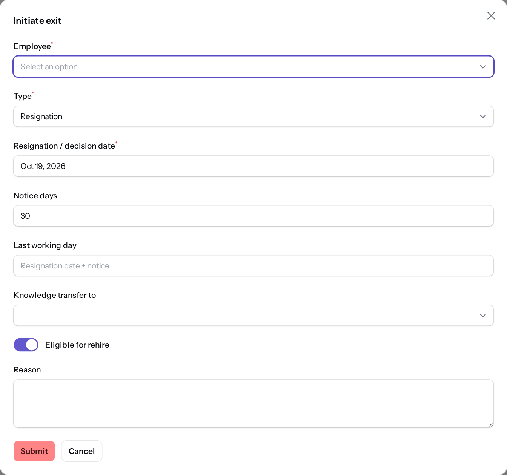
*Figure 2.22 — The Initiate exit form (not submitted). Demonstration data (fictional).*

1. Open **Exit cases** and click **Initiate exit**.
2. Choose the **Employee** and the **Type** (Resignation by default).
3. Check the **Resignation / decision date** (required). Check **Notice days** (pre-filled with your default, and hidden for termination, absconding and death).
4. Optionally set the **Last working day** (blank means resignation date plus notice), **Knowledge transfer to**, **Eligible for rehire** (on by default) and a **Reason**.
5. Click **Submit**.

**Expected result:** "EXIT-… initiated; last working day …". The employee moves to **Notice Period** and their manager is notified. For immediate types, or when the last day is close, clearance starts at once.
**How to verify:** the case appears in the list as **Serving notice** (or **Clearance**). The Employee 360 shows the last working day under **What's next**.
**Common mistakes:** setting a last working day before the resignation date.
**If it fails:** "An exit is already in progress for this employee." "Only current employees can be exited." "The last working day cannot be before the resignation date."

#### Task: Resign (employee)
**Purpose:** submit your own resignation.
**Before you start:** you are employed and have no open exit case.
1. Click your avatar and choose **My day**, then click **Resign**. Or open **My exit** and click **Resign**.
2. Read the message ("Your notice period is 30 days from today. HR and your manager will be informed.").
3. Enter the **Reason for leaving** (required). Optionally choose a **Requested last working day**.
4. Click **Confirm**.

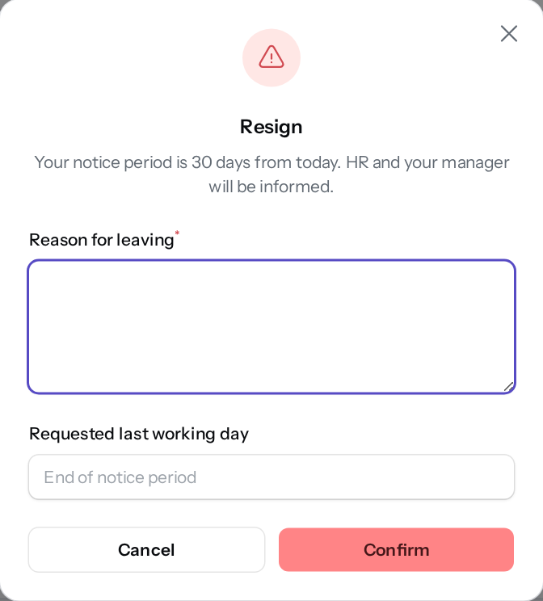
*Figure 2.23 — The employee's Resign form (not submitted). Demonstration data (fictional).*

**Expected result:** "Resignation submitted". Your case appears under **My exit** and you are in **Notice Period**.
**How to verify:** **My exit** lists the case with your last working day.
**Common mistakes:** requesting a last day later than the end of your notice. PeopleOS uses the end of the notice period instead. An earlier day is accepted as requested.
**If it fails:** if **Resign** is missing, you already have an open exit case, or your role does not allow resigning online. Contact HR.

#### Task: Withdraw a resignation
**Purpose:** cancel a resignation that is still open.
1. Open the exit case and click **Withdraw resignation**. HR and the employee can both do this.
2. Enter a **Reason** (required) and confirm.

**Expected result:** "Resignation withdrawn; employee is active again." The case becomes **Withdrawn** and the planned exit date is cleared.
**How to verify:** the employee's status is **Active**.
**If it fails:** "Only a resignation that is still open can be withdrawn." Withdrawal is possible only for resignations in Initiated, Serving notice or Clearance.

#### Task: Clear a clearance stage
**Purpose:** confirm that your part of the exit is done.
**Before you start:** clearance has started, and the stage is assigned to you or your role (or you are HR).
1. Open the exit case. In the **Clearance** tab, find your stage.
2. Click **Clear**. Tick the **Checklist** items that are done. Enter any **Amount to recover in F&F** ("Unreturned property, pending advances, damages") and **Remarks**. Submit.
3. If something blocks you, click **Block** and explain in **Remarks**. HR is notified. **Reopen** returns the stage to Pending.
4. HR can mark a stage **Not applicable**, with remarks.

**Expected result:** "Stage cleared". When the last stage is cleared, the case moves to **Settlement** and a draft full and final is created.
**How to verify:** the Clearance column shows, for example, "5 / 5".
**Common mistakes:** clearing the Asset stage while laptops or other assets are still with the person.
**If it fails:** "Assets still in custody: [tags]. Take them back, or record a recoverable amount." "Clearance has not started for this exit." "This stage is already cleared."

#### Task: Calculate and approve the full and final settlement
**Purpose:** work out and approve the final payment or recovery.
**Before you start:** you are Tenant HR Admin or HR Manager. The case is in **Settlement** (or you start the settlement early).
1. Open the exit case and click the **Full & final** tab.
2. Click **Calculate** (or **Start settlement** if no settlement exists yet). Later changes use **Recalculate**.
3. Click **Breakdown** and check every line.
4. Use **Add line** for anything missing, for example gratuity or a loan recovery: choose **Type** (Earning or Deduction), **Name**, **Amount** and an optional **Note**.
5. Click **Approve**. Read "Freezes the lines and posts leave encashment to the ledger", add an optional **Note**, and confirm.
6. After payment, click **Mark paid** and enter the **Payment reference**.

**Expected result:** "Calculated: net …", then "Settlement approved", then "Settlement paid".
**How to verify:** the case header shows **Settlement: Approved** (or Paid) and **Net F&F**.
**Common mistakes:** approving before adding manual lines. Approval freezes the lines.
**If it fails:** "An approved settlement cannot be recalculated." "Calculate the settlement before approving it." "Only an approved settlement can be paid."

#### Task: Complete the exit and create the alumni profile
**Purpose:** close the exit and keep the person as an alumnus.
**Before you start:** all stages are cleared or not applicable, and the settlement is approved.
1. Open the exit case and click **Complete exit**. Read "Marks the employee as exited on the last working day and disables their login. Requires all clearances and an approved settlement." Only when there is genuinely nothing to settle (for example after a death, or with no dues), tick **Complete without an approved settlement**. Confirm.
2. Click **Create alumni profile**. Check **Personal email** and **Phone**, **Enable alumni portal login** and **Consented to be contacted**. Submit.

**Expected result:** "Exit completed", then "Alumni profile created". The employee becomes **Exited**, then **Alumni**. Their sign-in is suspended at completion. If the portal is enabled, it is re-opened with the Alumni role only.
**How to verify:** the person appears under **Alumni**, and their Employee 360 shows **Alumni**.
**Common mistakes:** creating the alumni profile before completing the exit.
**If it fails:** "All clearance stages must be cleared first." "The full & final settlement must be approved first." "Complete the exit before creating the alumni profile."

### Example from everyday work
*Illustrative scenario.* Vikram Singh in Finance resigns to move abroad. Neha records the exit with a 30-day notice. A week before his last day, clearance starts by itself and each owner is notified. All five stages clear. Neha calculates the full and final, checks the breakdown, adds nothing and approves. On completion his sign-in is suspended. She creates his alumni profile, generates his experience letter, and a colleague approves and issues it.

### Related modules
- **Assets** (Organisation chapter) — the assets listed in the Asset clearance stage.
- **Payroll** (Pay chapter) — pays the final month up to the exit date.
- **Letters** — relieving and experience letters from the exit case.

---

## Exit interviews and exit insights

**Status:** Available

### Overview
An exit interview records why someone is leaving. It holds a reason, ratings from 1 to 5 on seven dimensions (manager experience, compensation and benefits, culture, workload, location or commute, career opportunities, work environment), whether they would recommend the company and whether they would rejoin, and free text. The leaver can fill it in themselves (**My exit interview**), or HR can record it (**Record exit interview**). *Exit insights* summarises all interviews. Reasons given by employees are shown separately from reasons inferred by HR, and average ratings use employee answers only.

### Where to find it
- **Menu path:** the exit case header (**Record exit interview** / **My exit interview**). Insights: People › Lifecycle › **All in Lifecycle** › Exit insights.
- **Who can open it:** interviews: HR with exit interview rights (Tenant HR Admin, HR Manager) and the leaver. Insights: Tenant HR Admin, Tenant Super Admin, HR Manager, Auditor.
- **Set-up needed first:** none.

### The screen at a glance
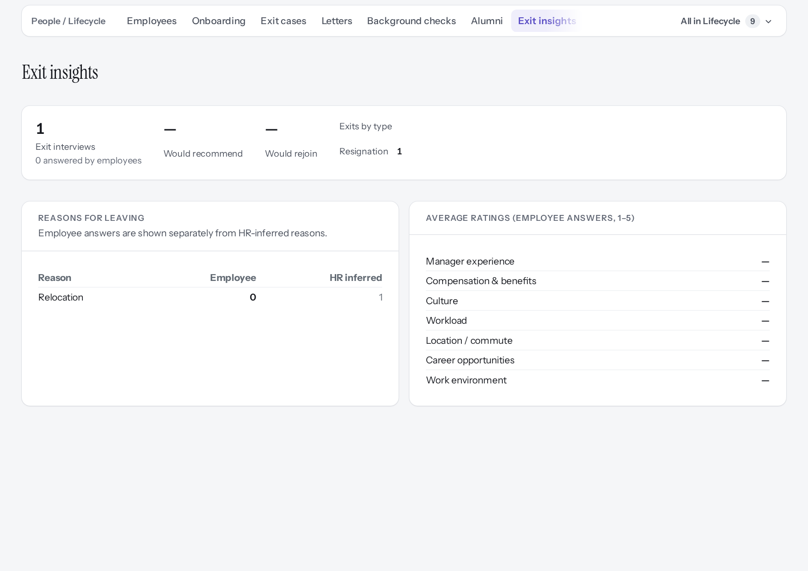
*Figure 2.24 — Exit insights: interviews, would recommend and would rejoin, exits by type, reasons and average ratings. Demonstration data (fictional).*

### Tasks

#### Task: Record an exit interview
**Purpose:** capture the leaver's feedback.
1. Open the exit case and click **Record exit interview** (HR) or **My exit interview** (the leaver).
2. Choose the **Reason for leaving**. Rate each item under **How would you rate…** from 1 to 5.
3. Set **Would recommend the company as a place to work** and **Would consider rejoining**. Fill in **What did you like most?** and **Suggestions**.
4. Submit.

**Expected result:** "Exit interview saved". The case shows **Exit interview: submitted**.
**How to verify:** **Exit insights** counts it. It is counted as employee-answered only when the leaver filled it in.
**If it fails:** "The exit is not open." Interviews can be recorded while the case is open or completed. "Ratings are 1 to 5 on the defined dimensions."

---

## Alumni and the alumni portal

**Status:** Available. The alumni portal is not shown in the demonstration, because no former employee there has a sign-in.

### Overview
Leaving is not the end of the relationship. An alumni profile keeps a former employee's contact details, last designation and department, dates, exit type, rehire eligibility, portal access and consent to be contacted. Through the *Alumni portal*, former employees can download their documents and recent payslips. They can also request experience or relieving letters, employment verification, salary certificates, payslip copies, Form 16, a reference, or something else. HR handles each request. Approving a request for an experience letter, relieving letter, employment verification or salary certificate generates and issues the letter automatically.

### Where to find it
- **Menu path:** People › Lifecycle › Alumni. Former employees: the **Alumni portal** page among their personal pages after signing in (the search bar also finds it).
- **Who can open it:** Tenant HR Admin, Tenant Super Admin and HR Manager (manage); Auditor (view). The portal: the Alumni role, when the portal is enabled on the profile.
- **Set-up needed first:** the alumni profile is created from the completed exit case.

### The screen at a glance
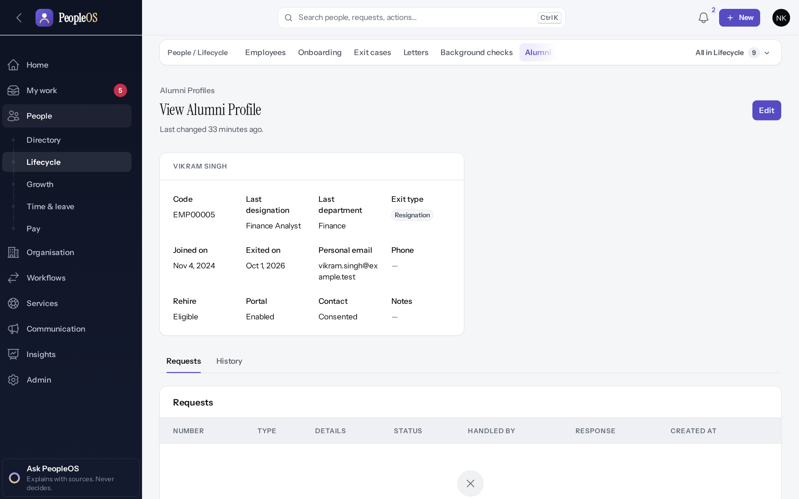
*Figure 2.25 — An alumni profile with the Requests tab. Demonstration data (fictional).*

The **Alumni** list shows Code, Name, Last designation, Exited on, Exit type, Rehire, Portal and Open requests, with a filter by exit type, plus **View** and **Edit**. **Edit** changes Personal email, Phone, **Eligible for rehire**, **Portal enabled**, **Consented to contact** and Notes. The **Requests** tab shows Number (ALR-year-number), Type, Details, Status, Handled by, Response and Created at.

### Statuses explained

| Request status | Meaning | Next |
|---|---|---|
| Submitted | Sent from the alumni portal | **Verify identity**, **Approve & generate** or **Reject** |
| Verified | HR has checked who is asking | **Approve & generate** or **Reject** |
| Approved | Approved; no automatic letter for this type | **Mark delivered** |
| Generated | The matching letter was generated and issued | **Mark delivered**; **Open letter** |
| Delivered | Sent to the former employee, with a response | Closed |
| Rejected | Refused, with a reason | Closed |

### Tasks

#### Task: Handle an alumni request
**Purpose:** respond to a former employee who needs a document.
1. Open **Alumni**, then the person, then the **Requests** tab.
2. Click **Verify identity** (optional **Note**) once you are sure who is asking.
3. Click **Approve & generate** (optional **Note**). For letter types, PeopleOS generates and issues the letter: "Letter generated and issued".
4. Click **Mark delivered** and add a **Response**. Or click **Reject** with a **Reason**.

**Expected result:** the request reaches **Delivered**, and the former employee sees the status and response in the portal.
**How to verify:** **Open letter** shows the issued letter.
**Common mistakes:** marking delivered before approving: "Approve or generate the request first."
**If it fails:** "The request cannot be approved now." "The request is closed."

#### Task: Request a document as a former employee
**Purpose:** get a letter or document after leaving.
1. Sign in and open **Alumni portal**.
2. Click **Request a document or reference**. Choose the **Type** and describe the **Purpose / details**. Submit.
3. Follow progress under **My requests**. Download documents from **My documents**, and payslips from **Payslips**.

**Expected result:** "Request ALR-… submitted".
**If it fails:** "The alumni portal is disabled for this profile." Contact your former employer's HR team.

---

## Limitations in this area

- **Employee imports:** in the build tested, saving **Map columns** fails, so imports cannot yet be completed from the screen. Contact Markedge.
- **Letters:** HTML only. No PDF generation and no electronic signature. Branding is limited to the company name.
- **Full and final:** gratuity is not calculated. Statutory deductions depend on payroll rules that are not yet verified.
- **Background checks:** in-house recording only. No external verification agency connections.
- **Onboarding:** joiners cannot fill in their own details before joining. Exit checklists are the same for the whole organisation; per-department or per-role exit checklists cannot be set up yet.
- **Employee photos:** there is no photo upload yet.
- **Alumni:** there is no public link for third parties to verify employment. Verification happens through alumni requests.
- **Rehire:** a returning employee can be made Active again on the same record, but there is no guided rehire screen.
- **Release status:** PeopleOS is not yet generally released. Hosting, support channels and commercial terms are to be confirmed with the SaaS provider.
