# Time and leave: attendance, shifts, holidays and leave

> **In this chapter:** how employees request leave and fix their attendance, how managers and HR approve, and how
> administrators set up leave types, balances, shifts, work schedules, holidays and attendance devices.
> **Who should read it:** employees, line managers, HR managers, HR and attendance administrators, and payroll teams
> who rely on attendance and leave figures.

Time and leave answers two everyday questions: "Who is working today, and when did they arrive?" and "Who is away, and
do they have leave left?" PeopleOS collects attendance punches (from a device, the **Check in** button or an administrator), turns
each day into an attendance record, and lists the days that need a human decision. Employees request leave in a few
clicks and see their balance change before they submit. Managers approve from one queue. Every balance is calculated
from a running ledger of credits and debits, so any number can be explained. Payroll reads the approved results.

| Module | What it is for | Where to find it | Who uses it | Status |
|---|---|---|---|---|
| Request leave, Apply leave | An employee asks for time off and sees the balance before and after | **Home › Request leave**; avatar menu › **My day › Apply leave** | Every employee | Available |
| Leave requests | All leave requests you may see, with Approve, Reject and Cancel | People › Time & leave › Leave requests | Employees (own), managers (team), HR | Available with limitations (**Apply on behalf** fails; see the section) |
| Approval Center (leave and attendance) | One queue for every decision waiting for you | My work › Approvals | Managers, HR | Available |
| Leave calendar | Who is away and when (a list, not a grid) | People › Time & leave › Leave calendar | Managers, HR, payroll, auditors | Available |
| Balances | Each person's balance per leave type and year; adjust, encash, run accrual | People › Time & leave › Balances | Employees (own), managers (team), HR | Available |
| Transactions | The leave ledger: every credit and debit, read-only | People › Time & leave › All in Time & leave › Transactions | Employees (own), managers (team), HR | Available |
| Encashments | Leave days turned into pay, as recorded by HR | People › Time & leave › All in Time & leave › Encashments | HR, payroll, auditors | Available with limitations (no amounts; HR records it) |
| Leave types | The kinds of leave you offer (earned, casual, sick and so on) | People › Time & leave › All in Time & leave › Leave types | HR (edit); everyone else (view) | Available |
| Leave policy | Who gets how many days of which leave, and the rules | Workflows › Policies (type **Leave policy**) | Tenant HR Admin (edit) | Available |
| Fix my attendance, Regularise attendance | An employee asks to correct a day | **Home › Fix my attendance**; avatar menu › **My day › Regularise attendance** | Every employee | Available |
| Check in and Check out | Record arrival and departure from the browser | **Home** (Your day) and avatar menu › **My day** | Every employee | Available |
| Attendance records | One record per person per day: status, times, exceptions | People › Time & leave › Attendance records | Employees (own), managers (team), HR, attendance and payroll teams | Available |
| Exception centre | Days with a missed punch, lateness, absence or overtime to review | People › Time & leave › Exception centre | Managers, HR, attendance and payroll teams | Available |
| Regularisations | Correction requests and their decisions | People › Time & leave › Regularisations | Employees (own), managers, HR | Available |
| Punches | The raw punches, read-only, with Retry for failures | People › Time & leave › All in Time & leave › Punches | Managers, HR, attendance and payroll teams | Available |
| Devices | Biometric and other punch devices | People › Time & leave › All in Time & leave › Devices | Attendance administrators | Available with limitations (two connection types; device set-up needs technical help) |
| Punch imports | Load punches from a CSV file | People › Time & leave › All in Time & leave › Punch imports | Tenant HR Admin, Tenant Super Admin | Available with limitations (the column-mapping step has a known defect) |
| Shifts | Working hours, breaks, grace time and overtime rules | People › Time & leave › All in Time & leave › Shifts | Attendance administrators (edit); others (view) | Available |
| Work Schedules | Which shift runs on which weekday, and who follows it | People › Time & leave › All in Time & leave › Work Schedules | Attendance administrators (edit); others (view) | Available |
| Holiday Calendars | Public and company holidays, and who they apply to | People › Time & leave › All in Time & leave › Holiday Calendars | Attendance administrators (edit); others (view) | Available with limitations (see the section) |

## Key ideas in plain words

- **Leave year.** Balances are kept per leave year. Your organisation decides when the year starts (January by
  default; April for an Indian financial year). Your administrator sets this once in **Admin › Setup › Settings**
  (see [Settings](09-administration-and-security.md#settings)).
- **Entitlement.** How many days of each leave type a person gets. Entitlements are not stored on the leave type. They
  come from a **leave policy** that matches the person (by company, location, grade and so on).
- **Accrual.** Crediting leave days into a balance: all at once at the start of the year, or month by month, or
  quarter by quarter. PeopleOS posts accruals every night by itself.
- **Ledger.** A running list of every credit and debit on a balance, like a bank statement. Nothing in it is ever
  edited or deleted; a mistake is corrected with a new entry. The balance you see is always the total of the ledger.
- **Working days.** When you request leave, PeopleOS counts only your working days. Weekly offs (from your work
  schedule) and holidays (from your holiday calendar) are skipped unless your leave policy says to count them.
- **Punch.** One recorded moment of arrival or departure, from a device, the **Check in** button or a manual entry by
  an administrator (file imports exist but currently have a defect; see [Punch imports](#punches-devices-and-punch-imports)).
  Punches are evidence and are never changed.
- **Attendance record.** PeopleOS turns the day's punches, your shift, holidays and approved leave into one record per
  person per day, with a status such as Present, Half day or Absent, and any exceptions.
- **Regularisation.** A request to correct a day (for example "I forgot to punch out"). Once approved, the day is
  recalculated with the corrected times. The original punches stay untouched.
- **Scope.** You only see people inside your access scope. A line manager sees their own team. An HR Manager scoped to
  Demo Technologies sees only Demo Technologies people.

## Who can do what

Most people also hold the **Employee** role, which lets them request their own leave and their own attendance
corrections. The table shows what each role adds. "Team" means the people the manager may see (normally their direct
reports); "scope" means the companies, departments or locations the person's access covers.

| Task | Employee | Manager | HR Executive | HR Manager | Attendance Admin | Payroll Admin | Auditor | Tenant HR Admin, Tenant Super Admin |
|---|---|---|---|---|---|---|---|---|
| Request own leave, cancel own requests | ✓ | ✓ | ✓ | ✓ | — | — | — | ✓ |
| See leave requests, balances and the calendar | Own only | Team | Scope | Scope | Scope | Scope | Scope | ✓ |
| Approve or reject leave (never your own) | — | Team | — | Scope | — | — | — | ✓ |
| Adjust balances, encash, edit leave types, cancel anyone's leave | — | — | — | Scope | — | — | — | ✓ |
| Ask for an attendance correction for yourself | ✓ | ✓ | — | — | ✓ | — | — | ✓ |
| See attendance records and the exception centre | Own records (no exception centre) | Team | — | Scope | Scope | Scope | Scope | ✓ |
| Approve corrections and overtime (never your own) | — | Team | — | Scope | Scope | — | — | ✓ |
| Set up shifts, schedules, holidays and devices; manual punches; process a day | — | — | — | — | ✓ | — | — | ✓ |
| Import punches from a file | — | — | — | — | — | — | — | ✓ |

> **Note:** The Attendance Admin role is described here from its permissions; the demonstration has no person with
> that role. Executives and Account Owners have no time-and-leave access through those roles alone.

---

## Leave for employees: requesting, checking and cancelling

**Status:** Available

### Overview

Every employee can request leave, see what they have left, follow their requests and cancel them. The request form
shows, before you submit, how many working days the request uses and what your balance will be afterwards. Your
manager (or HR) then decides. You need to be linked to an employee record to use these pages; your administrator
does this when your account is created.

### Where to find it

- **Menu path:** **Home › Request leave** (the button at the top of Home), or **Home › Start something › Request
  leave**; avatar menu (top right) › **My day › Apply leave**. Your own requests: **People › Time & leave › Leave
  requests**. Your balances: **People › Time & leave › Balances**.
- **Who can open it:** anyone with the Employee role (and HR roles, for their own leave).
- **Set-up needed first:** a leave policy that gives you leave types, and a work schedule and holiday calendar so that
  working days are counted correctly. See [Setting up time and leave for a new location](#setting-up-time-and-leave-for-a-new-location).

### The screen at a glance

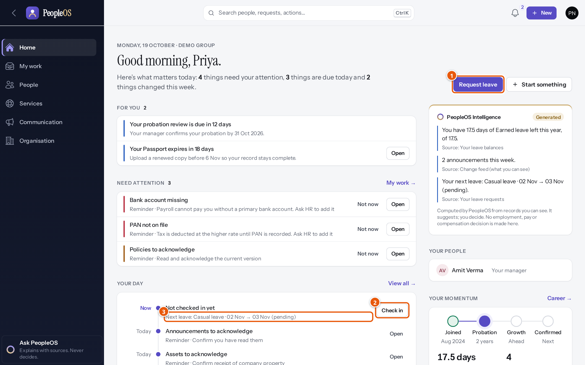
*Figure 3.1 — An employee's Home: Request leave at the top, and the day's attendance and next leave under Your day. Demonstration data (fictional).*

1. **Request leave** — opens the request form.
2. **Check in** — records your arrival time (it becomes **Check out** once you are checked in). See
   [Attendance for employees](#attendance-for-employees-checking-in-and-fixing-attendance).
3. **Next leave** — your next leave request and its status, here "Casual leave · 02 Nov → 03 Nov (pending)".

Further down Home, **My requests** lists your open requests ("Waiting for approval"), and **Start something** offers
**Request leave** and **Fix my attendance** again.

> **Tip:** If you are a manager and your Home shows your team, switch **View as** to **For you** to see the
> **Request leave** button. You can also use **My day › Apply leave**, which opens the same form.

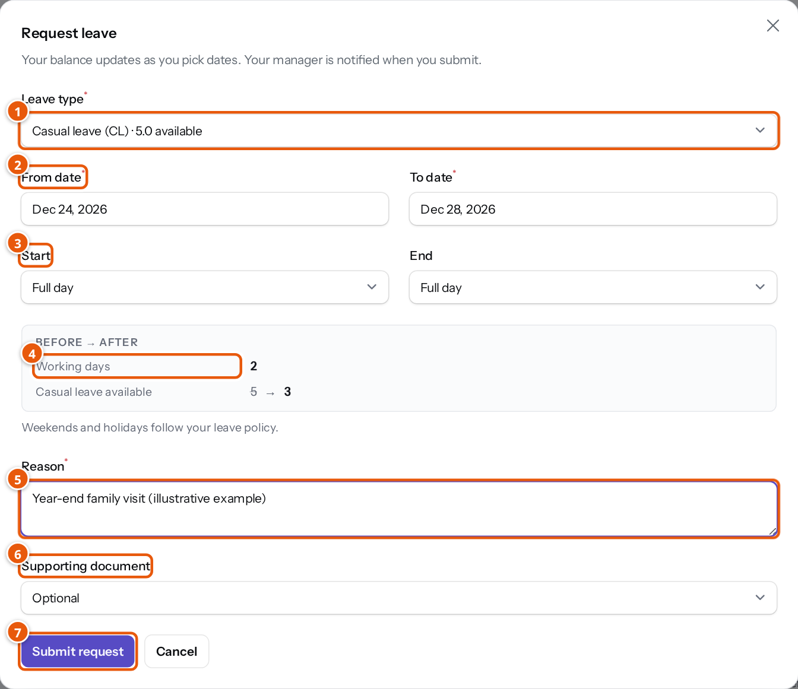
*Figure 3.2 — The Request leave form. Christmas (25 December) and the weekend are not counted, so 24 to 28 December uses 2 working days. Demonstration data (fictional; not submitted).*

1. **Leave type** (required) — only the types your leave policy gives you, plus **Leave without pay**. Each shows what
   is available now, for example "Casual leave (CL) · 5.0 available".
2. **From date** and **To date** (required) — the first and last day of your leave.
3. **Start** and **End** — **Full day**, **First half** or **Second half**. **Start** applies to the first day, **End**
   to the last day (**End** appears only when the two dates differ). A half day counts as 0.5.
4. **Before → After** — **Working days** in the request and your balance before and after. The line under it says
   "Weekends and holidays follow your leave policy." If the request is larger than your balance it warns: "This is
   more than your balance; the request may be refused or need an approval."
5. **Reason** (required, up to 255 characters).
6. **Supporting document** — optional; pick one of the documents already on your record. Some leave types require one.
7. **Submit request** — sends the request. **Cancel** closes the form without sending.

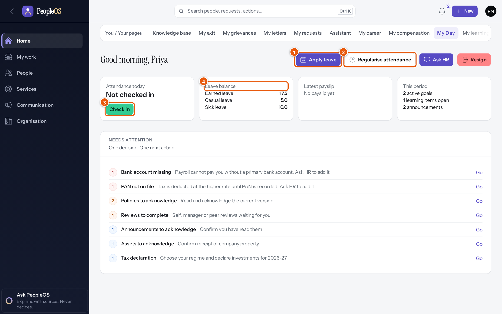
*Figure 3.3 — My day: quick actions, today's attendance and the leave balance per type. Demonstration data (fictional).*

1. **Apply leave** — the same form as **Request leave** (its button is labelled **Submit**).
2. **Regularise attendance** — ask to correct a day.
3. **Check in** — records your arrival.
4. **Leave balance** — what you have available now per leave type. If no leave policy applies to you, it says "No
   leave policy applies yet."

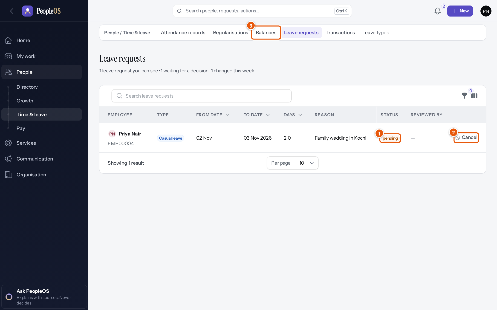
*Figure 3.4 — Leave requests as an employee sees it: only their own requests. Demonstration data (fictional).*

1. **Status** — **pending** until someone decides (see [Statuses explained](#statuses-explained)).
2. **Cancel** — withdraw the request, or cancel approved leave.
3. **Balances** — your balances per leave type, with how much is **Pending** and **Available**.

As an employee you see only your own rows in **Leave requests**, **Balances**, **Transactions**, **Attendance records**
and **Regularisations**. The area bar at the top shows these modules; you have no "All in" menu.

### Tasks

#### Task: Request leave

**Purpose:** ask for time off and reserve the days from your balance.
**Before you start:** check that your manager is recorded on your profile, so the request reaches the right person.

1. Open **Home** and click **Request leave** (or avatar menu › **My day** › **Apply leave**).
2. Choose the **Leave type**.
3. Pick the **From date** and **To date**. For a half day, set **Start** (or **End**) to **First half** or **Second half**.
4. Check **Before → After**: the number of **Working days** and your balance afterwards.
5. Enter a **Reason**. If the leave type needs a document, choose it under **Supporting document**.
6. Click **Submit request** (on My day the button is **Submit**).
7. PeopleOS checks the request against your leave policy. If it passes, you see "Leave requested: 2.0 day(s)" (with
   your number of days). The request is **pending**, its days appear as **Pending** in **Balances**, and it appears in
   the **Approval Center** of your manager and of HR.

**Expected result:** the request is listed under **My requests** on Home and in **Leave requests** with status
**pending**. If your leave type needs no approval, it is approved straight away.
**How to verify:** open **People › Time & leave › Leave requests**; your request is at the top. In **Balances**, the
**Pending** column shows the days and **Available** has gone down.
**Common mistakes:** choosing a range that is all weekend or holiday ("The selected span contains no working days.");
overlapping an earlier request.
**If it fails:** a red message titled **Cannot apply** explains the rule. The most common ones are:

| Message (example) | What it means | What to do |
|---|---|---|
| "Casual leave needs at least 1 day(s) notice." | Your policy needs notice before the leave starts | Choose a later start date, or speak to HR |
| "Casual leave allows at most 3 consecutive day(s)." | The request is longer than the policy allows | Split the request or choose another leave type |
| "Insufficient Casual leave balance: 5.0 available, 6.0 requested." | Not enough balance (pending requests already reserve days) | Request fewer days or another type, such as Leave without pay |
| "Leave already exists for 2026-11-02, 2026-11-03." | Another pending or approved request covers those dates | Cancel or change the other request first |
| "Earned leave is not available during probation." | Your policy does not give this leave during probation | Choose another type, or wait until you are confirmed |
| "A supporting document is required for more than 2 day(s)." | Longer leave of this type needs a document | Choose the document under **Supporting document** |
| "Half days are not allowed for this leave type." | This type is taken in full days | Set **Start** and **End** to **Full day** |
| "One or more of these days are locked for payroll." | Payroll for those days is already final | Contact HR |
| "Earned leave is available from 2026-12-01 (6 months of service)." | You have not served long enough yet | Wait until the date shown |

Contact your administrator if a leave type you expect is missing from the list: it means no leave policy gives it to you.

#### Task: Check your leave balance

1. Look at **Leave balance** on **My day**, or at the PeopleOS Intelligence panel on Home ("You have 17.5 days of Earned
   leave left this year").
2. For the full picture, open **People › Time & leave › Balances**. Each row is one leave type for the current year:
   **Opening**, **Accrued**, **Adjusted**, **Used**, **Pending**, **Encashed**, **Lapsed**, **Closing** and **Available**.
3. To see where a number comes from, open **Transactions** from the area bar: every credit and debit is listed with
   its date and note.

**Expected result:** **Available** = **Closing** minus **Pending**. See [How a leave balance is calculated](#how-a-leave-balance-is-calculated).

#### Task: Cancel a leave request

**Purpose:** withdraw a request you no longer need, or cancel leave that was approved.

1. Open **People › Time & leave › Leave requests**.
2. On your request, click **Cancel**.
3. Enter a **Reason** (required) and click **Confirm**.
4. What happens next depends on the request:
   - a **pending** request becomes **cancelled** and the reserved days are released;
   - an **approved** request is cancelled and the days go back to your balance, if the leave type lets employees cancel;
   - if the leave type says **Cancellation needs approval**, the request becomes **cancel_requested**. The leave still
     counts until your manager or HR clicks **Approve cancellation** or **Keep leave**.

**Expected result:** you see "Cancellation recorded".
**If it fails:** "Approved Sick leave can only be cancelled by HR." (with your leave type) means the leave type is set
to **Only HR may cancel**: ask HR. "One or more of these days are locked for payroll." means payroll has been finalised
for those days.

### Example from everyday work

*Illustrative scenario.* Priya Nair, a software engineer at Demo Technologies, wants two days off for a family
wedding in Kochi. On Home she clicks **Request leave**, picks **Casual leave**, 2 to 3 November, and sees that her
5 available days will become 3. She types the reason and submits. The request appears in her manager Amit Verma's
Approval Center, and her Home shows "Next leave: Casual leave · 02 Nov → 03 Nov (pending)".

### Related modules

- **[Leave requests and approvals](#leave-requests-and-approvals)** — what your manager sees and does next.
- **[Home and My day](01-workspace-and-self-service.md#home)** — the rest of your personal workspace.

---

## Leave requests and approvals

**Status:** Available with limitations — the **Apply on behalf** button on the Leave requests page fails with an error
in the version documented here. HR can apply for someone from the person's Employee 360 instead (see the task below).

### Overview

**Leave requests** is the register of every leave request you may see. Managers and HR approve or reject requests here
or, more conveniently, in the **Approval Center**, which shows the context of each request: the reason, whether
anyone else in the team is away, and the balance before and after. Nobody can approve their own leave. A manager can
approve only requests from people they may see (normally their team); an HR Manager within their scope.

If your organisation has set up an approval workflow for leave (see
[Workflows and runs](09-administration-and-security.md#workflows-and-runs)), the decision is taken through the
workflow's tasks instead, and the request is approved or rejected automatically when the workflow ends.

### Where to find it

- **Menu path:** **People › Time & leave › Leave requests**; for decisions, **My work › Approvals** (also reachable
  from the banner "You have N decisions waiting · Decide in the Approval Center →").
- **Who can open it:** Employee (own requests), Manager, HR Executive, HR Manager, Attendance Admin, Payroll Admin,
  Auditor, Tenant HR Admin, Tenant Super Admin. Approving needs Manager, HR Manager or Tenant HR Admin; cancelling
  other people's leave needs HR Manager or Tenant HR Admin.
- **Set-up needed first:** each employee's line manager must be recorded, so the right manager can see the request.

### The screen at a glance

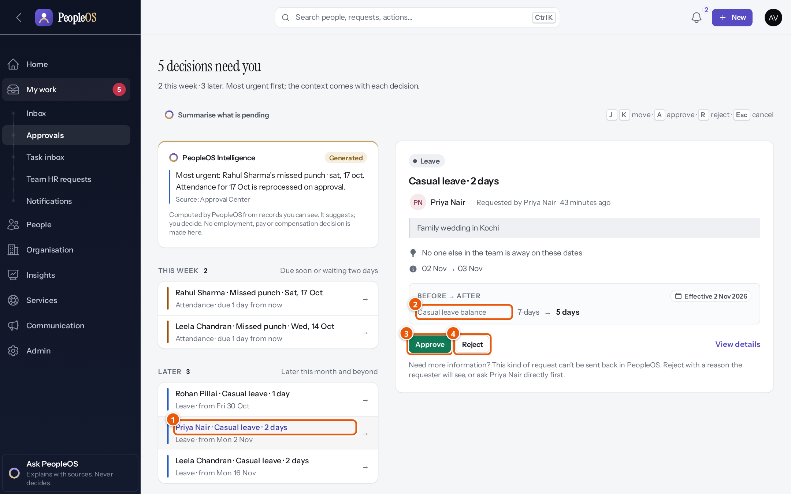
*Figure 3.5 — The Approval Center, as the manager Amit Verma sees it, with Priya Nair's leave request open. Demonstration data (fictional).*

1. **The request in the queue** — decisions are grouped by urgency (here **This week** and **Later**), most urgent first.
2. **Before → After** — the balance before and after approval, with the **Effective** date. Above it: the reason, the
   dates, and "No one else in the team is away on these dates" (or how many are away).
3. **Approve** — approves the request.
4. **Reject** — rejects it; you must give a reason the employee will see.

Keyboard shortcuts are shown at the top right: **J**/**K** to move, **A** to approve, **R** to reject, **Esc** to cancel.
A request cannot be sent back for changes: reject it with a reason, or talk to the person first.

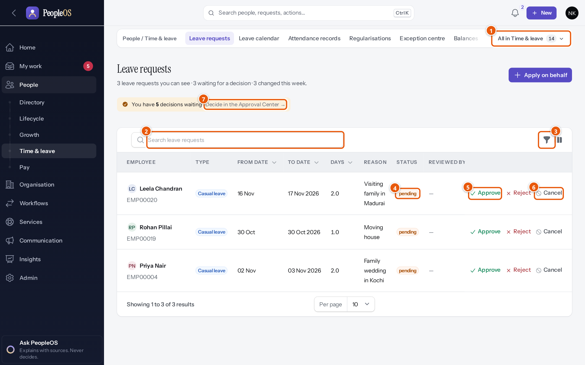
*Figure 3.6 — Leave requests as the HR Manager Neha Kapoor sees it. Demonstration data (fictional).*

1. **All in Time & leave** — the menu listing the rest of the Time & leave modules (the number is how many you may open).
2. **Search** — find requests by employee name.
3. **Filters** — **Status** (Pending, Approved, Rejected, Cancelled), **Type**, **Department** and **Period** (from, until).
4. **Status** — the request's status (see [Statuses explained](#statuses-explained)).
5. **Approve** and **Reject** — shown on pending requests to people allowed to decide them.
6. **Cancel** — shown to HR on open requests, and to employees on their own requests.
7. **Decide in the Approval Center →** — opens the Approval Center.

The columns are **Employee** (with the employee code), **Type**, **From date**, **To date**, **Days**, **Reason**,
**Status** and **Reviewed by**; **Requested** (the date it was made) can be switched on from the columns button. The
**Apply on behalf** button at the top right is shown to HR, but see the note below. On requests whose cancellation
is waiting for a decision, approvers also see **Approve cancellation** and **Keep leave**.

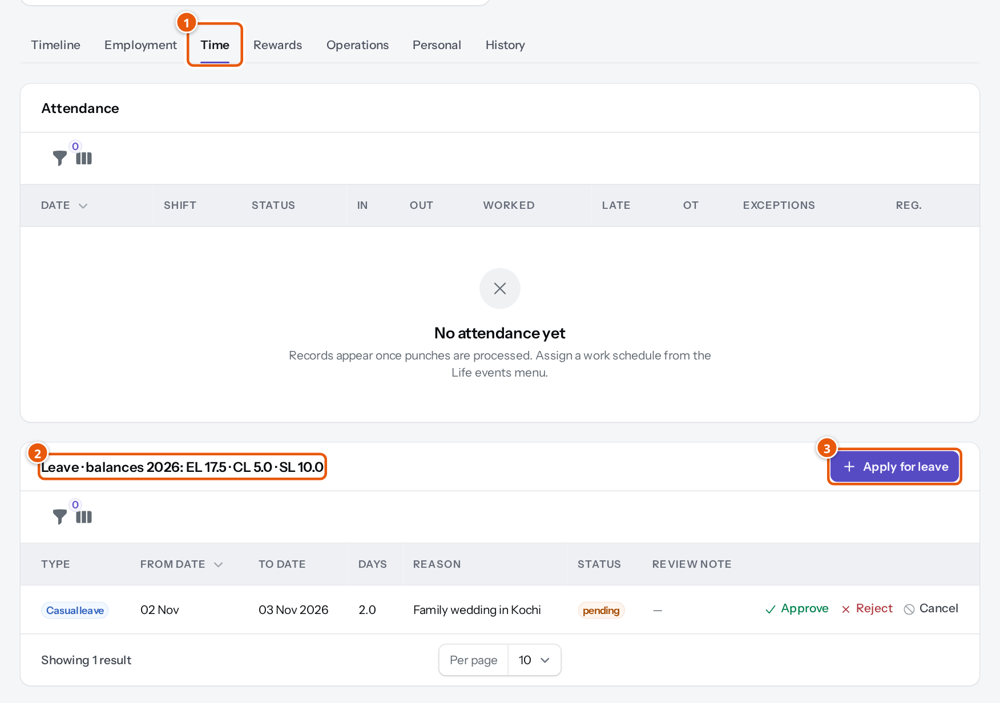
*Figure 3.7 — Employee 360 › Records › Time: attendance, then the Leave section with this year's balances and Apply for leave. Demonstration data (fictional).*

1. **Time** — the tab on the person's record that holds **Attendance** and **Leave**.
2. **Leave · balances** — this year's available balance per leave type, for example "EL 17.5 · CL 5.0 · SL 10.0".
3. **Apply for leave** — request leave for this person (HR), or for yourself on your own record.

### Tasks

#### Task: Approve or reject leave in the Approval Center

**Purpose:** decide a leave request with all the context in one place.
**Before you start:** you need the Manager, HR Manager or Tenant HR Admin role.

1. Open **My work › Approvals** (or click **Review** next to the request on Home).
2. Click the request in the queue. Read the reason, the team overlap and **Before → After**.
3. Click **Approve**, or click **Reject** and type a reason.
4. What happens next:
   - **Approve:** the request becomes **approved**. The days are deducted from the balance (a "usage" entry in
     **Transactions**), the person's timeline records the leave, and attendance for any past days in the request is
     recalculated as leave.
   - **Reject:** the request becomes **rejected** and the reserved days are released.

**Expected result:** "Leave approved" or "Leave rejected"; the item leaves your queue.
**How to verify:** in **Leave requests** the status has changed and **Reviewed by** shows your name.
**If it fails:** "Add a reason so the requester knows what to do next." — a rejection needs a reason. "This request
has already been decided." — someone else decided first. "Insufficient Casual leave balance: …" — another approval
or an adjustment has used the balance since the request was made; check **Balances** with HR. "This item is no longer
waiting for your decision." — refresh the page.

#### Task: Approve or reject from the Leave requests register

1. Open **People › Time & leave › Leave requests**.
2. On a **pending** request, click **Approve** (you may add a **Note**) or **Reject** (a **Note** is required).
3. Click **Submit**.

**Expected result:** "Leave approved" or "Leave rejected".

#### Task: Decide on a cancellation request

**Purpose:** some leave types need approval before approved leave can be cancelled.

1. Open the request in the **Approval Center** (titled "Cancel Casual leave · 2 days", for example) or in **Leave requests**.
2. Click **Approve cancellation** to cancel the leave and return the days, or **Keep leave** (with a reason) to keep it approved.

**Expected result:** "Cancellation approved; balance restored" or "Cancellation rejected; leave stays approved" (in the
Approval Center: "Cancellation approved" or "Leave kept").

#### Task: Apply for leave on someone's behalf (HR)

**Purpose:** record leave for an employee who cannot do it themselves, for example sick leave reported by phone.
**Before you start:** you need the HR Manager or Tenant HR Admin role.

1. Open the person's **Employee 360** (search for them, or **People › Directory**).
2. Click **Records**, then the **Time** tab, and scroll to the **Leave** section.
3. Click **Apply for leave** and fill in the same fields as the employee form: **Leave type**, **From date**,
   **To date**, **Start**, **End**, **Reason**, optional **Supporting document**.
4. Click **Submit**.

**Expected result:** "Leave requested: N day(s)". The request follows the same rules and approvals as any other.

> **Important:** The **Apply on behalf** button on the Leave requests page currently fails with an error when opened
> (in the version documented here). Use the Employee 360 route above until Markedge fixes it.

#### Task: Cancel someone's leave (HR)

1. In **Leave requests**, click **Cancel** on the request.
2. Enter a **Reason** and click **Confirm**.

HR can cancel approved leave whatever the leave type's cancellation setting, except for days already locked by payroll.

### Statuses explained

The status badges show the values exactly as below.

| Status | Meaning | What happens next |
|---|---|---|
| **pending** | Waiting for a decision. The days are reserved (shown as **Pending** in Balances) and block overlapping requests | Approve, reject, or cancel by the employee or HR |
| **approved** | Leave granted. The days are deducted from the balance and attendance shows the days as leave | The employee or HR can cancel it (subject to the leave type's setting) |
| **rejected** | Refused, with the approver's note. The reserved days are released | Nothing; the employee may submit a new request |
| **cancelled** | Withdrawn while pending, or cancelled after approval (the days are returned with a reversal entry) | Nothing |
| **cancel_requested** | The employee asked to cancel approved leave of a type that needs approval. The leave still counts | **Approve cancellation** (becomes cancelled) or **Keep leave** (stays approved) |

> **Note:** The **Status** filter in Leave requests offers Pending, Approved, Rejected and Cancelled only. To find
> cancellation requests, use the Approval Center or the Leave calendar's **Cancellation requested** filter.

**Flowchart — Requesting and approving leave.** How a leave request moves from the form to a decision. *Roles:*
employee, manager or HR. *Starts:* the employee clicks **Request leave**. *Ends:* the request is approved, rejected or
cancelled.

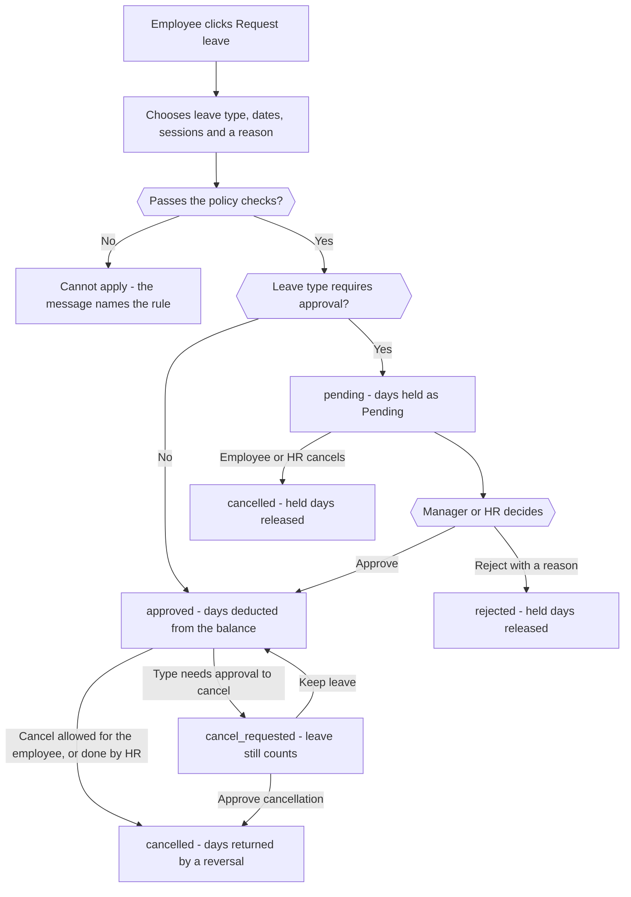

The policy checks are: the leave type is active and applies to the person, a leave policy grants it, the person's
employment stage and length of service allow it, half days are allowed, the notice period, the maximum consecutive
days, any document rule, no overlap with other leave, no payroll-locked days, and enough balance.

### Example from everyday work

*Illustrative scenario.* On Monday morning Amit Verma opens **My work › Approvals** and sees five decisions. Priya
Nair's casual leave shows that nobody else in the Platform team is away on 2 and 3 November and that her balance will
go from 7 to 5 days. He presses **A** to approve. Later that week Neha Kapoor in HR gets a call from Rohan Pillai, who
is unwell; she opens Rohan's Employee 360, goes to **Records › Time** and clicks **Apply for leave**.

### Related modules

- **[Approval Center](01-workspace-and-self-service.md#approvals-approval-center)** — everything else that waits for you.
- **[Leave calendar](#leave-calendar)** — check who else is away before you approve.
- **[Notification rules](07-services-and-communication.md#notification-rules-templates-and-the-delivery-log)** —
  whether e-mails are sent when leave is requested or decided depends on these rules.

> **Note:** The request form says "Your manager is notified when you submit." The request always appears in the
> manager's Approval Center and on their Home straight away. Whether an e-mail or in-app message is also sent depends
> on the notification rules your administrator sets up for leave events.

---

## Leave calendar

**Status:** Available (a list of absences; a calendar grid view is not available yet)

### Overview

The leave calendar answers "who is away, and when?" for the people you may see. It lists approved leave, pending
requests and cancellation requests. It never shows the reason for the leave, so it is safe to share with the team.

### Where to find it

- **Menu path:** **People › Time & leave › Leave calendar** (managers also find **Team leave calendar** under **Start
  something** on Home).
- **Who can open it:** Manager, HR Executive, HR Manager, Attendance Admin, Payroll Admin, Auditor, Tenant HR Admin,
  Tenant Super Admin. Employees without these roles cannot open it.

### The screen at a glance

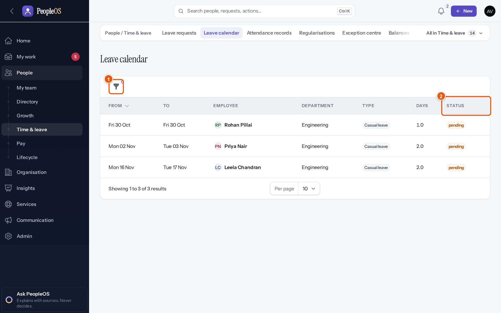
*Figure 3.8 — The leave calendar for the manager's team. Demonstration data (fictional).*

1. **Filters** — the date window (by default from the start of this month to the end of next month), **Status**
   (Approved, Pending, Cancellation requested), **Type** and **Department**.
2. **Status** — whether the absence is approved or still pending.

The columns are **From**, **To**, **Employee**, **Department**, **Type**, **Days** and **Status**. When nobody is away in
the window, the page says "Nobody is away in this window".

### Tasks

#### Task: See who is away next month

1. Open **People › Time & leave › Leave calendar**.
2. Open the filters and set **From** and **Until** to the month you want. Choose a **Department** if needed.
3. Read the list, sorted by start date.

**Expected result:** every approved or pending absence in that window for the people you may see.

---

## Leave balances, transactions and encashments

**Status:** Available with limitations — encashment amounts are not calculated, and employees cannot request
encashment themselves (HR records it).

### Overview

**Balances** shows, for each person, leave type and leave year, how many days were credited, used, reserved and left.
Balances are never typed in directly. They are calculated from **Transactions**, the leave ledger, where every
movement is recorded with its date and note. HR corrects a balance by posting an adjustment, which becomes a new
ledger entry with the reason. **Encashments** lists leave days that HR has converted into pay.

### Where to find it

- **Menu path:** **People › Time & leave › Balances**; **People › Time & leave › All in Time & leave › Transactions**;
  **People › Time & leave › All in Time & leave › Encashments**.
- **Who can open it:** Balances and Transactions — Employee (own), Manager, HR Executive, HR Manager, Attendance Admin,
  Payroll Admin, Auditor, Tenant HR Admin, Tenant Super Admin. Encashments — the same roles except Employee.
  **Adjust**, **Encash** and **Run accrual now** need HR Manager or Tenant HR Admin.

### The screen at a glance

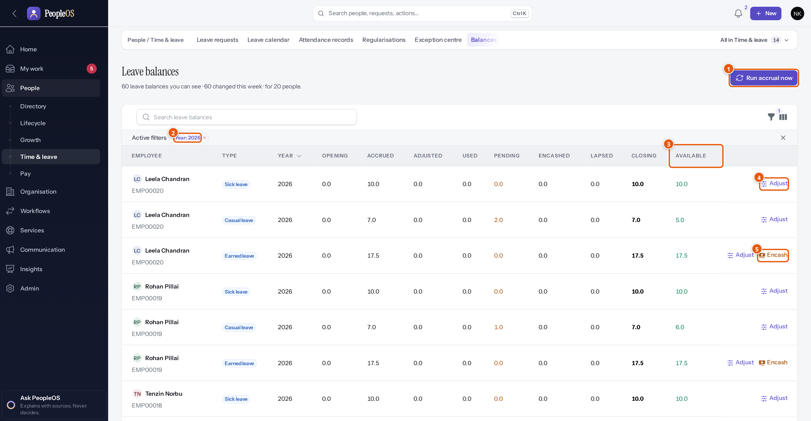
*Figure 3.9 — Leave balances, as HR sees them, for the current year. Demonstration data (fictional).*

1. **Run accrual now** — posts every accrual that is due up to today for all employees ("Safe to repeat."). PeopleOS
   also does this every night by itself.
2. **Year** — the leave year shown (the current year by default). You can also filter by **Type**.
3. **Available** — what the person can still request: **Closing** minus **Pending**.
4. **Adjust** — add or remove days with a note.
5. **Encash** — record encashment of days (shown only for encashable leave types with an available balance).

The columns are **Employee**, **Type**, **Year**, **Opening** (opening balance plus days carried forward), **Accrued**
(credits, including compensatory-off credits), **Adjusted**, **Used** (approved leave minus reversals), **Pending**
(requests waiting for a decision), **Encashed**, **Lapsed** (days lost at year end or when carried days expire),
**Closing** and **Available**.

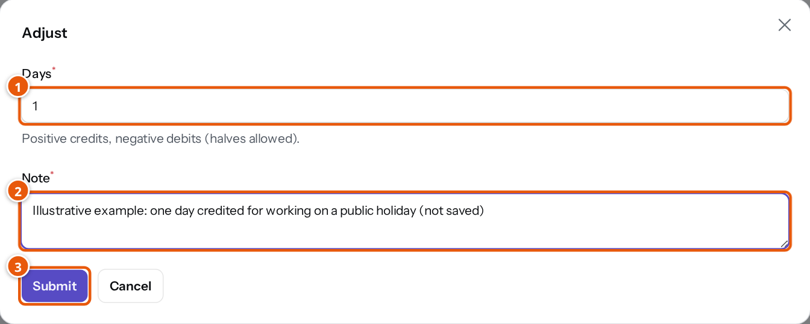
*Figure 3.10 — The Adjust form. Demonstration data (fictional; not saved).*

1. **Days** (required) — "Positive credits, negative debits (halves allowed)."
2. **Note** (required) — why you are adjusting. It is kept on the ledger entry and in the audit trail.
3. **Submit** — posts the adjustment.

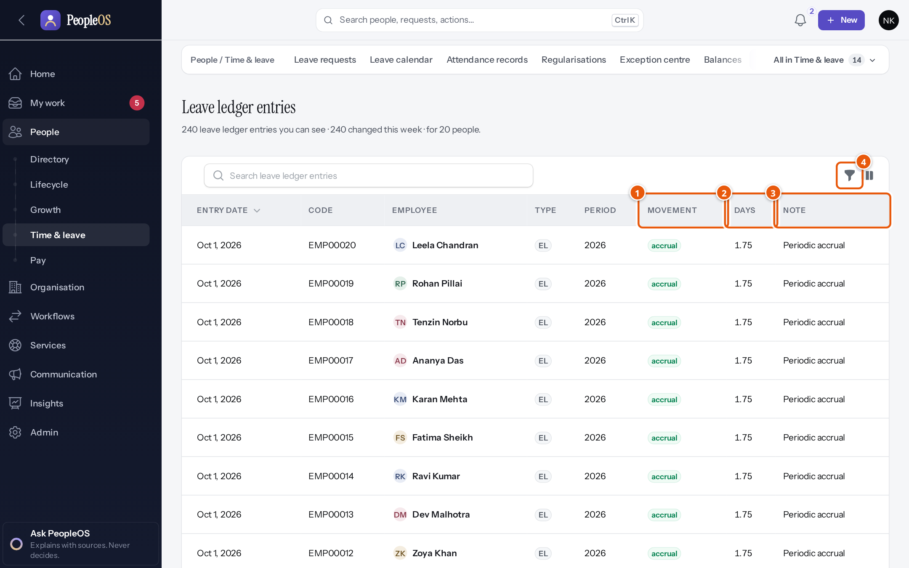
*Figure 3.11 — Transactions (the page is headed "Leave ledger entries"): monthly earned-leave accruals of 1.75 days. Demonstration data (fictional).*

1. **Movement** — the kind of entry (see the table below).
2. **Days** — positive for credits, negative for debits.
3. **Note** — for example "Periodic accrual", "Annual credit", the leave reason, or "Cancelled: …".
4. **Filters** — **Movement**, **Type** and **Period** (leave year).

The other columns are **Entry date**, **Code** (employee code), **Employee**, **Type** (leave type code) and **Period**.
Transactions is read-only: nobody can edit or delete an entry.

| Movement | When it is posted | Effect on the balance |
|---|---|---|
| **opening** | A starting balance for a leave year | Credit |
| **accrual** | Entitlement credited (at year start, or monthly or quarterly) | Credit |
| **comp_off_credit** | Compensatory off credited | Credit |
| **adjustment** | HR used **Adjust** | Credit or debit |
| **usage** | A leave request was approved | Debit |
| **reversal** | Approved leave was cancelled | Credit (gives the days back) |
| **carry_forward** | Unused days moved into the new leave year, up to the policy's limit | Credit in the new year |
| **lapse** | Unused days beyond the carry-forward limit at year end | Debit |
| **expiry** | Carried-forward days not used within the policy's expiry period | Debit |
| **encashment** | An encashment was recorded | Debit |

### How a leave balance is calculated

**Flowchart — How a leave balance is calculated.** Every number in Balances is the sum of ledger entries for one
person, leave type and leave year. *Roles:* none (automatic). *Starts:* any ledger entry. *Ends:* the Available figure
the employee sees.

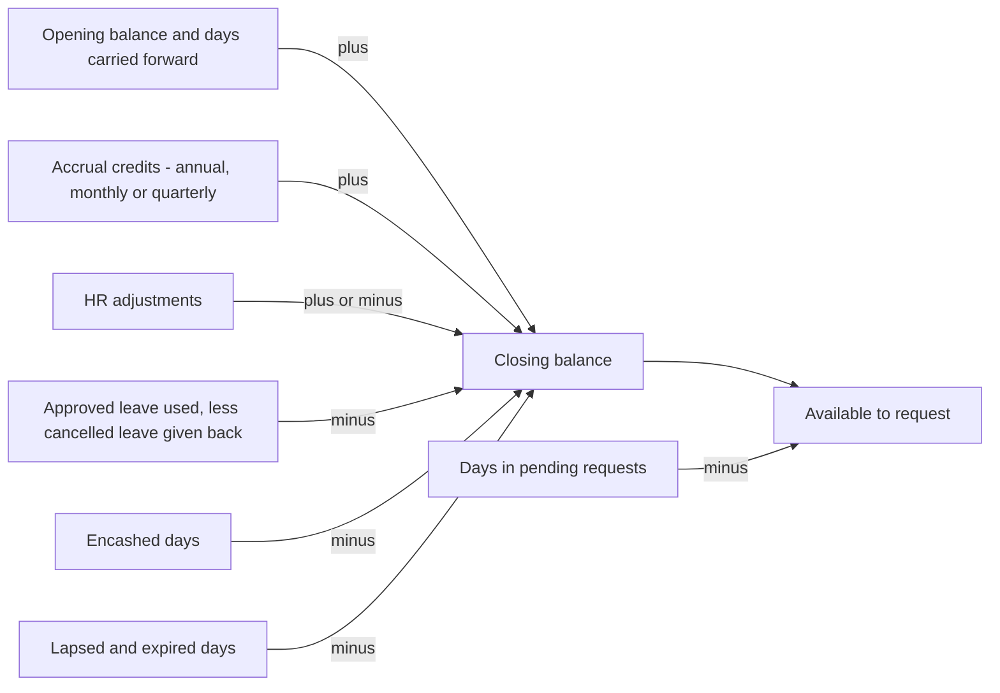

What happens automatically, every night:

- **Accrual.** Each leave type in a person's leave policy is credited: the full **Days per year** at the start of the
  leave year (**Annual**), or one twelfth each month (**Monthly**), or one quarter each quarter (**Quarterly**). Someone
  who joins during the year gets a pro-rated amount when the policy says so (by remaining months or remaining days).
  An accrual is never posted twice, however often it runs.
- **Year end.** On the first night of a new leave year, unused days are carried forward up to the policy's
  **Carry-forward limit** and the rest lapse. If the policy sets an expiry, carried days not used within that many
  months expire.

### Tasks

#### Task: Adjust a balance

**Purpose:** correct a balance, or give extra days (for example a day credited for working on a holiday).
**Before you start:** you need the HR Manager or Tenant HR Admin role. The person must already have a balance row for
that leave type and year.

1. Open **People › Time & leave › Balances**. Use **Search**, **Type** and **Year** to find the row.
2. Click **Adjust**.
3. Enter **Days** (for example 1, -0.5) and a **Note**.
4. Click **Submit**.

**Expected result:** "Balance adjusted". **Adjusted**, **Closing** and **Available** change, and a new **adjustment**
entry appears in **Transactions** with your note.
**If it fails:** "Adjustment must not be zero."

#### Task: Record an encashment

**Purpose:** convert unused leave into pay where your policy allows it.

1. In **Balances**, click **Encash** on the person's row (only for encashable leave types such as Earned leave).
2. Enter **Days** (at least 0.5) and an optional **Reason**.
3. Click **Submit**.

**Expected result:** "Encashment recorded". The encashment is recorded and approved in one step (note "Approved by HR"),
the balance goes down, and the encashment is listed in **Encashments** with status **approved**.
**If it fails:** "Earned leave cannot be encashed." (the leave type or the policy does not allow it); "At most 10 day(s)
may be encashed per year." (the policy's yearly maximum); "Not enough balance to encash."

> **Important:** PeopleOS records the encashed days but does not calculate the amount or add it to a payroll run in
> this release. Your payroll team pays it. (Encashment on leaving is part of the full and final settlement; see
> [Exit cases](02-people-and-employee-lifecycle.md#exit-cases-clearance-and-full-and-final-settlement).)

The **Encashments** screen lists **Employee**, **Type**, **Year**, **Days**, **Reason**, **Status** (pending, approved,
rejected, paid) and **Reviewed by**, with a **Status** filter. **Approve** and **Reject** appear only on pending
encashments; the screens described here record encashments as already approved.

#### Task: Run accrual now

1. In **Balances**, click **Run accrual now** and then **Confirm**.
2. PeopleOS reports how many entries it posted (for example "0 accrual entries posted" if everything was already up to date).

Use it after you change a leave policy or add employees, if you do not want to wait for the nightly run.

> **Note:** There is no screen for importing opening balances in this release. You can enter a starting balance with
> **Adjust** (it is recorded as an adjustment), or ask Markedge (your provider) about other options. Compensatory-off
> credits are supported by the leave engine but cannot be posted from a dedicated screen.

### Example from everyday work

*Illustrative scenario.* Leela Chandran asks HR why her casual leave shows 5 available when she was given 7. Neha
Kapoor opens **Balances**, filters by Leela, and sees **Accrued** 7.0 and **Pending** 2.0: Leela's request for 16 and
17 November is still waiting for approval. Nothing needs correcting.

---

## Leave types and the leave policy

**Status:** Available

### Overview

A **leave type** is a kind of leave you offer, such as Earned leave or Sick leave. It says whether the leave is paid,
whether half days are allowed, whether it can be encashed, whether it needs approval and who may cancel it once
approved. Every new organisation starts with nine types: Earned leave (EL), Casual leave (CL), Sick leave (SL),
Maternity leave (ML), Paternity leave (PL), Bereavement leave (BL), Compensatory off (CO), Restricted holiday (RH) and
Leave without pay (LWP). You can change them and add your own.

How many days people get is decided by a **leave policy**, not by the leave type. A leave policy is a policy of type
**Leave policy** under **Workflows › Policies**. It has one entitlement row per leave type, and assignment rules decide
who it applies to (for example "Location is Delhi"). Policy editing is described in
[Policies](09-administration-and-security.md#policies); this section explains what the settings mean for leave.

### Where to find it

- **Menu path:** **People › Time & leave › All in Time & leave › Leave types**; **Workflows › Policies**.
- **Who can open it:** Leave types — everyone with a leave role (view); HR Manager and Tenant HR Admin can create and
  edit. Policies — Tenant HR Admin and Tenant Super Admin edit; HR Manager, Attendance Admin, Account Owner and Auditor
  can read.

### The screen at a glance

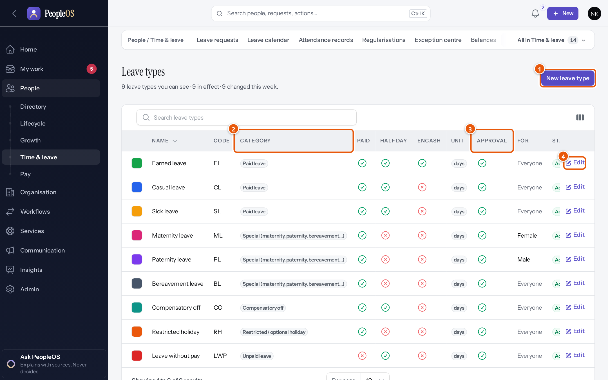
*Figure 3.12 — The nine starting leave types. Demonstration data (fictional).*

1. **New leave type** — opens the **Create Leave Type** form.
2. **Category** — Paid leave, Unpaid leave, Compensatory off, Restricted / optional holiday, or Special (maternity,
   paternity, bereavement…).
3. **Approval** — whether requests of this type need approval.
4. **Edit** — change the type (a **Reason for change** is recorded).

The other columns are the colour, **Name**, **Code**, **Paid**, **Half day**, **Encash**, **Unit**, **For** (Everyone,
or one gender) and **Status**.

**The leave type form.** **Name** and **Code** are required (the code cannot be changed later). **Category** is required.
**Applicable gender** (Everyone by default). Switches: **Paid**, **Half days allowed**, **Encashable**, **Supporting
document always required**, **Requires approval**. **Description**. **Unit** (Days or Hours: "Hourly requests are not
available yet; hour-based types can be configured for later use."). **Minimum per request** and **Maximum per
request** (days). **Cancelling approved leave**: **Employee may cancel**, **Cancellation needs approval** or **Only HR may
cancel**. **Effective from** and **Effective to**. **Colour**, **Sort order** and **Status** (Active, Inactive).

**The leave policy's entitlement settings** (one row per leave type):

| Setting | What it decides |
|---|---|
| **Leave type** and **Days per year** | Which leave and how many days a year |
| **Accrual** | **Annual (credited at year start)**, **Monthly** or **Quarterly** |
| **Pro-rate in the joining year** and **Pro-ration basis** | Whether joiners get a part-year amount, by **Remaining months** or **Remaining days** (or **No pro-ration**) |
| **Available** and **N (days or months)** | **Immediately**, **After N days of service**, **After N months of service** or **After confirmation** |
| **Carry-forward limit (days)** and **Carried days expire after (months, 0 = never)** | What moves into the next leave year, and for how long |
| **Encashment allowed** and **Max encashable days per year** | Whether and how much can be encashed |
| **Available during probation** | Whether people on probation may take it |
| **Negative balance allowed up to (days)** | How far below zero a balance may go |
| **Half days allowed** | Half days for this policy (the leave type must allow them too) |
| **Minimum notice (days)** | How far ahead the leave must be requested |
| **Maximum consecutive days (0 = no limit)** | The longest single request |
| **Document required beyond (days, 0 = never)** | When a supporting document becomes mandatory |

Two settings apply to the whole policy: **Count weekly offs inside a leave span** and **Count holidays inside a leave
span**. Both are off by default, so weekends and holidays inside a leave request are not deducted.

In the demonstration, the **Standard leave** policy gives Earned leave 21 days a year (monthly, not during probation,
1 day's notice, up to 30 days carried forward, up to 10 days encashable), Casual leave 7 days (annual, at most 3
consecutive days, 1 day's notice) and Sick leave 10 days (annual, a document beyond 2 days).

### Tasks

#### Task: Add a new leave type

**Before you start:** you need the HR Manager or Tenant HR Admin role.

1. Open **People › Time & leave › All in Time & leave › Leave types** and click **New leave type**.
2. Enter **Name** and **Code**, and choose **Category** and **Unit** (Days).
3. Set the switches (**Paid**, **Half days allowed**, **Encashable**, **Requires approval**, **Supporting document
   always required**) and **Cancelling approved leave**.
4. Optionally set **Minimum per request**, **Maximum per request**, **Applicable gender**, effective dates and **Colour**.
5. Click **Create**.
6. Ask your Tenant HR Admin to add an entitlement row for the new type to the right leave policy (new draft, edit,
   publish) — see [Policies](09-administration-and-security.md#policies).

**Expected result:** the type appears in the list. Employees see it in **Request leave** only once a leave policy that
applies to them grants it (Leave without pay and other unpaid types are always offered).
**Common mistakes:** creating the type but forgetting the policy entitlement; using the Hours unit (requests are refused:
"… is configured in hours; hourly leave requests are not available yet.").

> **Tip:** Changes to a leave policy create a new version from an effective date. Past ledger entries are never
> rewritten; accruals and requests use the version in force on their own date.

---

## Attendance for employees: checking in and fixing attendance

**Status:** Available

### Overview

Employees record their day with **Check in** and **Check out** in the browser (where your organisation uses this
instead of, or as well as, a device). If a day is wrong — a forgotten punch, a day worked from home, a client visit — the
employee asks for a correction. The manager or HR approves it and PeopleOS recalculates the day.

### Where to find it

- **Menu path:** **Home** (Your day: **Check in**; Start something: **Fix my attendance**); avatar menu › **My day**
  (**Check in**, **Regularise attendance**); your own records: **People › Time & leave › Attendance records** and
  **Regularisations**.
- **Who can open it:** anyone with the Employee role (their own records only).
- **Set-up needed first:** a work schedule that applies to you, so PeopleOS knows your shift.

### The screen at a glance

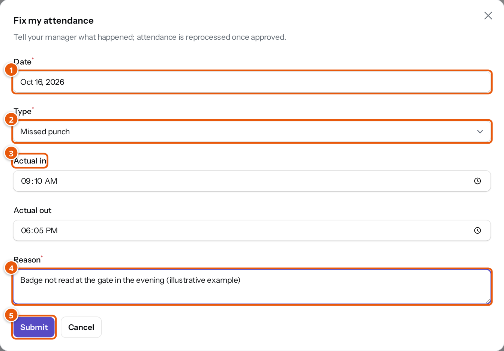
*Figure 3.13 — The Fix my attendance form on Home. Demonstration data (fictional; not submitted).*

1. **Date** (required) — the day to correct (today or earlier; yesterday by default).
2. **Type** (required) — **Missed punch**, **Late coming**, **Early leaving**, **Work from home**, **On duty**, **Field
   duty** or **Marked absent by mistake**.
3. **Actual in** and **Actual out** — the real times, when you know them.
4. **Reason** (required) — what happened.
5. **Submit** — sends the request to your manager.

### Tasks

#### Task: Check in and check out

1. On **Home** under **Your day** (or on **My day**), click **Check in** when you start work.
2. Click **Check out** when you leave.

**Expected result:** a message "Checked in" (or "Checked out") with the time; Home shows "Checked in at 09:05".
The punch is stored and your day is recalculated.

#### Task: Ask for an attendance correction

**Purpose:** correct a day that is wrong, for example a missed punch.
**Before you start:** corrections are accepted only for recent days — 7 days back by default, or the window set in your
attendance policy.

1. On **Home**, click **Fix my attendance** (or avatar menu › **My day** › **Regularise attendance**).
2. Choose the **Date** and the **Type**.
3. Enter **Actual in** and **Actual out** if you know them, and a **Reason**.
4. Click **Submit**.

**Expected result:** "Correction sent to your manager" (on My day: "Regularisation requested"). The request is
**pending** and appears on Home under **My requests** as "Attendance correction · 17 Oct — Waiting for your manager".
**If it fails** (title **Cannot request**):
- "Regularisation is only allowed within 7 days." — the day is too old; contact HR.
- "A request for this date is already pending." — wait for the first request to be decided.
- "This day is locked for payroll." — payroll has been finalised for that day; contact HR.
- "Regularisation is not allowed under the applicable attendance policy." — your organisation does not allow corrections.

You can also click **Regularise** on a row in **Attendance records** (fields **Type**, **In**, **Out**, **Reason**).

> **Note:** Once sent, a correction request cannot be withdrawn from the screens in this release. If you made a
> mistake, ask your manager to reject it, then send a new one.

---

## Attendance records and the exception centre

**Status:** Available

### Overview

PeopleOS builds one **attendance record** per person per day. It looks at the person's shift for that date, the
holiday calendar, approved leave, approved corrections, the attendance and overtime policies, and the punches inside
the shift's time window. It then sets a status, the first-in and last-out times, worked minutes, late minutes,
overtime and any exceptions. Days are processed automatically when punches arrive and again every night for the
previous day. The **Exception centre** lists the recent days that need someone to look at them.

Days that payroll has finalised are locked and are never recalculated.

### Where to find it

- **Menu path:** **People › Time & leave › Attendance records**; **People › Time & leave › Exception centre**. Each
  person's days are also on their Employee 360 › **Records** › **Time** › **Attendance**.
- **Who can open it:** Attendance records — Employee (own), Manager, HR Manager, Attendance Admin, Payroll Admin,
  Auditor, Tenant HR Admin, Tenant Super Admin. Exception centre — the same roles except Employee. **Manual punch**,
  **Process day** and **Reprocess** need Attendance Admin or Tenant HR Admin.

### The screen at a glance

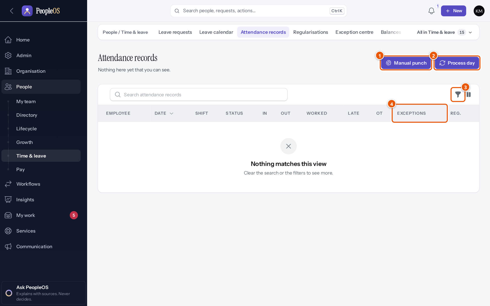
*Figure 3.14 — Attendance records as the Tenant HR Admin sees them. The demonstration has no punches yet, so the list is empty. Demonstration data (fictional).*

1. **Manual punch** — record a punch by hand for an employee, with a required **Note** ("Why this punch is being
   recorded by hand."). Fields: **Employee**, **Punched at**, **Direction** (Auto, In, Out).
2. **Process day** — recalculate one **Date** for every employed person.
3. **Filters** — **Date** (from the start of this month by default), **Status** and **Department**.
4. **Exceptions** — what is wrong with the day, if anything.

The columns are **Employee**, **Date**, **Shift**, **Status**, **In**, **Out**, **Worked** (hours:minutes), **Late**
(minutes), **OT** (approved / calculated minutes), **Exceptions** and **Reg.** (whether the day was regularised). Row
actions: **Regularise**, **Approve OT**, **Reject OT** and **Reprocess**, each shown only to people allowed to use it.

*Figure 3.15 — The exception centre. Demonstration data (fictional).*

1. **Counts for the last 30 days** — **Exceptions (30d)**, **Missing punch**, **Late**, **Absent**, **OT pending**,
   **Regularisations** (waiting for a decision) and **Failed punches**.
2. **Filters** — **Date** (the last 30 days by default) and **Exception** (one exception type).
3. **The list** — the same columns and row actions as Attendance records, for days with exceptions only. When there
   are none: "No attendance exceptions".

### Attendance statuses and exceptions

| Status | Meaning |
|---|---|
| **Present** | Worked at least the shift's full day |
| **Half day** | Worked some time, but less than the shift's full day |
| **Absent** | No punches on a working day, and no leave |
| **Incomplete (missed punch)** | Only an in or only an out punch |
| **Weekly off** | A day off in the work schedule |
| **Holiday** | A holiday on the person's holiday calendar |
| **Leave** / **Leave without pay** | Approved paid or unpaid leave for the full day |
| **Work from home**, **On duty**, **Field duty** | Set by an approved correction of that type |
| **Not processed** | The day has not been calculated yet |

| Exception | Meaning |
|---|---|
| **Missed punch**, **Missing IN punch**, **Missing OUT punch**, **Invalid punch sequence** | The punches do not make a complete day |
| **Late coming** / **Early leaving** | Arrived after the shift start plus grace time, or left before the end minus grace |
| **Short hours** | Worked less than the shift's full day |
| **Absent without leave** | Absent on a working day |
| **No shift assigned** | No work schedule applies to the person |
| **Worked on holiday / weekly off** | Punches on a holiday or day off |
| **Overtime pending approval** | Overtime waiting for a decision |

**Flowchart — From punch to attendance record to exception and regularisation.** *Roles:* employee, manager or HR,
attendance administrator. *Starts:* a punch arrives. *Ends:* the day is complete, or corrected and recalculated.

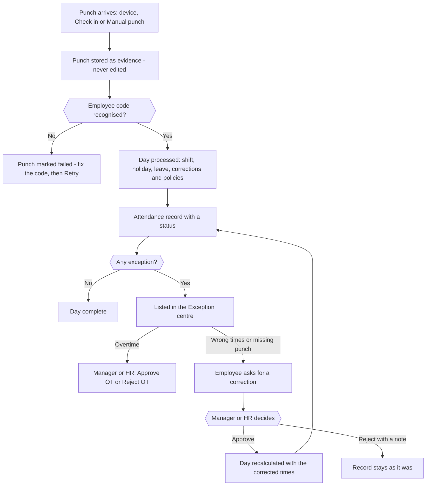

### Tasks

#### Task: Review exceptions

1. Open **People › Time & leave › Exception centre**.
2. Use the **Exception** filter to focus on one kind, for example **Missing OUT punch**.
3. For each day, ask the employee to send a correction, or (with Attendance Admin or Tenant HR Admin) click
   **Regularise** to correct it yourself.

**Expected result:** corrected days disappear from the list once recalculated without exceptions.

> **Important:** When someone with Attendance Admin or Tenant HR Admin rights clicks **Regularise** on another
> person's day, the correction is applied immediately ("Regularised and reprocessed", noted "Applied by HR"); it does not
> wait for approval. Use it only when you have the evidence.

#### Task: Approve or reject overtime

**Before you start:** you need Manager, HR Manager, Attendance Admin or Tenant HR Admin, and the day must not be your own.

1. Find the day in **Exception centre** or **Attendance records** (the **OT** column shows, for example, "0/45 m").
2. Click **Approve OT**, check **Minutes** ("Recorded: 45 minutes"; you cannot approve more than recorded) and add an
   optional **Note**, then **Submit**. Or click **Reject OT** and give a **Reason**.

**Expected result:** "Overtime approved" or "Overtime rejected". The overtime exception is cleared and payroll sees the
approved minutes.

#### Task: Record a manual punch

**Purpose:** add a punch the device missed, with an explanation.
**Before you start:** you need Attendance Admin or Tenant HR Admin.

1. In **Attendance records**, click **Manual punch**.
2. Choose the **Employee**, set **Punched at** and **Direction**, and type a **Note**.
3. Click **Submit**.

**Expected result:** "Punch recorded and day reprocessed" (or "Duplicate punch ignored" if the same punch already exists).

#### Task: Process a day again

1. In **Attendance records**, click **Process day**, choose the **Date** and click **Submit**.

**Expected result:** "N employee(s) processed for 2026-10-18" (with your date). Use it after you change a shift, a work
schedule or a holiday that affects past days. For one person's day, use **Reprocess** on the row.

---

## Regularisations and overtime approval

**Status:** Available

### Overview

**Regularisations** lists attendance correction requests and their decisions. The person who reviews each request is
recorded, and nobody can review their own request. Approving a request recalculates the day and keeps a copy of how
the day looked before and after. Managers usually decide these in the **Approval Center**, where corrections are due
within two days and those for days more than 20 days old are marked "Close to the payroll cut-off".

### Where to find it

- **Menu path:** **People › Time & leave › Regularisations**; **My work › Approvals**.
- **Who can open it:** Employee (own requests), Manager, HR Manager, Attendance Admin, Payroll Admin, Auditor, Tenant HR
  Admin, Tenant Super Admin. Deciding needs Manager (team), HR Manager, Attendance Admin or Tenant HR Admin.

### The screen at a glance

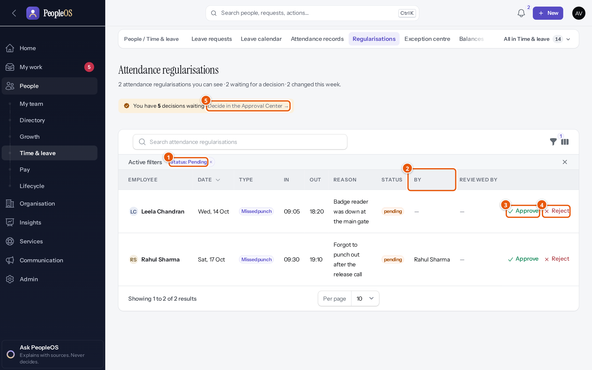
*Figure 3.16 — Regularisations as the manager sees them, filtered to pending requests. Demonstration data (fictional).*

1. **Status: Pending** — the default filter. Remove it to see approved, rejected and cancelled requests too.
2. **By** — who sent the request. **Reviewed by** shows who decided it.
3. **Approve** — approve and recalculate the day (an optional **Note**).
4. **Reject** — reject with a required **Note**.
5. **Decide in the Approval Center →** — the same decisions with more context.

The columns are **Employee**, **Date**, **Type**, **In**, **Out** (the requested times), **Reason**, **Status**, **By**
and **Reviewed by**. The menu shows a badge with the number of pending requests.

### Tasks

#### Task: Approve or reject a correction

1. Open **People › Time & leave › Regularisations** (or **My work › Approvals**).
2. Check the requested **In** and **Out** times and the **Reason**.
3. Click **Approve** (optionally add a **Note**) or **Reject** (a **Note** is required), then **Submit**.

**Expected result:** "Approved and reprocessed" or "Rejected" (in the Approval Center: "Approved and attendance
reprocessed" or "Correction rejected"). The employee's day is recalculated with the corrected times.
**If it fails:** "You cannot review your own regularisation."; "This request has already been reviewed."

### Statuses explained

| Status | Meaning | What happens next |
|---|---|---|
| **pending** | Waiting for a decision; only one pending request per person per day | Approve or reject |
| **approved** | Accepted; the day was recalculated with the requested times or status | Nothing |
| **rejected** | Refused with the reviewer's note | The employee may send a new request |
| **cancelled** | Withdrawn by the requester (not available from the screens in this release) | Nothing |

### Example from everyday work

*Illustrative scenario.* Rahul Sharma forgot to punch out after a late release call on Saturday 17 October. On Monday he
clicks **Fix my attendance**, chooses **Missed punch**, enters 09:30 and 19:10 and explains why. His manager Amit Verma
sees "Rahul Sharma · Missed punch · Sat, 17 Oct" at the top of his Approval Center, due within a day, and approves it.

---

## Punches, devices and punch imports

**Status:** Punches — Available. Devices — Available with limitations (two connection types; connecting a device needs
technical set-up). Punch imports — Available with limitations: the **Map columns** step has a known defect, so a file
cannot get past the inspection step from the screens today. Punches from devices, the API and **Check in** are not
affected.

### Overview

Every punch, wherever it comes from, is stored once as evidence and never changed. **Punches** shows them with their
processing state. A punch whose employee code PeopleOS does not recognise is kept as **failed**, so it can be retried
once the code is fixed. **Devices** lists the punch devices (for example the biometric reader at the main gate) that
send punches to PeopleOS. Each device uses an *adapter*, the translator for its data format: **Generic JSON** or
**eSSL (push)**. **Punch imports** loads punches from a CSV file through the same checked steps as employee imports.

### Where to find it

- **Menu path:** **People › Time & leave › All in Time & leave › Punches**, **Devices** and **Punch imports**.
- **Who can open it:** Punches and Devices — Manager, HR Manager, Attendance Admin, Payroll Admin, Auditor, Tenant HR
  Admin, Tenant Super Admin (only Attendance Admin and Tenant HR Admin can add or edit devices and retry punches).
  Punch imports — Tenant HR Admin and Tenant Super Admin only.

### What you see

**Punches.** Columns **Punched at**, **Code**, **Employee** (or "Unknown: [code]" when the code was not recognised),
**Direction** (in, out or auto), **Source** (Biometric device, Mobile, Web, API, Manual, Import), **Device**,
**Processing** (received, normalized, processed, failed, ignored) and **Error**. Optional columns: **Source TZ**,
**External id**, **Received at**, and **Payload** (the raw data, for attendance administrators only). Filters:
**Processing**, **Source**, **Date**. Action: **Retry** on failed punches. The demonstration has no punches yet.

**Devices.** Columns **Name**, **Code**, **Adapter**, **Location**, **Last seen at** ("Never" until the device first
sends a punch) and **Status**. The demonstration has one device, "Delhi main gate".

| Screen | What you store there | Path | Who |
|---|---|---|---|
| Devices | One row per punch device: **Name**, **Code** ("Used in the push URL."), **Adapter**, **Location**, **Status** | All in Time & leave › Devices | Attendance Admin, Tenant HR Admin |
| Punch imports | Uploaded CSV files of punches and their progress | All in Time & leave › Punch imports | Tenant HR Admin, Tenant Super Admin |

### Tasks

#### Task: Add a device

1. Open **Devices** and click **New attendance device**.
2. Enter **Name** and **Code**, choose the **Adapter** and the **Location**, and leave **Status** on **Active**.
3. Click **Create**.

**Expected result:** the device is listed with **Last seen at** "Never". To make it send punches, the device must be
configured to send them to PeopleOS using its code and an API key that allows attendance writes. This is technical
work for your device supplier, with your administrator (see
[API keys](09-administration-and-security.md#api-keys-scim-and-the-peopleos-api)), or Markedge (your provider).

#### Task: Retry a failed punch

1. Open **Punches** and filter **Processing** to **Failed**. Read the **Error** (for example an unknown employee code).
2. Fix the cause, for example correct the employee code on the person's record.
3. Click **Retry** on the punch.

**Expected result:** "Punch queued for processing", or "Still failing" with the reason.

#### Task: Import punches from a CSV file

1. Open **Punch imports** and click **Upload punches CSV**. The form says: "CSV with a header row (employee code,
   timestamp, optional timezone/direction/external id/device)."
2. Choose the **CSV file** and click **Create**. The import page opens.
3. Click **Inspect file** to stage the rows.
4. The next steps are **Map columns** (match each column to **Employee code**, **Punch timestamp**, **Timezone**,
   **Direction (in/out)**, **External punch id** or **Device code**, and choose a **Default timezone for timestamps**),
   **Validate rows**, **Approve import** (with a reason) and **Run import**.

> **Important:** In the version documented here, **Map columns** fails with an error, so an import cannot continue
> past **Inspect file**. Until Markedge fixes it, bring punches in through a device, the API, **Check in** or
> **Manual punch**. You can remove an unfinished import with **Discard**. The import page is headed "Employee imports"
> because it shares its screen with employee imports.

---

## Shifts and work schedules

**Status:** Available

### Overview

A **shift** describes a working day: its start and end (or just a number of hours for a flexible shift), breaks,
how many minutes make a full day and a half day, the grace time before someone counts as late, and whether overtime is
counted. A **work schedule** says which shift runs on each weekday; a day left empty is a weekly off. A schedule with
several weeks rotates week by week, which covers patterns such as alternate Saturdays. Schedules reach people through
**Applies to** rules (for example "Location is Pune") or through an individual assignment on the person's record,
which always wins over the rules.

Nothing such as "8 hours is a full day" is fixed in PeopleOS: every threshold is set on the shift.

### Where to find it

- **Menu path:** **People › Time & leave › All in Time & leave › Shifts** and **Work Schedules**. Individual
  assignment: Employee 360 › **Action** › **Assign work schedule**.
- **Who can open it:** Manager, HR Manager, Attendance Admin, Payroll Admin, Auditor, Tenant HR Admin, Tenant Super
  Admin. Only Attendance Admin and Tenant HR Admin (and Tenant Super Admin) can create and edit.

### The screen at a glance

The **Shifts** list shows **Name**, **Code**, **Timing** (for example "09:00 – 18:00", "22:00 – 07:00 (+1)" or
"Flexible · 8 h"), **Full day**, **Grace**, **OT** and **Status**. The demonstration has General (09:00–18:00), Night
(22:00–07:00) and Flexible (8 h).

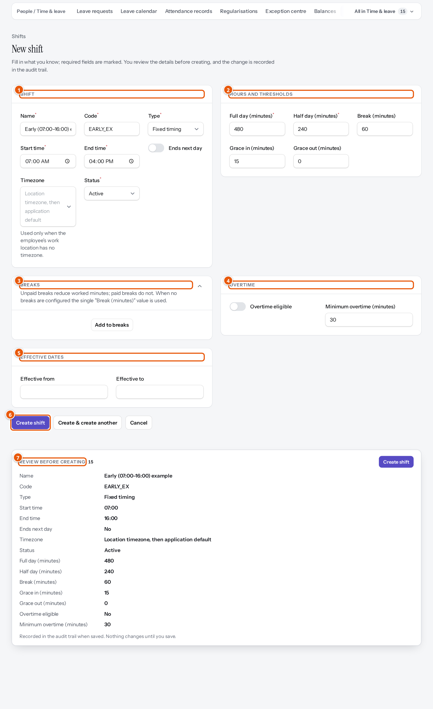
*Figure 3.17 — The New shift form with its review panel. Demonstration data (fictional; not created).*

1. **Shift** — **Name**, **Code** and **Type** (**Fixed timing** or **Flexible (hours only)**) are required. For a
   fixed shift, **Start time** and **End time** are required; switch on **Ends next day** for a night shift.
   **Timezone** is "Used only when the employee's work location has no timezone." **Status**.
2. **Hours and thresholds** — **Full day (minutes)** (480 by default) and **Half day (minutes)** (240) are required;
   **Break (minutes)** (60), **Grace in (minutes)** (15) and **Grace out (minutes)** (0).
3. **Breaks** — optional named breaks (**Add to breaks**: **Name**, **Starts**, **Minutes**, **Paid**). "Unpaid
   breaks reduce worked minutes; paid breaks do not."
4. **Overtime** — **Overtime eligible** and **Minimum overtime (minutes)** (30).
5. **Effective dates** — **Effective from** and **Effective to**.
6. **Create shift** — saves the shift (**Create & create another** saves and opens a new form).
7. **Review before creating** — every value you entered, for a last check. "Nothing changes until you save."

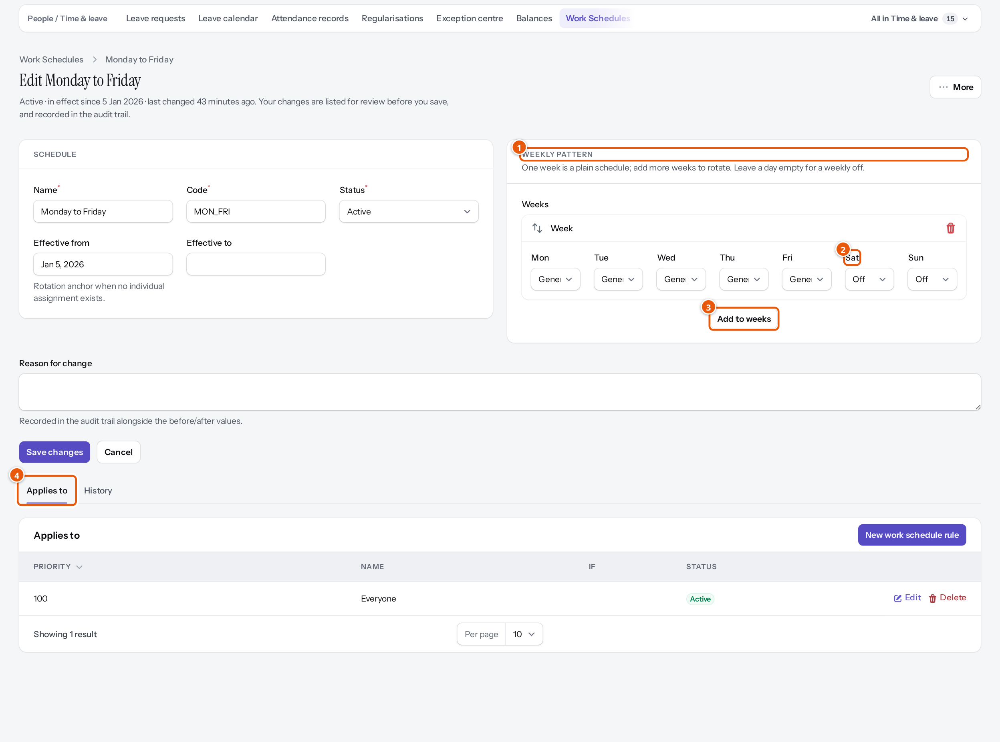
*Figure 3.18 — Editing the Monday to Friday schedule: General shift on weekdays, Saturday and Sunday off. Demonstration data (fictional).*

1. **Weekly pattern** — "One week is a plain schedule; add more weeks to rotate. Leave a day empty for a weekly off."
2. **A day** — choose a shift for each day, or **Off**.
3. **Add to weeks** — add a second week to make a rotating pattern.
4. **Applies to** — the rules that give this schedule to groups of people.

The **Work Schedules** list shows **Name**, **Code**, **Type** (Weekly, or for example "2-week rotation"),
**Days/week**, **Assigned** (individual assignments), **Rules** and **Status**. The schedule form also has **Name**,
**Code**, **Status**, **Effective from** ("Rotation anchor when no individual assignment exists.") and **Effective to**.

### Tasks

#### Task: Create a shift

**Before you start:** you need Attendance Admin or Tenant HR Admin.

1. Open **Shifts** and click **New shift**.
2. Fill in the **Shift** section, then **Hours and thresholds**, and optionally **Breaks**, **Overtime** and
   **Effective dates**.
3. Check **Review before creating**, then click **Create shift**.

**Expected result:** the shift is listed. It is used only once a work schedule refers to it.

#### Task: Create a work schedule and decide who follows it

1. Open **Work Schedules** and click **New work schedule**.
2. Enter **Name** and **Code**. Under **Weekly pattern**, choose a shift for each working day and leave days off empty
   (**Off**). For a rotation, click **Add to weeks** and fill the next week.
3. Save the schedule.
4. On the schedule's **Applies to** tab, click **New work schedule rule**. Enter **Name**, **Priority** (100 by default;
   the lowest number is checked first), **Status**, optional **Effective from** / **Effective to**, at least one
   condition (for example **Location** **is** Pune), and a **Reason for change**. Save.

**Expected result:** people matching the rule follow the schedule from the rule's dates, unless they have an individual
assignment.

#### Task: Give one person a different schedule

1. Open the person's **Employee 360** and click **Action** › **Assign work schedule**.
2. Choose the **Schedule**, the **Effective from** date and a **Reason for change**. Submit.

**Expected result:** "Schedule assigned". From that date the person follows this schedule; an open earlier individual
assignment ends the day before. (The Attendance tab's empty message calls this menu "Life events".)

> **Tip:** Changing a shift or schedule does not change days already calculated. Use **Process day** (or **Reprocess**
> on a record) for past days that should follow the new rules. Days locked by payroll never change.

---

## Holiday calendars

**Status:** Available with limitations — every date on a person's holiday calendar is treated as a full holiday for
attendance and leave counting, whatever its **Type** and the **Half day** switch.

### Overview

A **holiday calendar** lists your public and company holidays for a year. You can keep several calendars (for example
one per state or country) and use **Applies to** rules to give each person exactly one calendar: the first matching
rule, by priority, wins. Holidays are skipped when leave days are counted and give attendance the status **Holiday**.

### Where to find it

- **Menu path:** **People › Time & leave › All in Time & leave › Holiday Calendars**.
- **Who can open it:** Manager, HR Manager, Attendance Admin, Payroll Admin, Auditor, Tenant HR Admin, Tenant Super
  Admin. Only Attendance Admin and Tenant HR Admin (and Tenant Super Admin) can create and edit.

### The screen at a glance

The list shows **Name**, **Code**, **Year** ("Any" when blank), **Holidays** (how many), **Rules** and **Status**. The
demonstration has "National holidays 2026" with seven holidays and one rule.

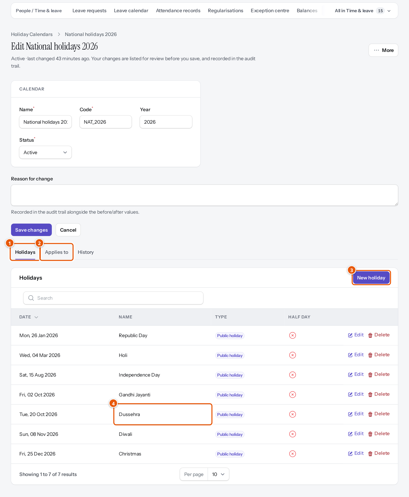
*Figure 3.19 — A holiday calendar with its holidays. Demonstration data (fictional).*

1. **Holidays** — the dates on this calendar, with **Date**, **Name**, **Type** and **Half day**.
2. **Applies to** — the rules that decide who uses this calendar.
3. **New holiday** — add a date (**Date**, **Name**, **Type**, **Half day**).
4. **A holiday** — each row has **Edit** and **Delete**.

### Tasks

#### Task: Add a holiday

1. Open **Holiday Calendars** and click the calendar's name (or **New holiday calendar** to start a new one with
   **Name**, **Code**, **Year** and **Status**), and stay on the **Holidays** tab.
2. Click **New holiday**. Enter the **Date** and **Name**, choose the **Type** (**Public holiday**, **Optional /
   restricted holiday** or **Company holiday**), and save.

**Expected result:** the holiday is listed. Leave requests made from now on skip it. Attendance for that day shows
**Holiday** when the day is processed; for past days, use **Process day**.

> **Important:** PeopleOS treats every date on the calendar as a full day off for everyone the calendar applies to,
> including optional holidays and those marked **Half day**. To let people choose optional holidays, do not put them
> on the calendar; use the **Restricted holiday** leave type instead.

#### Task: Decide who uses a calendar

1. On the calendar's **Applies to** tab, click **New holiday calendar rule**.
2. Enter **Name**, **Priority** (lowest number checked first) and **Status**, add at least one condition (for example
   **Location** **is** Delhi) and a **Reason for change**. Save.

**Expected result:** people who match use this calendar. Someone who matches no rule has no holidays at all.

---

## Setting up time and leave for a new location

Use this checklist when you open a new office or bring a new company onto PeopleOS. Most steps need the Tenant HR Admin
role (Attendance Admin can do the attendance steps; HR Manager can do the leave-type step).

**Flowchart — Setting up time and leave for a new location.** *Roles:* Tenant HR Admin, Attendance Admin. *Starts:*
the location exists in Organisation. *Ends:* employees there can request leave and their attendance is calculated.

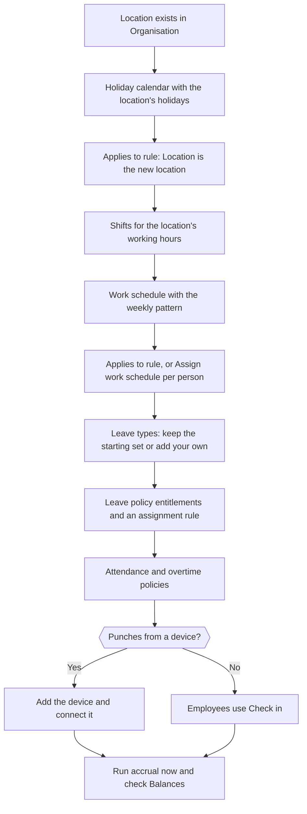

1. **Organisation.** Make sure the location exists, with its timezone (see
   [Companies, locations and organisation units](06-organisation-workforce-and-assets.md#companies-locations-and-organisation-units)).
2. **Holiday calendar.** Create a calendar for the year, add the holidays, and add an **Applies to** rule for the
   location (give it a lower priority number than any broad "Everyone" rule).
3. **Shifts.** Create the shifts the location works.
4. **Work schedule.** Create the weekly pattern and an **Applies to** rule for the location; assign individual
   schedules for exceptions.
5. **Leave types.** Review the starting nine types; add any your policy needs.
6. **Leave policy.** In **Workflows › Policies**, give the location's employees a leave policy (a new policy, or an
   assignment rule on an existing one) with an entitlement row per leave type. See
   [Policies](09-administration-and-security.md#policies).
7. **Attendance and overtime policies.** Set grace minutes, whether corrections are allowed and their window (in days),
   and the overtime minimum, rounding, daily cap and whether approval is needed.
8. **Devices.** If the office has a punch device, add it under **Devices** and have it connected.
9. **Check.** Click **Run accrual now** in **Balances** and check a few employees' balances, then ask one employee to
   open **Request leave** and confirm the right leave types and balances appear.

> **Note:** The attendance policy also has **Late marks before action** and **Action on threshold** (warn, deduct half
> day, loss of pay). These values can be stored, but PeopleOS does not apply them automatically in this release.

---

## Limitations in this area

- **Apply on behalf** on the Leave requests page fails with an error when opened. HR can apply for leave from the
  person's Employee 360 (**Records › Time › Leave › Apply for leave**).
- **Punch imports:** the **Map columns** step fails, so CSV imports cannot be completed from the screens. Devices, the
  API, **Check in** and **Manual punch** work.
- **Hourly leave** cannot be requested yet; leave types with the Hours unit are refused.
- **Sandwich rules** (counting weekends between two leave days) are not available. The leave policy can only count, or
  not count, all weekly offs and holidays inside a request.
- **Leave calendar** is a list; a calendar grid view is not available.
- **Encashment:** amounts are not calculated and encashments are not paid through payroll automatically; employees
  cannot request encashment themselves.
- **Opening balances and compensatory-off credits** have no dedicated screen; **Adjust** is the available tool.
- **Holiday calendars:** the **Type** and **Half day** settings do not change how a holiday is treated; every holiday is
  a full day off.
- **Attendance corrections** cannot be withdrawn by the employee from the screens.
- **Late-mark actions** in the attendance policy are not applied automatically.
- **Location checks** (GPS geofencing) for punches are not enforced.
- **Statutory leave law** is not built in. Leave entitlements and notice periods are your own configuration (country
  packs give starting values), not verified statutory calculations.
- **Devices** connect through two adapters only (Generic JSON and eSSL push); other device types need new adapters
  from Markedge.
- PeopleOS is not yet generally released. Hosting region, service levels and support channels are *to be confirmed
  with the SaaS provider*.

## Related chapters

- **[Your workspace](01-workspace-and-self-service.md)** — Home, My day, My work and the Approval Center.
- **[People and the employee lifecycle](02-people-and-employee-lifecycle.md#employee-360)** — the Employee 360, where
  each person's attendance and leave also appear.
- **[Pay](04-payroll-compensation-and-compliance.md#payroll-runs)** — payroll reads approved attendance and unpaid
  leave, and locks the days it has finalised.
- **[Organisation](06-organisation-workforce-and-assets.md)** — locations and timezones used by shifts and devices.
- **[Administration](09-administration-and-security.md#policies)** — leave, attendance and overtime policies,
  settings such as the leave year, workflows and API keys.
