# Pay: payroll, compensation and statutory compliance

> **In this chapter:** how PeopleOS calculates monthly pay, issues payslips, manages salary changes and prepares statutory returns, and what is still blocked before payroll can be used for real pay. **Who should read it:** business owners and buyers, payroll administrators, HR administrators and HR managers, auditors, and employees who want to see their pay.

Pay is where PeopleOS turns people records into money. Payroll staff open a monthly payroll run, check every employee's result, have it approved by a second person and then issue payslips. HR proposes salary changes, which three more people must review, approve and apply before payroll uses them. Employees see their own pay, payslips and tax declarations. The compliance screens hold India's statutory rules (provident fund, state insurance, professional tax, labour welfare fund and income tax) and prepare the statutory returns from finished payroll. Every step records who did what and when.

> **Important — read this before you plan to run payroll in PeopleOS.**
> - **No statutory rule is verified yet.** PeopleOS ships 24 statutory rule versions as data (India: EPF, ESI, professional tax for 9 states, labour welfare fund for 7 states, TDS on salary and gratuity; UAE: one pension rule). As of Markedge's latest statutory register (October 2026), **0 of 24 are verified** against official sources and **5 regulatory notices are open**.
> - **Payroll cannot be finalised while it relies on an unverified rule.** "Verified-rule enforcement" is always on in production (and is on in the demonstration). Any employee whose pay uses an unverified rule, or a rule with an open regulatory notice, gets a *blocking issue*. The run cannot be validated or finalised, and no payslips are issued. You can see this in the demonstration screenshots below.
> - **Payroll is blocked in countries without rules.** PeopleOS holds statutory rules only for India and one rule for the UAE. For any other country (for example the USA, the UK or EU countries) pay is blocked rather than paid with no tax or contributions.
> - **Gratuity is not calculated.** A gratuity rule is stored, but no calculation uses it. Exit settlements have no gratuity line; any gratuity must be added as a manual line.
> - **Statutory returns depend on all of the above.** Returns are built only from finalised payroll, and exporting a return is refused until the rules, registrations, establishments and file layouts it uses are verified. PeopleOS never files anything with an authority; you file on the authority's portal and record the reference.
> - PeopleOS is not yet generally released. **Confirm with Markedge (your provider)**: which statutory rules will be verified for your states before go-live and when; whether your country is supported for payroll; how gratuity will be handled; whether the return file layouts you need are verified; and how a parallel-run month (PeopleOS beside your current payroll) will be organised. Prices, timelines and support terms are to be confirmed with the SaaS provider.

## Modules in this area

All Pay modules are under **People › Pay**. The area bar at the top shows the everyday modules; the **All in Pay** menu lists the rest under three headings: **Payroll**, **Compensation** and **Compliance**. There are two links called **Control room** in the area bar: the first opens the *Payroll control room*, the last opens the *Compliance control room*.

| Module | What it is for | Where to find it | Who uses it | Status |
|---|---|---|---|---|
| Control room (payroll) | One-page view of payroll readiness and this month's runs | People › Pay › Control room (first link) | Payroll Admin, Tenant HR Admin, Auditor (view) | Available |
| Payroll runs | Calculate, check, approve and finalise monthly pay | People › Pay › Payroll runs | Payroll Admin, Tenant HR Admin; Auditor views | Available with limitations (finalising blocked by unverified rules) |
| Payslips | Employees' payslips | People › Pay › Payslips | Everyone with an employee record (own only); payroll staff (all in scope) | Available with limitations (issued only after finalising; on-screen only) |
| Adjustments | One-off earnings, deductions, reimbursements, arrears and loss-of-pay days for a month | People › Pay › All in Pay › Adjustments | Payroll Admin, Tenant HR Admin | Available |
| Salary components | The building blocks of pay (Basic, HRA, allowances) and their formulas | People › Pay › All in Pay › Salary components | Payroll Admin, Tenant HR Admin | Available |
| Payroll Auditor | Automatic checks that flag unusual results in a run | People › Pay › All in Pay › Payroll Auditor | Payroll Admin, Tenant HR Admin | Available |
| Tax declarations | Employee's tax regime and investment declarations | People › Pay › Tax declarations | Employees (own); payroll staff verify | Available with limitations |
| Company statutory profiles (legacy) | Older per-company statutory settings | People › Pay › All in Pay › Company statutory profiles (legacy) | Payroll Admin, Tenant HR Admin | Available (older method) |
| Compensation changes | Salary changes moving through four people | People › Pay › Compensation changes | HR Manager, Tenant HR Admin, Payroll Admin, Auditor | Available |
| Cycles | Annual increment, promotion or market adjustment for many people at once | People › Pay › All in Pay › Cycles | Tenant HR Admin prepares; HR Manager reviews | Available |
| Budgets | Money set aside for salary increases | People › Pay › All in Pay › Budgets | Tenant HR Admin | Available |
| Pay ranges | Minimum, midpoint and maximum pay per grade | People › Pay › All in Pay › Pay ranges | Tenant HR Admin | Available |
| Salary structures | Which components make up pay, versioned by date | People › Pay › All in Pay › Salary structures | Tenant HR Admin (others view) | Available |
| Analytics | Pay totals and averages with small-group protection | People › Pay › All in Pay › Analytics | Tenant HR Admin, HR Manager, Payroll Admin, Executive, Auditor | Available |
| My compensation | An employee's own approved pay | Avatar menu › My compensation | Employees | Available |
| Control room (compliance) | Statutory readiness, rules and returns on one page | People › Pay › Control room (last link) | Tenant HR Admin, Payroll Admin, Auditor (view) | Available |
| Compliance rules, Rule verification, Regulatory notices | The statutory rule library, its verification history and open notices | People › Pay › All in Pay › (Compliance) | Tenant HR Admin, Payroll Admin, Auditor (read only) | Available, read only for customers |
| Statutory registrations, Statutory profiles | Your registration numbers and which statutes apply to each establishment | People › Pay › All in Pay › (Compliance) | Tenant HR Admin | Available |
| EPF returns (ECR), ESI returns, Professional tax returns, LWF returns | Monthly statutory returns built from finalised payroll | People › Pay › All in Pay › (Compliance) | Tenant HR Admin | Available with limitations (gate blocks export; layouts unverified) |
| TDS statements (Form 138), TDS certificates (Form 130), TDS investment proofs, TDS deductor profiles | Income tax on salary: quarterly statement, annual certificate, proofs and the deductor | People › Pay › All in Pay › (Compliance) | Tenant HR Admin | Available with limitations |
| Export layouts | File formats used for statutory exports | People › Pay › All in Pay › Export layouts | Tenant HR Admin, Payroll Admin, Auditor (read only) | Available, none verified yet |
| Parallel payroll | Compare a finalised PeopleOS month with your current payroll system | People › Pay › All in Pay › Parallel payroll | Tenant HR Admin | Available |

*Tenant Super Admin can open every module. Opening a module does not mean every button is available: each action has its own permission, explained in each section.*

---

## Payroll control room

**Status:** Available

### Overview
The payroll control room is the starting page for payroll staff. It shows, in one place, how ready your data is for payroll and where each company's run stands this month. A warning line at the top tells you which statutory rules are not verified and that payroll using them cannot be finalised.

### Where to find it
- **Menu path:** People › Pay › Control room (the first **Control room** link; the page is titled "Payroll control room")
- **Who can open it:** Payroll Admin, Tenant HR Admin, Tenant Super Admin, Auditor
- **Set-up needed first:** companies, employees with an approved salary (see *Compensation changes*), bank accounts and PAN on employee records.

### The screen at a glance

*Figure 4.1 — The payroll control room for Arjun Bose, Payroll Admin. Demonstration data (fictional).*

1. **Statutory warning** — lists the statutory rules that are not verified (here EPF, ESI, GRATUITY, LWF, PT, TDS) and says payroll using them cannot be finalised.
2. **Open payroll run** — starts a run for a company and month. Next to it, **Compliance control room** opens the statutory side.
3. **Readiness figures** — **Employees without a salary**, **Without a primary bank account**, **Without PAN** and **Statutory rules in force**. Amber numbers need attention before you run payroll.
4. **Company card** — one card per company for the current month: **Status**, **Headcount**, **Without salary**, **Statutory profile**, **Net pay**, **Exceptions** and an **Open run** link.

Below the cards is the run register: **Period**, **Company**, **Status**, **Employees**, **Net pay**, **Exceptions** and an **Open** action for each run.

### Tasks
#### Task: Check readiness before the monthly run
**Purpose:** find gaps that would stop or distort payroll.
**Before you start:** you need payroll view access.
1. Open **People › Pay › Control room**.
2. Read the warning line under the title. If statutory rules are listed, payroll that uses them cannot be finalised (see the Important note at the top of this chapter).
3. Look at **Employees without a salary**. Employees without an approved salary are not paid; ask HR to complete their compensation change.
4. Look at **Without a primary bank account** and **Without PAN**. Without a bank account payment will fail; without PAN, tax is deducted at the higher rate.
5. On each company card, check **Without salary** and **Statutory profile** ("Configured" or "Defaults (not configured)").

**Expected result:** you know which records to fix before you calculate.
**How to verify:** after HR fixes records, the figures go down when you reload the page.
**Common mistakes:** treating "Statutory rules in force" as "verified". It counts rules that are in effect, verified or not.
**If it fails:** if the page does not open, ask your administrator for payroll access.

### Related modules
- **Payroll runs** — open and work through a run.
- **Compliance control room** — statutory readiness and returns.

---

## Payroll runs

**Status:** Available with limitations — finalising is refused while the run uses unverified statutory rules (all rules today), and payroll is blocked for countries without rules. Payroll is calculated monthly only.

### Overview
A payroll run is one month's pay for one company. PeopleOS works out each employee's paid days (calendar days less days before joining or after leaving, absences and unpaid leave from attendance and leave, and manual loss-of-pay days), calculates each salary component, adds approved adjustments, applies the statutory deductions (EPF, ESI, professional tax, labour welfare fund, TDS) and records how every line was worked out. A run moves through fixed steps, and the person who opened the run cannot approve it.

**Loss of pay (LOP)** means days that are not paid, such as absence without leave. **Net pay** is what the employee receives after deductions. **Employer cost** is earnings plus employer contributions.

### Where to find it
- **Menu path:** People › Pay › Payroll runs
- **Who can open it:** Payroll Admin, Tenant HR Admin, Tenant Super Admin, Auditor (view only)
- **Who can do what (standard roles):**
  - Open, calculate, validate and set the payment date: Payroll Admin, Tenant HR Admin
  - Approve: Payroll Admin, Tenant HR Admin — but **never the person who opened the run**
  - Finalise, download the bank file, mark as paid, reopen: Payroll Admin, Tenant HR Admin
- **Set-up needed first:** salary components and a salary structure; an approved compensation for each employee; attendance processed for the month; statutory set-up (establishments, statutory profiles, registrations) — and, for production use, verified statutory rules.

### The screen at a glance
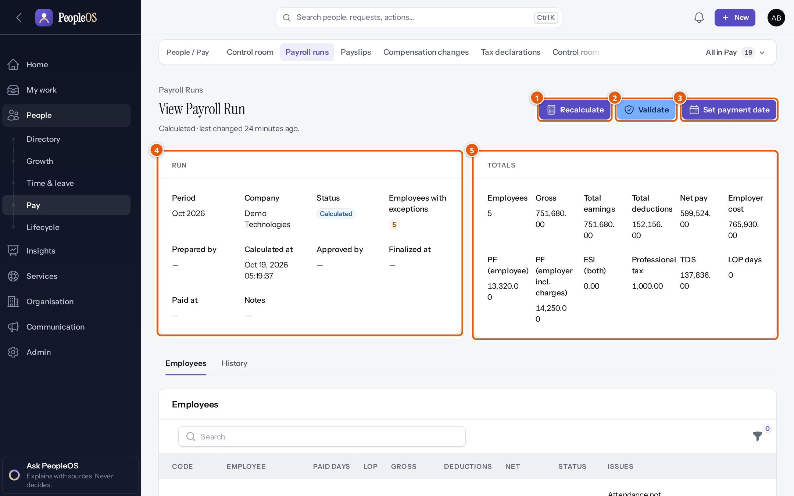
*Figure 4.2 — A calculated run for October 2026, Demo Technologies. Demonstration data (fictional).*

1. **Recalculate** (called **Calculate** on a new run) — runs every employee through the calculation again. Earlier results for this run are replaced.
2. **Validate** — checks that no employee has a blocking issue.
3. **Set payment date** — records the salary payment date, which decides which tax rule and tax year apply. A calculated run goes back to Draft and must be recalculated.
4. **Run** section — **Period**, **Company**, **Status**, **Employees with exceptions**, **Prepared by**, **Calculated at**, **Approved by**, **Finalized at**, **Paid at**, **Notes**.
5. **Totals** section — **Employees**, **Gross**, **Total earnings**, **Total deductions**, **Net pay**, **Employer cost**, **PF (employee)**, **PF (employer incl. charges)**, **ESI (both)**, **Professional tax**, **TDS**, **LOP days**.

Other buttons appear when the run reaches the right step: **Approve**, **Finalize & generate payslips**, **Bank file**, **Mark as paid** and **Reopen**. The **History** tab shows the audit trail of the run.

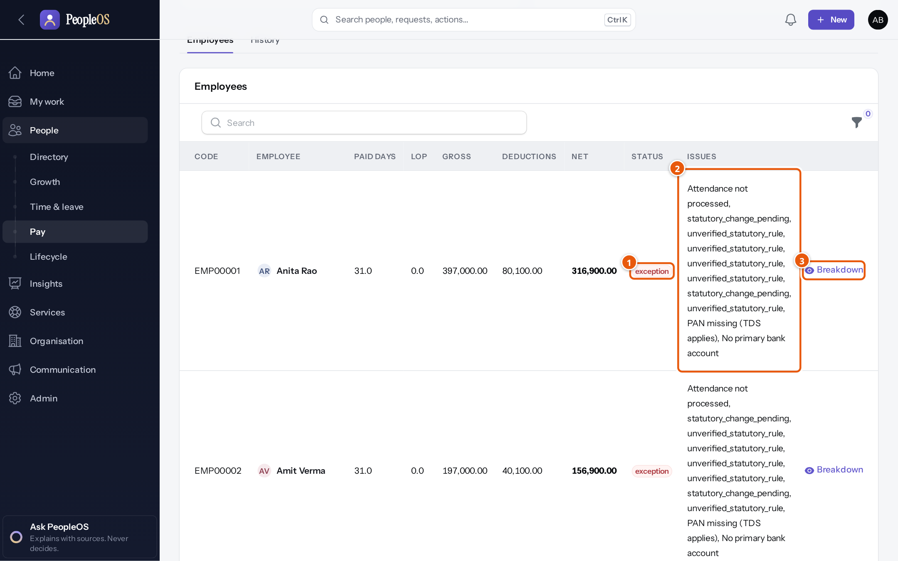
*Figure 4.3 — The Employees tab. Every employee has blocking issues because the statutory rules are not verified. Demonstration data (fictional).*

1. **Status** — **ok**, **warning** or **exception**. An exception blocks the run.
2. **Issues** — the reasons, in short form (explained in the table below).
3. **Breakdown** — opens the detail for one employee.

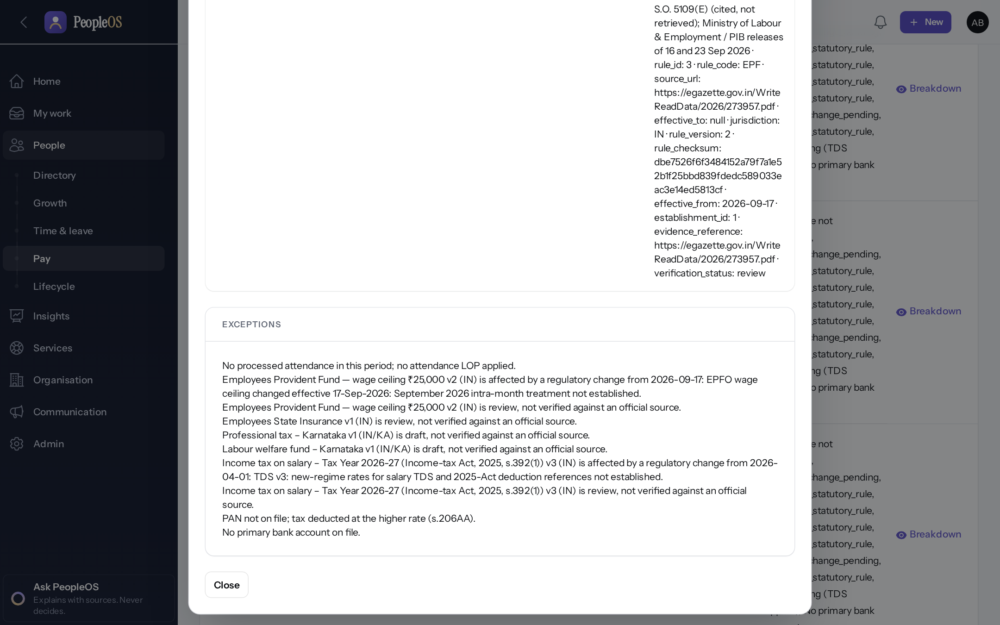
*Figure 4.4 — Breakdown for Priya Nair: each line keeps its basis (formula, days, rule version and source), and the Exceptions section lists the blocking reasons in full. Demonstration data (fictional).*

**What the issue codes mean**

| Shown as | Meaning | Blocks the run? |
|---|---|---|
| unverified_statutory_rule | A statutory rule used for this employee is not verified against an official source | Yes, with enforcement on (always in production) |
| statutory_change_pending | An open regulatory notice says the rule is out of date from a date in this period | Yes, with enforcement on |
| statutory_rule_missing | A statute applies but PeopleOS has no rule for that state and date; nothing was deducted | Yes, with enforcement on |
| statutory_jurisdiction_unsupported | PeopleOS holds no statutory rules for the employee's country | Yes, with enforcement on |
| statutory_state_missing | Professional tax applies but the establishment has no state | Yes, with enforcement on |
| No salary assignment / Salary structure has no components / Formula error / Negative net pay | Missing or broken pay set-up | Yes |
| Attendance not processed | No processed attendance this month; no attendance LOP applied | No (warning) |
| PAN missing (TDS applies) | Tax deducted at the higher rate | No (warning) |
| No primary bank account | Payment will fail | No (warning) |

### Tasks
#### Task: Open and calculate a payroll run
**Purpose:** produce this month's results for one company.
**Before you start:** attendance for the month is processed, adjustments are entered, and employees have approved compensation.
1. Open **People › Pay › Payroll runs** (or the payroll control room).
2. Click **Open payroll run**.
3. Choose **Company**, **Year** and **Month** (all required). Click **Submit**.
4. On the run page, click **Calculate** and confirm.
5. PeopleOS shows "Calculated for *N* employee(s); *M* with exceptions". The run is now **Calculated**.

**Expected result:** every employee of the company who was employed during the month appears on the **Employees** tab with paid days, gross, deductions and net.
**How to verify:** compare **Employees** in Totals with the company headcount on the control room; open **Breakdown** for a few people.
**Common mistakes:** opening a second run for the same month — PeopleOS simply opens the existing unfinished run. People who have not joined yet (pre-employees, onboarding) are never included.
**If it fails:** "*Month* is closed. Reopen the finalized run to change it." means the month was already finalised. "A *status* run cannot be recalculated. Reopen it first." means the run is approved or finalised.

#### Task: Fix exceptions and validate
**Purpose:** clear blocking issues so the run can be approved.
1. On the **Employees** tab, filter **Status** to **Exception**.
2. Click **Breakdown** and read the **Exceptions** section.
3. Fix the cause (for example ask HR to complete a salary, process attendance, add an adjustment).
4. Click **Recalculate**, then **Validate**.

**Expected result:** "Run validated; ready for approval". The run is **Validated**.
**If it fails:** "*N* employee(s) have blocking exceptions. Fix the inputs and recalculate." If the exceptions are statutory (unverified rule, change pending, rule missing, unsupported country), you cannot fix them yourself: the rules must be verified by Markedge. Contact your administrator.

#### Task: Approve, finalise and pay
**Purpose:** lock the month, issue payslips and record payment.
**Before you start:** the run is Validated. The approver must be a different person from the one who opened the run.
1. The approver opens the run and clicks **Approve**, optionally adds a **Note**, and confirms. The run is **Approved**.
2. A person with finalise rights clicks **Finalize & generate payslips** and confirms.
3. PeopleOS re-checks everything: the run was calculated on the current calculation version, every statutory rule used is verified and unchanged with no open notice, there are no blocking issues, totals reconcile and no employee's approved compensation changed since calculation. It then locks attendance for the month, closes the period and issues payslips.
4. Click **Bank file** to download the salary payment file (CSV). Make the payment through your bank, outside PeopleOS.
5. Click **Mark as paid**, choose **Paid on** and confirm. The run is **Paid**.

**Expected result:** "Run finalized; payslips generated"; employees are notified in PeopleOS and see their payslip.
**How to verify:** **Finalized at** and **Paid at** are filled in; the **Payslips** list shows the new payslips.
**Common mistakes:** sharing the bank file by e-mail. It contains full account numbers and its download is recorded in the audit trail.
**If it fails:**
- "The person who prepared the run cannot approve it." — ask a second payroll person.
- "Statutory rules are not verified for production finalization: …" — the run used unverified rules. This is expected today; see the Important note.
- "Compensation changed for *N* employee(s) since the run was calculated; recalculate before finalizing." — a salary change was applied; reopen and recalculate.
- "Run totals do not reconcile with its entries; recalculate before finalizing."

#### Task: Reopen a run
**Purpose:** correct a run after approval or finalisation.
1. Open the run and click **Reopen**.
2. Enter a **Reason** (required) and confirm.
3. An approved run returns to **Draft** for recalculation. A finalised, unpaid run returns to **Draft**: payslips are withdrawn, attendance is unlocked and the month reopens.

**Common mistakes:** trying to reopen a **Paid** run — this is not allowed. Pay the difference next month as an **Arrear** or **Recovery** adjustment.

### Statuses explained
| Status | Meaning | What happens next |
|---|---|---|
| Draft | Run opened, not calculated (or reopened) | Calculate |
| Calculated | Results exist; may have exceptions | Fix, recalculate, then Validate |
| Validated | No blocking issues | A second person approves |
| Approved | Approved by someone other than the preparer | Finalise, or reopen to Draft |
| Finalized | Period closed, attendance locked, payslips issued | Bank file, Mark as paid, or reopen (with reason) |
| Paid | Payment recorded | Final; corrections go into a later month |

**Flowchart — Monthly payroll run.** The real steps of a run and who may act. *Roles:* Payroll Admin or Tenant HR Admin (preparer, finaliser), a second payroll person (approver). *Starts:* a run is opened for a company and month. *Ends:* the run is Paid.

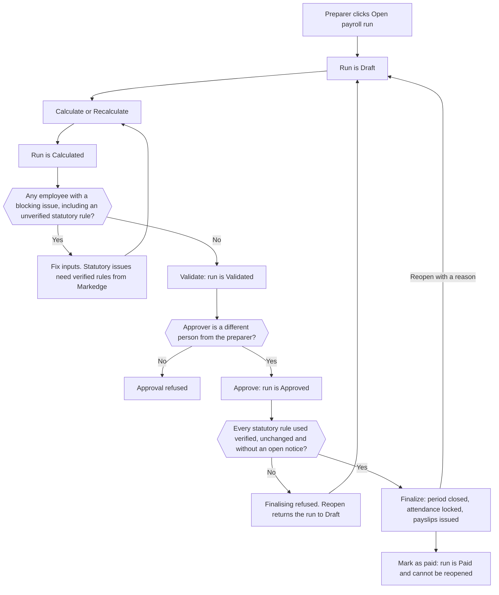

### Example from everyday work
*Illustrative scenario.* At the end of October, Arjun Bose (Payroll Lead, Demo Technologies) opens the October run and calculates it. The control room had already warned him that 15 employees have no salary yet, so he asks Kavya Menon's HR team to complete their compensation. After recalculating, every employee still shows **exception**: the Breakdown lists "not verified against an official source" for the EPF, ESI, professional tax, labour welfare fund and TDS rules. Arjun knows this is expected until Markedge verifies the rules, so he records the October figures as a trial and does not try to finalise.

### Related modules
- **Adjustments** — one-off amounts for the month.
- **Compensation changes** — the approved salaries a run uses.
- **Payroll Auditor** — automatic checks on a run.
- **Compliance control room** — returns built from finalised runs.

---

## Payslips

**Status:** Available with limitations — payslips are created only when a run is finalised (blocked today while rules are unverified). Payslips are shown on screen; there is no PDF download. The demonstration has no payslips yet for this reason.

### Overview
A payslip is a fixed copy of the employee's result taken at finalisation. It does not change if records change later; it is withdrawn only if the run is reopened. Each payslip has a number in the form PS-YYYYMM-*employee code*. Every time someone opens a payslip, PeopleOS records it in the audit trail.

### Where to find it
- **Menu path:** People › Pay › Payslips. Employees also see their latest payslip on **My Day** (button **View payslip** when one exists) and get a notification when a payslip is issued. Former employees with the Alumni role see recent payslips in the alumni portal.
- **Who can open it:** every person with an employee record (own payslips only); Payroll Admin, Tenant HR Admin and Auditor see all payslips within their organisation scope. A manager sees nothing through the reporting line alone.
- **Set-up needed first:** a finalised payroll run.

### The screen at a glance
The list shows **Number**, **Period**, **Code**, **Employee**, **Gross**, **Net pay** and **Generated at**, with a search box. Opening a payslip shows:
- a header "*Company* · Payslip for *period*" with **Number**, **Employee**, **Code**, **Designation**, **Department**, **Joined**, **PAN**, **UAN**, **Bank**, **Account**, **Paid days** and **LOP days**;
- **Earnings** and **Deductions** with their totals;
- **Net pay** and **In words**;
- **Employer contributions** and **Tax computation** (folded sections).

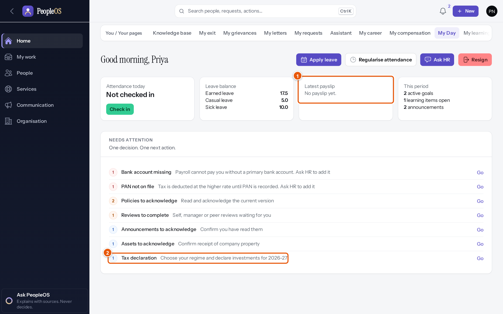
*Figure 4.5 — Priya Nair's My Day: (1) the Latest payslip card, which shows "No payslip yet." until a run is finalised; (2) the Tax declaration reminder. Demonstration data (fictional).*

### Tasks
#### Task: View my payslip (employee)
1. Open **My Day** from the avatar menu and click **View payslip**, or open **People › Pay › Payslips**.
2. Click the payslip for the month.
3. Open **Tax computation** to see how tax was estimated.

**Expected result:** you see only your own payslips.
**If it fails:** "No payslips yet" means the month's payroll has not been finalised. Ask your payroll team. If the **Bank account missing** or **PAN not on file** items show on My Day, ask HR to add them.

### Related modules
- **Payroll runs** — payslips are issued at finalisation and withdrawn on reopen.
- **Tax declarations** — affect the tax shown on the payslip.

---

## Adjustments

**Status:** Available

### Overview
Adjustments are one-off amounts for one employee in one month: an extra earning, a deduction, a non-taxable reimbursement, an arrear for an earlier month, a recovery, a correction, or loss-of-pay days. Only adjustments in an **open** month can be added, changed or deleted. Your administrator can switch on a setting so that new adjustments wait for approval by a second person.

### Where to find it
- **Menu path:** People › Pay › All in Pay › Adjustments
- **Who can open it:** Payroll Admin, Tenant HR Admin, Tenant Super Admin, Auditor (view)
- **Set-up needed first:** the employee and an open payroll month.

### The screen at a glance
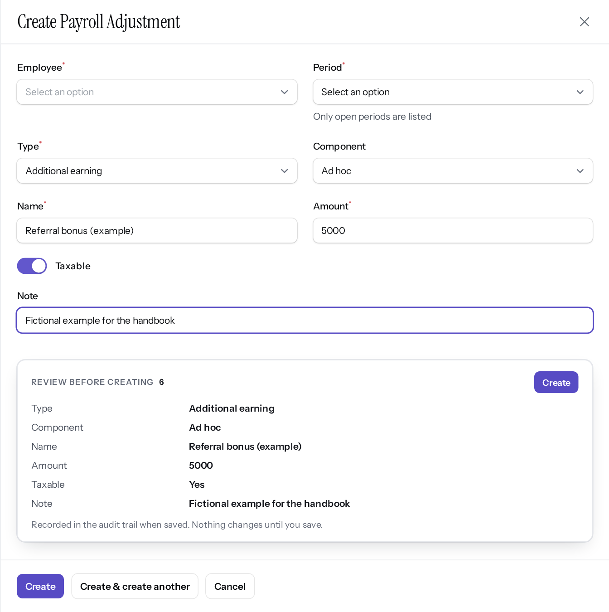
*Figure 4.6 — The Create Payroll Adjustment dialog, filled with fictional values and cancelled. Demonstration data (fictional).*

List columns: **Period**, **Code**, **Employee**, **Status** (approved or pending), **Type**, **Name**, **Amount**, **Note**; filter by **Type**. Row actions: **Approve** (only for pending adjustments, by someone other than the creator), **Edit** and **Delete** (open months only).

### Tasks
#### Task: Add an adjustment
1. Open **People › Pay › All in Pay › Adjustments** and click **New payroll adjustment**.
2. Fill in **Employee**, **Period** ("Only open periods are listed") and **Type** — all required. Types: **Additional earning**, **Additional deduction**, **Loss of pay (days)**, **Reimbursement (non-taxable)**, **Arrear (earning for an earlier period)**, **Recovery (deduction for an earlier period)**, **Correction**.
3. Optionally choose a **Component** (or leave **Ad hoc**). Statutory components cannot be chosen.
4. Enter **Name** and **Amount** (required; for loss of pay the field is **Days**). For an earning, set **Taxable**. Add a **Note**.
5. Check the **Review before creating** panel and click **Create**.

**Expected result:** the adjustment appears with status **approved** (or **pending** if your organisation requires approval) and is included the next time the run is calculated.
**Common mistakes:** forgetting to recalculate the run after adding an adjustment.
**If it fails:** "The payroll period is closed; record an arrear or recovery in an open period instead."

---

## Salary components and the formula engine

**Status:** Available

### Overview
Salary components are the building blocks of pay: Basic, House rent allowance, Conveyance allowance, Special allowance, Bonus, Salary advance recovery and any you add. Each component is an earning, deduction, employer contribution or reimbursement, and is either a **fixed amount** taken from the employee's compensation or a **formula**. Formulas use simple arithmetic only, for example `basic * 0.50`. Statutory lines (provident fund, state insurance, professional tax, labour welfare fund and TDS) are never configured here: they come from the statutory rules, and their codes are reserved.

### Where to find it
- **Menu path:** People › Pay › All in Pay › Salary components
- **Who can open it:** Payroll Admin, Tenant HR Admin, Tenant Super Admin, Auditor (view). Creating and editing needs payroll management rights (Payroll Admin, Tenant HR Admin).

### The screen at a glance
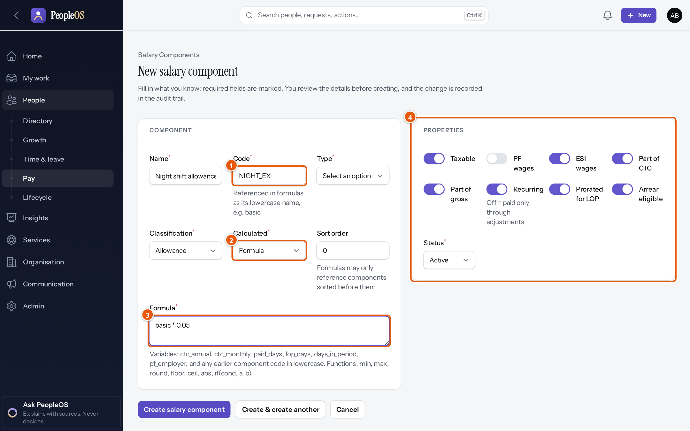
*Figure 4.7 — A new component with a formula, not saved. Demonstration data (fictional).*

1. **Code** — referenced in formulas as its lowercase name (for example `basic`). Codes reserved for statutory lines are refused.
2. **Calculated** — **Fixed amount from the salary assignment** or **Formula**.
3. **Formula** — variables: `ctc_annual`, `ctc_monthly`, `paid_days`, `lop_days`, `days_in_period`, `pf_employer` and any earlier component code in lowercase. Functions: `min`, `max`, `round`, `floor`, `ceil`, `abs`, `if(cond, a, b)`. The formula is checked when you save.
4. **Properties** — **Taxable**, **PF wages**, **ESI wages**, **Part of CTC**, **Part of gross**, **Recurring** ("Off = paid only through adjustments"), **Prorated for LOP**, **Arrear eligible**, and **Status**.

The list shows **#** (sort order), **Name**, **Code**, **Type**, **Method**, **Formula**, **Taxable**, **PF**, **ESI**, **Prorate**, **Statutory** and **Status**.

### Tasks
#### Task: Add a salary component
1. Click **New salary component**.
2. Enter **Name**, **Code**, **Type**, **Classification**, **Calculated** (all required) and a **Sort order** — formulas may only reference components sorted before them.
3. If **Calculated** is **Formula**, enter the **Formula**.
4. Set the **Properties** and click **Create salary component**.
5. Add the component to a salary structure version (see *Salary structures*) so that payroll uses it.

**Common mistakes:** referring in a formula to a component that comes later in the sort order.
**If it fails:** "This code is reserved for a statutory line." Choose another code. When you edit an existing component, enter a **Reason for change**; if your organisation requires approval for configuration changes, the change waits in the Configuration Change Centre and the component stays unchanged until approved.

---

## Payroll Auditor

**Status:** Available

### Overview
The Payroll Auditor checks a calculated run against fixed rules and thresholds and lists anything unusual for a person to review: bank accounts shared by several employees (possible duplicate payment), blocking exceptions, zero or negative net pay, deductions above 60% of gross, more than 10 loss-of-pay days, a missing bank account, missing PAN while tax is deducted, net pay changing by more than 30% from the last finalised run, TDS more than doubling, salary revisions above 50% in the month, employees missing from the previous finalised run, and employees who left before the month started. It only reads; it never changes pay. Despite the name "AI Payroll Auditor", the checks are fixed rules computed inside PeopleOS.

### Where to find it
- **Menu path:** People › Pay › All in Pay › Payroll Auditor
- **Who can open it:** Payroll Admin, Tenant HR Admin, Tenant Super Admin (the feature can be switched off by your administrator).

### The screen at a glance
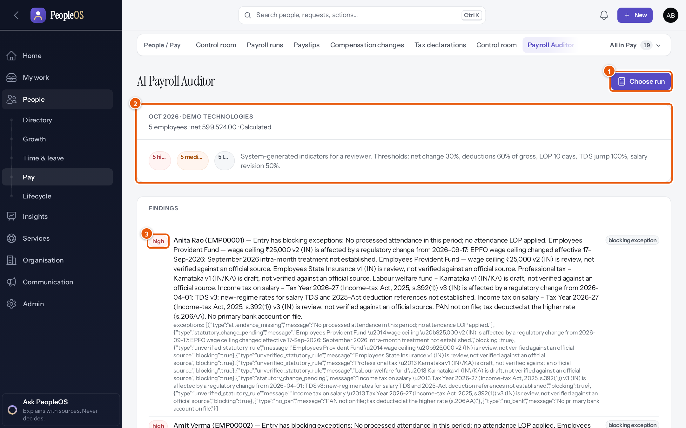
*Figure 4.8 — Findings for the October run. Demonstration data (fictional).*

1. **Choose run** — pick any calculated, validated, approved, finalised or paid run.
2. **Run summary** — employees, net pay and status, with counts of **high**, **medium** and **low** findings and the thresholds used.
3. **Findings** — each with its severity, the employee, a message and the evidence.

### Task: Review a run before approval
1. Open **Payroll Auditor**, click **Choose run** and select the run.
2. Work through **high** findings first, then **medium** and **low**.
3. Fix causes in the source records and recalculate the run.

---

## Tax declarations and TDS investment proofs

**Status:** Available with limitations — employees save a declaration as Draft (there is no separate submit button); payroll staff verify it. Proof records are kept for checking but do not change the tax calculation; the tax estimate uses the declared amounts. There is no document upload for proofs on these screens.

### Overview
For income tax on salary (TDS — tax deducted at source), each employee chooses a **tax regime** for the financial year and declares investments and deductions. The **new regime** is the default. Chapter VI-A deductions (such as 80C) and the HRA (house rent allowance) exemption apply only in the **old regime**. Payroll uses the employee's declaration for that financial year in the monthly tax estimate as soon as it is saved, whatever its status. Payroll staff then check the proofs and mark the declaration **Verified**; after that the employee can no longer change it.

### Where to find it
- **Tax declarations — menu path:** People › Pay › Tax declarations. **Who can open it:** every person with an employee record (own declaration only); Payroll Admin, Tenant HR Admin and Auditor see everyone's. Only Payroll Admin and Tenant HR Admin can set the status or click **Verify**. My Day shows a **Tax declaration** reminder ("Choose your regime and declare investments for 2026-27").
- **TDS investment proofs — menu path:** People › Pay › All in Pay › TDS investment proofs. **Who can open it:** Tenant HR Admin, Tenant Super Admin.

### The screen at a glance
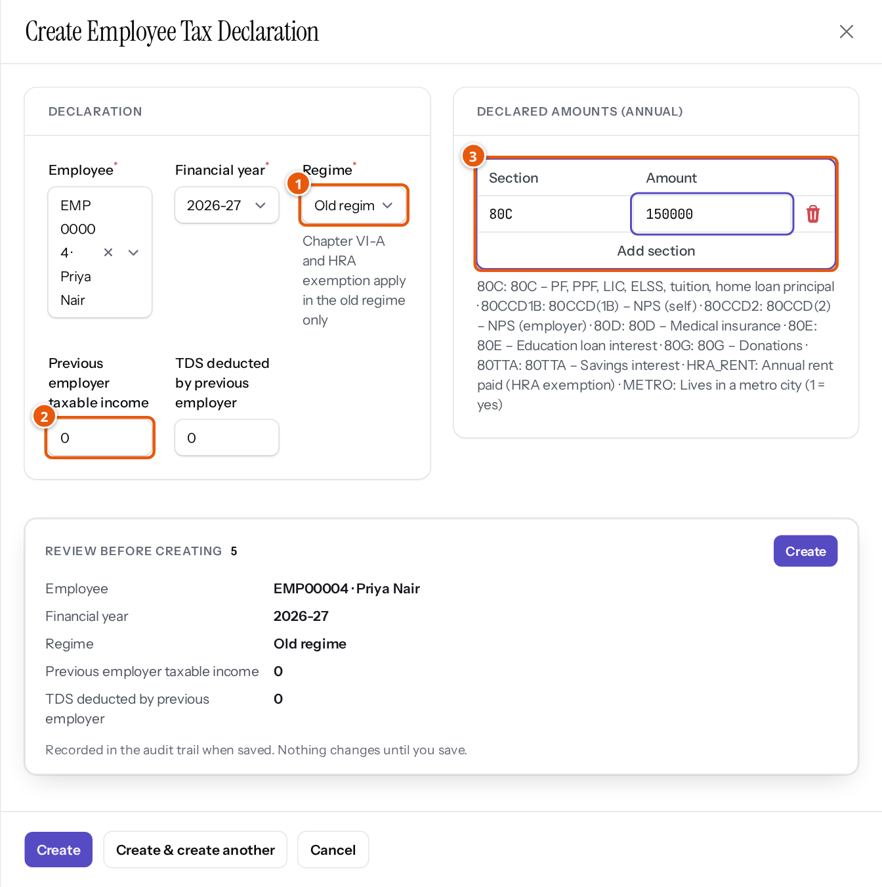
*Figure 4.9 — Priya Nair filling a declaration (cancelled). Demonstration data (fictional).*

1. **Regime** — **New regime (default)** or **Old regime**.
2. **Previous employer taxable income** and **TDS deducted by previous employer** — for people who changed jobs during the year.
3. **Declared amounts (annual)** — one row per **Section** with its **Amount**. Section codes: **80C**, **80CCD1B**, **80CCD2**, **80D**, **80E**, **80G**, **80TTA**, **HRA_RENT** (annual rent paid) and **METRO** (1 if you live in a metro city).

The list shows **FY**, **Code**, **Employee**, **Regime**, **Declared total** and **Status**, with a **Status** filter.

### Tasks
#### Task: Declare my regime and investments (employee)
1. Open **People › Pay › Tax declarations** (or click **Go** next to **Tax declaration** on My Day).
2. Click **New employee tax declaration**. **Employee** is already set to you.
3. Choose **Financial year** and **Regime** (required).
4. If you joined from another employer this year, enter their taxable income and TDS.
5. Under **Declared amounts (annual)**, click **Add section** for each item, for example **80C** with the annual amount. For HRA exemption add **HRA_RENT** and, if applicable, **METRO** = 1.
6. Check **Review before creating** and click **Create**.

**Expected result:** your declaration appears with status **Draft** and is used from the next payroll calculation.
**Common mistakes:** declaring 80C amounts under the new regime — they are ignored there. You can edit your declaration until payroll verifies it.

#### Task: Record and verify a proof (payroll)
1. Open **People › Pay › All in Pay › TDS investment proofs** and click **New tds employee investment**.
2. Enter **Employee** (search by employee code), **Financial year** (for example 2026-27), **Section**, **Description** and **Declared amount**, then create.
3. When the evidence arrives, click **Verify proof** on the row, enter **Proof amount**, set **Proof status** to **Verified** or **Rejected**, add **Notes** and confirm.
4. If the verified amount differs from the declaration, edit the employee's declaration amount so payroll uses the right figure.
5. In **Tax declarations**, click **Verify** on the declaration.

**If it fails:** "You cannot verify your own investment proof." — another person must verify it.

### Statuses explained
| Item | Statuses |
|---|---|
| Tax declaration | Draft → Submitted (set by payroll staff, optional) → Verified (locked for the employee) |
| Investment proof | Pending → Verified or Rejected |

**Flowchart — Employee tax declaration and proof.** *Roles:* Employee, Payroll Admin, Tenant HR Admin. *Starts:* the employee opens Tax declarations. *Ends:* the declaration is Verified.

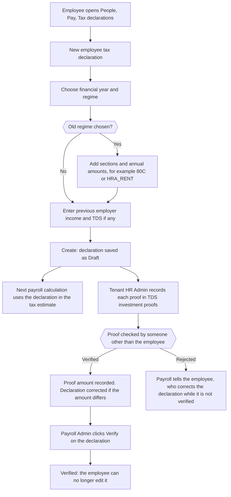

---

## Compensation changes (four-person approval)

**Status:** Available

### Overview
An employee's salary in PeopleOS is changed only through an approved **compensation change**. **CTC** (cost to company) is the total annual cost of the employee's pay. Four different people must act on every change: a **proposer**, a **reviewer**, an **approver** and an **executor** who writes the approved change into the salary history. Nobody can act on their own compensation, whatever their role. Payroll then uses only approved, applied compensation. Changes are visible to people with full compensation access and to the people with a duty on that change — never to the employee concerned, who sees only the result on **My compensation**.

With the standard roles: **HR Manager** can propose and review; **Tenant HR Admin** can propose, review, approve and execute (but only one step per change); **Payroll Admin** can execute. So you need at least four people, for example two HR Managers, one Tenant HR Admin and one Payroll Admin. Your administrator can adjust roles.

### Where to find it
- **Menu path:** proposals start on the employee's record: **People › Lifecycle › Employees** (or the search bar at the top) → open the employee → **Records** → **Rewards** tab → **Compensation**. The list of all changes is **People › Pay › Compensation changes**.
- **Who can open the list:** HR Manager, Tenant HR Admin, Payroll Admin, Tenant Super Admin, Auditor (all changes in scope). Ordinary employees can open the page but see only changes where they have a duty, so it is normally empty for them.

### The screen at a glance
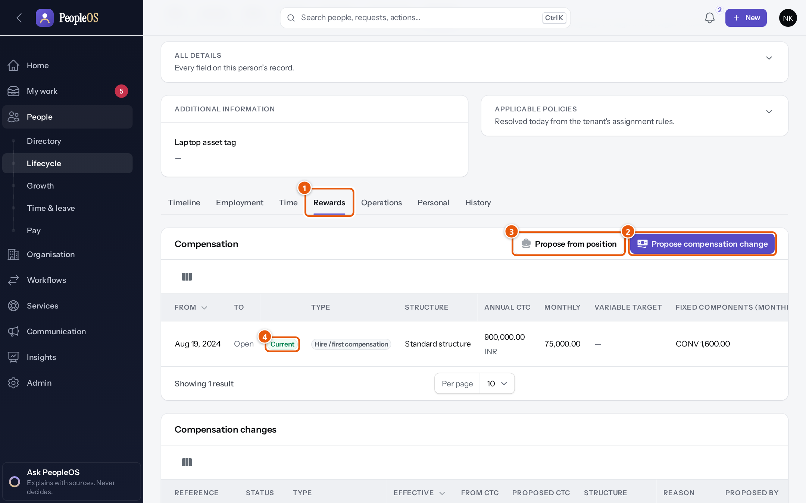
*Figure 4.10 — The Compensation tab on an employee record, seen by Neha Kapoor (HR Manager). Demonstration data (fictional).*

1. **Rewards** tab — under **Records** on the employee's profile.
2. **Propose compensation change** — starts a proposal.
3. **Propose from position** — prefills a draft from the approved pay range of a position; it moves nobody.
4. **Current** — the compensation in force today. Columns: **From**, **To**, **Type**, **Structure**, **Annual CTC**, **Monthly**, **Variable target**, **Fixed components (monthly)**, and for full readers **Range position**, **Reason** and **Approved by**. Opening this tab is recorded in the audit trail.

Below it, **Compensation changes** lists this employee's changes.

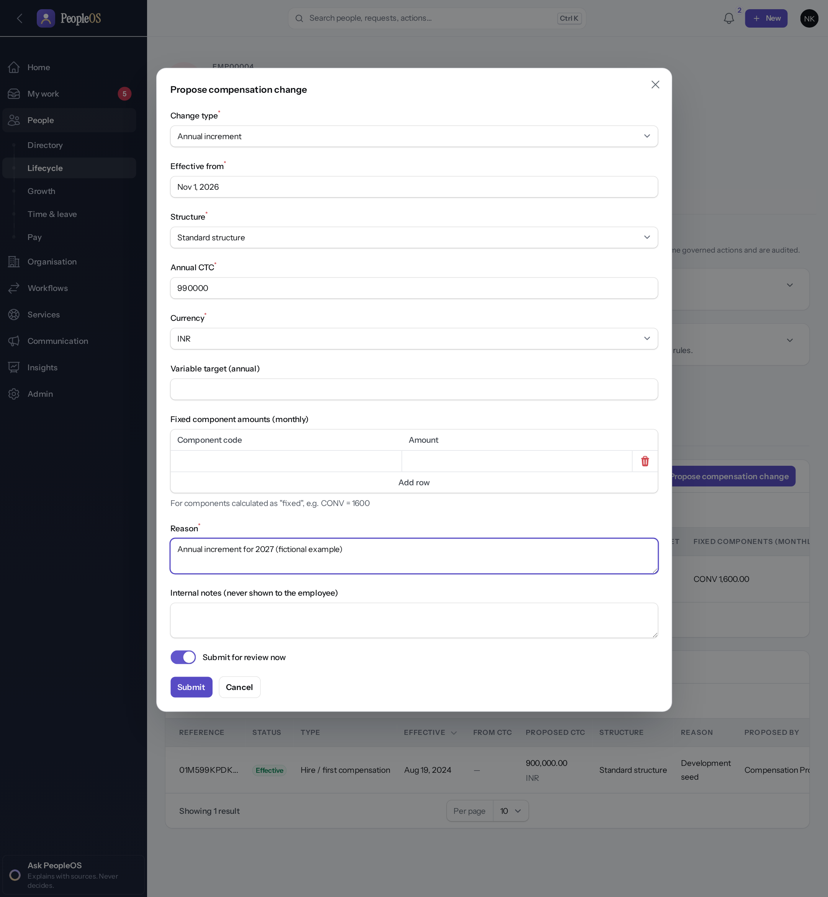
*Figure 4.11 — The proposal dialog filled with fictional values and cancelled. Demonstration data (fictional).*

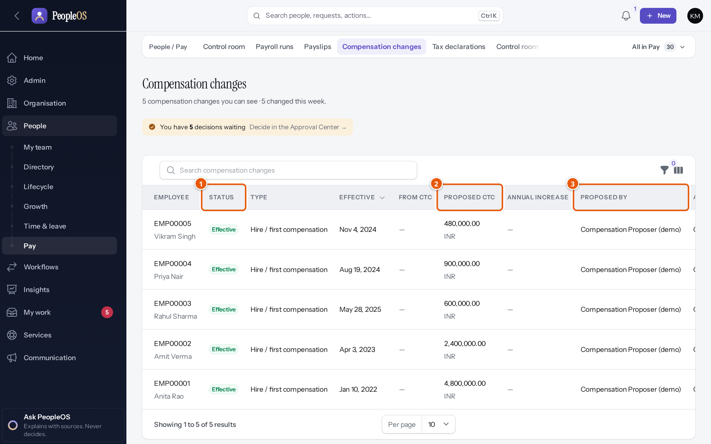
*Figure 4.12 — The Compensation changes list for Kavya Menon (Tenant HR Admin). Demonstration data (fictional).*

1. **Status** — see the table below.
2. **Proposed CTC** — with **From CTC** and **Annual increase**.
3. **Proposed by** — with **Approved by**.

Filters: **Status** and **Type**. Each row has an actions menu showing only the steps you may take: **Submit for review**, **Mark reviewed**, **Approve**, **Reject**, **Return to proposer**, **Execute (schedule)**, **Cancel**.

### Tasks
#### Task: Propose a salary change (proposer)
1. Open **People › Lifecycle › Employees**, open the employee, then click **Records** and the **Rewards** tab.
2. Click **Propose compensation change**.
3. Fill in the required fields: **Change type** (for example **Annual increment**, **Promotion-related increase**, **Market adjustment**, **Correction**), **Effective from**, **Structure**, **Annual CTC**, **Currency** and **Reason**. Optional: **Variable target (annual)**, **Fixed component amounts (monthly)** (for example CONV = 1600) and **Internal notes (never shown to the employee)**.
4. Leave **Submit for review now** on (or switch it off to save a draft).
5. Click **Submit**.

**Expected result:** "Compensation change submitted for review" with a reference. Reviewers are notified in PeopleOS.
**If it fails:** messages explain the problem, for example "Structure STANDARD has no approved version in force on *date*.", "Annual CTC must be positive.", "Compensation cannot start after the employee's exit date (…)", "No one proposes, reviews, approves or executes their own compensation."

#### Task: Review, approve and execute
1. **Reviewer** (not the proposer): in **Compensation changes**, open the row's actions and click **Mark reviewed** (optional note). Status becomes **Under review**.
2. **Approver** (neither proposer nor reviewer, with approval rights): click **Approve**. If the change is linked to a budget, the increase is charged to it; an increase larger than what is left is refused.
3. **Executor** (none of the three before): click **Execute (schedule)**. If the effective date is today or earlier the change is **Effective** at once; otherwise it is **Scheduled** and becomes **Effective** automatically on its date (a daily process).
4. At any pending step, a reviewer or approver can **Reject** (reason required) or **Return to proposer** (note required).

**Expected result:** the new row appears on the employee's Compensation tab and payroll uses it from the effective date.
**Common mistakes:** choosing an effective date inside a month whose payroll is already finalised — this is refused; pay the difference as an arrear adjustment instead.
**If it fails:** "The compensation in force on *date* has changed since this change was submitted; return it to the proposer." means someone else changed the salary in the meantime.

### Statuses explained
| Status | Meaning | What happens next |
|---|---|---|
| Draft | Saved by the proposer, not submitted | Proposer submits or cancels |
| Submitted | Waiting for review | A reviewer marks it reviewed, rejects or returns it |
| Under review | Reviewed, waiting for approval | An approver approves, rejects or returns it |
| Approved | Decided, not yet applied | An executor executes it; an approver may cancel |
| Scheduled | Written to the salary history with a future date | Becomes Effective on its date; an approver may cancel until then |
| Effective | In force | Final; later changes create a new row |
| Rejected / Cancelled | Stopped, with a reason | Nothing further |

**Flowchart — Compensation change approval.** *Roles:* proposer, reviewer, approver and executor — four different people. *Starts:* a proposal on the employee record. *Ends:* the change is Effective.

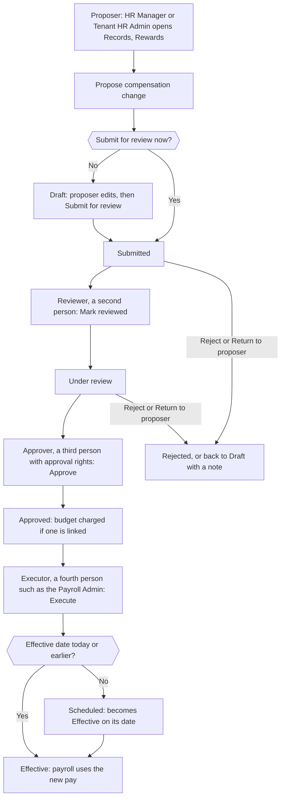

### Example from everyday work
*Illustrative scenario.* Neha Kapoor (HR Business Partner, Demo Technologies) proposes an annual increment for Priya Nair from 1 November. A second HR manager reviews it, Kavya Menon (Head of People) approves it, and Arjun Bose (Payroll Lead) executes it. Because the date is in the future, the change shows **Scheduled** until 1 November, then **Effective**. Priya sees the new figure on **My compensation** from the effective date, but never the proposal, the reason or the internal notes.

---

## Compensation cycles, budgets, pay ranges and salary structures

**Status:** Available

These screens let HR plan pay for many people at once. Each one is created by one person and approved by another.

| Screen | What you store there | Path | Who |
|---|---|---|---|
| Cycles | A bulk round of changes (**Annual increment cycle**, **Promotion cycle**, **Market adjustment cycle**) for a company, optionally a unit or location, with a **Default increase %** or **Increase % by finalized rating label** from a finalised performance cycle | People › Pay › All in Pay › Cycles | Tenant HR Admin prepares; HR Manager or Tenant HR Admin reviews; Tenant HR Admin approves; Payroll Admin or Tenant HR Admin executes — four people |
| Budgets | An amount of annual CTC increase for a company and period, in one currency. **Planned vs actual** shows budget, planned, approved, committed, actual and variance | People › Pay › All in Pay › Budgets | Tenant HR Admin creates and closes; another person with approval rights approves |
| Pay ranges | **Minimum**, **Midpoint**, **Maximum** for a **Grade**, optionally narrowed by structure, company, job family or designation; used to show range position and compa-ratio (pay divided by midpoint) | People › Pay › All in Pay › Pay ranges | Tenant HR Admin drafts and submits; a second person approves |
| Salary structures | Which salary components make up pay, in which order, from which date. Each structure has dated **Versions**; an approved version never changes — a correction is a new version | People › Pay › All in Pay › Salary structures | Tenant HR Admin creates and edits drafts; a second person approves. Payroll Admin, HR Manager and Auditor view |

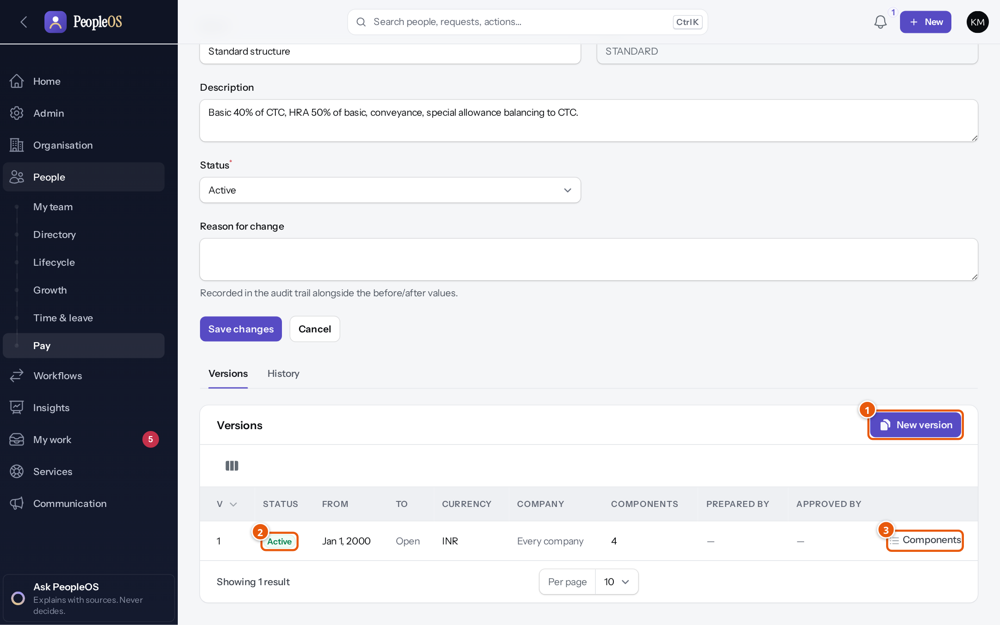
*Figure 4.13 — The Versions tab of the Standard structure, seen by Kavya Menon. (1) **New version** copies the latest approved version from a date you choose; (2) the version status; (3) **Components** lists the components in that version. Demonstration data (fictional).*

**Statuses:** cycles — Draft, Submitted, Under review, Approved, Executed, Rejected, Cancelled; budgets — Draft, Approved, Closed; pay ranges — Draft, Pending approval, Approved, Superseded, Archived; structure versions — Draft, Pending approval, Approved — scheduled, Active, Superseded, Archived.

#### Task: Run an annual increment cycle (generic steps)
1. Open **Cycles** and click **New cycle**. Enter **Code**, **Name**, **Cycle type**, **Company**, **Effective from** and **Default increase %** (required); optionally a unit, location, **Budget (optional)** and a finalised performance cycle with **Increase % by finalized rating label**.
2. Open the cycle and click **Populate**. PeopleOS takes a snapshot of eligible employees (never the preparer) and proposes each line.
3. On the **Employees and proposed compensation** tab, click **Adjust** to change a line while the cycle is a draft.
4. Click **Submit for review**. A second person clicks **Mark reviewed**, a third clicks **Approve**, and a fourth clicks **Execute**. Execution applies every line, or none if any line fails.

**Common mistakes:** expecting a performance rating to change pay by itself. Ratings only prefill proposals; people still review, approve and execute every line.
**Note:** salary structure versions cannot start inside a month whose payroll is finalised, and payroll supports monthly pay only.

---

## Compensation analytics and My compensation

**Status:** Available

**Analytics** (People › Pay › All in Pay › Analytics; Tenant HR Admin, HR Manager, Payroll Admin, Executive, Auditor, Tenant Super Admin) shows totals and averages of approved annual CTC on an **As of** date, filtered by **Company**, **Department**, **Location**, **Grade** and **Employment type**, with breakdowns by grade, department, location and employment type, **Range penetration** and counts of changes. Any group smaller than the minimum group size (five people by default) shows "Suppressed", and a filter that leaves fewer people than that shows nothing. The page states: "Facts only: no recommendation, pay-fairness verdict, performance inference or attrition prediction is made." People with export rights (Tenant HR Admin) can click **Export compensation (CSV)**; the export is recorded in the audit trail.

> **Note:** comparing two filters that differ by fewer than five people can still reveal individual pay. Give analytics access only to people who need it.

**My compensation** (avatar menu › **My compensation**) shows an employee their own approved pay: **In force today** (**Annual CTC**, **Monthly**, **Variable target (annual)**, **Since**, fixed monthly components) and **History and scheduled changes** (**From**, **To**, **Annual CTC**, **Type**). It never shows proposals, reasons, internal notes or pay ranges. Opening it is recorded in the audit trail. Your organisation can switch self-service off.

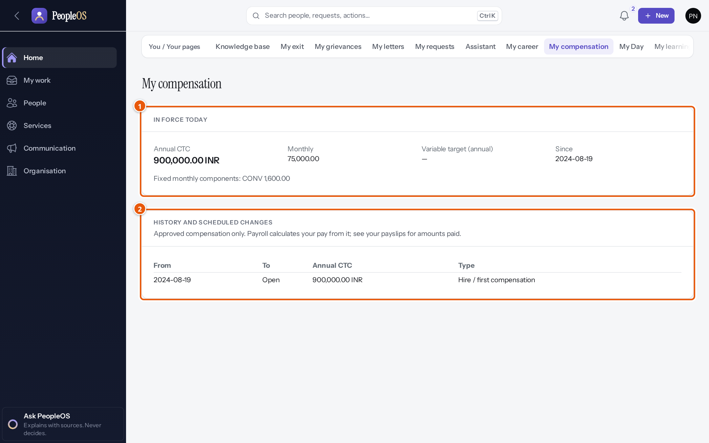
*Figure 4.14 — My compensation: (1) pay in force today; (2) approved history and scheduled changes. Demonstration data (fictional).*

> **Note:** people whose role gives them full compensation access (for example HR Manager, Payroll Admin, Tenant HR Admin) do not see **My compensation**; their own salary is visible on their employee record, and they can never act on their own changes. Managers see their team's approved pay only if the organisation gives them team compensation access (not part of the standard Manager role).

---

## Compliance control room

**Status:** Available

### Overview
The compliance control room is the statutory counterpart of the payroll control room. It shows whether verified-rule enforcement is on, how many rule versions are verified, the rules your organisation needs, open regulatory notices, export layouts, establishment and registration verification, and every statutory return with its **production gate** — the set of controls that must all pass before a return can be exported for filing. It reminds you that an exported file is not a filing.

### Where to find it
- **Menu path:** People › Pay › Control room (the last **Control room** link; titled "Compliance control room"), or the **Compliance control room** button on the payroll control room.
- **Who can open it:** Tenant HR Admin, Payroll Admin, Tenant Super Admin, Auditor.

### The screen at a glance
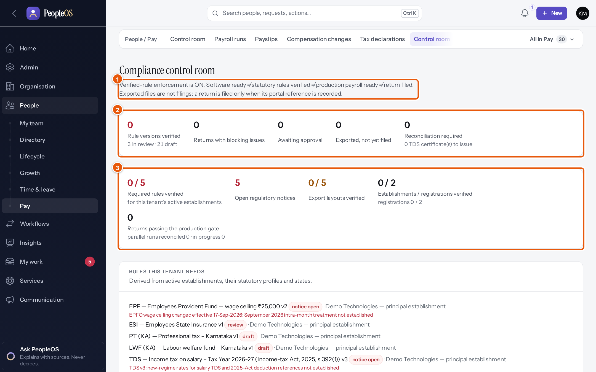
*Figure 4.15 — The compliance control room. Demonstration data (fictional); the rule counts are the real state of the shipped rule library.*

1. **Enforcement line** — "Verified-rule enforcement is ON." and the reminder that software ready, rules verified, payroll ready and return filed are four different things.
2. **Return figures** — **Rule versions verified** (with counts in review and draft), **Returns with blocking issues**, **Awaiting approval**, **Exported, not yet filed**, **Reconciliation required**, TDS certificates to issue.
3. **Readiness figures** — **Required rules verified**, **Open regulatory notices**, **Export layouts verified**, **Establishments / registrations verified**, **Returns passing the production gate**.

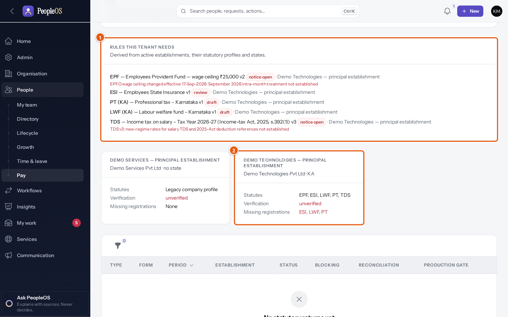
*Figure 4.16 — (1) **Rules this tenant needs**, derived from your active establishments, with each rule's status (draft, review, notice open); (2) an establishment card with **Statutes**, **Verification** and **Missing registrations**. Below is the return register. Demonstration data (fictional).*

The return register lists **Type**, **Form**, **Period**, **Establishment**, **Status**, **Blocking**, **Reconciliation** and **Production gate** (hover the icon to see failing controls), with an **Open** action.

### Task: Daily compliance check
1. Open the compliance control room.
2. Resolve red figures first: blocking issues and reconciliation required.
3. Check **Missing registrations** on each establishment card and add them in **Statutory registrations**.
4. Approve validated returns you did not generate.
5. After filing on the authority's portal, record the submission and acknowledgement on the return.

---

## The statutory rule library: Compliance rules, Rule verification and Regulatory notices

**Status:** Available, read only for your organisation. Verification is done by Markedge.

### Overview
Statutory rates and limits are not entered by customers. They live in a versioned rule library maintained by Markedge. Each rule version has an effective date, an authority, an official source and a **verification status**. A rule becomes **Verified against an official source** only when one Markedge platform administrator submits official evidence covering every parameter and a *different* administrator verifies it. A **regulatory notice** records that a rule is out of date from a certain date; while it is open, the rule cannot be verified and payroll using it is blocked. Today no rule is verified and five notices are open (EPF wage ceiling change from 17 September 2026 and related EPF parameters; TDS for tax year 2026-27 under the Income-tax Act, 2025).

### Where to find it
- **Menu path:** People › Pay › All in Pay › Compliance rules / Rule verification / Regulatory notices
- **Who can open it:** Tenant HR Admin, Payroll Admin, Tenant Super Admin, Auditor (read only).

### The screen at a glance
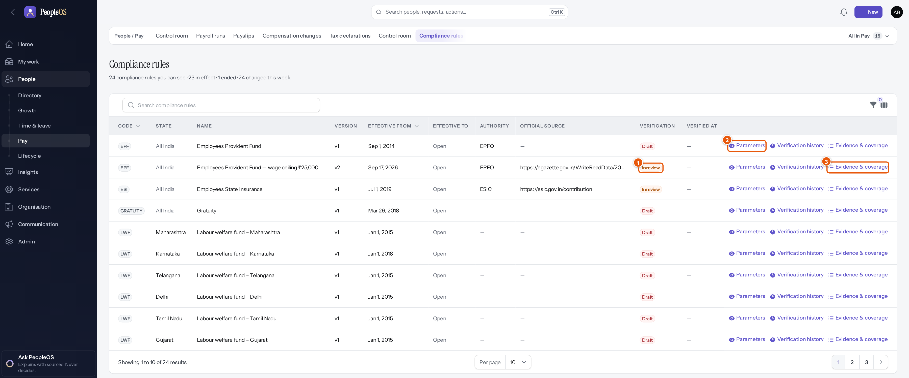
*Figure 4.17 — Compliance rules: every row is Draft or In review. Demonstration data (fictional); the statuses are the real state of the shipped library.*

1. **Verification** — **Draft**, **In review**, **Verified against an official source**, **Superseded** or **Rejected**.
2. **Parameters** — the values the rule holds (rates, ceilings, slabs).
3. **Evidence & coverage** — the official documents attached, how each parameter is supported, and the **Blocking gaps for verification**.

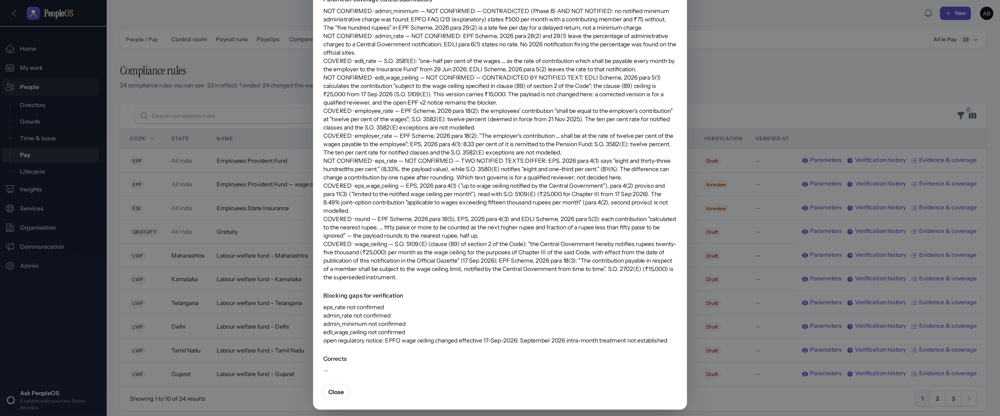
*Figure 4.18 — Evidence & coverage for EPF v2: parameters marked NOT CONFIRMED and an open regulatory notice are listed as blocking gaps. Demonstration data (fictional).*

Other columns: **Code**, **State**, **Name**, **Version**, **Effective from**, **Effective to**, **Authority**, **Official source**, **Verified at**; filters by code and verification. **Verification history** shows each step. **Rule verification** lists every step across rules (**Created at**, **Rule**, **State**, **Version**, **Action**, **Status**, **By**, **Source**, **Notes**). **Regulatory notices** lists **Code**, **State**, **Affects**, **Effective date**, **Title**, **Status** (open or resolved) and **Resolved by**, with **Details**.

### Statuses explained
| Status | Meaning |
|---|---|
| Draft | Loaded, no official evidence accepted yet. Blocks payroll under enforcement |
| In review | Evidence submitted; waiting for a second Markedge administrator. Blocks payroll under enforcement |
| Verified against an official source | Usable for production payroll; can never be edited |
| Superseded | Replaced by a later verified correction |
| Rejected | Not usable |

> **Tip:** use **Compliance control room › Rules this tenant needs** to see which rules matter for your establishments, then ask Markedge for the verification plan for exactly those rules.

---

## Statutory set-up: Statutory registrations, Statutory profiles, TDS deductor profiles and the legacy company profile

**Status:** Available

Statutory set-up tells PeopleOS which statutes apply where and records your registration numbers. It builds on legal entities, establishments and employee establishment assignments, which your Tenant Super Admin (or Account Owner) sets up under **Organisation** (see the Organisation chapter). Employees must be explicitly assigned to an establishment, because professional tax and labour welfare fund follow the establishment's state.

| Screen | What you store there | Path | Who |
|---|---|---|---|
| Statutory registrations | Registration numbers per legal entity or establishment: **EPF establishment code**, **ESIC employer code**, **TAN**, **PAN (deductor)**, **PT registration certificate (employer)**, **Labour welfare fund registration**, **Shops & establishments registration** and others. Numbers are stored encrypted and shown masked | People › Pay › All in Pay › Statutory registrations | Tenant HR Admin |
| Statutory profiles | Which statute (**EPF**, **ESI**, **PT**, **LWF**, **TDS**) applies to each establishment from which date, the linked registration and, for EPF, **Restrict PF to the statutory wage ceiling**. Profiles hold no rates | People › Pay › All in Pay › Statutory profiles | Tenant HR Admin |
| TDS deductor profiles | The deductor for each legal entity: **Deductor category**, **TAN**, **Deductor PAN**, responsible person name, designation and PAN, contact details | People › Pay › All in Pay › TDS deductor profiles | Tenant HR Admin |
| Company statutory profiles (legacy) | The older per-company settings (applicability switches, PT and LWF state, registration numbers). Used only for establishments that have no statutory profiles; returns built on a legacy-profile state are blocked | People › Pay › All in Pay › Company statutory profiles (legacy) | Payroll Admin, Tenant HR Admin |

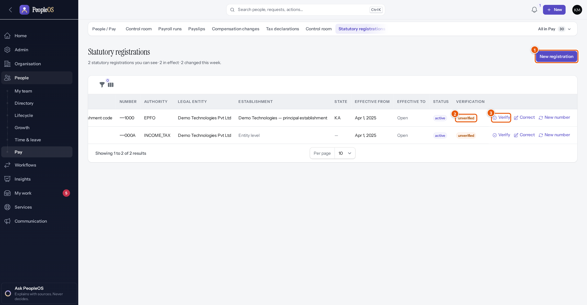
*Figure 4.19 — Statutory registrations: (1) **New registration**; (2) the **Verification** status, here unverified; (3) **Verify**, which must be done by someone other than the person who recorded the registration. Demonstration data (fictional).*

#### Task: Add and verify a registration
1. Open **Statutory registrations** and click **New registration**.
2. Fill in **Legal entity**, **Registration type**, **Registration number**, **Effective from** and **Reason** (required); choose the **Establishment** (or leave it at entity level for PAN or TAN), **Registration name**, **Jurisdiction / office** and **State**.
3. Save. The registration is **active** and **unverified**.
4. A different person compares it with the certificate, clicks **Verify**, enters **Certificate / portal reference checked** and optional **Notes**.

**Common mistakes:** editing a registration number. Use **New number** to replace it; use **Correct** only for the name, jurisdiction, closing date and notes.
**If it fails:** "A registration cannot be verified by the person who recorded it."; "This registration number is already active for another establishment."

---

## Statutory returns: EPF, ESI, professional tax, LWF and TDS

**Status:** Available with limitations — returns are built only from finalised payroll (blocked today); export is refused by the production gate until rules, registrations, establishments and export layouts are verified; no export layout is verified; PeopleOS never files with an authority.

### Overview
PeopleOS prepares five kinds of statutory return from finalised payroll:
- **EPF returns (ECR)** — the provident fund Electronic Challan-cum-Return, per establishment and wage month (**Regular**, **Supplementary (new members)**, and revisions through **Revise members**).
- **ESI returns** — state insurance monthly contributions, per establishment and month.
- **Professional tax returns** and **LWF returns** — state levies, per establishment, state and month.
- **TDS statements (Form 138)** — the quarterly statement of tax deducted on salary (formerly Form 24Q), per legal entity and quarter, with the tax deposit (challan) details you enter.
- **TDS certificates (Form 130)** — the annual certificate to employees (formerly Form 16), prepared only after all four quarterly statements are acknowledged and the annual ledger is verified.

Every return follows the same steps, with separation of duties: the person who generates a return cannot approve it, and the person who records the filing must be neither the generator nor the approver. Approval freezes the content. Exporting produces a file but **nothing is filed**: you upload the file on the authority's portal and record the reference in PeopleOS.

### Where to find it
- **Menu path:** People › Pay › All in Pay › **EPF returns (ECR)**, **ESI returns**, **Professional tax returns**, **LWF returns**, **TDS statements (Form 138)**, **TDS certificates (Form 130)**
- **Who can open it:** Tenant HR Admin, Tenant Super Admin (Payroll Admin does not have these by default).
- **Set-up needed first:** finalised payroll for the period; legal entity and establishment verified; registrations recorded and verified; statutory profiles; employees assigned to establishments; and, for export, verified rules and export layouts.

### The screen at a glance
Each return list shows **Period**, **Establishment**, **Legal entity**, **State**, **Kind**, **Status**, **Lines**, **Blocking** and **Portal ref.**, with a generate button: **Generate ECR**, **Generate ESI return**, **Generate PT return**, **Generate LWF return** or **Generate Form 138 statement**. A return's page shows its details (**Form**, **Period**, **Status**, **Export layout**, **File structure**, **Portal validation**, **Reconciliation**, **Generated by**, **Approved by**, **Portal reference**, **Acknowledgement**) and sections for **Totals**, **Validation**, **Reconciliation**, **Entries (masked)** and **Actions** (the step log).

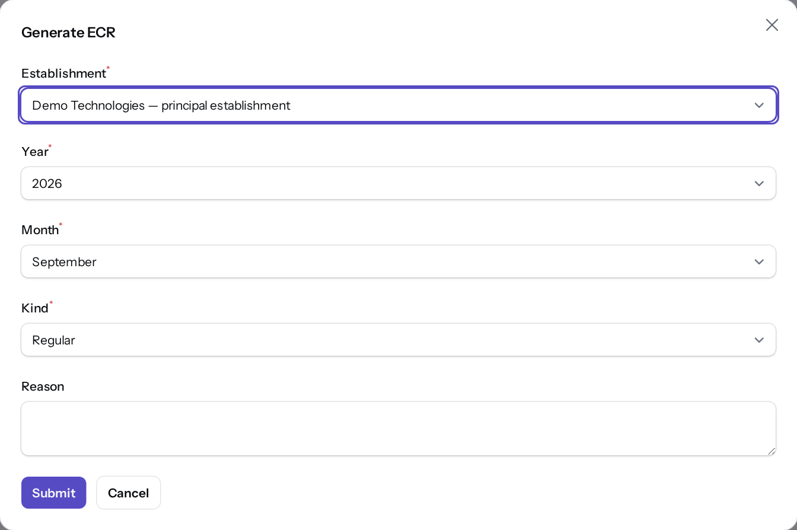
*Figure 4.20 — The Generate ECR dialog (cancelled): **Establishment**, **Year**, **Month**, **Kind** and an optional **Reason**. Demonstration data (fictional).*

Steps on a return page: **Validate & reconcile**, **Approve** (with an **Approval note**), **Export file**, **Record portal validation**, **Record submission** (**Portal reference (e.g. TRRN / token / ack no.)**, **Filed at**), **Record acknowledgement**, **Reconcile filing** and **Cancel** (before submission, with a reason).

### Tasks
#### Task: Prepare and record a monthly return (EPF example)
1. Open **EPF returns (ECR)** and click **Generate ECR**. Choose **Establishment**, **Year**, **Month** and **Kind**, then **Submit**. The return is **Calculated** ("ECR generated from finalized payroll").
2. Open the return and click **Validate & reconcile**. With no blocking issues and a balanced reconciliation it becomes **Validated**; otherwise read the **Validation** section, fix the cause and generate again.
3. A second person clicks **Approve**. The content is frozen.
4. Click **Export file**. If the production gate passes, the file downloads ("Exported — not filed").
5. Upload the file on the authority's portal, outside PeopleOS.
6. A third person clicks **Record submission** and enters the portal reference, then **Record acknowledgement** when the authority acknowledges it, and finally **Reconcile filing** with the acknowledged amounts.

**Expected result:** the return moves to **Submitted (filing recorded)**, **Acknowledged** and **Reconciled**.
**If it fails:**
- "*Return* is already *status*; create a revision instead of regenerating it." — use **Revise members** (EPF) after correcting payroll.
- "Separation of duties: the person who generated a return cannot approve it."
- "A return with blocking issues or an unbalanced reconciliation cannot be approved."
- "The production gate blocks this export: …" — the listed controls are failing; there is no override.
- "Submission needs the external reference issued by the portal (e.g. TRRN or acknowledgement number)."

#### Task: Prepare TDS certificates (Form 130)
1. In **TDS certificates (Form 130)**, click **Verify annual ledger**, choose **Legal entity** and **Financial year**. This needs all four Form 138 statements acknowledged and matching the ledger.
2. Click **Prepare Form 130** for the same legal entity and year.
3. A different person clicks **Issue** on each certificate and enters the **TRACES certificate number** (Part A is downloaded from the income tax TRACES portal, outside PeopleOS).

**If it fails:** "Form No. 130 is prepared only from a verified annual ledger; …"; "Separation of duties: the person who prepared the certificate cannot issue it."

### Statuses explained
| Status | Meaning | What happens next |
|---|---|---|
| Draft / Calculated | Built from finalised payroll; may have blocking issues | Validate & reconcile |
| Validated | No blocking issues; reconciliation balanced | Approve (not the generator) |
| Reconciliation required | Totals differ from payroll or from what the authority acknowledged | Fix and validate, or reconcile filing |
| Approved | Content frozen | Export file |
| Exported (not filed) | A file was produced; nothing filed | File on the portal, then Record submission |
| Submitted (filing recorded) | A person recorded the portal reference | Record acknowledgement |
| Acknowledged | Authority's reference recorded | Reconcile filing |
| Reconciled | Acknowledged amounts match | Done |
| Revised / Cancelled | Replaced by an approved revision / withdrawn before submission | Nothing further |

**Flowchart — Preparing a statutory return.** Shows where the verified-rule gate stops the process. *Roles:* Tenant HR Admin (generator), a second person (approver), a third person (filer). *Starts:* a payroll month. *Ends:* the return is Reconciled.

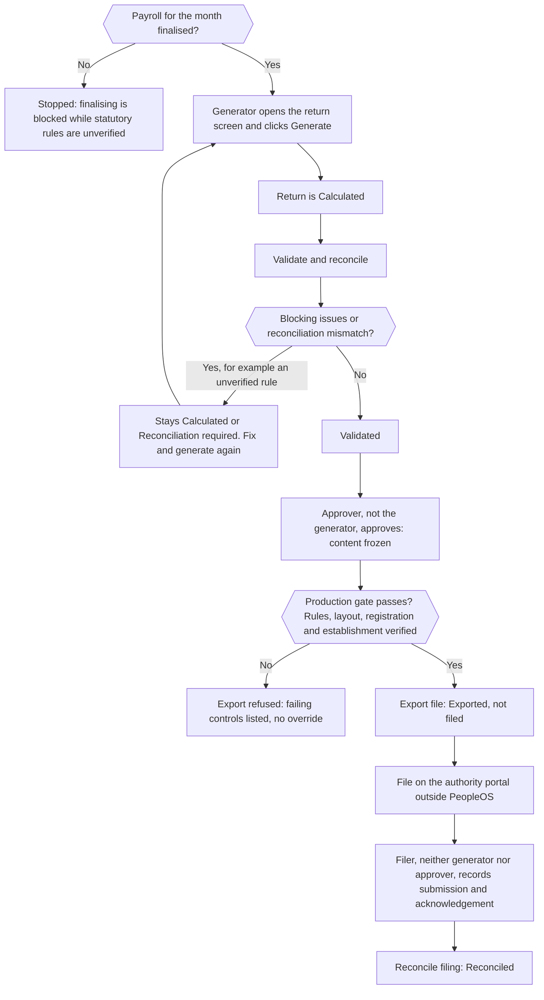

> **Note — current limitations of returns:** export layouts are published by Markedge and none is verified yet (all five are draft); the PT and LWF exports are generic working schedules, not state forms; the Form 138 export is a working schedule, not the official utility (FVU) file; there is no TRACES integration, no Form 12BA and no lower-deduction certificates; EPF's 10% contribution option, EPS eligibility by age, and refunds of advances are not modelled; ESI's disability wage limit and daily-wage exemption are not modelled; payments, challans, interest and damages stay on the authorities' portals.

---

## Export layouts and Parallel payroll

**Status:** Available — export layouts are read only for your organisation and none is verified; parallel payroll needs a finalised run.

| Screen | What it does | Path | Who |
|---|---|---|---|
| Export layouts | The versioned file formats used for statutory exports (**EPF_ECR**, **ESI_MC**, **PT_RETURN**, **LWF_RETURN**, **TDS_FORM_138**) with their status and **Specification**. Markedge verifies a layout against the authority's own specification (two different administrators) | People › Pay › All in Pay › Export layouts | Tenant HR Admin, Payroll Admin, Auditor, Tenant Super Admin (read only) |
| Parallel payroll | Compares one finalised PeopleOS month with values from your current payroll system or portal, line by line, before you rely on PeopleOS | People › Pay › All in Pay › Parallel payroll | Tenant HR Admin, Tenant Super Admin |

#### Task: Run a parallel payroll month
1. Finalise one month in PeopleOS (possible only once the rules you use are verified).
2. Open **Parallel payroll** and click **Import reference values**. Choose the **Finalized payroll run**, name the **Reference source (payroll system / portal)**, upload the **Reference CSV (level,employee_code,scope,component,amount)** and add a **Description**.
3. Click **Compare**. Every value becomes a line: matched, difference, missing reference, missing in PeopleOS, or not compared.
4. A different person clicks **Review** on each difference and records **Why the values differ** and the **Resolution (never "changed the rule to match")**.
5. A person other than the importer clicks **Reconcile**. This is allowed only when every difference is resolved and at least one statutory return total matched.

**If it fails:** "The person who imported the reference values cannot sign off the reconciliation."; "*N* difference(s) are not explained and resolved."; "Compare at least one statutory return total; employee-level matching alone is not a reconciled parallel run."

---

## Limitations and what to confirm with Markedge

> **Important:** the list below summarises what is not yet available or not yet verified in this area. Ask Markedge (your provider) about each item that matters to you before you commit to a go-live date.

- **Statutory verification:** 0 of 24 rule versions verified; 5 regulatory notices open; no statutory specialist engaged yet according to the latest register. Payroll cannot be finalised in production until the rules your establishments need are verified. Confirm the plan and dates for your states.
- **Countries:** payroll is blocked outside India and the UAE (one UAE pension rule only, also unverified). USA, UK and EU payroll rules do not exist in PeopleOS.
- **Gratuity:** not calculated; settle it outside PeopleOS or with a manual line on the exit settlement until Markedge decides otherwise.
- **Returns and filing:** export layouts unverified; no official utility files; PeopleOS never files and never pays tax or contributions.
- **Payroll scope:** monthly pay only; payslips on screen only (no PDF); automatic arrears from back-dated changes are not calculated (use arrear adjustments); loan and advance schedules are not built; ESI coverage continuity across a contribution period is detected, not applied; payroll approval is the in-app step with separation of duties, not routed through the workflow engine.
- **Tax declarations:** employees cannot submit a declaration as such (it stays Draft until payroll changes it); proof records do not change the tax estimate; there is no proof document upload on these screens.
- **Compensation:** salary changes cannot be made through the integration interface (API) — only on screen, through the four-person chain; the four-person chain needs at least four suitably authorised people; managers see team pay only if granted.
- **Release:** PeopleOS is not yet generally released; commercial terms, hosting and support are to be confirmed with the SaaS provider.

## Related chapters
- **Organisation** — legal entities, establishments and establishment assignments that statutory calculations depend on.
- **Time & leave** — attendance and unpaid leave feed loss-of-pay days.
- **Lifecycle (exit)** — final settlements, which have no gratuity line.
- **Admin** — roles, settings (such as adjustment approval and compensation self-service) and the audit trail.
