# Growth: performance, learning, skills and talent

> **In this chapter:** how PeopleOS runs performance reviews, goals, continuous feedback, learning, skills, development plans, careers and succession planning. **Who should read it:** HR administrators who set these up, managers who review and develop their teams, and every employee who sets goals, completes reviews and takes training.

Growth is where your organisation helps people do their best work and move forward. Once a year (or more often) you run a **performance cycle**: everyone sets goals, writes a self review, gets a manager review, and receives a final rating that they acknowledge. Between reviews, people check in on progress, give each other feedback and hold one-on-ones. Learning covers the course catalogue, mandatory training, classroom sessions and certificates. Skills and development plans show what people can do and what they are working on. Career and succession pages let employees record their ambitions, and let HR plan who could step into critical roles — confidentially.

| Module | What it is for | Where to find it | Who uses it | Status |
|---|---|---|---|---|
| Cycles | Run a review period with ordered stages | People › Growth › All in Growth › Cycles | HR administrators | Available with limitations (stages move on manually) |
| Templates | Reusable, versioned review set-ups | People › Growth › All in Growth › Templates | HR administrators | Available |
| Appraisals | Self, manager and peer reviews, final rating, acknowledgement | People › Growth › Appraisals | Everyone | Available |
| Calibration | Rating distribution; calibrate and finalise | People › Growth › All in Growth › Calibration | HR administrators | Available |
| Calibration sessions | Recorded calibration meetings with an adjustment history | People › Growth › All in Growth › Calibration sessions | HR administrators | Available with limitations (no invitations or minutes) |
| Goals | Goals, OKRs, KRAs and KPIs with cascade and key results | People › Growth › Goals | Everyone | Available with limitations (see Goals) |
| Check-ins | Regular written check-ins with your manager | People › Growth › All in Growth › Check-ins | Employees, managers | Available |
| Feedback | Praise and constructive feedback, feedback requests | People › Growth › Feedback | Everyone | Available |
| One-on-ones | Manager–employee meetings with shared and private notes | People › Growth › One-on-ones | Managers, employees | Available |
| Improvement plans | Performance improvement plans with checkpoints | People › Growth › All in Growth › Improvement plans | HR administrators, managers | Available |
| Rating scales, Competencies, KRA library | Reference data for reviews and goals | People › Growth › All in Growth | HR administrators | Available |
| Development needs | Things a person needs to develop, found in reviews | People › Growth › All in Growth › Development needs | Everyone | Available |
| Career passport | One-page summary of a person's growth | People › Growth › All in Growth › Career passport | Everyone (own), managers, HR | Available |
| Analytics (performance) | Completion and rating figures by department | People › Growth › All in Growth › Analytics | HR administrators | Available with limitations (department only, no trends) |
| Dashboard (learning) | Learning and development figures | People › Growth › Dashboard | HR administrators | Available |
| Courses | Course catalogue with versions, modules and assessments | People › Growth › All in Growth › Courses | HR administrators (manage), everyone (browse) | Available with limitations (links and text only) |
| Learning paths, Programs | Bundles of courses | People › Growth › All in Growth | HR administrators | Available |
| Enrolments | Who is taking which learning, and its status | People › Growth › All in Growth › Enrolments | Everyone | Available |
| Assignments | Rule-based and recurring learning assignments | People › Growth › All in Growth › Assignments | HR administrators, managers | Available |
| Certificates | Certificates issued on completion, and external credentials | People › Growth › All in Growth › Certificates | Everyone | Available with limitations (documents are not PDF) |
| Training sessions | Classroom and virtual sessions with attendance | People › Growth › All in Growth › Training sessions | HR administrators, managers, employees | Available with limitations (see Training sessions) |
| Providers, Instructors | Training vendors and trainers | People › Growth › All in Growth | HR administrators | Available |
| Skills, Skill levels, Skill assessments | Skill library, proficiency scales, assessed skill levels | People › Growth › All in Growth | HR administrators, managers, employees | Available |
| Development plans | Personal plans that turn needs into learning and milestones | People › Growth › All in Growth › Development plans | Everyone | Available |
| My learning | An employee's own learning, certificates and skills | Avatar menu › My learning | Every employee | Available |
| Team learning | A manager's view of the team's learning | People › My team › Team learning | Managers | Available |
| My career | An employee's career profile, aspirations, career goals | Avatar menu › My career | Every employee | Available |
| Team career | What team members chose to share about their career | People › My team › Team career | Managers | Available |
| Career paths, Career architecture, Role requirements, Career profiles | Career ladders, tracks and what roles need | People › Growth › All in Growth | HR administrators | Available |
| Dashboard (talent), Analytics (talent) | Succession coverage and talent figures | People › Growth › Dashboard / All in Growth › Analytics | HR administrators | Available |
| Critical positions, Succession plans, Successors, Readiness, Development actions | Succession planning | People › Growth › All in Growth | HR administrators | Available |
| Talent pools, Talent reviews | Named groups of people and recorded review decisions | People › Growth › All in Growth | HR administrators | Available |
| My Team | A manager's daily team view | People › My team | Managers | Available |

## Finding your way and who can do what

**Navigation.** Open **People › Growth**. The **area bar** at the top shows the everyday screens: **Appraisals**, **Goals**, **One-on-ones** and **Feedback**. HR administrators also see two links both labelled **Dashboard**: the first opens the learning dashboard ("Learning & development"), the second the talent dashboard ("Talent & succession"). Everything else is in the **All in Growth** menu, grouped into three columns: **Performance**, **Talent** and **Learning**. The menu has its own search box ("Find in Growth"). Your personal pages, **My learning** and **My career**, are in the avatar menu (top right). Managers find **My Team**, **Team career** and **Team learning** under **People › My team**.

**Roles.** What you see depends on your role (the set of permissions your administrator gave you):

- **Employee** — your own goals, appraisal, check-ins, feedback, one-on-ones, learning, skills, development plans and career page.
- **Manager** — the above, plus the people you manage: their goals, reviews, check-ins, one-on-ones, improvement plans, learning (assign and approve) and skill assessments. "The people you manage" means people linked to you by a line, functional, dotted-line, secondary or HR business partner relationship. Mentors, buddies and project leads do not count.
- **Tenant HR Admin** and **Tenant Super Admin** — set up and run everything in this chapter.
- **Auditor** — read-only access to most Growth screens.
- **HR Manager** — as delivered, this role has no performance, learning, career or talent administration rights. An HR Manager uses Growth as an employee (and can view the Skills library). Your administrator can add more permissions to the role.
- **Performance Admin** — this role is described as "Manages performance cycles", but as delivered it only lets the holder view company, organisation and people set-up data (for example **Designations** and **Skills**). It cannot open **Cycles** or any other performance screen until your administrator adds the performance permissions it needs.

> **Important:** In this chapter, "HR administrator" means a **Tenant HR Admin** or **Tenant Super Admin**, unless your administrator has given another role the same rights.

Everything material you do here — launching a cycle, submitting a review, calibrating, finalising, assigning learning, recording readiness — is recorded in the audit trail: who did it, when, what changed and, where asked, why.

## Performance cycles and templates

**Status:** Available with limitations — a scheduled cycle does not launch by itself, and stages move on only when an HR administrator moves them.

### Overview

A **performance cycle** is one review period, such as "FY 2026-27 annual review". It has a period, a rating scale, the competencies to rate, weights for goals and competencies, and **ordered stages**: Goal setting, Self review, Manager review, Peer / 360 review, Calibration and Final rating. You choose which stages to use and in what order. **Eligibility rules** decide who gets an appraisal. A **template** stores a review set-up you want to reuse; each time you publish it, PeopleOS saves a new numbered **version** that never changes. When a cycle launches, the version it uses is **pinned** (fixed), so later changes to the libraries never alter reviews already under way.

### Where to find it

- **Menu path:** People › Growth › All in Growth › Cycles (and … › Templates)
- **Who can open it:** Tenant HR Admin, Tenant Super Admin; Auditor (read only)
- **Set-up needed first:** at least one active rating scale (a five-point scale is provided), the competencies you want to rate, and current reporting lines (each appraisal takes the employee's current manager).

### The screen at a glance

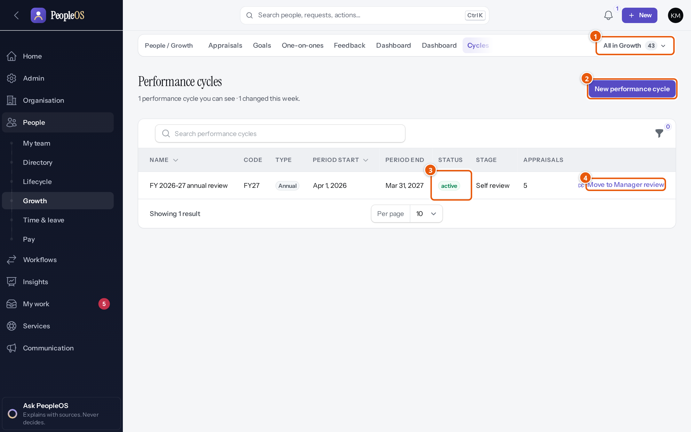
*Figure 5.1 — The Performance cycles list, with the FY 2026-27 cycle active at the Self review stage. Demonstration data (fictional).*

1. **All in Growth** — opens the menu with every Growth screen you may use.
2. **New performance cycle** — starts a new cycle.
3. **Status** and **Stage** — where the cycle is (draft, scheduled, active, closed, archived) and which stage is open.
4. **Move to Manager review** — moves the cycle to its next stage. The button names the next stage; on the last stage it reads **Close cycle**.

Other columns: **Name**, **Code**, **Type** (Annual, Half-yearly, Quarterly, Probation, Project), **Period start**, **Period end**, **Appraisals** (how many). You can search and filter by status. Open a cycle to see its **Appraisals** tab and its change history.

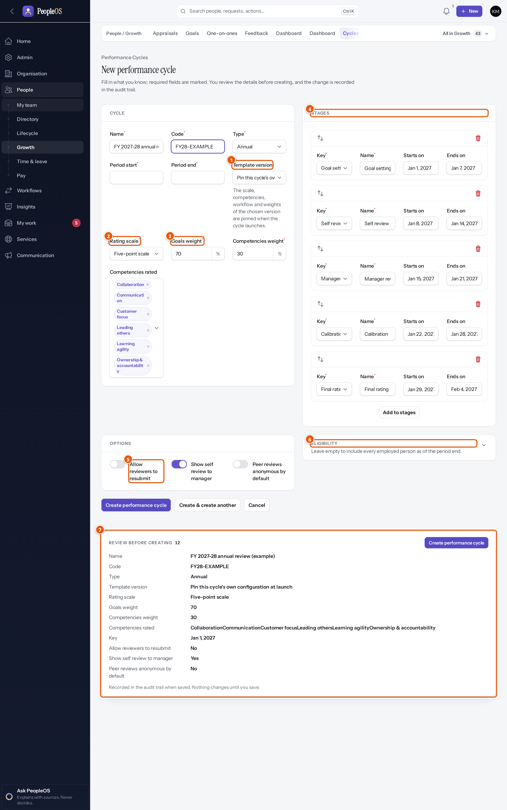
*Figure 5.2 — The New performance cycle form, filled in with example values and not saved. Demonstration data (fictional).*

1. **Template version** — optional. Choose a published template version, or leave "Pin this cycle's own configuration at launch".
2. **Rating scale** — the scale reviewers rate on.
3. **Goals weight** and **Competencies weight** — how much each part counts in the computed rating (defaults 70% and 30%).
4. **Stages** — the ordered stages, each with **Key**, **Name**, **Starts on** and **Ends on**. Drag to reorder; **Add to stages** adds one.
5. **Options** — **Allow reviewers to resubmit**, **Show self review to manager**, **Peer reviews anonymous by default** (see the note below).
6. **Eligibility** — rules that decide who is included. Leave empty to include every employed person as of the period end.
7. **Review before creating** — a summary of what you filled in. Nothing is saved until you click **Create performance cycle**.

> **Note:** In the current version the three **Options** are saved with the cycle but have no visible effect: once a review is submitted its button disappears, managers can always read the submitted reviews of their team, and anonymity is chosen for each reviewer when you click **Add reviewer**.

### Tasks

#### Task: Set up and launch a performance cycle

**Purpose:** create appraisals for everyone in scope and open the first stage.
**Before you start:** check reporting lines in the employee records; decide whether to use a template.

1. Open **People › Growth › All in Growth › Cycles**.
2. Click **New performance cycle**.
3. Enter **Name**, **Code**, **Type**, **Period start** and **Period end** (all required). Choose a **Rating scale** (required) and, if you use one, a **Template version**.
4. Check the **Goals weight**, **Competencies weight** and **Competencies rated**.
5. Under **Stages**, keep, remove or reorder stages and set their dates. The dates are used for reminders: reviewers with a pending review are reminded three days before the stage ends.
6. Optionally set **Options** and **Eligibility** rules.
7. Click **Create performance cycle**. The cycle is created as a draft and opens for editing. If you chose a template version, the cycle takes its stages, scale, competencies and weights.
8. Optional: click **Schedule**, choose **Launch on** and submit. This freezes the configuration; the cycle shows as scheduled.
9. Click **Launch cycle**. The confirmation tells you how many eligible employees will get an appraisal. Confirm.

**Expected result:** the cycle is active, every eligible employee has an appraisal with status **Pending**, and the first stage is open.
**How to verify:** the **Appraisals** column shows the number of appraisals; open **People › Growth › Appraisals** and filter by the cycle.
**Common mistakes:** expecting a scheduled cycle to launch on its date — it does not; you must click **Launch cycle**. Launching before reporting lines are correct: each appraisal takes the manager recorded at launch.
**If it fails:** "Only a draft cycle can be scheduled.", "Define at least one stage before launching." or "Only a draft or scheduled cycle can be launched." explain the problem. If a template version no longer matches the cycle, PeopleOS lists the differences and asks you to apply the template again or clear it.

> **Note:** Once a cycle is scheduled or launched, its period, scale, stages, weights, competencies, eligibility, options, type and template version can no longer change. An archived cycle is read-only.

#### Task: Move a cycle to the next stage, close it and archive it

1. Open **Cycles** and click the move button on the cycle (for example **Move to Manager review**), or open the cycle and use the same button at the top. Confirm.
2. PeopleOS opens the next stage and notifies the people who now have a review to write.
3. On the last stage, the button reads **Close cycle**. A cycle closes only when every appraisal is **Finalized** or **Acknowledged**; otherwise you see, for example, "2 appraisal(s) are not finalized yet."
4. After closing, click **Archive** to make the cycle read-only.

**What each stage does:**

| When this stage opens | What happens |
|---|---|
| Self review (or Manager review, if there is no self review stage) | The cycle's goals are **locked for review**: their title, weight, measure, targets, alignment and owner can no longer change. Appraisals move to **In review**. Reviewers are notified. |
| Manager review, Peer / 360 review | Appraisals still pending move to **In review**; reviewers are notified. |
| Calibration | PeopleOS computes each score and moves open appraisals to **Calibration**. |
| Final rating | PeopleOS recomputes the scores of appraisals not yet finalised. |
| Close cycle | Every appraisal is locked (no review or rating can change), and the cycle's open goals are marked completed. |

#### Task: Publish a template version

1. Open **People › Growth › All in Growth › Templates** and click **New performance template** (**Name**, **Code**, **Description**) if you need a new one.
2. On the template row, click **Publish version**.
3. Choose the **Rating scale**, tick the **Competencies**, the **Workflow stages (in this order)** and the **Sections**, and set **Goals weight**, **Competencies weight** and, optionally, **Required goal weight total** (leave empty for no required total). Click **Submit**.

**Expected result:** a new version number appears in **Latest**. Publishing takes a snapshot of the rating scale and competencies as they are now; a published version never changes. Click **Versions** to see every version.

> **Note:** The review form always asks for goal ratings, competency ratings and an overall rating. The **Sections** you tick are recorded with the version.

### Statuses explained

| Cycle status | Meaning | What happens next |
|---|---|---|
| draft | Being set up; can be edited | Schedule or launch |
| scheduled | Configuration frozen; a launch date is recorded | An HR administrator clicks **Launch cycle** |
| active | Running; one stage is open at a time | Move through the stages, then close |
| closed | All appraisals final and locked | Archive |
| archived | Read-only history | — |

## Appraisals

**Status:** Available.

### Overview

An **appraisal** is one employee's review in one cycle. It collects a **self review**, a **manager review** and any **peer reviews** (peer, upward, skip level or external stakeholder). Each review rates the employee's goals and the cycle's competencies, then gives an overall rating with strengths, areas to develop and comments. PeopleOS then **computes** a rating, HR can **calibrate** it, and HR **finalises** it. The employee reads the outcome and **acknowledges** it.

**How the computed rating works:** only the manager's review feeds it. PeopleOS takes the manager's goal ratings, weighted by each goal's weight, and the average of the competency ratings, blends them using the cycle's goal and competency weights, and expresses the result on the rating scale. If the manager rated no goals or competencies, the manager's overall rating is used. Self and peer ratings are shown alongside for comparison.

**Who sees what:** employees see their own appraisal and only the reviews of it that have been submitted; anonymous peer reviewers appear as "Anonymous". Managers see the appraisals of the people they manage. Reviewers see the appraisals they must review. HR administrators see all.

### Where to find it

- **Menu path:** People › Growth › Appraisals
- **Who can open it:** every employee (own), Manager (team), Tenant HR Admin, Tenant Super Admin, Auditor
- **Set-up needed first:** a launched cycle. Appraisals are never created by hand.

### The screen at a glance

The list shows **Cycle**, **Code**, **Employee**, **Manager**, **Status**, **Reviews** (for example "Self …, Manager …"; a tick means submitted), and the **Self**, **Manager**, **Computed**, **Calibrated** and **Final** ratings. Filter by **Cycle** or **Status**; click **View** to open one.

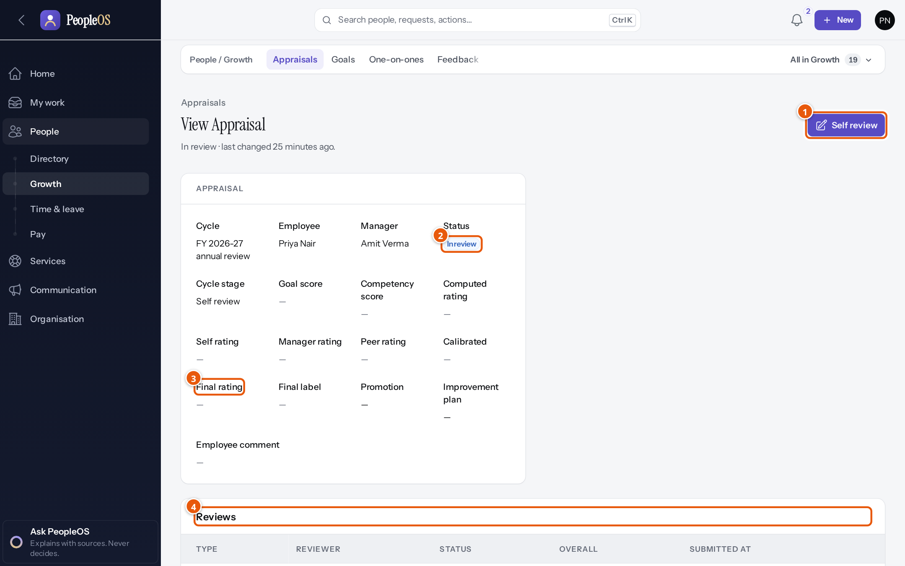
*Figure 5.3 — Priya Nair's appraisal in the FY 2026-27 cycle, as she sees it. Demonstration data (fictional).*

1. **Self review** — opens your self review form. The button appears only while your review is still to do.
2. **Status** — where the appraisal is (here **In review**).
3. Ratings — **Goal score**, **Competency score**, **Computed rating**, the **Self**, **Manager** and **Peer rating**, **Calibrated**, **Final rating** and **Final label**, plus **Promotion** and **Improvement plan** recommendations once recorded.
4. **Reviews** — the reviews of this appraisal. Click **Read** on a submitted review to see its ratings and comments.

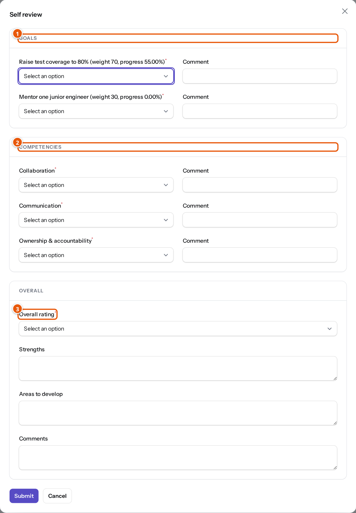
*Figure 5.4 — The Self review form (not submitted). Demonstration data (fictional).*

1. **Goals** — one rating and an optional **Comment** per goal; the label shows the goal's weight and progress.
2. **Competencies** — one rating and an optional comment per competency of the cycle.
3. **Overall rating** — required; followed by **Strengths**, **Areas to develop** and **Comments**.

### Tasks

#### Task: Complete your self review (employee)

**Before you start:** the cycle must have reached the **Self review** stage. Check your goal progress first.

1. Open **People › Growth › Appraisals** and click **View** on your appraisal (or open it from the notification).
2. Click **Self review**.
3. Choose a rating for every goal and every competency (required), add comments if you wish, choose an **Overall rating** and write your strengths, areas to develop and comments.
4. Click **Submit**.

**Expected result:** "Review submitted". The **Reviews** list shows your self review as submitted.
**Common mistakes:** trying before the stage opens — you see "The Self review stage has not opened yet."
**If it fails:** "Ratings must be between 1 and 5." means a value is outside the scale. Once submitted, a review cannot be changed from the screens; ask HR if something must be corrected.

#### Task: Write a manager review and add other reviewers (manager)

1. Open the appraisal of a team member (People › Growth › Appraisals › **View**).
2. To ask someone else for input, click **Add reviewer**, choose the **Reviewer** and **Type** (Peer, Upward (direct report), Skip level, External stakeholder), tick **Anonymous to the employee** if needed, and submit. The reviewer finds a **My peer review** button on the appraisal and can submit it once the **Peer / 360 review** stage is open (if the cycle has that stage).
3. When the **Manager review** stage is open, click **Manager review**, complete the same form as the self review, and click **Submit**.

**Expected result:** your rating appears in the **Manager** column. You can read the employee's submitted self review under **Reviews** (click **Read**) before writing yours.
**If it fails:** "An employee cannot be their own peer reviewer." Reviews of a finalised appraisal cannot be added or submitted ("The appraisal is finalized.").

> **Note:** Employees cannot nominate their own peer reviewers; the manager or HR adds them.

#### Task: Calibrate and finalise appraisals (HR administrator)

**Purpose:** agree fair final ratings across teams, then publish them to employees.

1. Open **People › Growth › All in Growth › Calibration** (see Figure 5.5). Click **Choose cycle** if needed.
2. To change a rating, click **Calibrate** on the row, choose the **Calibrated rating**, enter a **Note** (required) and submit. This is possible from the **Calibration** stage onwards.
3. When ready, click **Finalize**. Optionally choose a **Final rating** (leave empty to use the computed or calibrated rating), write a **Summary for the employee**, and tick **Recommend for promotion** or **Recommend an improvement plan**. Submit.

**Expected result:** "Appraisal finalized"; the status becomes **Finalized** and the employee is notified. The summary and final rating become visible to the employee.
**If it fails:** "Finalization opens at the calibration or final stage." / "Calibration has not opened yet." — move the cycle forward first. "The manager review is not submitted; provide a final rating explicitly." "The rating was changed by someone else. Reload and try again." — someone calibrated it meanwhile.

> **Note:** The promotion and improvement-plan recommendations are recorded only. PeopleOS never promotes anyone, changes pay, or opens a plan automatically, and it does no AI scoring or ranking.

#### Task: Acknowledge your final appraisal (employee)

1. Open your appraisal once it shows **Finalized**.
2. Read the final rating and summary, then click **Acknowledge**. Add a **Comment** if you wish and submit.

**Expected result:** status **Acknowledged**; your comment appears as **Employee comment**.

### Statuses explained

| Appraisal status | Meaning | What happens next |
|---|---|---|
| Pending | Created at launch | Becomes In review when a review stage opens |
| In review | Reviews are being written | Calibration stage |
| Calibration | Scores computed; HR may calibrate | Finalize |
| Finalized | Final rating set; shown to the employee | Employee acknowledges |
| Acknowledged | Employee has confirmed they read it | Locked when the cycle closes |

**Flowchart — Performance cycle from launch to acknowledgement.** The path a cycle and its appraisals take. *Roles:* HR administrator, Employee, Manager, peer reviewers. *Starts:* a draft cycle. *Ends:* an archived cycle.

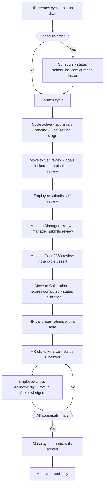

### Example from everyday work

*Illustrative scenario.* Kavya Menon, Head of People at Demo Group, launches the "FY 2026-27 annual review" for Demo Technologies. When she moves the cycle to **Self review**, Priya Nair's goals lock and she receives a notification. Priya rates her two goals and three competencies and submits. Amit Verma, her manager, adds Rahul Sharma as a peer reviewer, then writes his manager review when that stage opens. At **Calibration**, Kavya reviews the distribution on the calibration board, adjusts one rating with a note, and finalises Priya's appraisal with a short summary. Priya reads it and clicks **Acknowledge**.

### Related modules

- **Goals** — the goals rated in each review.
- **Calibration sessions** — record a formal calibration meeting.
- **Improvement plans** and **Development needs** — follow-up after a review.
- **Career passport** — shows finalised appraisals over time.

## Calibration board and calibration sessions

**Status:** Available (sessions: no participant invitations or meeting minutes yet).

### Overview

**Calibration** means comparing ratings across teams so that the same performance gets the same rating. The **Calibration** board shows, for one cycle, how many appraisals sit at each rating level, with **Calibrate** and **Finalize** on every row. **Calibration sessions** let you record a calibration meeting: a named session over part or all of a cycle, in which every rating change is stored as a permanent adjustment record (original rating, previous rating, new rating, reason, who and when) that can never be edited. PeopleOS does no ranking and no forced distribution.

### Where to find it

- **Menu path:** People › Growth › All in Growth › Calibration / Calibration sessions
- **Who can open it:** Tenant HR Admin, Tenant Super Admin
- **Set-up needed first:** an active cycle. Adjustments are accepted from the Calibration stage onwards.

### The screen at a glance

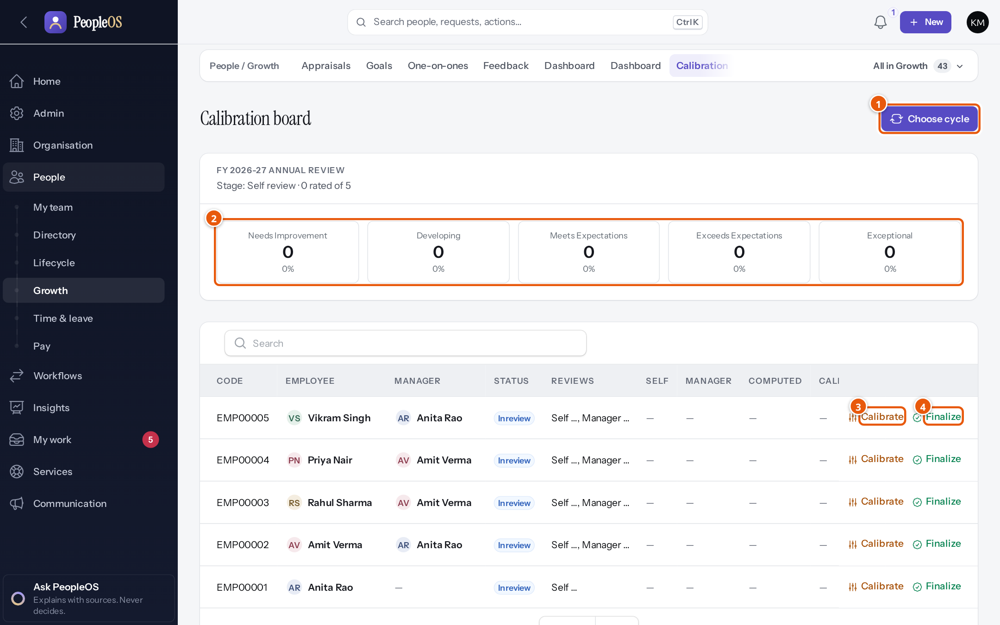
*Figure 5.5 — The Calibration board for the FY 2026-27 cycle. Demonstration data (fictional).*

1. **Choose cycle** — switch to another cycle.
2. Distribution — the number and share of appraisals at each rating label, and "rated of" the total.
3. **Calibrate** — record a calibrated rating with a note.
4. **Finalize** — set the final rating (see the Appraisals task above).

### Tasks

#### Task: Run a calibration session

1. Open **Calibration sessions** and click **Open session**.
2. Choose the **Cycle** (active cycles only), enter a **Name**, and choose the **Population** (appraisals to include; leave empty for everyone in the cycle). Submit.
3. On the session row, click **Adjust rating**. Choose the **Appraisal** (the list shows the current rating), the **Calibrated rating** and a **Reason** (required). Submit.
4. Click **History** to see every adjustment, in the form "previous → new (original): reason".
5. When the meeting ends, click **Close session**.

**If it fails:** "This appraisal is not in the session population.", "The calibration session is closed.", "The appraisal is finalized.", "The rating was changed by someone else. Reload and try again."

## Goals

**Status:** Available with limitations — there is no separate "submit goal plan" step; the weight total is checked each time a goal is saved. KRAs are picked by hand; goal templates per designation do not exist.

### Overview

Goals describe what a person or unit will achieve. Goals **cascade**: a company goal can be supported by business, department and team goals, and by employee goals. Each goal has a **type** (Goal, Objective (OKR), KRA, KPI), a **weight**, a **measure** (Percentage, Number, Amount, Done / not done, Milestones), start and target values and dates. Objectives can have **key results**; their progress rolls up by weight, and an aligned goal's progress also feeds the goal it supports. Progress changes only through **Check in**, and every check-in is kept as permanent history that cannot be edited.

**Who can do what:** employees create **Employee goals** for themselves; managers create goals for the people they manage; only HR administrators set organisation goals (company, business, department, team). Everyone sees organisation goals; personal goals are visible to the owner, their manager and HR.

### Where to find it

- **Menu path:** People › Growth › Goals
- **Who can open it:** every employee, Manager, Tenant HR Admin, Tenant Super Admin, Auditor
- **Set-up needed first:** an active cycle if goals belong to a review; optionally a **KRA library**.

### The screen at a glance

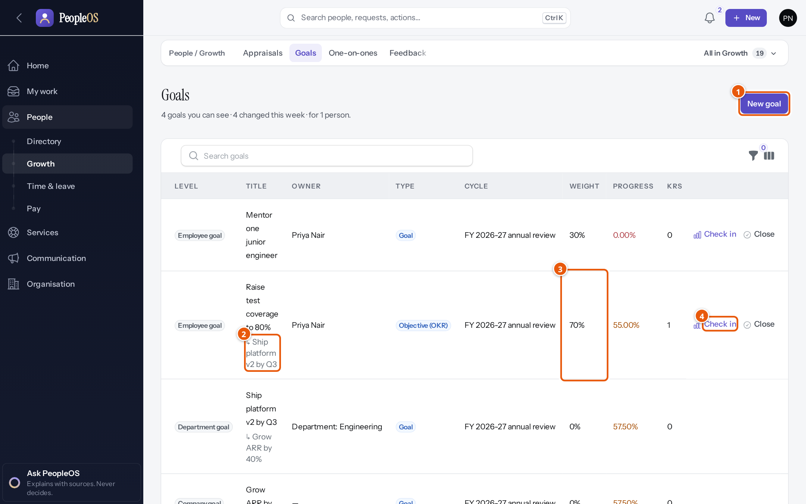
*Figure 5.6 — Goals as Priya Nair sees them: her own goals and the department and company goals above them. Demonstration data (fictional).*

1. **New goal** — create a goal.
2. The line under a title (↳) shows the goal it is **aligned to**.
3. **Weight** — how much the goal counts in the review.
4. **Check in** — record progress. **Close** marks a goal **Completed** or **Cancelled** with a reason.

Columns: **Level**, **Title**, **Owner**, **Type**, **Cycle**, **Weight**, **Progress**, **KRs** (number of key results), **Due date**, **Status** (Draft, Active, Completed, Cancelled). Filters: **Level**, **Status**, **Cycle**. **Edit** is shown while a goal is not locked for review.

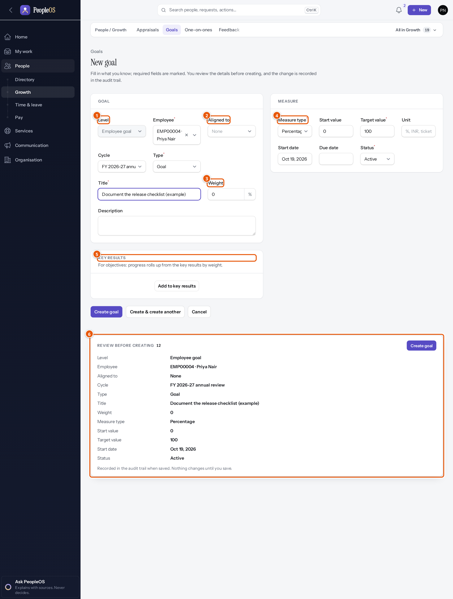
*Figure 5.7 — The New goal form as an employee sees it, with an example title, not saved. Demonstration data (fictional).*

1. **Level** — fixed to Employee goal for employees and managers.
2. **Aligned to** — the goal this one supports (same level or higher).
3. **Weight** — 0 to 100%.
4. **Measure type** — with **Start value**, **Target value**, **Unit**, **Start date**, **Due date** and **Status**.
5. **Key results** — for objectives; click **Add to key results**.
6. **Review before creating** — a summary of the values you entered.

### Tasks

#### Task: Create a goal

1. Open **People › Growth › Goals** and click **New goal**.
2. Check **Employee** (yourself, or a team member if you are a manager) and **Cycle**; choose **Type**. For KRA or KPI types, you can pick **From KRA library**.
3. Enter the **Title** (required), **Weight**, and optionally **Aligned to** and **Description**.
4. Under **Measure**, set **Measure type** and **Target value** (required), and the other values.
5. For an objective, add **Key results** (each with title, measure, start, target, current value, unit and weight).
6. Click **Create goal**.

**Expected result:** the goal appears in the list as active.
**If it fails:**
- "Goal weights would add up to 110 ; this cycle allows 100." — the cycle (or its template) requires a total; lower a weight.
- "A goal with this title already exists for this owner and cycle."
- "A goal can only align to a goal at its own level or above." / "This alignment would create a circular goal chain."
- "You can only set goals for yourself or for employees you manage." / "Only performance administrators set organisation goals."
- "The due date cannot be before the start date."

#### Task: Check in on a goal

1. On the goal row, click **Check in** (see Figure 5.8).
2. If the goal has key results, choose the **Key result** or "The goal itself".
3. Enter the **Current value** (required), choose **Confidence** (On track, At risk, Off track), and optionally **How it was measured** and a **Note**. Click **Submit**.

**Expected result:** "Progress updated"; the **Progress** column changes and any goals it is aligned to are recalculated.
**If it fails:** "This goal is closed." or "This goal belongs to a closed cycle."

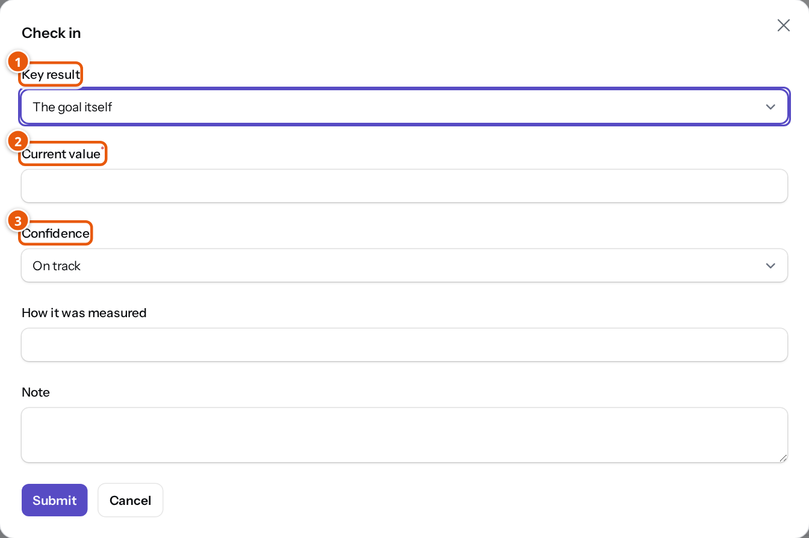
*Figure 5.8 — The Check in window for a goal with a key result (not submitted). Demonstration data (fictional).*

1. **Key result** — which part of the goal you are updating.
2. **Current value** — the value now; progress is calculated from start and target.
3. **Confidence** — On track, At risk or Off track.

> **Note:** When the cycle reaches the Self review stage, goals are locked for review. You can still check in, but the title, weight, measure, targets and alignment cannot change ("This goal is locked for review; its definition cannot change."). If two people edit the same goal, the second save is refused: "This goal was changed by someone else. Reload and try again."

## Check-ins

**Status:** Available.

### Overview

A **check-in** is a short written update from an employee to their manager for a period (weekly, every two weeks, monthly or custom): what went well, blockers, support needed, next priorities, goal progress and feedback for the manager. The manager responds with feedback and agreed actions. There is one check-in per person per period. Goal progress entered in a check-in is saved to the goal's history.

- **Menu path:** People › Growth › All in Growth › Check-ins (the page heading is "Performance check ins")
- **Who can open it:** every employee (own), Manager (team), Tenant HR Admin, Tenant Super Admin, Auditor

The list shows **Period**, **Employee**, **Cadence**, **Manager**, **Status** (Draft, Submitted, Reviewed) and **Submitted at**.

#### Task: Write and submit a check-in (employee)

1. Open **Check-ins** and click **My check-in**.
2. Choose the **Cadence** and **Date** (required). Fill in **What went well**, **Blockers**, **Support needed** and **Next priorities**.
3. Optionally add rows under **Goal progress** (**Goal**, **Value**, **Note**) and write **Feedback for my manager**.
4. Leave **Submit to my manager** on to send it, or turn it off to keep a draft. Click **Submit**.

**Expected result:** "Check-in saved". A submitted check-in goes to your manager.
**If it fails:** "This check-in was already submitted." / "Check-in progress can only update your own open goals."

#### Task: Respond to a check-in (manager)

1. Open **Check-ins**; find a check-in with status Submitted.
2. Click **Respond**, write **Your feedback** (required) and any **Agreed actions** (**Item**, **Owner**). Submit.

**Expected result:** status Reviewed; the check-in becomes read-only. Managers are reminded about check-ins left unanswered for three days.

**Flowchart — Setting goals and checking in.** How goals are set, updated and used in the review. *Roles:* HR administrator, Employee, Manager. *Starts:* the Goal setting stage of a cycle. *Ends:* goals completed when they are closed or the cycle closes.

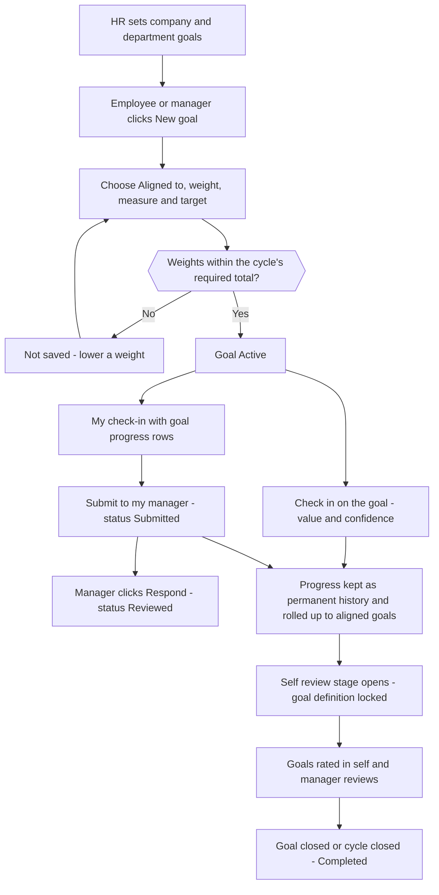

## Feedback

**Status:** Available.

### Overview

Anyone can give **Praise** or **Constructive** feedback to a colleague at any time, optionally linked to a goal or competency, and can **request** feedback from someone. You choose who can see it: **Only the recipient**, **Recipient and their manager**, or **Everyone in the tenant**. You can also give feedback **anonymously**.

- **Menu path:** People › Growth › Feedback (the page heading is "Feedback entries")
- **Who can open it:** every employee, Manager, Tenant HR Admin, Tenant Super Admin, Auditor
- **What you see:** feedback about you, feedback you wrote, requests sent to you, public feedback, and (for managers) feedback about your team marked "Recipient and their manager".

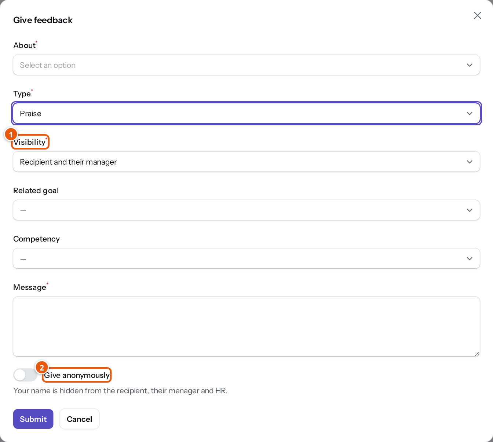
*Figure 5.9 — The Give feedback window (not submitted). Demonstration data (fictional).*

1. **Visibility** — who can read the feedback.
2. **Give anonymously** — "Your name is hidden from the recipient, their manager and HR."

#### Task: Give or request feedback

1. Open **People › Growth › Feedback**.
2. To give feedback, click **Give feedback**; choose **About**, **Type** and **Visibility**, optionally a **Related goal** and **Competency**, write the **Message** (all except goal and competency are required), and optionally turn on **Give anonymously**. Click **Submit**.
3. To ask for feedback, click **Request feedback**; choose whom to **Ask** and write **What would you like feedback on?**. Managers can also choose whom the feedback is **About**. Submit.
4. When someone asks you, click **Answer** on the request row.

**If it fails:** "Feedback is about someone else." (you cannot give yourself feedback) / "Ask someone else for feedback."

> **Note:** The author of anonymous feedback is kept for moderation. A person with the special "reveal author" permission can click **Reveal author**, must give a reason, and the reveal is audited. The audit trail itself records who performed each action, so people allowed to read the audit trail can see who created an anonymous entry. Your administrator should limit audit access accordingly.

## One-on-ones

**Status:** Available.

### Overview

A **one-on-one** is a meeting between a manager and an employee. It has an agenda, **Shared notes** (visible to the employee, the manager and HR), action items, and **Private manager notes**. Private notes are stored encrypted. Only the manager who holds the meeting can write them, the employee can never read them, and anyone else needs a special permission — every such read is recorded in the audit trail.

- **Menu path:** People › Growth › One-on-ones (the page heading is "One on ones")
- **Who can open it:** every employee (meetings they are part of), Manager, Tenant HR Admin, Tenant Super Admin, Auditor

The list shows **Scheduled at**, **Employee**, **Manager**, **Agenda**, **Actions** (done / total) and **Status** (Scheduled, Held, Cancelled).

#### Task: Schedule a one-on-one and keep notes (manager)

1. Open **One-on-ones** and click **Schedule**.
2. Choose the **Employee** (people you manage) and check **Manager**, **Scheduled at** and **Status**. Add an **Agenda**, **Shared notes** and **Action items** (**Item**, **Done**). Click **Create**.
3. After the meeting, click **Edit** on the row. Update shared notes and action items, set **Status** to Held, and write **Private manager notes** ("Only you can read these. The employee never sees them."). Save.

> **Note:** The **Private manager notes** field appears only when you edit an existing meeting, not when you first schedule it.

## Improvement plans

**Status:** Available.

### Overview

A **performance improvement plan** (PIP) is a formal plan with a reason, objectives, a start and end date, and **checkpoints** where progress is reviewed. Plans are sensitive: only HR, the employee's manager and the employee see them. An employee can have only one open plan at a time.

- **Menu path:** People › Growth › All in Growth › Improvement plans
- **Who can open it:** every employee (own plan), Manager (plans for people they manage), Tenant HR Admin, Tenant Super Admin, Auditor
- **Who can act:** HR administrators, and managers for the people they manage.

The list shows **Employee**, **Manager**, **Start date**, **End date**, **Objectives**, **Status** and **Outcome**.

#### Task: Open and run an improvement plan

1. Open **Improvement plans** and click **Open plan**.
2. Choose the **Employee**, check the **Manager**, set **Start date** and **End date**, write the **Reason** and at least one **Objective** (with an optional **Measure**). Click **Create**. A plan opened here starts as **Active**.
3. Click **Add checkpoint** to add review points (**Title**, **Due date** inside the plan period, **Notes**).
4. At each checkpoint, click **Review checkpoint**, choose the checkpoint, the result (**Met**, **Partially met**, **Not met**) and write the **Outcome**. Each checkpoint is reviewed once.
5. If more time is needed, click **Extend**, choose a later **End date** and give a **Reason**.
6. At the end, click **Close**, choose **Successfully completed**, **Unsuccessful** or **Cancelled**, and record the **Outcome**.
7. Finally, click **Close plan** and give a reason to archive a completed or unsuccessful plan.

**If it fails:** "An improvement plan is already active for this employee.", "A checkpoint must fall within the plan period.", "An extension must end after the current end date.", "Only HR or a manager of this employee manages the improvement plan."

### Statuses explained

| Status | Meaning | Next |
|---|---|---|
| Draft | Prepared but not started (plans opened from this screen skip this) | Activate or cancel |
| Active | Running | Extend, or close with an outcome |
| Extended | End date moved later | Extend again, or close with an outcome |
| Successfully completed / Unsuccessful | Outcome recorded | **Close plan** |
| Closed / Cancelled | Final; read-only | — |

## Performance reference data

| Screen | What you store there | Path | Who |
|---|---|---|---|
| Rating scales | Ordered levels (value, label, description); one default scale. A five-point scale (Needs Improvement to Exceptional) is provided. Levels of a scale used by a launched cycle cannot change. | People › Growth › All in Growth › Rating scales | Tenant HR Admin, Tenant Super Admin (Auditor reads) |
| Competencies | Behaviours you rate: name, code, category (Core, Functional, Leadership, Behavioural), level, weight, effective dates, behavioural indicators. Six are provided. | … › Competencies | Same |
| KRA library | Key result areas with a category, default weight and suggested KPIs (name, measure, target), picked when creating KRA or KPI goals. | … › KRA library | Same |

#### Task: Add a rating scale, competency or KRA

1. Open the screen and click the **New** button at the top right (for example **New competency**).
2. Fill in the required fields (**Name**, **Code**, and the levels or category) and click **Create**.
3. To change one later, click **Edit**, make the change, add a **Reason for change** (recorded in the audit trail) and save. The code cannot be changed after creation.

## Development needs and career passport

**Status:** Available.

**Development needs** record something a person should develop — found in an appraisal, improvement plan, check-in, one-on-one, skill assessment or career discussion, or added manually. They feed **Development plans** (see later). Open **People › Growth › All in Growth › Development needs**, click **Record need**, choose the **Employee** (yourself or someone you manage), enter a **Title** (required), and optionally a **Competency**, **Priority** (Low, Medium, High), **Identified in** and **Description**. Use **Update status** to move a need through Open, In progress, Addressed and Closed.

The **Career passport** (People › Growth › All in Growth › Career passport) is a one-page summary of a person: active and completed goals, praise received, latest rating, skills, certifications and qualifications, finalised appraisals, experience, aspirations, and where they sit on a career path with the skill gaps to the next step. Employees see their own; managers can **Choose employee** among their team; HR can choose anyone. **Update aspirations** records a target career path and role, interests and openness to relocation or a role change.

**Analytics** (Performance column of All in Growth; HR administrators and Auditors) shows, per cycle and per department, employees, appraisals, completion, average goal progress, check-ins in the last 90 days and the rating distribution. Groups smaller than five people are suppressed so no individual rating can be inferred, and rating distributions appear only when enough appraisals are final. There is no trend history yet.

## Learning: catalogue

**Status:** Available with limitations — course content is a link or text (no file upload, no SCORM); assessments are single-choice questions; certificate documents are web pages, not PDFs.

### Overview

The **course catalogue** lists what people can learn: e-learning links, videos, documents, classroom or virtual training, and assessment-only courses. Each course has modules, an optional assessment, rules (mandatory, self-enrolment, approval, certificate validity, pass mark, attempts) and **skill outcomes** (skill levels a completion proves). A course goes through a lifecycle: it is drafted, **submitted for approval**, **approved by a second person** (never the person who submitted it), then **published** as a numbered version. Learners stay on the version they started, so "what someone completed" never changes when the course is updated. **Learning paths** bundle courses in order with prerequisites and milestones; **Programs** bundle courses and paths with eligibility rules, a completion rule (all required items plus a number of optional ones) and an optional program certificate. **Providers** and **Instructors** record training vendors and trainers (an instructor can be an employee).

### Where to find it

- **Menu path:** People › Growth › All in Growth › Courses (also Learning paths, Programs, Providers, Instructors)
- **Who can open it:** everyone can browse; Tenant HR Admin and Tenant Super Admin create and change. Auditors read.

### The screen at a glance

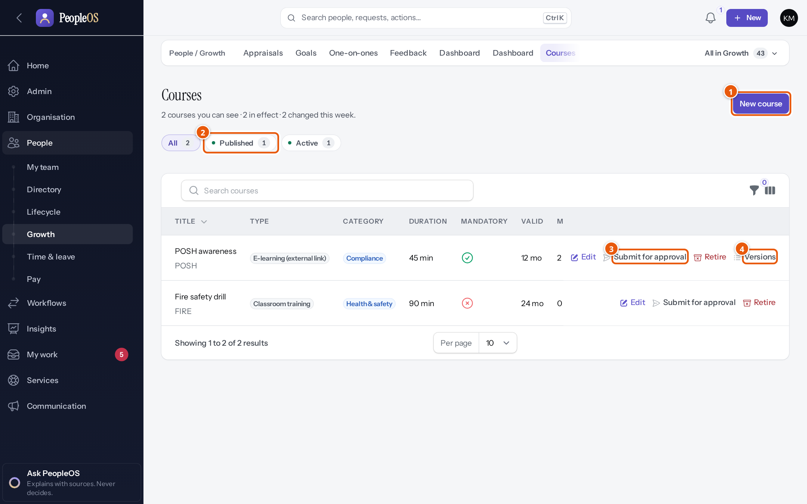
*Figure 5.10 — The course catalogue with its lifecycle actions. Demonstration data (fictional).*

1. **New course** — create a course.
2. Status tabs — **All**, **Published**, **Active** (with counts).
3. **Submit for approval** — send a draft or changed course for approval.
4. **Versions** — the published versions of the course.

Columns: **Title**, **Type**, **Category**, **Duration**, **Mandatory**, **Valid** (certificate validity), **Modules**, **Enrolled**, **Version**, **Mode**, **Status**. Other actions: **Edit**, **Retire**, and, when relevant, **Approve**, **Send back**, **Publish version** and **Archive**.

### Tasks

#### Task: Create and publish a course

1. Open **Courses** and click **New course**.
2. Under **Course**, enter **Title** and **Code** (required), choose **Type** and **Category**, and add a duration, **Content url**, **Owner** and **Description**.
3. Under **Catalogue**, optionally set topic, difficulty, delivery mode, language, **Provider**, **Instructor**, effective dates and **Prerequisites**.
4. Under **Rules**, set **Mandatory (compliance)**, **Employees may self-enrol**, **Requests need approval**, **Certificate valid for** (months; leave empty for no certificate), **Passing score** and **Attempts allowed**.
5. Optionally add **Skill outcomes** (skill and level). Click **Create course**. The course opens for editing.
6. On the **Modules** tab click **Add module** (title, type, link or text, duration). On the **Assessment** tab click **Add assessment** (title, pass mark, questions with options and the correct option).
7. Back on the list, click **Submit for approval**.
8. A second HR administrator clicks **Approve** (or **Send back** with a reason).
9. Click **Publish version**. Optionally enter **Effective from**; a future date schedules the course, and scheduled courses are released automatically on that date.

**Expected result:** "Version 1 published"; the course status becomes Published and people can enrol.
**Common mistakes:** submitting and approving with the same account — approval needs a different person.
**If it fails:** "A course cannot be its own prerequisite.", "A course cost cannot be negative."

> **Note:** If your organisation has only one HR administrator, no one can approve their courses. Ask your administrator to give a second person approval rights.

| Course status | Meaning |
|---|---|
| Draft | Being prepared |
| Pending approval | Waiting for a second person |
| Approved | Ready to publish |
| Scheduled | Published with a future start date |
| Published / Active | Open for enrolment |
| Retired | No longer offered; can be published again or archived |
| Archived | Final |

#### Task: Build a learning path or program

1. Open **Learning paths**, click **New learning path**, fill in **Name**, **Code**, **Description**, **Status** and optional **Milestones**, and click **Create learning path**. On the **Courses** tab add courses in order, marking each **Is required** and any **Prerequisites in this path**. Click **Publish version**.
2. For a program, open **Programs**, click **New learning program** (**Name**, **Code**, **Description**) and **Create**, then **Publish version** on its row: add **Items** (course or learning path, required or not), **Optional items to complete**, **Issue a program certificate**, validity and **Eligibility (empty = everyone)**. Use **Enrol employee** to add participants.

## Learning: assignments and enrolments

**Status:** Available.

### Overview

An **enrolment** is one person on one piece of learning. Enrolments are created in three ways: an **assignment** (HR or a manager decides who must learn what, by when), a **request** from the employee, or **registration** for a training session. **Assignments** can target one employee, a manager's team, an organisation unit, or a **rule-defined population** (for example everyone in one location). They can be mandatory, have a due period, and **repeat every** N months. Rule-based and team assignments keep enrolling people who match later, every day. Enrolments are never deleted; closed ones are read-only history.

### Where to find it

- **Menu path:** People › Growth › All in Growth › Assignments / Enrolments. People without the "view all learning" right see the enrolments link labelled **My learning**.
- **Who can open it:** Assignments — Tenant HR Admin, Tenant Super Admin, Manager, Auditor. Enrolments — everyone (own), managers (team), HR administrators (all).
- **Who can assign:** HR administrators to anyone; managers only to people they manage and their own team. Organisation units and rule-defined populations need an HR administrator.

### The screen at a glance

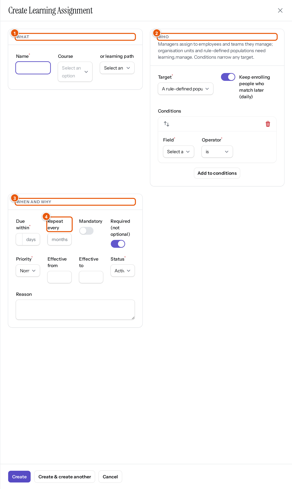
*Figure 5.11 — The Create Learning Assignment panel, here targeting a rule-defined population (not submitted). Demonstration data (fictional).*

1. **What** — **Name** (required) and the **Course** or **or learning path**.
2. **Who** — **Target** (One employee, A manager's team, An organisation unit, A rule-defined population), **Keep enrolling people who match later (daily)**, and **Conditions**.
3. **When and why** — **Due within** (days, required), **Mandatory**, **Required (not optional)**, **Priority**, effective dates, **Status** (Active, Paused) and **Reason**.
4. **Repeat every** — months; leave empty for once.

### Tasks

#### Task: Assign mandatory training to a group

1. Open **Assignments** and click **Assign learning**.
2. Under **What**, enter a **Name** and choose a **Course** (published courses only) or a learning path.
3. Under **Who**, choose the **Target** and add **Conditions** if needed.
4. Under **When and why**, set **Due within**, turn on **Mandatory**, and set **Repeat every** for annual refreshers.
5. Click **Create**. People who match are enrolled with status **Assigned**.
6. Later, click **Apply now** to enrol new matches immediately instead of waiting for the daily run.

**Expected result:** the **Enrolments** column shows how many people were enrolled.
**If it fails:** if the message says managers assign learning only to employees and teams they manage, the target needs an HR administrator — ask one to create the assignment.

> **Note:** Changing an assignment's target, conditions, due period, repetition or flags creates a new assignment version. **Cancel** (with a reason) cancels the enrolments that have not started; started learning continues. Organisation-unit targets include only people in that unit, not in units below it.

To assign one course to one person quickly, managers can also use **Assign learning** on **Team learning** or on the enrolments list (**Employee**, **Course** or **or learning path**, **Due on**, **Reason**).

#### Task: Request learning (employee) and approve it (manager)

1. The employee opens **My learning** (avatar menu) and clicks **Request learning**, chooses a **Course** (only courses open to self-enrolment or requests are listed) and writes **Why do you need it?** (required). Submit.
2. If the course allows self-enrolment, the employee is **Enrolled** at once. If **Requests need approval** is on, the request becomes **Pending approval**.
3. The manager opens **Team learning** → **Requests awaiting your decision**, opens the request, and clicks **Approve** (optional note) or **Reject** (reason required).

**If it fails:** "This course is assigned by L&D or managers; it cannot be requested." "Learning requests cannot be approved by the learner or the requester." If the course names an approval workflow, the workflow decides instead of the manager.

#### Task: Complete a course (employee)

1. Open **My learning** and click the course name (see Figure 5.14).
2. Click **Start**. If the course has prerequisites you have not completed, you see "Complete the prerequisites first: …".
3. Work through the content and click **Mark module complete** for each module.
4. If there is an assessment, click **More › Take assessment**. The window shows the pass mark and your attempt number. Answer every question and submit; you see "Passed — score …%" or "Not passed".
5. For self-paced, on-the-job, blended or external learning, you can also use **Update progress** ("Progress is not completion: completion is recorded separately.") and **More › Upload evidence** (PDF, PNG or JPEG).

**Expected result:** when all modules are done and the assessment (if any) is passed, the enrolment becomes **Completed**, a completion record is created, the course's skill outcomes are added to your skills, and — if the course has a certificate validity — a certificate is issued.
**If it fails:** after your last allowed attempt fails, the enrolment becomes **Failed** ("No attempts left."). Ask HR to assign the course again.

> **Note:** Answers are checked by PeopleOS, not in your browser, and the correct answers are never sent to the learner. Opening an enrolment with status **Enrolled** counts as starting it. HR administrators can also **Record completion** (score, grade, attendance, evidence note) and **Correct completion** with a reason; a correction is a new record and the original is kept.

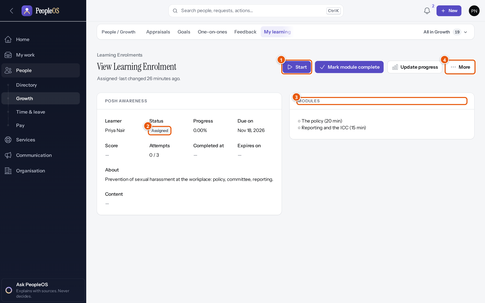
*Figure 5.12 — An enrolment opened by the learner. Demonstration data (fictional).*

1. **Start** — begin the learning.
2. **Status** — here **Assigned**.
3. **Modules** — the content, with a tick for each completed module.
4. **More** — **Take assessment** and **Upload evidence**.

### Statuses explained

| Enrolment status | Meaning | What happens next |
|---|---|---|
| Assigned | Given by an assignment or a manager | Start |
| Requested / Pending approval | The employee asked; waiting for a decision | Approved or Rejected |
| Approved | Request approved | Enrolled / Started |
| Enrolled | Place confirmed | Start |
| Waitlisted | The training session is full | Enrolled if a place frees up |
| Started | In progress | Completed, Failed or Overdue |
| Overdue | Due date passed (checked daily) | Can still be completed |
| Completed | Final completion recorded | Expired when the certificate expires |
| Failed | Assessment attempts used up | — |
| Withdrawn / Cancelled / Rejected | Stopped | — |
| Expired | The certificate from this completion expired | A repeating assignment enrols the person again |

**Flowchart — Learning: from assignment or request to certificate.** *Roles:* HR administrator, Manager, Employee. *Starts:* an assignment, a request or a session registration. *Ends:* a certificate or a closed enrolment.

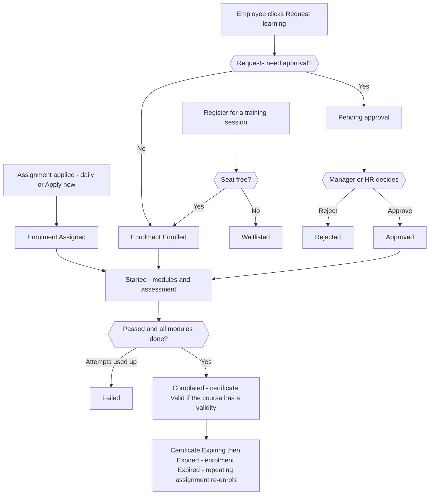

## Certificates

**Status:** Available with limitations — the certificate document is produced as a web page, not a PDF.

A certificate is issued automatically when someone completes a course that has a **Certificate valid for** period. Its number, holder, learning and dates never change. Thirty days before expiry it shows as **Expiring**, then **Expired**; an expired certificate is never extended — the person takes the learning again and gets a new certificate. Employees can also record **external** credentials, which stay **Unverified** until someone else verifies them.

- **Menu path:** People › Growth › All in Growth › Certificates
- **Who can open it:** everyone (own), managers (team), HR administrators (all)
- Columns: **Number**, **Employee**, **Course**, **Issued on**, **Expires on**, **Score**, **Version**, **Issuer**, **Verified**, **Status** (Valid, Expiring, Expired, Revoked). Actions: **Download**, **Attach document**, **Verify**, **Revoke** (reason required; final).

#### Task: Record an external certificate

1. Open **Certificates** and click **Record external certificate**.
2. Choose the **Employee** ("Me" for yourself), the **Learning item**, and enter **Credential number**, **Issuer** and **Issued on** (required), plus **Expires on**, **Credential url** and a file (PDF, PNG or JPEG) if you have them. Submit.

**Expected result:** "Recorded — awaiting verification". An HR administrator with certificate rights clicks **Verify**. A holder can never verify their own certificate.

## Training sessions

**Status:** Available with limitations — there is no button to give up a session place, so a waiting list does not move up from the screens; there are no reminders before sessions and no trainer feedback reports.

Training sessions are classroom or virtual deliveries of a course, with a trainer, venue or meeting link, and capacity. Employees click **Register me**; when the session is full, they are **Waitlisted**. Marking someone **Attended** completes their enrolment (unless the course still has an assessment to pass).

- **Menu path:** People › Growth › All in Growth › Training sessions
- **Who can open it:** everyone (list and **Register me**); Tenant HR Admin, Tenant Super Admin and Managers schedule sessions and record attendance.

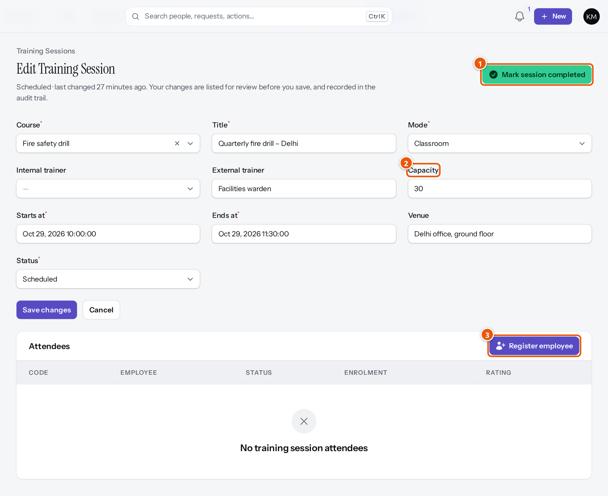
*Figure 5.13 — A classroom training session with its Attendees list. Demonstration data (fictional).*

1. **Mark session completed** — close the session after recording attendance.
2. **Capacity** — leave empty for unlimited.
3. **Register employee** — add a person (managers: people they manage).

#### Task: Schedule a session and record attendance

1. Open **Training sessions** and click **Schedule session**.
2. Choose the **Course** (published classroom or virtual courses), enter **Title**, **Mode** (Classroom or Virtual), an **Internal trainer** or **External trainer**, **Capacity**, **Starts at** and **Ends at**, and the **Venue** or **Meeting url**. Click **Create training session**.
3. People register themselves, or you use **Register employee** on the **Attendees** tab.
4. After the session, click **Attended** or **Absent** on each row, or select rows and use **Mark attended**.
5. Click **Mark session completed** ("Record attendance on the Attendees tab first; attending completes each learner's enrolment.").

## My learning and Team learning

**Status:** Available.

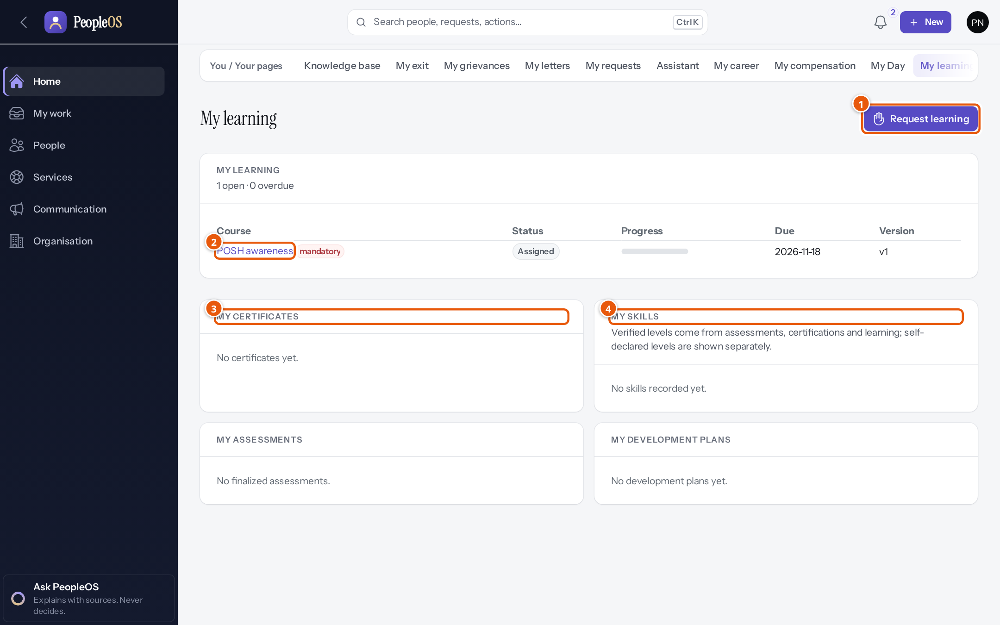
*Figure 5.14 — Priya Nair's My learning page with the mandatory POSH awareness course. Demonstration data (fictional).*

1. **Request learning** — ask for a course.
2. A course name — opens the enrolment (overdue items appear first, then pending requests, then open learning).
3. **My certificates** — your certificates and their expiry.
4. **My skills** — verified levels (from assessments, certificates and learning) and self-declared levels, shown separately.

**My learning** (avatar menu) also shows **My assessments** (finalised skill assessments) and **My development plans**.

**Team learning** (People › My team › Team learning) is for managers. It shows, for each person you manage, **Open**, **Overdue**, **Mandatory overdue**, **Completed** and **Certificates expiring (60 d)**, plus **Requests awaiting your decision**, **Team skill gaps** and **Development plans**. Use **Assign learning** at the top.

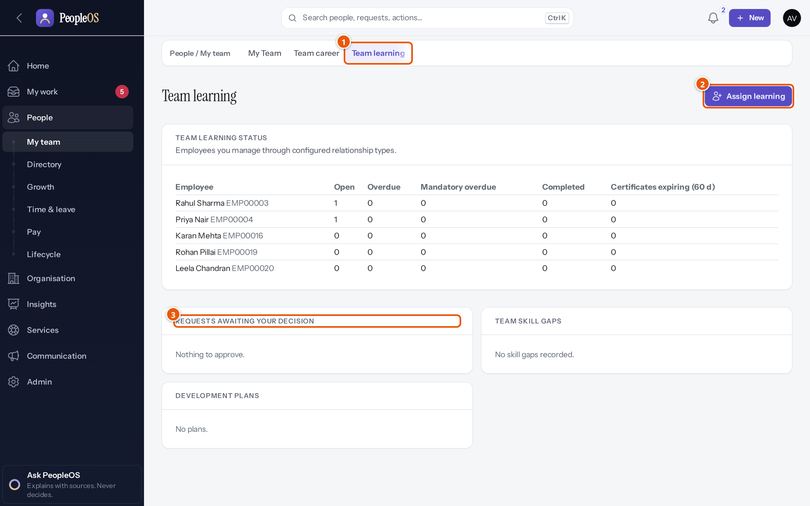
*Figure 5.15 — Team learning for Amit Verma's team. Demonstration data (fictional).*

1. **Team learning** — in the My team area bar, next to **My Team** and **Team career**.
2. **Assign learning** — assign a course or path to a team member.
3. **Requests awaiting your decision** — learning requests from your team.

The learning **Dashboard** ("Learning & development"; HR administrators and Auditors) shows completion rate, mandatory compliance, learning hours, certificates (valid, expiring in 30 and 90 days, expired, revoked), development plans, mandatory training per course, popular courses, skill gaps, departments and, for people allowed to see them, providers and costs. Groups of fewer than five people are suppressed.

## Skills and development plans

**Status:** Available.

### Overview

The **Skills** library lists the skills your organisation cares about. **Skill levels** are proficiency scales (for example Beginner, Intermediate, Advanced, Expert); publishing levels creates a new version, and existing records keep the version they used. **Skill assessments** record a person's level in a skill: a **Self assessment** (never counted as verified), a **Manager assessment**, a **Formal assessment** or a **Certification**. An assessment is saved as a draft, then **finalised**; a finalised assessment never changes — a mistake is fixed with **Correct**, which drafts a new assessment that replaces the old one once finalised. A self-declared level never overwrites a verified one.

A **development plan** turns needs into action: goals, skill gaps, learning activities, milestones and reviews. When a plan is created, the person's open **Development needs** are added automatically. Courses that match a skill gap are **suggested**; learning starts only when someone chooses **Enrol learning**.

### Where to find it

- **Menu path:** People › Growth › All in Growth › Skills / Skill levels (page heading "Skill scales") / Skill assessments / Development plans
- **Who can open it:** Skills library — Tenant HR Admin and Tenant Super Admin manage; HR Manager, HR Executive, Payroll Admin, Attendance Admin, Performance Admin, Account Owner and Auditor can view (ordinary employees and managers cannot open the library). Skill levels, Skill assessments and Development plans — everyone (own records), managers (team), HR administrators (all).

### Tasks

#### Task: Record a skill assessment

1. Open **Skill assessments** and click **New assessment**.
2. Choose the **Employee** ("Me", or a team member), the **Skill**, the **Type**, and enter the **Level** (a value on the skill's scale; required). Optionally add **Target level**, **Valid until**, **Evidence**, **Comments (visible to the employee)** and **Private notes (assessor only)**. Submit.
3. You see "Draft saved — finalize it when ready". Click **Finalize** on the row; optionally turn on **Record a development need for the gap to the target**.

**Who may assess:** employees assess themselves (self); managers assess people they manage; formal and certification assessments need an HR administrator. The employee never sees private notes.

#### Task: Create and use a development plan

1. Open **Development plans** and click **New plan**.
2. Choose the **Employee**, enter a **Title** (required), and optionally **Summary**, **Starts on**, **Target date** and (managers and HR only) **Private notes (manager / L&D only)**. Submit. You see "Plan created with the employee's open development needs".
3. Click **Change status** and choose Active.
4. Click **Add item**: choose the **Type** (Goal, Skill gap, Learning activity, Milestone, Review), a **Title**, and optionally a **Skill** with current and target levels, a **Course** and a due date.
5. For an item with a course, click **Enrol learning** (the plan must be Active). Click **Items** to see items and suggested courses; click **Complete item** when done.

| Plan status | Next |
|---|---|
| Draft | Active or Cancelled |
| Active | On hold, Completed or Cancelled |
| On hold | Active or Cancelled |
| Completed / Cancelled | Archived (read-only) |

## Careers

**Status:** Available with limitations — mobility interest is recorded only; there is no internal job marketplace or matching.

### Overview

**My career** is the employee's own career page: a **career profile** (career track, roles of interest, preferred job families and locations, mobility preferences, development priorities), **aspirations** for the short, medium and long term (each new entry is kept, earlier ones remain as history), **career goals** (separate from performance goals — achieving one never changes your job, pay or position by itself), **mobility interests**, the facts about **what the roles you target require** compared with your verified records, and your **movement history** from your employment record.

**You decide what your manager sees.** Three switches control sharing: aspirations (off by default), career goals (on by default) and mobility preferences and interests (off by default). HR career administrators see profiles within their scope.

For HR, **Career architecture** (page heading "Career tracks") groups paths into tracks (Individual contributor, People manager, Technical specialist, Functional specialist, Leadership). **Career paths** are ladders of designations with typical years and required skills per step, published as versions. **Role requirements** record, per role (designation, optionally within an organisation unit), the skills and levels, competencies, minimum experience, certifications and learning the role needs, from an effective date. **Career profiles** lists employees' profiles and their aspiration history.

### Where to find it

- **Menu path:** Avatar menu › My career; People › My team › Team career; People › Growth › All in Growth › Career paths / Career architecture / Role requirements / Career profiles
- **Who can open it:** My career — every employee. Team career — managers with team members. The HR screens — Tenant HR Admin, Tenant Super Admin, Auditor (read).

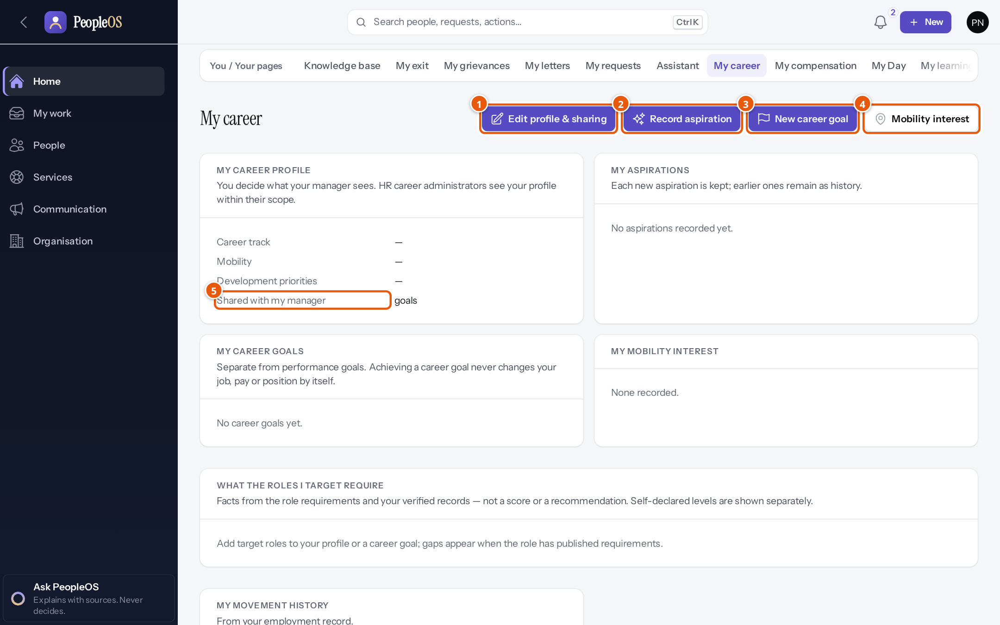
*Figure 5.16 — Priya Nair's My career page. Demonstration data (fictional).*

1. **Edit profile & sharing** — your profile and the three sharing switches.
2. **Record aspiration** — **Term**, **Target role**, **Aspiration**.
3. **New career goal** — **Title**, **Type** (Reach a role, Build a skill, Build a capability, Move function / location, Assignment / experience), **Target role**, **Target date**.
4. **Mobility interest** — what you are interested in (a position, job family, department, location or career track).
5. **Shared with my manager** — what your manager can currently see.

#### Task: Update your career profile and choose what to share (employee)

1. Open **My career** from the avatar menu and click **Edit profile & sharing**.
2. Choose a **Career track**, **Roles I am interested in**, **Preferred job families**, **Preferred locations**, **Mobility** options (Open to relocation, Open to international moves, Open to a role change, Open to travel) and **Development priorities**.
3. Turn on or off **Share my aspirations with my manager**, **Share my career goals with my manager** and **Share my mobility preferences and interests with my manager**. Submit.

**Expected result:** "Profile saved". Gaps for your target roles appear once HR has published requirements for them. Use **Update goal** to mark a career goal achieved, paused or abandoned, and **Withdraw interest** to end a mobility interest.

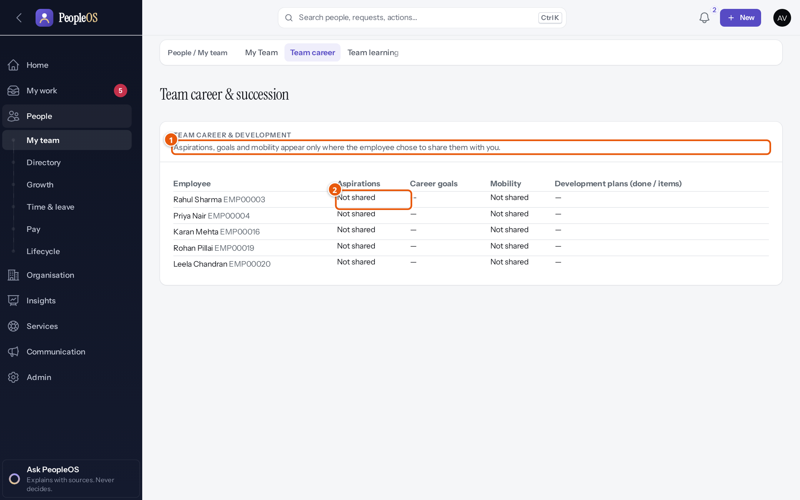
*Figure 5.17 — Team career as Amit Verma sees it. Demonstration data (fictional).*

1. "Aspirations, goals and mobility appear only where the employee chose to share them with you."
2. **Not shared** — the employee has not shared this.

#### Task: Publish role requirements (HR administrator)

1. Open **Role requirements** and click **Publish requirements**.
2. Choose the **Role** and optionally **Organisation unit (optional)**; set **Effective from**; add **Skills** (skill, level on the skill's current scale, required); choose **Competencies**, **Minimum experience (years)**, **Certifications (courses)**, **Learning: courses** and **Learning: paths**; add notes. Submit.

**Expected result:** a new version appears; the previous version for the same role ends the day before. Employees targeting this role now see factual gaps on **My career** — "not a score or a recommendation".

## Talent and succession

**Status:** Available.

### Overview

**Succession planning** makes sure someone could step into a critical role if the current holder leaves. You mark a role as a **critical position** and record why. You create one **succession plan** per critical position and add **successors**. For each successor, you record a **readiness** label — Ready now, Ready < 1 year, Ready 1–2 years, Longer term or Not assessed — valid for 12 months, and you can add **development actions** that become items in the person's development plan. **Talent pools** are named groups (for example "Future leaders") with explicit, dated membership. **Talent reviews** are sessions in which participants record a decision for each person (Retain and develop, Accelerate development, Add to a talent pool, Nominate as successor, No change, Revisit next review). Decisions are recorded only; any follow-up is a separate action by a person.

Everything here is a **fact recorded by a person**. PeopleOS does not predict who will leave or who should be promoted, and it does not score or rank people.

> **Important — who can see talent and succession information:**
> - **Employees never see** whether they are in a talent pool, on a succession plan, or what readiness label they have. No delivered role allows it; your organisation can grant "see my own succession candidacy" to a role only by an explicit decision.
> - **Managers** see an employee's career aspirations and mobility only if the employee chose to share them. By default, managers do not see talent pools or succession candidacy. A manager can be given "succession information about employees I manage" by your administrator, in which case **Team career** also shows a confidential succession section ("Your team members are not told about their candidacy.").
> - **Confidential notes** on plans, successors and talent records are stored encrypted. Only people with a special permission can read them, never about themselves, and every read is recorded in the audit trail.
> - Development actions appear in the employee's development plan with **neutral wording** that never mentions succession, and notifications about talent and succession are never sent to the employee concerned.
> - Nobody can be a successor to their own position, and nobody manages succession records about themselves.

### Where to find it

- **Menu path:** People › Growth › All in Growth › Critical positions / Succession plans / Successors / Readiness / Development actions / Talent pools / Talent reviews / Analytics (Talent column); People › Growth › Dashboard (the second one, "Talent & succession")
- **Who can open it:** Tenant HR Admin and Tenant Super Admin. Talent review participants see only the sessions they take part in.
- **Set-up needed first:** designations and organisation units; ideally role requirements and skills, so successor gaps can be shown.

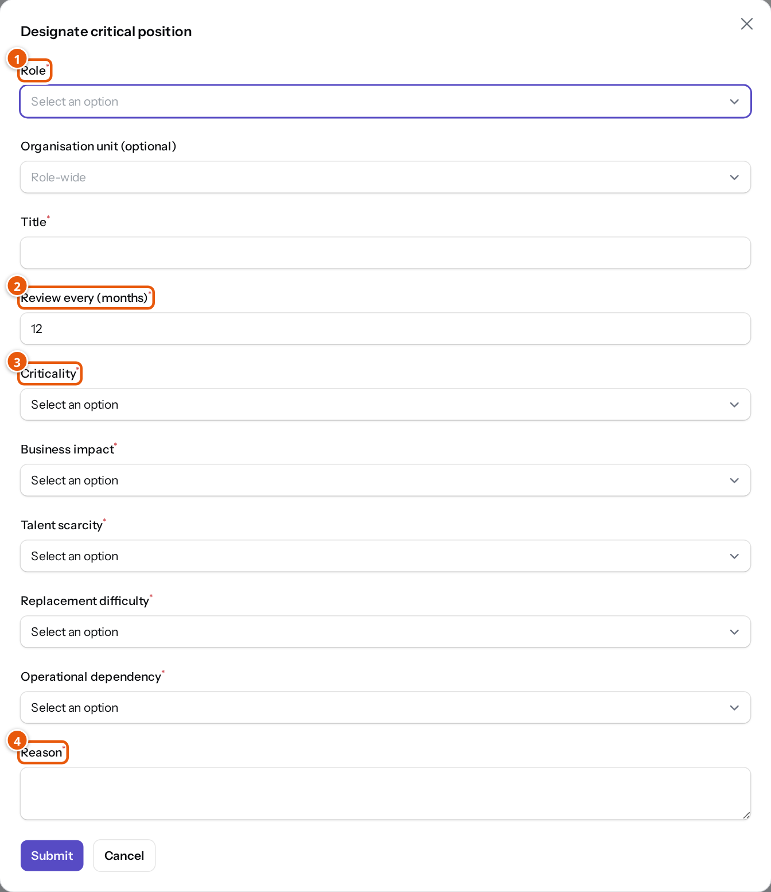
*Figure 5.18 — The Designate critical position window (not submitted). Demonstration data (fictional).*

1. **Role** — the designation that is critical (optionally only within one organisation unit).
2. **Review every (months)** — how often the position must be reviewed (default 12).
3. **Criticality** — Low, Medium, High or Critical; followed by **Business impact**, **Talent scarcity**, **Replacement difficulty** and **Operational dependency** (Low, Medium, High).
4. **Reason** — why this position is critical (required).

### Tasks

#### Task: Designate a critical position and create a succession plan

1. Open **Critical positions** and click **Designate critical position**.
2. Choose the **Role**, optionally an **Organisation unit (optional)** ("Role-wide" if empty), enter a **Title**, **Review every (months)**, the five judgement fields and a **Reason**. Submit.
3. On the new row, click **Facts** to see the current incumbents and any recorded exit date (taken from Exit cases).
4. Click **Create succession plan**. Optionally record **Vacancy risk (recorded judgement)**, a **Review date** and **Confidential notes**. Submit. The plan starts as **Draft**.
5. Use **Reassess** when the position is reviewed (each assessment is kept), and **Retire** (with a reason) when the role is no longer critical.

**If it fails:** "This critical position already has an open succession plan." / "Succession plans are made for active critical positions."

#### Task: Add successors, record readiness and plan development

1. Open **Succession plans** and click **Add successor** on the plan. Choose the **Employee** (people in your scope, never yourself), and add **Strengths**, **Development gaps** and **Confidential notes**. Submit.
2. Open **Successors**. On the successor row, click **Record readiness**: choose **Readiness**, enter a **Reason** (required), **Evidence** and **Effective from**. A new label replaces the current one; the old one is kept as history.
3. Click **Development action**: choose the **Type** (Complete a learning path, Gain a certification, Build a skill, Project assignment, Mentoring, Coaching, Stretch assignment, Job rotation), a neutral **Title** ("Shown to the employee in their development plan — keep it neutral; do not mention succession."), and optionally a skill and target level, course, learning path and due date. Submit.
4. On **Succession plans**, click **Change status** and choose Active. Later move it to Under review and back, or close it with a reason.
5. To take someone off a plan, click **Remove** on **Successors** and give a reason.

**Expected result:** the plan lists its successors and readiness under **Successors**; the development action appears under **Development actions** and as an item in the employee's development plan.
**If it fails:** "The incumbent is not a successor to their own position." / "This employee is already a successor on the plan."

> **Note:** If your provider has configured an approval workflow for succession plans, activating a plan starts that workflow. None is configured by default.

| Succession plan status | Next |
|---|---|
| Draft | Active or Closed |
| Active | Under review or Closed |
| Under review | Active or Closed |
| Closed | Final (a reason is required) |

**Flowchart — Succession planning for a critical position.** *Roles:* HR administrator. *Starts:* a role identified as critical. *Ends:* a closed plan.

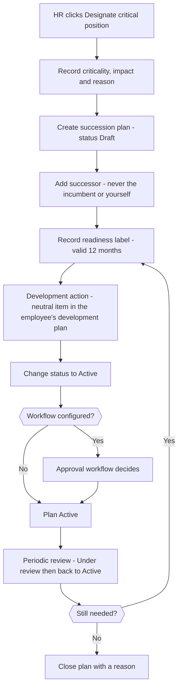

#### Task: Run a talent review

1. Open **Talent reviews** and click **New talent review**: **Name**, **Scope (organisation unit)**, **Participants** (users who will record decisions) and **Scheduled for**. Submit. Participants also need the talent review permission; as delivered, only HR administrators have it.
2. Click **Add employees** to build the population, then **Start**.
3. Participants click **Record decision**, choose an **Employee**, a **Decision** and a **Reason** (required). Nobody records a decision about themselves.
4. Click **Population** to follow progress, then **Complete** with a **Summary** (or **Cancel** with a reason).

**Expected result:** "Review completed" (or "Sent for approval" if your provider configured a review workflow). Decided items become read-only.

#### Task: Add members to a talent pool

1. Open **Talent pools** and click **New talent pool**: **Code**, **Name**, **Description**, **Criteria (for the people who nominate — nothing is applied automatically)** and **Status**.
2. On the pool row, click **Add members**, choose **Employees** and give a **Reason** (required). Submit.
3. Use **Members** to see current members and **End membership** (with a reason) to remove someone. Memberships are ended, never deleted.

The **Talent & succession** dashboard shows critical positions (and overdue reviews), how many have successors, a ready-now successor and an open plan, the positions without a ready-now successor, and talent pools. **Analytics** (Talent column) adds bench strength per critical position, readiness labels, development-action progress, review decisions, aspirations, mobility interest, and successor skill and certification gaps. Groups below five people are suppressed.

### Example from everyday work

*Illustrative scenario.* Kavya Menon designates "Engineering Manager — Platform" as a critical position at Demo Technologies with criticality High and the reason "single point of leadership for the platform team". She creates a succession plan and adds Priya Nair and Rahul Sharma as successors, records Priya as "Ready 1–2 years" with a short reason, and adds a development action titled "Lead the quarterly release planning". Priya sees a new item with that neutral title in her development plan, but nothing about the succession plan. Amit Verma, her manager, sees nothing about it either, because managers do not get succession information by default.

## My Team

**Status:** Available.

**My Team** (People › My team) is a manager's daily view of the people who report to them. It opens for anyone with current direct reports. It shows the headcount and today's attendance (present, on leave, absent, late, missing punch, working from home or on duty), pending regularisations and overtime, a **Needs attention** list (for example leave approvals and attendance regularisations, each with **Go**), and the team list with **Open** to view each employee. The area bar links to **Team career** and **Team learning**.

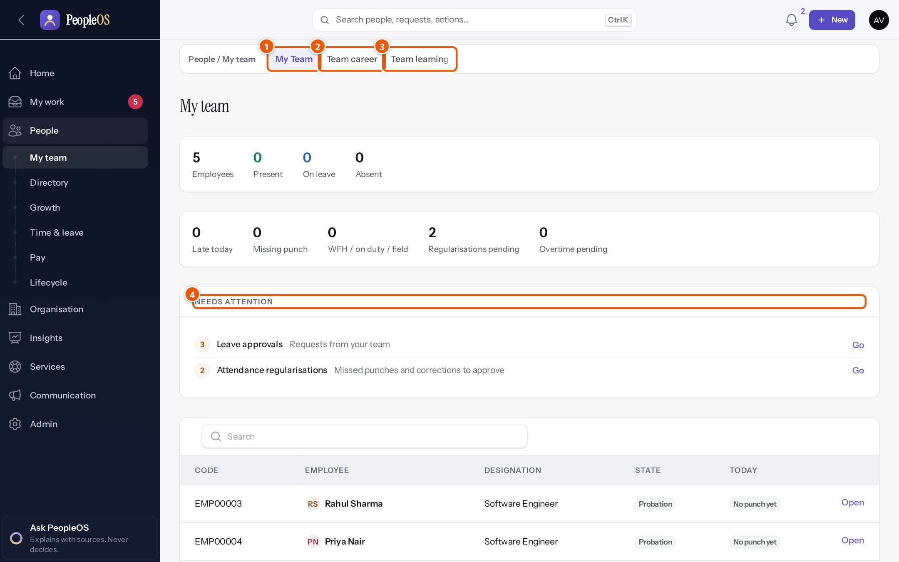
*Figure 5.19 — The My team page for Amit Verma. Demonstration data (fictional).*

1. **My Team** — today's team view.
2. **Team career** — what team members chose to share about their careers.
3. **Team learning** — the team's learning, requests and skill gaps.
4. **Needs attention** — items waiting for you, with a **Go** link to each.

> **Note:** Team career and Team learning use the performance relationships described at the start of this chapter. My Team itself lists direct reports. An Executive with direct reports can open My Team but not Team career or Team learning.

### Related modules

- **Employee 360** — HR and managers see Performance, Learning, Skills, Career, Talent and Succession tabs on an employee's record, each shown only when the viewer is allowed.
- **Time & leave** — the approvals listed under **Needs attention**.
- **Exit** — recorded exit dates feed the **Facts** of a critical position.

## Known limitations in this area

- A scheduled cycle does not launch automatically, and stages do not move on by date; an HR administrator moves them.
- Employees cannot nominate their own peer reviewers. Only the manager's review feeds the computed rating.
- There is no "submit my goal plan" step; the required weight total is checked when each goal is saved. KRAs are chosen manually and there are no goal templates per designation.
- People who can read the audit trail can see who created anonymous feedback.
- Calibration sessions do not send invitations or record minutes. Performance analytics group by department only, with no trend history.
- Course content is a link or text (no uploads, no SCORM); assessments are single-choice questions; certificate documents are web pages, not PDFs.
- Organisation-unit targets for learning assignments, critical positions and role requirements do not include child units.
- Training sessions: there is no button to cancel a place, so the waiting list does not move up from the screens; no reminders before sessions or trainer feedback reports.
- Mobility interest is a record only; there is no internal job marketplace. There is no visual 9-box grid; a position is a role (designation) plus an optional unit, with no seat or headcount record.
- Approval workflows for learning requests, talent reviews and succession plans work only when your provider has configured them; none is configured by default.
