# Organisation, workforce planning and assets

> **In this chapter:** how you describe your organisation in PeopleOS (companies, legal entities, establishments, locations, departments and the job reference data), how you plan positions and headcount, and how you track company property issued to employees. **Who should read it:** administrators setting up PeopleOS, HR teams, finance and workforce planners, executives, managers and anyone who issues or looks after company assets.

Every HR process needs a clear picture of the organisation behind it. This area of PeopleOS holds that picture. Administrators record the companies and the legal employers behind them, the registered workplaces (establishments) that statutory registrations belong to, the locations and the units people work in, and the job reference data such as levels, grades and designations. Everyone else then uses that picture: the **Org map** shows who reports to whom, **Workforce** planning shows how many seats the business has approved and how many are filled, and the **Asset register** shows which laptop, phone or card is with which employee. Changes are dated and recorded in the audit trail, so you can always see what changed, when, by whom and why.

| Module | What it is for | Where to find it | Who uses it | Status |
|---|---|---|---|---|
| Org map | See reporting lines and departments as a picture | Organisation › Org map | Everyone with organisation or people access; employees linked to an employee record | Available |
| Organisation Designer | Build and rearrange the unit tree (company › business unit › department › team) | Organisation › Organisation › Organisation Designer | Tenant HR Admin, Account Owner | Available with limitations (no drag-and-drop) |
| Companies | The organisations you manage in PeopleOS | Organisation › Organisation › Companies | Administrators (read: most staff roles) | Available |
| Locations | Offices, branches, factories, sites | Organisation › Organisation › Locations | Administrators (read: most staff roles) | Available with limitations (see Establishments) |
| Departments, Teams | Where people work day to day | Organisation › Organisation › Departments / Teams | Administrators (read: most staff roles) | Available |
| Business Units, Divisions | Larger groupings above departments | Organisation › Organisation › All in Organisation | Administrators (read: most staff roles) | Available |
| Cost Centres, Profit Centres | Finance codes used for costs and reporting | Organisation › Organisation › All in Organisation | Administrators (read: most staff roles) | Available |
| Legal Entities | The registered employer behind each company | Organisation › Organisation › All in Organisation › Legal Entities | Tenant Super Admin, Account Owner | Available |
| Establishments | Registered workplaces that statutory registrations belong to | Organisation › Organisation › All in Organisation › Establishments | Tenant Super Admin, Account Owner | Available with limitations (state list) |
| Establishment assignments | Which establishment each employee belongs to, by date | Organisation › Organisation › All in Organisation › Establishment assignments | Tenant Super Admin, Account Owner | Available |
| Levels, Grades, Job Families, Designations | Job reference data | Admin › Setup › All in Setup | Tenant HR Admin (read: HR and specialist admins) | Available |
| Employment Types, Employee Categories, Work Modes | How people are employed and where they work | Admin › Setup › All in Setup | Tenant HR Admin (read: HR and specialist admins) | Available |
| Document types | The kinds of employee documents you collect | Admin › Setup › All in Setup › Document types | Tenant HR Admin (read: HR Manager, HR Executive, Auditor) | Available |
| Workforce Dashboard | Seats, occupancy and vacancies at a glance | Organisation › Workforce › Dashboard | Tenant HR Admin, Executive, Auditor | Available |
| Positions | Approved seats, independent of the people in them | Organisation › Workforce › Positions | Tenant HR Admin, Auditor (read), Manager (own team) | Available with limitations |
| Position hierarchy | How positions sit under each other on a date | Organisation › Workforce › Position hierarchy | Tenant HR Admin, Auditor | Available |
| Vacancies | Unfilled seats in open positions | Organisation › Workforce › Vacancies | Tenant HR Admin, Auditor | Available |
| Headcount plans | Planned changes in seats over a period, with approval | Organisation › Workforce › Headcount plans | Tenant HR Admin, Auditor (read) | Available with limitations |
| Scenarios | Named planning assumptions (for example attrition %) | Organisation › Workforce › All in Workforce › Scenarios | Tenant HR Admin, Auditor (read) | Available |
| Budgets | Workforce cost budgets compared with plans and payroll | Organisation › Workforce › All in Workforce › Budgets | Tenant HR Admin | Available with limitations |
| Workforce snapshots | Headcount and seats on any past or future date | Organisation › Workforce › All in Workforce › Workforce snapshots | Tenant HR Admin, Auditor | Available |
| Analytics | Seats and occupancy by group, plans and budgets against actuals | Organisation › Workforce › Analytics | Tenant HR Admin, Executive | Available |
| Team positions | A manager's view of positions in their team | People › My team › Team positions | Managers who hold or manage positions | Available with limitations (appears only when such positions exist) |
| Asset register (My assets for employees) | Company property and who holds it | Organisation › Assets › Asset register | Tenant HR Admin, Asset Admin, Auditor (read); employees and managers see their own | Available with limitations |
| Asset Categories, Models | Kinds of assets and makes and models | Organisation › Assets › Categories / Models | Tenant HR Admin, Asset Admin, Auditor (read) | Available |

> **Note:** PeopleOS is not yet generally released. The screens in this chapter come from a demonstration organisation ("Demo Group", with the companies Demo Technologies and Demo Services) with fictional people. A few records named "example" or "handbook" were added to the demonstration to show screens that were otherwise empty. Commercial terms, hosting region and support channels are to be confirmed with the SaaS provider, Markedge.

---

## Key ideas in plain words

You will meet these terms throughout the chapter.

| Term | What it means |
|---|---|
| **Company** | An organisation you manage in PeopleOS, as HR and management think of it (for example "Demo Technologies"). |
| **Legal entity** | The registered employer that signs employment contracts and files tax returns (for example "Demo Technologies Pvt Ltd"). A company has at least one. |
| **Establishment** | A registered place of work of a legal entity, under labour and tax law. Statutory registrations (for example provident fund, state insurance, professional tax and labour welfare fund in India) belong to an establishment, because the authorities register and assess each workplace separately, often by state. |
| **Location** | A physical site where people work (an office, branch, factory, site). |
| **Unit** | A business unit, division, department or team. |
| **Designation** | A job title or role, such as "Software Engineer". |
| **Position** | An approved seat in the organisation, such as "two Data Engineer seats in Engineering". A position exists whether or not anyone sits in it. |
| **FTE** | Full-time equivalent. 1.0 is one full-time person; 0.5 is half-time. |
| **Effective date** | The date from which a record or a change applies. "Effective from" is the start; an empty "Effective to" means "open-ended". |
| **Reason for change** | A short note you type when you change a record. It is stored in the audit trail with the before and after values. |

---

## Setting up your organisation (recommended order)

**Status:** Available

### Overview

Markedge (your provider) creates your organisation in PeopleOS and its first administrator. After that, your administrators enter the structure themselves. The order matters because some screens need records from others. For example, a location cannot be saved without a company, an establishment needs a legal entity, and a grade can point to a level. Following the order below means every list you need is already filled when you reach a form.

The order is based on the fields each form requires or offers:

| Step | Screen | What it needs first | Why |
|---|---|---|---|
| 1 | **Companies** | Nothing | Everything else belongs to a company. Creating a company also creates its primary legal entity and a principal establishment automatically. |
| 2 | **Legal Entities**, **Establishments** | A company; a legal entity | Check the automatically created records, set the establishment **State**, add any further legal entities or establishments, and submit them for verification. |
| 3 | **Locations** | A company (**Company** is required) | Sites people work at. |
| 4 | **Cost Centres**, **Profit Centres** | Optional: a company | A department can point to a cost centre. |
| 5 | **Business Units**, **Divisions**, **Departments**, **Teams** | Optional: a company; for departments, a cost centre | The units people work in. |
| 6 | **Organisation Designer** | The units above (or create them here) | Places units in one tree, so PeopleOS knows what sits beneath what. |
| 7 | **Levels**, then **Grades**, then **Job Families** | A grade can point to a level | Job reference data. |
| 8 | **Employment Types**, **Employee Categories**, **Work Modes** | Nothing (starting lists are provided) | Review the starting lists; edit or add to them. |
| 9 | **Designations** | Optional: level, grade, job family, department, employment types | A designation links to all of these, so create it after them. |
| 10 | **Document types** | Nothing | The documents you collect from employees. |
| 11 | Employees (see chapter 5.2) | A company (required when adding an employee) | Everything else on the employee's job record is optional but uses the lists above. |
| 12 | **Positions**, then **Headcount plans** (optional) | Company or organisation unit; designations, locations, grades | Only if you manage approved seats. |
| 13 | **Asset Categories**, **Models**, then the **Asset register** | Employees (to assign assets) | Starting categories are provided. |

**Flowchart — Setting up your organisation structure (recommended order).** The order in which administrators fill the organisation screens. *Roles:* Markedge, Tenant Super Admin or Account Owner (legal entities and establishments), Tenant HR Admin. *Starts:* your organisation exists in PeopleOS. *Ends:* you can add employees, positions and assets.

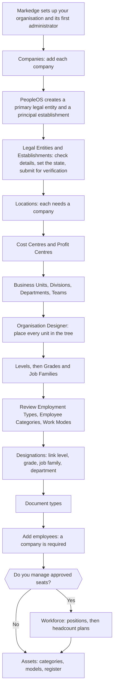

> **Tip:** you do not have to finish every screen before you start. Only the company is required to add an employee. You can come back and fill in departments, grades or designations later, and record the change on each employee from that date.

> **Important:** organisation and job reference changes can be routed for approval. When your administrator switches on approval of configuration changes, edits to companies, business units, divisions, cost centres and profit centres (and, if the approval level is set lower, other set-up records) are parked in the **Change Centre** until a second person approves them. You see the message **Submitted for approval**, and the record stays unchanged until then. In the demonstration organisation this approval is switched off, so edits apply at once.

---

## Org map

**Status:** Available

### Overview

The **Org map** shows your organisation as people, not boxes of codes. It draws reporting lines from the top of the organisation down, opens level by level, and can also show relationships beyond the line manager (dotted line, functional, matrix and support relationships such as an HR partner, mentor or buddy). A second view shows each department with its headcount. Use it to answer "who reports to whom?", "who is in Design?" or "where does this new joiner sit?".

The map is read-only. You change reporting lines on the employee's record (chapter 5.2) and units in the **Organisation Designer**.

### Where to find it

- **Menu path:** **Organisation › Org map**.
- **Who can open it:** Executive, Tenant HR Admin, Tenant Super Admin, Account Owner, HR Manager, HR Executive, Manager, Payroll Admin, Attendance Admin, Performance Admin, Asset Admin, Auditor, and any user linked to an employee record.
- **What each person sees:** only the people their access allows. A manager such as Amit Verma sees his own reporting line and team; an HR administrator sees everyone. The number of open positions per department appears only for people with workforce access.
- **Set-up needed first:** employees with a line manager recorded.

### The screen at a glance

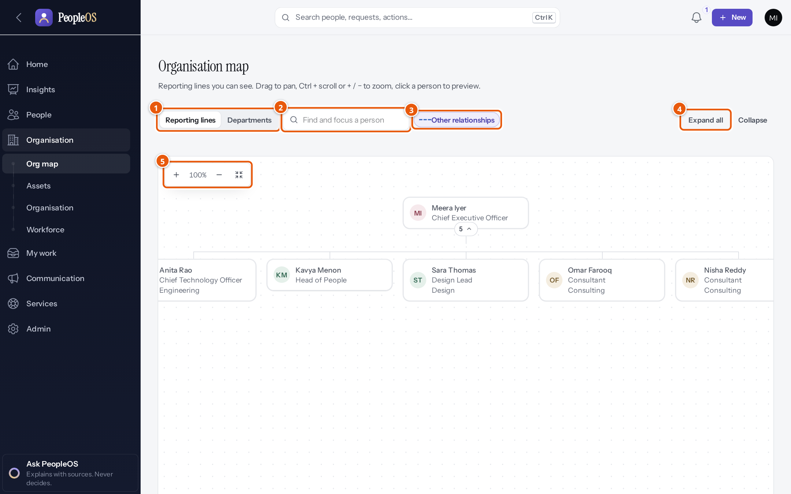
*Figure 6.1 — The Org map, reporting lines view, as the CEO sees it. Demonstration data (fictional).*

1. **Reporting lines / Departments** — switches between the people tree and the department cards.
2. **Find and focus a person** — type at least two letters of a name, then pick the person. The map opens their chain up to the top and moves to them.
3. **Other relationships** — shows or hides dotted-line, functional, matrix and support relationships. Hover over or focus a person to highlight who they work with.
4. **Expand all** — opens every level. **Collapse** closes them again.
5. **Zoom** — **+** and **−** zoom; the last button resets the view. You can also drag to pan and use Ctrl + scroll to zoom. Click a person to see a preview.

The number under a person (for example **5** under Meera Iyer) is how many people report to them; click it to open or close that level. Large teams show the first 12 people and a button to show more.

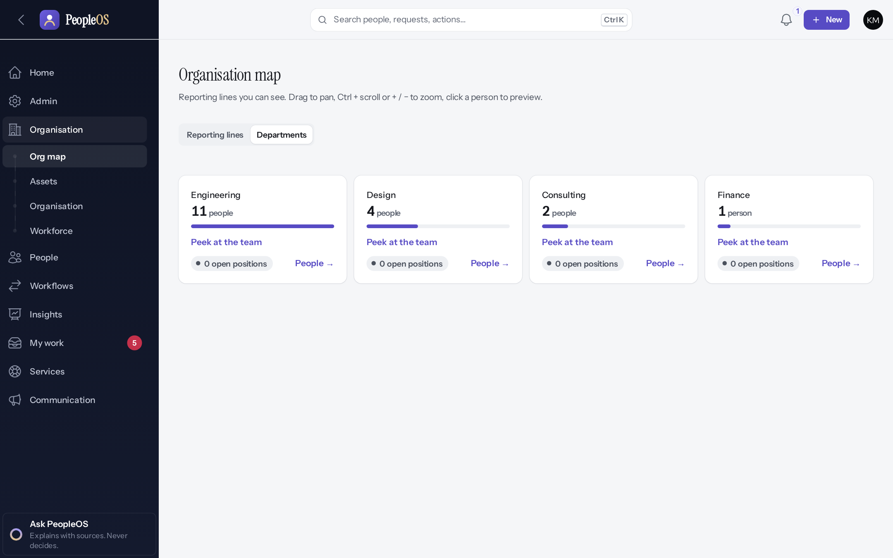
*Figure 6.2 — The departments view: headcount per department, a team preview and open positions. Demonstration data (fictional).*

Each department card shows the number of people, **Peek at the team** (a few names), the number of open positions (workforce access only) and **People →**, which opens the people of that department.

### Tasks

#### Task: Find where a person sits

**Purpose:** see a person's manager, team and reporting chain.
**Before you start:** the person must be someone you are allowed to see.

1. Open **Organisation › Org map**.
2. Click in **Find and focus a person** and type at least two letters of the name.
3. Click the person in the list of matches.
4. Click the person's card to see a preview.

**Expected result:** the map opens every level from the top down to the person and centres on them.
**How to verify:** the person's card is highlighted and their manager is directly above.
**Common mistakes:** looking for someone outside your access. People you may not see never appear, even by search.
**If it fails:** if a person is missing, check that they have a line manager recorded and have already joined. People who have not yet joined, and people who have left, are not on the map.

#### Task: See headcount by department

1. Open **Organisation › Org map**.
2. Click **Departments**.
3. Click **Peek at the team** on a card to see some names, or **People →** to open the full list.

**Expected result:** one card per department with its headcount, largest first.

### Example from everyday work

*Illustrative scenario.* Meera Iyer, the CEO of Demo Group, prepares for a board meeting. She opens the Org map, sees her five direct reports, clicks **Expand all** and checks that the new Design Lead, Sara Thomas, already appears with her team.

### Related modules

- **Employee 360 (chapter 5.2)** — where reporting lines are recorded and changed.
- **Organisation Designer** — where units (not people) are arranged.
- **Workforce Dashboard** — seats and vacancies rather than people.

---

## Organisation Designer

**Status:** Available with limitations (units are moved with a dialog, not by drag-and-drop)

### Overview

The **Organisation Designer** is where you build the structure of units: which business units sit under a company, which departments under a business unit, which teams under a department. Every unit appears once in a single tree, so there is exactly one answer to "what sits beneath what?". Every change asks for a **Reason for change**, and the history of each unit shows the full story.

PeopleOS follows simple containment rules:

| A… | can contain… |
|---|---|
| Company (the only type allowed at the top) | Business Unit, Division, Department, Location, Team |
| Business Unit | Business Unit, Division, Department, Location, Team |
| Division | Division, Department, Location, Team |
| Location | Department, Team |
| Department | Department, Team |
| Team | Team |

### Where to find it

- **Menu path:** **Organisation › Organisation › Organisation Designer** (for administrators it is the first item of the area bar).
- **Who can open it:** Tenant HR Admin, Tenant Super Admin and Account Owner. Other roles see a "This page is not available to you" page.
- **Set-up needed first:** at least one company. You can create the other units here or on their own screens.

> **Note:** the Feature flags screen lists a switch called **organisation.designer** ("Visual organisation designer"), which is off by default. In this version the switch has no effect: the Organisation Designer opens for anyone whose role allows it, whether the switch is on or off. Control access through roles.

### The screen at a glance

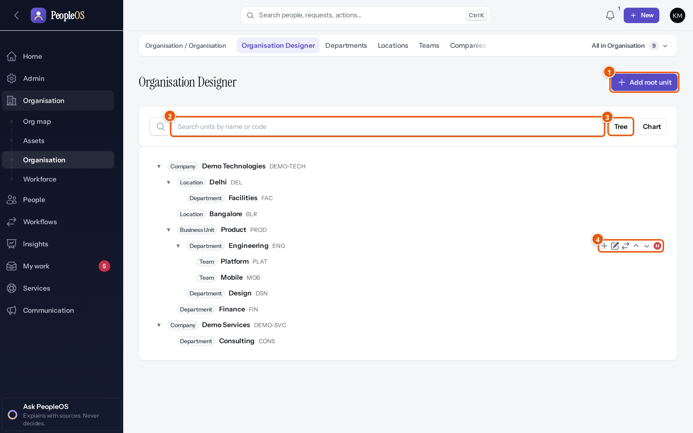
*Figure 6.3 — The Organisation Designer, tree view. Demonstration data (fictional).*

1. **Add root unit** — adds a company at the top of the tree.
2. **Search units by name or code** — shows matching units and the units above them.
3. **Tree** / **Chart** — the same structure as an indented list or as a chart.
4. **Unit actions** — appear when you point at a unit: **Add child**, **Rename**, **Move**, **Move up**, **Move down**, **Deactivate** (or **Reactivate** for an inactive unit) and, for a unit with nothing beneath it, **Remove from tree**.

Each row shows the unit type (for example **Department**), the name and the code. Inactive units are struck through and marked **Inactive**.

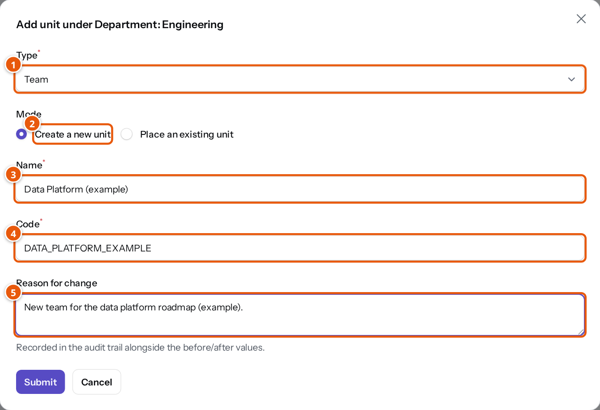
*Figure 6.4 — Adding a unit beneath the Engineering department (example values; the dialog was cancelled). Demonstration data (fictional).*

1. **Type** — only the types allowed beneath this unit are offered.
2. **Mode** — **Create a new unit** or **Place an existing unit** (one created on its own screen and not yet in the tree).
3. **Name** — required for a new unit.
4. **Code** — filled in from the name; you can change it. Letters, numbers, dashes and underscores only.
5. **Reason for change** — recorded in the audit trail.

### Tasks

#### Task: Add a unit to the tree

**Purpose:** create a new department, team or other unit in the right place.
**Before you start:** the parent unit must already be in the tree.

1. Open **Organisation › Organisation › Organisation Designer**.
2. Point at the parent unit and click **Add child** (the **+** icon). To add a company at the top, click **Add root unit** instead.
3. Choose the **Type** (required).
4. Keep **Create a new unit**, enter the **Name** (required) and check the **Code** (required).
5. Type a **Reason for change**.
6. Click **Submit**.

**Expected result:** the message **Unit added** appears and the unit is shown beneath its parent. A new unit takes its company from the nearest company above it.
**How to verify:** the unit also appears on its own screen (for example **Teams**).
**Common mistakes:** choosing a parent that cannot contain that type, for example a team directly under nothing.
**If it fails:** the message **Not allowed** explains why, for example "A Team cannot sit …". A code already used by another unit is refused; choose another code.

#### Task: Move a unit

1. Point at the unit and click **Move**.
2. Choose the **New parent**. Only parents allowed to contain this unit type are listed.
3. Type a **Reason for change** and click **Submit**.

**Expected result:** **Moved**; the unit and everything beneath it move together.
**If it fails:** **A unit cannot be moved beneath itself or one of its descendants.**

#### Task: Deactivate or remove a unit

1. Point at the unit and click **Deactivate**.
2. Read the warning: "The unit and everything beneath it will be marked inactive. History is kept."
3. Type the **Reason for change** (required) and confirm.

**Expected result:** the unit and all units beneath it are marked **Inactive**. **Reactivate** brings back only the unit you choose, not the units beneath it, so you reactivate each one deliberately.

To take a unit out of the tree without deleting it, use **Remove from tree** (only for a unit with nothing beneath it). "Only the placement is removed; the unit record itself stays and can be placed again." If the unit still has units beneath it, PeopleOS says **Move or remove the child units first.**

### Example from everyday work

*Illustrative scenario.* Kavya Menon, Head of People at Demo Group, sets up a new Data Platform team under Engineering. She opens the Designer, adds a **Team** beneath **Department: Engineering**, names it and records "New team for the data platform roadmap" as the reason. The team now appears on the Teams screen and can be chosen on employee records.

### Related modules

- **Companies, Locations and units** — the same records, one screen per type.
- **Positions** — a position can name an organisation unit from this tree.

---

## Companies, locations and organisation units

**Status:** Available

### Overview

These screens hold one list per kind of unit: **Companies**, **Locations**, **Business Units**, **Divisions**, **Departments**, **Teams**, **Cost Centres** and **Profit Centres**. They all work the same way: a list with search and a **Status** filter, a **New …** button, and an edit page. Each record has a unique **Code** (a short, stable identifier used in imports and integrations), a **Status** (**Active** or **Inactive**) and optional **Effective from** / **Effective to** dates. "Leave blank for open-ended. History is never overwritten."

The line under each title tells you how many records you can see, how many are in effect today and how many changed this week.

### Where to find it

- **Menu path:** **Organisation › Organisation**. **Departments**, **Locations**, **Teams** and **Companies** are on the area bar; **Business Units**, **Cost Centres**, **Divisions** and **Profit Centres** are under **All in Organisation**.
- **Who can open it:** Tenant HR Admin, Tenant Super Admin, Account Owner (create and change); HR Manager, HR Executive, Payroll Admin, Attendance Admin, Performance Admin, Asset Admin, Executive, Manager and Auditor (view only).
- **What each person sees:** people whose access is limited to part of the organisation see only that part. For example Neha Kapoor (HR Manager for Demo Technologies) sees only Demo Technologies and its departments, without **New** or **Edit** buttons.

### The screen at a glance

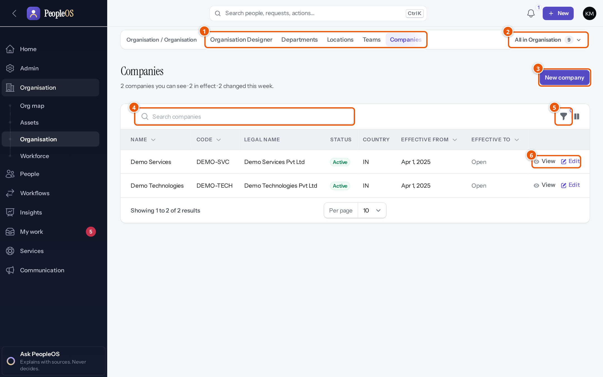
*Figure 6.5 — The Companies list, with the area bar of the Organisation area. Demonstration data (fictional).*

1. **Area bar** — the everyday screens of this area: **Organisation Designer**, **Departments**, **Locations**, **Teams**, **Companies**.
2. **All in Organisation** — the remaining screens of the area (for example **Business Units**, **Cost Centres**, **Divisions**, **Profit Centres**, and for the Tenant Super Admin and Account Owner also **Legal Entities**, **Establishments** and **Establishment assignments**). It has its own search box, **Find in Organisation**.
3. **New company** — opens the form.
4. **Search companies** — searches name, code and legal name.
5. **Filter** — filter by **Status**.
6. **View** / **Edit** — open or change the record.

Columns: **Name**, **Code**, **Legal name**, **Status**, **Country**, **Effective from**, **Effective to**.

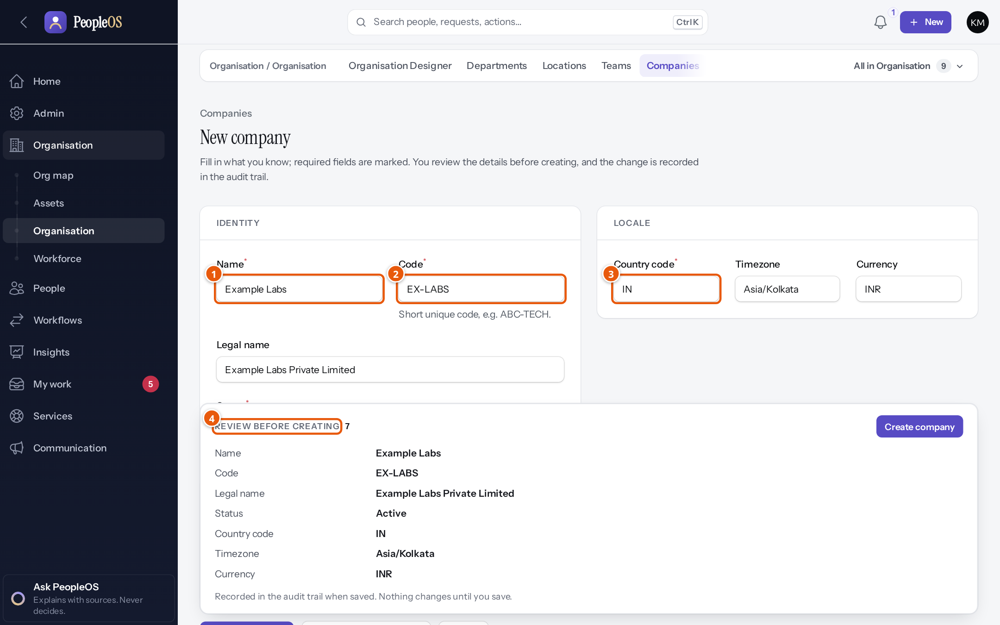
*Figure 6.6 — The New company form with example values (not saved). Demonstration data (fictional).*

1. **Name** — required.
2. **Code** — required, unique. "Short unique code, e.g. ABC-TECH."
3. **Country code** — required, two letters (for example IN). **Timezone** and **Currency** (three letters, for example INR) are optional.
4. **Review before creating** — lists what you entered. "Recorded in the audit trail when saved. Nothing changes until you save."

The form also has **Legal name**, **Status** (required) and **Effective from** / **Effective to**. If your organisation has added custom fields for companies, they appear in their own section.

The other unit forms ask for less:

| Screen | Required fields | Optional fields | Notes |
|---|---|---|---|
| **Locations** | **Company**, **Name**, **Code**, **Type** (Office, Branch, Factory, Warehouse, Site, Remote, Other), **Country code**, **Status** | Address line 1 and 2, City, State code, Postal code, Timezone, effective dates | List columns include **Type** and **City**. |
| **Business Units**, **Divisions**, **Teams** | **Name**, **Code**, **Status** | Company, Description, effective dates | |
| **Departments** | **Name**, **Code**, **Status** | Company, **Cost centre**, Description, effective dates | List shows the cost centre. |
| **Cost Centres**, **Profit Centres** | **Name**, **Code**, **Status** | Company, Description, effective dates | Finance codes; a department can point to a cost centre. |

### Tasks

#### Task: Add a company

**Purpose:** record a new company in PeopleOS.
**Before you start:** decide the code. It must be unique and is used by imports and integrations.

1. Open **Organisation › Organisation › Companies**.
2. Click **New company**.
3. Enter the **Name**, **Code** and **Country code** (required) and the **Status** (Active is preselected). Add the **Legal name**, **Timezone** and **Currency** if you know them.
4. Leave the effective dates empty unless the company starts on a known date.
5. Check the **Review before creating** panel.
6. Click **Create company** (or **Create & create another**).

**Expected result:** the company appears in the list. PeopleOS also creates its primary legal entity (named after the legal name, or the name) and a principal establishment called "[company name] — principal establishment".
**How to verify:** a Tenant Super Admin or Account Owner opens **Legal Entities** and **Establishments** and finds the new records.
**Common mistakes:** using spaces or special characters in the code (only letters, numbers, dashes and underscores are accepted).
**If it fails:** a code already in use is refused. Pick another code.

#### Task: Add a location, department, team or other unit

1. Open the screen (for example **Organisation › Organisation › Locations**, or **All in Organisation › Cost Centres**).
2. Click **New location** (or **New department**, **New team**, **New business unit**, **New division**, **New cost centre**, **New profit centre**).
3. Fill in the required fields from the table above. For a location, choose the **Company**.
4. Click the create button.
5. To place the new unit in the structure, open the **Organisation Designer**, point at the parent and use **Add child › Place an existing unit**.

**Expected result:** the unit appears in its list and can be chosen on employee records.

#### Task: Change or close a unit

**Purpose:** rename a unit, change its details, or stop using it while keeping its history.

1. Open the list and click **Edit** on the row.
2. Change the fields. To stop using the unit, set **Status** to **Inactive** or enter an **Effective to** date.
3. Type a **Reason for change**. It is stored in the audit trail with the before and after values.
4. Save.

**Expected result:** the change is saved, or, if your organisation requires approval for this kind of record, you see **Submitted for approval** and the record stays unchanged until a second person approves it in the Change Centre.
**Common mistakes:** deleting instead of closing. Edit pages also offer **Delete**, but employee history refers to these units. Closing a unit with **Inactive** or an end date keeps that history intact.

### Example from everyday work

*Illustrative scenario.* Demo Technologies opens a Pune office. Kavya Menon adds the location "Pune" under Demo Technologies with type **Office**, then places it under the company in the Organisation Designer. From the next day, HR can choose Pune when they record a transfer for an employee.

### Related modules

- **Legal Entities and Establishments** — the legal side of each company.
- **Organisation Designer** — arranges these units in one tree.
- **Employee 360 (chapter 5.2)** — each employee's job record names a company, location, unit and cost centre from these lists.

---

## Legal entities, establishments and establishment assignments

**Status:** Available with limitations (see the notes below)

### Overview

PeopleOS separates three things that are easy to confuse:

- the **company** HR and management think in,
- the **legal entity**, the registered employer that signs contracts and files tax returns, and
- the **establishment**, a registered workplace of that legal entity.

Why does the establishment matter? Many labour and tax obligations are registered per workplace and per state. In India, for example, provident fund and state insurance codes are issued per establishment, and professional tax and labour welfare fund follow the state the establishment is in. An employer with offices in two states owes these contributions under two state schedules. That is why PeopleOS attaches statutory registrations to an establishment, takes the state rules from the establishment's **State**, and records which establishment each employee belongs to on each date.

When you create a company, PeopleOS creates one primary legal entity and one principal establishment for it. A company with one legal employer in one state needs nothing more. Add further legal entities or establishments when you have them.

Before a statutory return counts as ready to file, PeopleOS checks that the legal entity and the establishment have been verified, and that every employee in the return has an explicit establishment assignment. That is why these screens include verification and assignment.

### Where to find it

- **Menu path:** **Organisation › Organisation › All in Organisation › Legal Entities** (also **Establishments** and **Establishment assignments**). When open, the screen appears on the area bar.
- **Who can open it:** Tenant Super Admin and Account Owner. The Tenant HR Admin role does not include these screens.
- **Who can verify:** a person with the verify permission (by default the Tenant Super Admin), who did not submit the details.
- **Set-up needed first:** a company.

### The screen at a glance

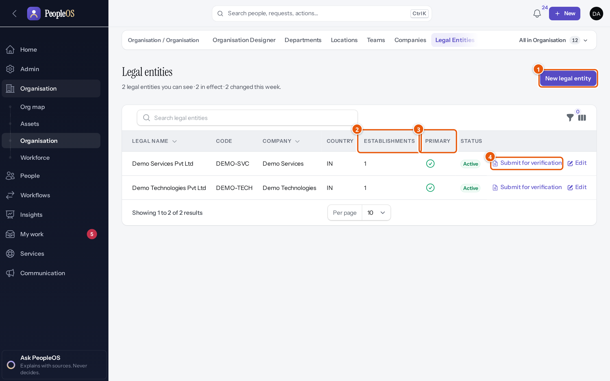
*Figure 6.7 — Legal entities. Demonstration data (fictional).*

1. **New legal entity** — adds another legal employer to a company.
2. **Establishments** — how many establishments the legal entity has.
3. **Primary** — the company's primary legal entity.
4. **Submit for verification** — sends the details for checking against the certificate.

Further columns, to the right: **Status**, **Verification** (**unverified**, **review** or **verified**), **Effective from**, **Effective to**. The legal entity form asks for **Company** and **Code** (both fixed once saved), **Legal name** (required), **Trade name**, **Legal form** (for example Private limited company, Limited liability partnership, Partnership firm), **Country** (required, two letters), **Incorporation identifier (e.g. CIN / LLPIN)**, **Status**, **Effective from** (required), **Effective to** and **Primary legal entity of the company**.

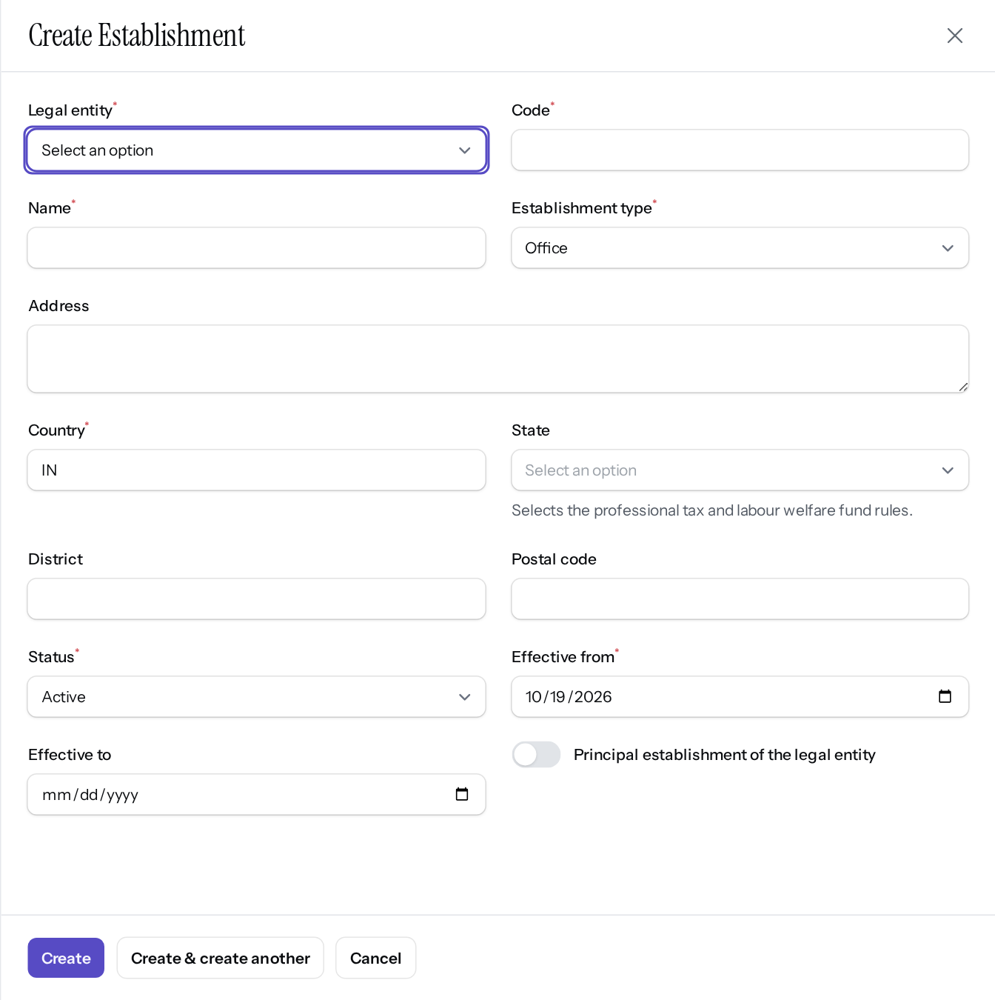
*Figure 6.8 — Creating an establishment (the dialog was cancelled). Demonstration data (fictional).*

Required: **Legal entity**, **Code**, **Name**, **Establishment type** (Registered office, Office, Branch, Factory, Warehouse, Shop / commercial establishment, Project site, Other), **Country**, **Status** and **Effective from**. Optional: **Address**, **State** ("Selects the professional tax and labour welfare fund rules."), **District**, **Postal code**, **Effective to** and **Principal establishment of the legal entity**. The list can be filtered by **Status** and **State**.

The **Establishment assignments** screen lists, per employee, the **Establishment**, **Effective from**, **Effective to**, **Source** and **Reason**. Assignments created when PeopleOS first linked employees to establishments show the source **backfill**.

### Tasks

#### Task: Add an establishment

**Purpose:** record a second registered workplace, for example a branch in another state.
**Before you start:** have the registration certificate at hand.

1. Open **Organisation › Organisation › All in Organisation › Establishments**.
2. Click **New establishment**.
3. Choose the **Legal entity**, enter a **Code** and **Name**, choose the **Establishment type** and check the **Country**.
4. Choose the **State**. This decides which state rules apply (for example professional tax).
5. Check **Effective from** (today is preselected).
6. Click **Create**.

**Expected result:** the establishment appears in the list with **Verification** "unverified".
**Common mistakes:** leaving **State** empty. State-based rules cannot be chosen without it.

#### Task: Submit a legal entity or establishment for verification, and verify it

**Purpose:** confirm that the details match the official certificate before statutory work relies on them.

1. On the row, click **Submit for verification**.
2. Enter the **Certificate / document reference** (required). Optionally attach a **Copy of the certificate (optional)** and add **Notes**.
3. Submit. The status becomes **review**.
4. A second person with verify rights opens the list and clicks **Verify**, reads "Confirm the legal name, identifiers, state and address match the certificate. You cannot verify details you submitted.", enters **Verification notes** (required) and confirms.

**Expected result:** the status becomes **verified**.
**If it fails:** "The person who submitted the details cannot verify them." — ask a colleague. "Only a record submitted for verification can be verified." — submit it first. Changing an identity field later (such as the legal name) resets verification, and the record must be verified again.

#### Task: Assign an employee to an establishment

**Purpose:** record that an employee works for a given establishment from a date, for example after a transfer to another state.

1. Open **Organisation › Organisation › All in Organisation › Establishment assignments**.
2. Click **Assign establishment**.
3. Choose the **Employee**, the **Establishment**, the **Effective from** date and the **Source** (**Manual** or **Transfer**), and type the **Reason** (all required).
4. Click **Confirm**.

**Expected result:** **Establishment assigned**. The employee's previous assignment is closed the day before the new date.
**If it fails:** assignment history is never rewritten. PeopleOS refuses a date on or before an existing assignment ("establishment history cannot be rewritten"), an establishment that is not active on that date, and an establishment of a different company than the employee's job on that date.

> **Note:** where no assignment exists, PeopleOS works out the establishment from the employee's location, and otherwise uses the company's principal establishment. In this version you cannot link a location to an establishment from the **Locations** screen: only locations that existed when PeopleOS first created establishments are linked. For employees at newer locations, record an establishment assignment.

> **Note:** the **State** list contains 13 Indian states in this version. Statutory rules are shipped for India (and one UAE rule) only, and none is verified yet. See chapter 5.4 for what this means for payroll.

### Example from everyday work

*Illustrative scenario.* Demo Technologies Pvt Ltd opens a branch in Maharashtra. Demo Admin adds the establishment "Mumbai branch" with **State** Maharashtra, submits it for verification with its registration certificate reference, and asks a colleague to verify it. Then the employees who move to Mumbai receive an establishment assignment from their transfer date.

### Related modules

- **Statutory registrations and statutory returns (chapter 5.4)** — registrations belong to establishments; returns are built per establishment or per legal entity.
- **Companies** — creating a company creates its first legal entity and establishment.

---

## People Setup reference data

**Status:** Available

### Overview

These lists feed the job details on every employee record and on positions. Keep them tidy: a short, agreed list of designations and grades makes reports, pay structures and approvals much easier. New organisations receive starting lists of employment types, employee categories, work modes and levels, which you can edit, add to or retire.

### Where to find it

- **Menu path:** **Admin › Setup › All in Setup**, group **People Setup**. A screen you have open is also shown on the area bar.
- **Who can open it:** Tenant HR Admin, Tenant Super Admin and Account Owner (create and change); HR Manager, HR Executive, Payroll Admin, Attendance Admin, Performance Admin and Auditor (view only). **Document types** can be opened by the Tenant HR Admin, HR Manager, HR Executive and Auditor; only the Tenant HR Admin (and Tenant Super Admin) can add or change them.

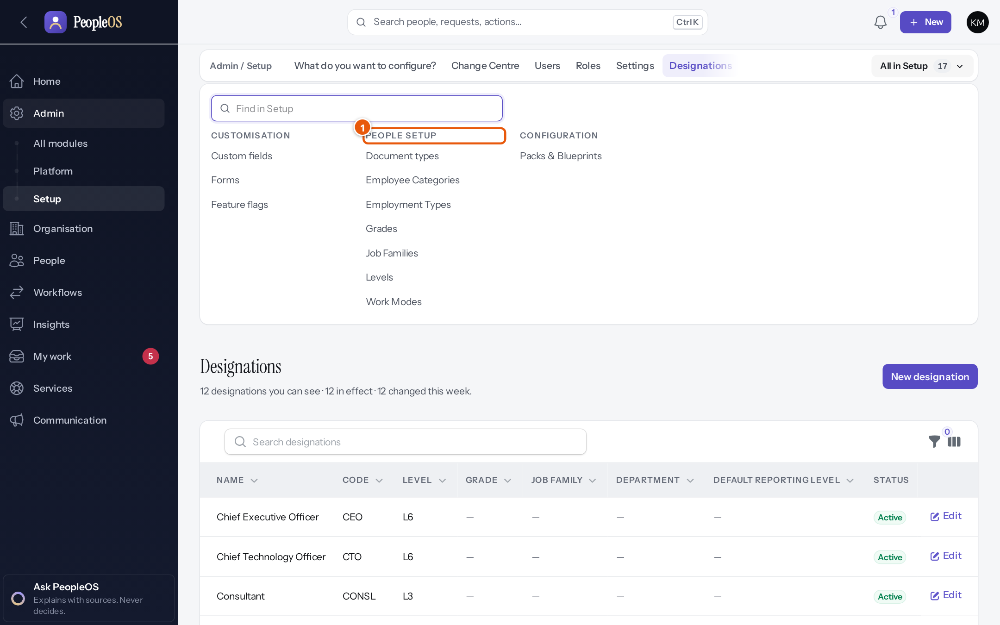
*Figure 6.9 — The People Setup screens in the All in Setup menu. Demonstration data (fictional).*

1. **People Setup** — Document types, Employee Categories, Employment Types, Grades, Job Families, Levels and Work Modes. **Designations** is listed here too when you are on another screen.

| Screen | What you store there | Required fields | Optional fields |
|---|---|---|---|
| **Levels** | Seniority bands (for example L1 to L6) | **Name**, **Code**, **Status** | **Rank** ("Ordering position; lower comes first."), Description, effective dates |
| **Grades** | Pay or job grades (for example G1 to G6) | **Name**, **Code**, **Status** | **Level**, **Rank**, Description, effective dates |
| **Job Families** | Groups of related jobs (for example Engineering, Finance) | **Name**, **Code**, **Status** | Description |
| **Designations** | Job titles | **Name**, **Code**, **Status** | **Level**, **Grade**, **Job family**, **Department**, **Default reporting level**, **Employment types** (several), Description, effective dates |
| **Employment Types** | Full-time, Part-time, Fixed-term, Contract, Consultant, Apprentice, Intern (starting list) | **Name**, **Code**, **Status** | Description |
| **Employee Categories** | Permanent, Probationer, Contract, Consultant, Intern and others | **Name**, **Code**, **Status** | Description |
| **Work Modes** | Office, Hybrid, Remote, Field | **Name**, **Code**, **Status** | Description |
| **Document types** | Kinds of employee documents, by category (Identity, Education, Previous employment, Tax, Statutory, Company, Training, Medical, Exit, Other) | **Name**, **Code**, **Category**, **Status** | **Has an expiry date**, **Mandatory for onboarding** |

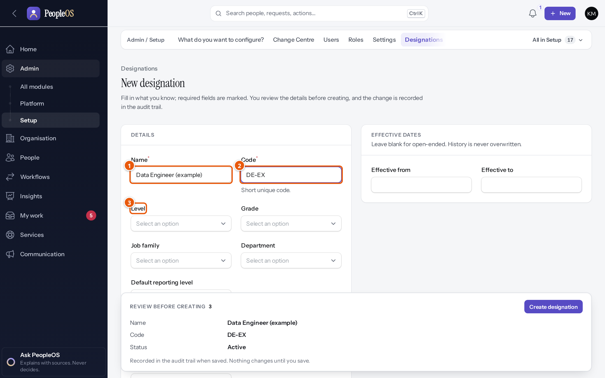
*Figure 6.10 — The New designation form with example values (not saved). Demonstration data (fictional).*

1. **Name** — the job title people will see.
2. **Code** — short and unique.
3. **Level** — and next to it **Grade**, **Job family**, **Department** and **Default reporting level**. These links are optional but make designations far more useful in reports and positions.

### Tasks

#### Task: Add a designation

**Purpose:** add a new job title.
**Before you start:** create the level, grade, job family and department it should point to.

1. Open **Admin › Setup › All in Setup › Designations**.
2. Click **New designation**.
3. Enter the **Name** and **Code** (required).
4. Choose the **Level**, **Grade**, **Job family**, **Department** and **Default reporting level** where they apply.
5. Choose the allowed **Employment types**.
6. Check the **Review before creating** panel and click **Create designation**.

**Expected result:** the designation appears in the list and in the **Designation** list on employee records and positions.
**If it fails:** a code already in use is refused.

#### Task: Add any other People Setup item

1. Open the screen from **Admin › Setup › All in Setup** (for example **Work Modes**).
2. Click **New …** (for example **New work mode**).
3. Enter the **Name**, **Code** and **Status** (required) and any optional fields from the table above.
4. Click the create button.

To retire an item, edit it and set **Status** to **Inactive** (or an **Effective to** date where offered), with a **Reason for change**. As with organisation units, edits may be routed to the Change Centre if your organisation requires approval.

### Related modules

- **Employee 360 (chapter 5.2)** — job details use these lists.
- **Documents and onboarding (chapter 5.2)** — document types marked **Mandatory for onboarding** drive onboarding document collection.
- **Positions** — use designations, job families, grades and employment types.

---

## Workforce planning

**Status:** Available with limitations (see each screen)

### Overview

Workforce planning answers "how many seats has the business approved, how many are filled, and what is planned?". PeopleOS keeps three things separate and never mixes them up:

- **Positions and seats** — the approved capacity (a position can have one seat or several).
- **FTE** — how much working time those seats represent.
- **Employees** — the people. A position exists without anyone in it, and when someone leaves, the position stays.

A position is linked to a person only through the person's own job record. When HR records a hire or a transfer and chooses a position, the person "occupies" a seat. "Occupied" is therefore never a status you set; PeopleOS works it out from the job records on each date. A **vacancy** is simply an unfilled seat in an open position. PeopleOS does not run recruitment: it can tell an outside recruitment system when a position is opened or vacated, if your organisation connects one.

Every change to a position after its draft stage becomes a new dated version, so you can always see what the position looked like on any day. Plans, scenarios and budgets never change live positions or employees. The only bridge from a plan to real capacity is the deliberate **Propose position from line** action, and that position still needs approval.

**Separation of duties.** The person who proposes a position never approves it. The person who submits a plan never reviews, approves, rejects or returns it. The person who prepares a scenario or a budget never approves it. By default only the Tenant HR Admin (and Tenant Super Admin) roles can plan and approve, so you need at least two people with these rights, or a custom role created by your administrator.

### Where to find it

- **Menu path:** **Organisation › Workforce**. The area bar shows **Dashboard**, **Positions**, **Headcount plans**, **Vacancies** and **Position hierarchy**; **All in Workforce** also lists **Scenarios**, **Budgets**, **Workforce snapshots** and **Analytics**.
- **Who can open it:**

| Screen | Who can open it |
|---|---|
| **Dashboard** | Tenant HR Admin, Tenant Super Admin, Executive, Auditor |
| **Positions** | Tenant HR Admin, Tenant Super Admin, Auditor (view), Manager (positions in their team only) |
| **Position hierarchy**, **Vacancies**, **Headcount plans**, **Scenarios**, **Workforce snapshots** | Tenant HR Admin, Tenant Super Admin, Auditor (view) |
| **Budgets** | Tenant HR Admin, Tenant Super Admin (cost access needed) |
| **Analytics** | Tenant HR Admin, Tenant Super Admin, Executive |
| **Team positions** (People › My team) | Managers, when at least one position is in their team |

HR Managers and other HR roles do not see the Workforce screens unless your administrator gives them workforce access. Costs (planned cost, budgets, actual payroll cost) are shown only to people with workforce cost access.

### Workforce dashboard, snapshots, hierarchy, vacancies and analytics

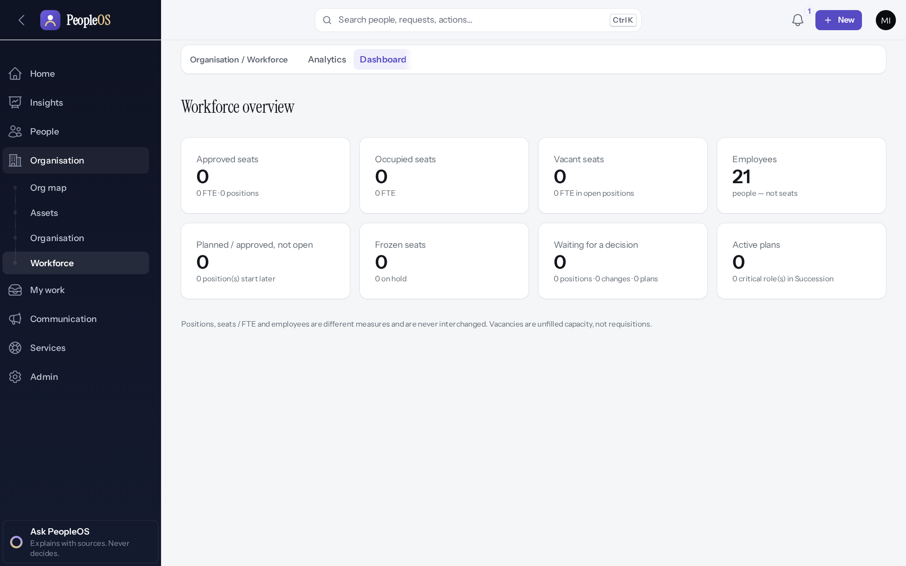
*Figure 6.11 — The Workforce overview as an executive sees it (the demonstration organisation has no approved positions yet). Demonstration data (fictional).*

The **Dashboard** (page title **Workforce overview**) shows eight tiles: **Approved seats** (with FTE and number of positions), **Occupied seats**, **Vacant seats** (FTE in open positions), **Employees** ("people — not seats"), **Planned / approved, not open**, **Frozen seats** (and how many are on hold), **Waiting for a decision** (positions, changes and plans) and **Active plans** (with the number of critical roles in Succession). The footnote reminds you: "Positions, seats / FTE and employees are different measures and are never interchanged. Vacancies are unfilled capacity, not requisitions."

| Screen | What it shows | How to use it |
|---|---|---|
| **Workforce snapshots** (title **Workforce snapshot**) | Positions in force, approved, occupied, vacant, frozen, on hold and planned seats and employees on a chosen date, plus tables **By department** and **By location** | Pick a date under **As of** to see the past or a future date (future-dated changes included). |
| **Position hierarchy** | Positions in force on a date, indented under their parent position, with seats and occupancy | Pick a date under **As of**. "The position hierarchy describes capacity; employee reporting lines are separate and are never derived from it." |
| **Vacancies** | Open positions with unfilled seats: **Position**, **Title**, **Designation**, **Location**, **Seats**, **Occupied**, **Vacant**, **Open since** | Review long-open seats. PeopleOS sends reminders about vacancies open for a long time (30 days by default). |
| **Analytics** (title **Workforce analytics**) | Seats, FTE, occupied and vacant **By department**, **By location**, **By job family**, **By employment type**; **Planned vs actual (active plans)**; **Budget vs actual** | For executives and planners. In **Budget vs actual**, actual payroll cost is hidden for small groups so that no individual's pay can be worked out. "Facts only — nobody is ranked, scored or predicted." |

### Positions

#### The screen at a glance

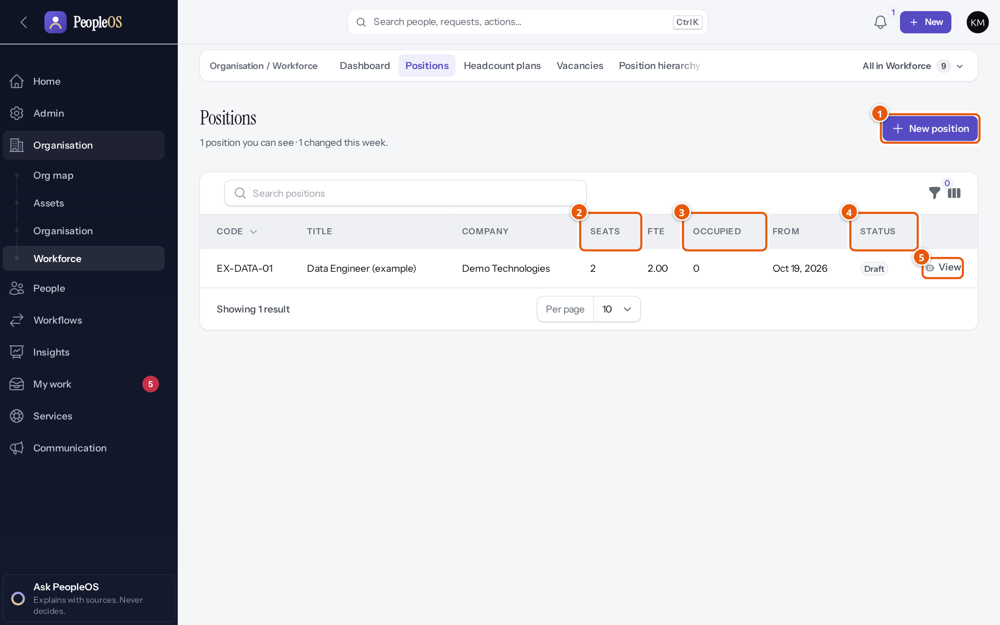
*Figure 6.12 — Positions, with one example position in draft. Demonstration data (fictional).*

1. **New position** — creates a position as a draft.
2. **Seats** — how many people the position can hold.
3. **Occupied** — how many seats are filled today, worked out from job records.
4. **Status** — the position's lifecycle status (filter by status with the filter button).
5. **View** — opens the position.

The **FTE** column is the position's total FTE capacity; **From** is the date of its first version.

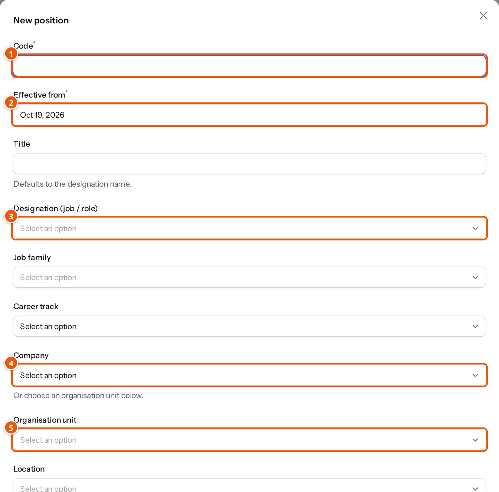
*Figure 6.13 — The New position dialog, first fields (cancelled). Demonstration data (fictional).*

1. **Code** — required, unique.
2. **Effective from** — required; today is preselected.
3. **Designation (job / role)** — the job. **Title** defaults to the designation name.
4. **Company** — "Or choose an organisation unit below."
5. **Organisation unit** — a unit from the Organisation Designer tree; the company is then taken from the unit.

Further down: **Job family**, **Career track**, **Location**, **Employment type**, **Worker type** (Employee, Contractor, Apprentice, Intern, Consultant), **Grade**, **Cost centre**, **Parent position**, **Occupancy mode** (**Single occupant** or **Multiple occupants**), **Seats**, **FTE per seat**, **FTE capacity** ("Defaults to seats × FTE per seat."), **Standard hours / week** and **Reason**.

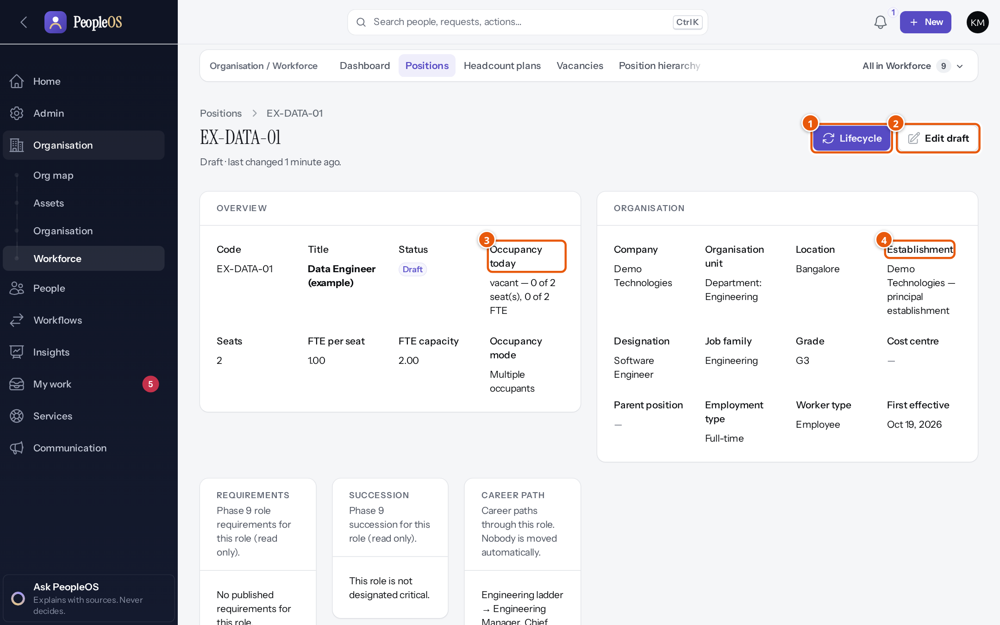
*Figure 6.14 — An example position in draft. Demonstration data (fictional).*

1. **Lifecycle** — moves the position to its next status (only the moves allowed from the current status are shown).
2. **Edit draft** — changes the position while it is still a draft. After that, use **Change from a date**.
3. **Occupancy today** — for example "vacant — 0 of 2 seat(s), 0 of 2 FTE".
4. **Establishment** — worked out from the location (here the principal establishment of Demo Technologies).

Below the details, read-only panels show the role's **Requirements**, **Succession** (if you may see succession) and **Career path**; "Nobody is moved automatically." At the bottom, tabs show **History** (every version), **Occupancy** (who has occupied the position and when), **Change requests** and the audit **History**.

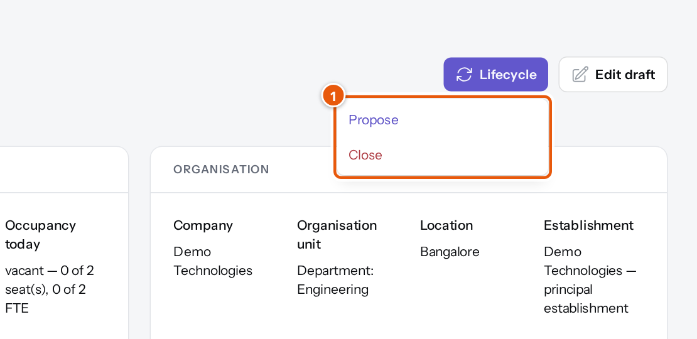
*Figure 6.15 — For a draft position, the Lifecycle menu offers Propose and Close. Demonstration data (fictional).*

#### Statuses explained

| Status | Meaning | What can happen next |
|---|---|---|
| **Draft** | Being prepared; editable in place | **Propose**, or **Close** |
| **Proposed** | Waiting for approval | **Approve** (a different person with approval rights), back to **Draft**, or **Close** |
| **Approved** | Approved capacity, not yet open | **Mark planned**, **Open**, or **Close** |
| **Planned** | Approved and expected to open later | **Open**, **Freeze**, **Put on hold**, **Abolish**, **Close** |
| **Open** | Can take employees; unfilled seats are vacancies | **Freeze**, **Put on hold**, **Abolish**, **Close** |
| **Frozen** | Temporarily not to be filled; empty seats are not counted as vacancies | **Unfreeze** (back to Open), **Abolish**, **Close** |
| **On hold** | Paused | **Open**, **Freeze**, **Abolish**, **Close** |
| **Abolished** / **Closed** | Final; kept for history | Nothing |

Approved, planned, open, frozen and on-hold positions count as approved capacity. Only **Open** positions accept new employees.

**Flowchart — Position, vacancy and hire.** How a seat goes from an idea to a filled position. *Roles:* Tenant HR Admin (proposer), a second Tenant HR Admin or approver, HR recording the hire or transfer. *Starts:* a new position is created. *Ends:* the seat is filled, or the position is frozen, abolished or closed.

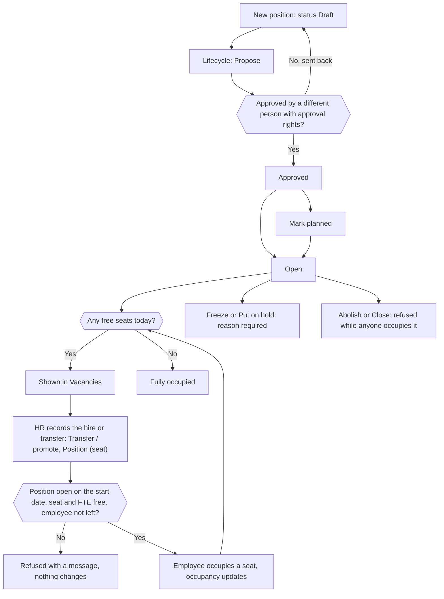

#### Task: Create a position

**Purpose:** record approved capacity, for example two Data Engineer seats.
**Before you start:** the designation, organisation unit or company, location and grade you need exist.

1. Open **Organisation › Workforce › Positions**.
2. Click **New position**.
3. Enter the **Code** and check **Effective from** (both required).
4. Choose the **Designation (job / role)** (or type a **Title**), and the **Company** or **Organisation unit**.
5. Choose the **Location**, **Employment type**, **Grade** and any other details.
6. For more than one seat, choose **Multiple occupants** and enter the number of **Seats**.
7. Leave **FTE per seat** and **FTE capacity** empty for full-time seats (see the note below).
8. Type a **Reason** and click **Submit**.

**Expected result:** "Position [code] created as a draft". The establishment is filled in from the location.
**Common mistakes:** forgetting the company or unit ("A position belongs to a company (choose a company or an organisation unit).") or leaving both title and designation empty ("A position needs a title or a designation.").
**If it fails:** "Position code … is already used." — choose another code.

> **Important:** in this version the **FTE per seat** and **FTE capacity** boxes accept only values such as 0.96 or 1.01. If you type a whole number such as 1, your browser shows "Please enter a valid value" and the form is not sent. Leave the boxes empty instead: PeopleOS then uses 1 FTE per seat and seats × FTE per seat. The same applies to the **FTE** box when you assign a position to an employee. Your provider has been told about this.

#### Task: Propose and approve a position

1. Open the position and click **Lifecycle › Propose**. Optionally enter an **Effective from** date ("Leave empty for today (never before the latest version).") and a reason, then confirm.
2. A second person with approval rights opens the position and clicks **Lifecycle › Approve**.
3. The approver (or the proposer) then clicks **Lifecycle › Open** when the seats may be filled, or **Mark planned** if they open later.

**Expected result:** the status changes ("Position is now …") and the creator is notified in PeopleOS.
**If it fails:** "The person who proposed a position cannot approve it." — ask another approver. "A position cannot move from … to …" — the move is not allowed from the current status.

#### Task: Fill a seat (hire or transfer into a position)

**Purpose:** record that an employee occupies a seat.
**Before you start:** the position is **Open** and has a free seat. You need the right to change employees' jobs and workforce access; without workforce access the **Position (seat)** box is not shown.

1. Open the employee's record (People › Directory, then the person) and click **Transfer / promote**.
2. In **Context**, choose the change type and the **Effective from** date.
3. In **Change**, choose the **Position (seat)**. Only open positions are listed. Leave **FTE** empty to use the position's FTE per seat.
4. In **Review**, check the before and after values, enter the **Reason for change** and click **Confirm change**.

**Expected result:** **Position assigned**. The position's **Occupancy** tab lists the employee, and the seat no longer appears in **Vacancies**.
**If it fails:** PeopleOS explains the reason, for example "Position … has no free seat from …", "Position … is frozen on … and cannot take a new assignment", or "An employee who has left cannot be assigned to a position."
**Tip:** to free a seat, use **Transfer / promote** again and tick **Vacate current position**. A transfer that does not name a new position keeps the employee in their current seat.

#### Task: Change a position from a date

1. Open the position and click **Change from a date**.
2. Enter the **Effective from** date (required). "Only fill what changes."
3. Change the fields that change, type a **Reason** (required) and submit.

**Expected result:** either **New version recorded**, or **Change request sent for approval**. Changes to seats, FTE, organisation unit and grade need a second person; status, location and other definition changes apply directly. Approvers decide pending requests on the **Change requests** tab with **Approve** or **Reject** (a note is required to reject). The requester can **Cancel** their own request.
**If it fails:** "A change cannot start before the position's latest version (…)." — choose a later date. "The new capacity is below the current occupancy …" — vacate seats first. "A position keeps its company; abolish it and create another."

#### Task: Freeze, abolish or close a position

1. Click **Lifecycle** and choose **Freeze**, **Put on hold**, **Abolish** or **Close**.
2. Enter the reason (required) and confirm.

**Expected result:** the new status applies from the date given. Frozen seats stop counting as vacancies.
**If it fails:** "Position … is occupied from …; move or vacate the occupant through employment first. Nobody is moved automatically." PeopleOS never moves, transfers or ends anyone's employment for you.

> **Note:** limitations of positions in this version: changes cannot be backdated before a position's latest version (a correction of the past is a new version or a new position); abolishing an occupied position is always refused; position approval is always a direct decision by a second person (there is no approval-workflow option for positions).

### Headcount plans, scenarios and budgets

#### Overview

A **headcount plan** states the intended capacity for a period, for example "FY 2027-28 for Demo Technologies". Each plan has versions. A version holds **lines**, and each line is a movement (for example **New position**, **Position expansion**, **Transfer in**, **Position reduction**, **Position closure**, **Transfer out**, **Retirement**, **Known exit**, or **Existing capacity (baseline)**), with a headcount, optional FTE, an effective date inside the period and, for people with cost access, a planned cost with its **Cost basis**.

A **scenario** names your planning assumptions, for example "Growth" with an expected attrition of 8 % per year. A plan version can use a scenario. The assumption is shown separately in the forecast and is always labelled as an assumption, never as a prediction about any employee.

A **budget** sets an amount for a company, unit or cost centre over a period, on one cost basis, and compares it with the planned cost from a plan and with actual employer cost from finalised payroll.

#### The screen at a glance

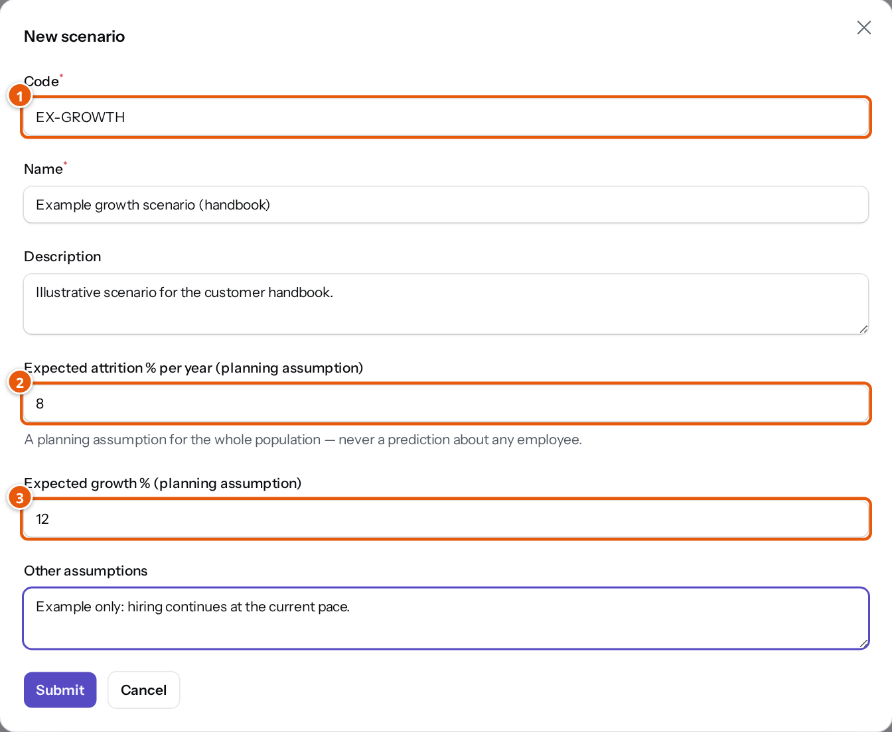
*Figure 6.16 — Creating a scenario with labelled planning assumptions. Demonstration data (fictional).*

1. **Code** — required, unique. **Name** is also required.
2. **Expected attrition % per year (planning assumption)** — 0 to 100. "A planning assumption for the whole population — never a prediction about any employee."
3. **Expected growth % (planning assumption)** — optional. **Other assumptions** takes free text.

The **Scenarios** list (under **All in Workforce**) shows **Code**, **Name**, **Planning assumptions** and **Status** (**draft**, **approved**, **archived**), with **Edit** (draft only), **Approve** (shown only to an approver who did not create the scenario) and **Archive** (reason required).

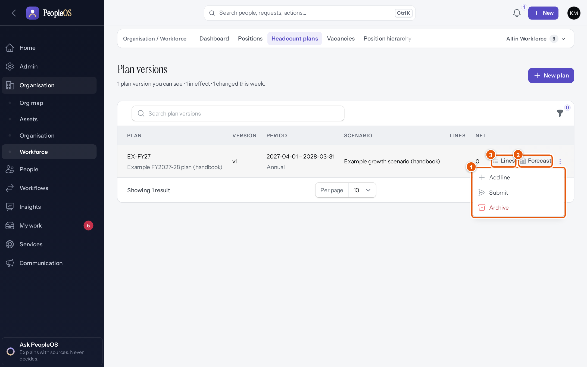
*Figure 6.17 — Headcount plans (page title "Plan versions"), with the actions of a draft version. Demonstration data (fictional).*

1. **Actions menu** (⋮) — the actions allowed now. For a draft: **Add line**, **Submit**, **Archive**. Later: **Start review**, **Approve**, **Reject**, **Return for changes**, **Publish (make active)**, **New version (correction)** and **Propose position from line**.
2. **Forecast** — month-by-month planned seats, recorded exits and the scenario's attrition assumption.
3. **Lines** — the plan's lines.

Columns: **Plan** (code and name), **Version**, **Period**, **Scenario**, **Lines**, **Net headcount** and **Status**.

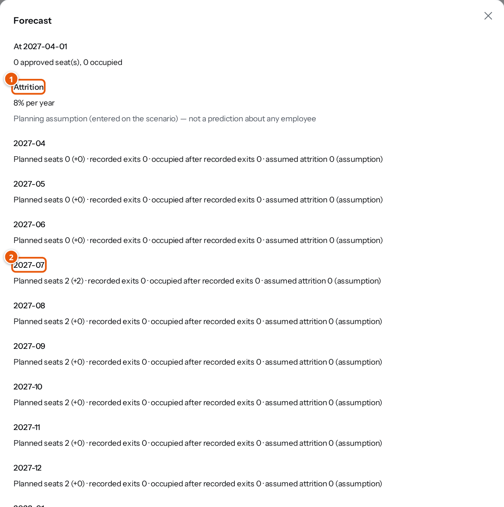
*Figure 6.18 — The forecast of an example plan. Demonstration data (fictional).*

1. **Attrition** — the scenario's assumption, labelled "Planning assumption (entered on the scenario) — not a prediction about any employee".
2. **A month** — for each month: planned seats and the change, recorded exits (exits already recorded with a last working day), occupied after recorded exits and, separately, the assumed attrition.

#### Statuses explained (plan versions)

| Status | Meaning | What happens next |
|---|---|---|
| **Draft** | Being prepared; the only editable state | **Add line**, then **Submit** |
| **Submitted** | Locked, waiting for review | Another person clicks **Start review**, **Reject** or **Return for changes** |
| **Under review** | Being reviewed | An approver who did not submit it clicks **Approve**, **Reject** or **Return for changes** |
| **Approved** | Approved; content locked | **Publish (make active)**, **Propose position from line**, **New version (correction)** |
| **Active** | The version in force; one per plan | **New version (correction)**, **Propose position from line**, **Archive** |
| **Superseded** | Replaced by a newer active version | **New version (correction)** or **Archive** |
| **Rejected** | Turned down, with a note | **New version (correction)** or **Archive** |
| **Archived** | Kept for history | Nothing |

**Flowchart — Headcount plan approval.** From a draft plan to an active plan. *Roles:* planner (submits), reviewer and approver (different people). *Starts:* a new plan. *Ends:* an active plan version, or a rejected or archived one.

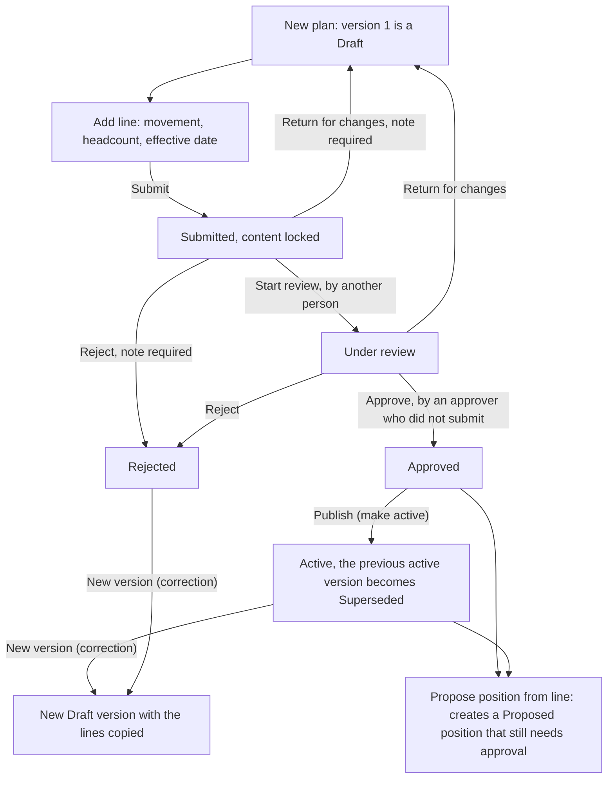

#### Task: Create a scenario

1. Open **Organisation › Workforce › All in Workforce › Scenarios**.
2. Click **New scenario**.
3. Enter the **Code** and **Name** (required), and the assumptions you want to state.
4. Click **Submit**.

**Expected result:** **Scenario created**, status **draft**. A different person with approval rights approves it with **Approve**, which locks it.
**If it fails:** "Scenario code … is already used." — choose another code. "The person who prepared a scenario cannot approve it."

#### Task: Create a headcount plan and add lines

1. Open **Organisation › Workforce › Headcount plans** and click **New plan**.
2. Enter the **Code** and **Name**, choose the **Company** or **Organisation unit** (optionally a **Location**), the **Scenario**, the **Period type** (Monthly, Quarterly, Half-year, Annual, Custom), the **Period start** and **Period end** (all marked fields are required), and click **Submit**.
3. On the new row, open the **Actions** menu and click **Add line**.
4. Choose the **Movement** and enter the **Headcount** and **Effective date** (required). Optionally choose an **Existing position**, **Organisation unit**, **Location**, **Designation** and **Job family**, and enter **FTE** and **Notes**. With cost access you can also enter a **Planned cost** and its **Cost basis**.
5. Click **Submit**. Repeat for each line.

**Expected result:** "Plan created with a draft version", then **Line added**. **Net headcount** adds lines that increase capacity and subtracts lines that reduce it.
**If it fails:** "A plan line's effective date falls inside the planning period." "A planned cost needs its cost basis …". "A plan line can only name a position of the plan's company."
**Tip:** a transfer between two units is recorded as two lines: **Transfer out** in one unit and **Transfer in** in the other.

#### Task: Submit, review, approve and publish a plan version

1. The planner opens **Actions › Submit** on the draft and confirms. A version needs at least one line.
2. A reviewer (not the submitter) clicks **Actions › Start review**.
3. An approver (not the submitter) clicks **Actions › Approve** (optional note), or **Reject** or **Return for changes** with a required note.
4. An approver clicks **Actions › Publish (make active)** and optionally sets the **Effective from** date.

**Expected result:** "Plan version is active". Any previous active version of the same plan becomes **Superseded**. People named in the plan's steps receive in-app notifications, and PeopleOS sends daily reminders about plans waiting for review or approval and plans whose period is ending.
**If it fails:** "The person who submitted a plan version cannot approve it." (or review, reject, return it). If your organisation's plan approvals run through an approval workflow set up by Markedge, the buttons are replaced by that workflow: "This plan version is decided by its approval workflow."

#### Task: Propose a position from a plan line

1. On an **Approved** or **Active** version, click **Actions › Propose position from line**.
2. Choose the **Line** (only **New position** and **Position expansion** lines not used yet are offered) and enter a **Position code**.
3. Submit.

**Expected result:** "Position [code] proposed — it still needs approval". The position appears in **Positions** with status **Proposed**.

#### Task: Record a workforce budget and compare it

**Purpose:** set a cost budget and see it against plans and payroll.
**Before you start:** you need workforce cost access and planning rights.

1. Open **Organisation › Workforce › All in Workforce › Budgets** and click **New budget**.
2. Enter the **Name**, **Period start**, **Period end**, **Cost basis** and **Amount** (required). Choose the **Company**, **Organisation unit** or **Cost centre**, and optionally the **Plan version (for planned cost)**. **Currency** defaults to the company currency.
3. Click **Submit**. The budget is recorded as a draft.
4. A different approver clicks **Approve**. To replace an approved budget, an approver clicks **Supersede** and gives a reason.
5. Click **Planned vs actual** on a row to compare.

**Expected result:** the comparison shows the budget, planned cost, actual cost and the differences.

> **Note:** actual cost comes only from finalised or paid payroll, as employer cost, and is compared only with an **Employer cost** budget in the same currency. It is hidden when fewer than five employees are behind it. Employees who move during the period are attributed to the budget by their job record, not split proportionally. Because payroll in PeopleOS depends on statutory rules that are not yet verified (chapter 5.4), actual costs may not be available yet. This comparison was not exercised in the demonstration organisation.

### Team positions (for managers)

**Status:** Available with limitations

A manager whose team holds positions sees **People › My team › Team positions** (heading **Positions in my scope**): the positions under the positions they hold and those held by the people they manage, with **Status**, **Seats**, **Occupied** and **Vacant**, and summary tiles **Positions**, **Seats**, **Occupied** and **Open or planned**. It shows no plans, scenarios or costs. Mentors, buddies and project leads gain nothing from this view. The page appears only when at least one such position exists, which was not the case in the demonstration organisation, so it is described here from the product specification. Managers can also open **Organisation › Workforce › Positions**, which lists only the same team positions.

### Example from everyday work

*Illustrative scenario.* Kavya Menon plans two extra Data Engineer seats for the next financial year. She creates the scenario "Growth" with an attrition assumption of 8 %, a plan for Demo Technologies with a **New position** line of two seats from July, and submits it. A second Tenant HR Admin reviews and approves it, then publishes it. Kavya clicks **Propose position from line**, which creates a proposed position. Once a colleague approves and opens it, the two seats appear in **Vacancies** until HR records the new hires with **Transfer / promote**.

### Related modules

- **Employee 360 (chapter 5.2)** — **Transfer / promote** is where an employee occupies or vacates a seat.
- **Career and succession (chapter 5.5)** — the position page shows role requirements, critical-role succession and career paths, read-only.
- **Insights (chapter 5.8)** — the Workforce Command Centre and dashboards use the same figures.
- **Payroll (chapter 5.4)** — the source of actual workforce cost.

---

## Assets

**Status:** Available with limitations (no depreciation, stock counts or barcode scanning)

### Overview

The **Asset register** records company property, such as laptops, phones, SIM cards, ID and access cards, software licences, vehicles and tools, and who holds each item. Every step is recorded as a movement: received, assigned, transferred, returned, sent for repair, back from repair, reported lost, found, retired, disposed and location changes. Employees acknowledge what they receive. When someone leaves, the items still in their custody appear in the exit clearance, so nothing is forgotten.

Staff see the screen as **Asset register**. Employees and managers who have no asset rights see the same screen as **My assets**, with only the items in their own custody.

### Where to find it

- **Menu path:** **Organisation › Assets › Asset register** (employees: **Organisation › Assets › My assets**). **Categories** and **Models** are on the area bar.
- **Who can open it:**
  - **Asset Admin** — the role for people who look after equipment. It can receive, assign, transfer, take back, repair, relocate, report lost, retire and dispose of assets, manage categories and models, and view companies, locations and employees. (The demonstration has no Asset Admin user, so this role is described from its permissions.)
  - **Tenant HR Admin**, **Tenant Super Admin** — the same rights.
  - **Auditor** — view only.
  - **Employee**, **Manager** — **My assets**: only items in their own custody, with **Acknowledge receipt**.
- **Set-up needed first:** asset categories (eleven starter categories are provided), optionally models, and employees to assign to.

### The screen at a glance

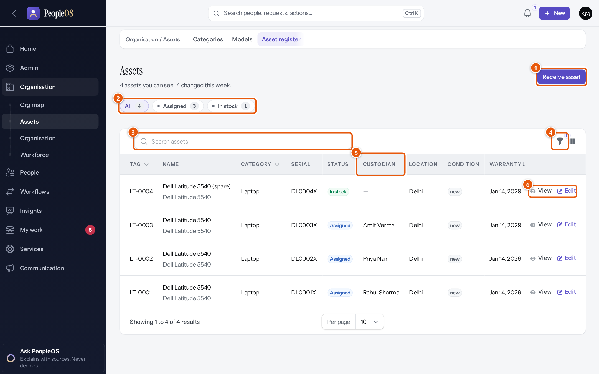
*Figure 6.19 — The Asset register. Demonstration data (fictional).*

1. **Receive asset** — adds a new item to stock.
2. **All / Assigned / In stock** — quick views with counts.
3. **Search assets** — by tag, name or serial number.
4. **Filter** — by **Status** and **Category**.
5. **Custodian** — the employee who holds the item.
6. **View** / **Edit** — open or change the item. Status and custodian cannot be edited directly; they change only through the actions below.

Columns: **Tag**, **Name** (with the model underneath), **Category**, **Serial**, **Status**, **Custodian**, **Location**, **Condition**, **Warranty until**.

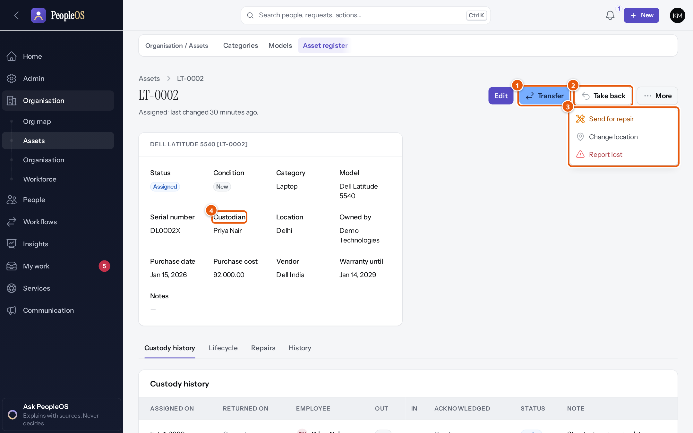
*Figure 6.20 — An assigned laptop and the actions available for it. Demonstration data (fictional).*

1. **Transfer** — hands the item straight to another employee.
2. **Take back** — returns the item to stock.
3. **More** — **Send for repair**, **Change location**, **Report lost**.
4. **Custodian** — who holds it now.

Other actions appear when the status allows them: **Assign** (in stock), **Back from repair** (in repair), **Found** (lost), **Retire** and **Dispose**. The tabs show **Custody history** (who held it, condition out and in, acknowledged or **Pending**), **Lifecycle** (every movement, with who did it), **Repairs** and the audit **History**.

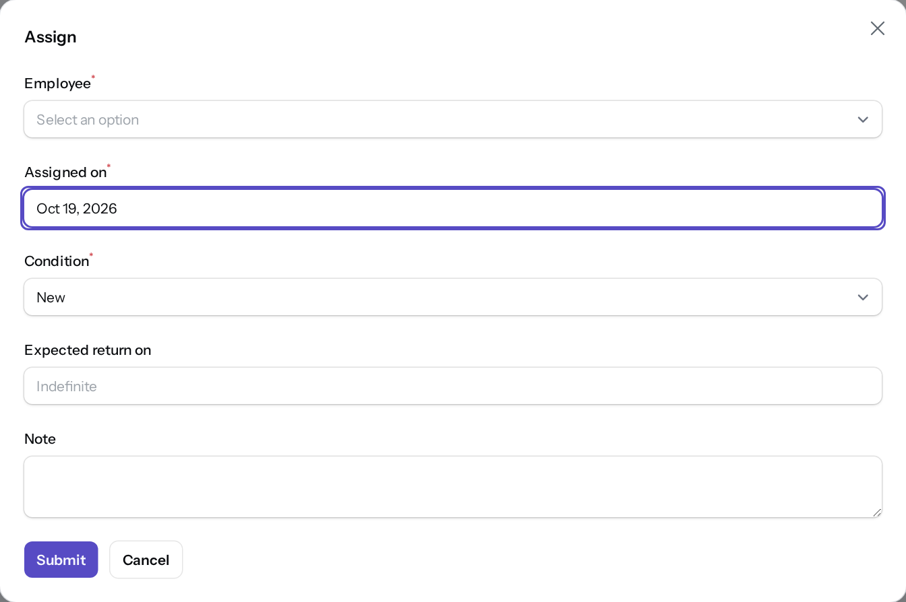
*Figure 6.21 — Assigning an in-stock laptop (the dialog was cancelled). Demonstration data (fictional).*

**Employee**, **Assigned on** (today is preselected) and **Condition** are required. **Expected return on** ("Indefinite" when empty) and **Note** are optional.

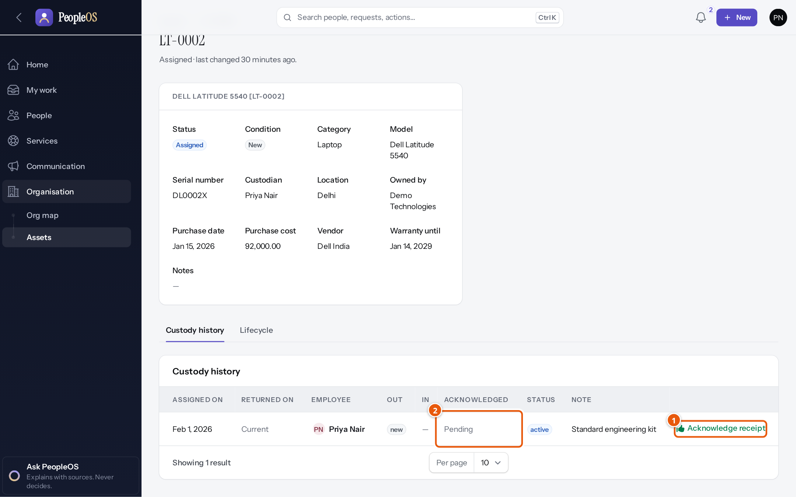
*Figure 6.22 — What an employee sees: their laptop, still to be acknowledged. Demonstration data (fictional).*

1. **Acknowledge receipt** — the employee confirms they received the item.
2. **Acknowledged** — shows **Pending** until then, and the date and time afterwards.

### Statuses explained

| Status | Meaning | Actions available |
|---|---|---|
| **In stock** | Available, nobody holds it | **Assign**, **Send for repair**, **Change location**, **Report lost**, **Retire**, **Dispose** |
| **Assigned** | Held by an employee (the custodian) | **Transfer**, **Take back**, **Send for repair**, **Change location**, **Report lost** |
| **In repair** | With a repairer | **Back from repair**, **Change location**, **Retire**, **Dispose** |
| **Lost** | Reported lost | **Found**, **Retire**, **Dispose** |
| **Retired** | No longer in use | **Dispose** |
| **Disposed** | Sold, scrapped, donated, returned to vendor or written off | None (final) |
| **In transit** | Listed in the status filter; no action sets it in this version | — |

**Flowchart — Asset lifecycle.** The statuses an asset moves through and the action that moves it. *Roles:* Asset Admin or Tenant HR Admin; the employee acknowledges receipt; HR runs exit clearance. *Starts:* an asset is received. *Ends:* the asset is disposed of.

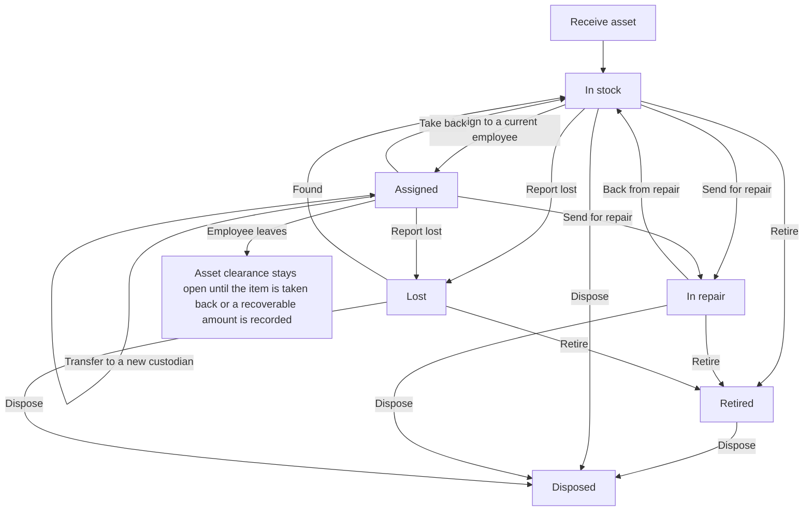

### Tasks

#### Task: Receive a new asset

1. Open **Organisation › Assets › Asset register** and click **Receive asset**.
2. In **Asset**, choose the **Category** (required), then the **Model** (only models of that category are offered).
3. Enter the **Asset tag** (required, unique; fixed once saved) and **Name** (required). Enter the **Serial number** (required if the category says so), choose the **Condition** (required), and optionally **Owned by** (company) and **Location**.
4. In **Procurement**, optionally enter the **Purchase date**, **Purchase cost**, **Vendor**, **Invoice number**, **Warranty until** and **Notes**.
5. Save.

**Expected result:** the asset opens with status **In stock**. A **Procured** movement is recorded.
**If it fails:** a tag already in use is refused.

#### Task: Assign an asset to an employee

1. Open an **In stock** asset and click **Assign**.
2. Choose the **Employee**, check **Assigned on** and **Condition**, and optionally set **Expected return on** and a **Note**.
3. Click **Submit**.

**Expected result:** **Asset assigned**; the status becomes **Assigned**. The employee is notified in PeopleOS, and the assignment appears on their timeline and on the **Assets** tab of their Employee 360 page.
**If it fails:** "Asset … is … and cannot be assigned." — only in-stock assets can be assigned. "Assets can only be assigned to current employees."

#### Task: Acknowledge an asset you received (employees)

1. Open **Organisation › Assets › My assets** and click **View** on the item.
2. On the **Custody history** tab, click **Acknowledge receipt**.

**Expected result:** **Acknowledged** shows the date and time instead of **Pending**.

#### Task: Transfer, take back or send an asset for repair

1. Open the assigned asset.
2. Click **Transfer** and choose the **New custodian** (optional **Note**); or click **Take back** and choose the **Condition on return** (optional **Note**); or click **More › Send for repair**, describe the **Issue** (required) and optionally the **Vendor**.
3. Submit.

**Expected result:** "Asset transferred", "Asset back in stock" or "Sent for repair". Sending an assigned asset for repair also ends the current custody.
**When the repair is done:** click **Back from repair**, enter the **Cost** (optional), the **Condition** (required) and the **Resolution**. The asset returns to **In stock**.

#### Task: Report an asset lost, found, retired or disposed

1. Open the asset.
2. Choose **More › Report lost** and enter a **Note** (required); later, **Found** returns it to stock. Or choose **Retire** with a **Reason** (required).
3. To dispose of it, choose **Dispose**, then the **Method** (Sale, Scrap, Donation, Returned to vendor, Write-off) and **Disposed on** (required), and optionally the **Realised value**, **Reference** (for example an invoice or gate pass) and **Note**. Confirm.

**Expected result:** the status changes and a movement is recorded.
**If it fails:** "An assigned asset cannot be disposed of; return it first." "Return the asset to stock before retiring it."

### Categories and Models

| Screen | What you store there | Path | Who |
|---|---|---|---|
| **Categories** | Kinds of assets: **Name**, **Code** (fixed once saved), **Serial number required**, **IT asset (IT clearance at exit)**, **Useful life** (months), **Status**. Eleven starter categories are provided (Laptop, Desktop, Monitor, Mobile phone, SIM card, ID card, Access card, Software licence, Vehicle, Tools & equipment, Other company property). | Organisation › Assets › Categories | Tenant HR Admin, Asset Admin; Auditor (view) |
| **Models** | Makes and models: **Category**, **Manufacturer**, **Model**, **Status** and **Specifications** (pairs such as "ram: 16 GB") | Organisation › Assets › Models | Tenant HR Admin, Asset Admin; Auditor (view) |

#### Task: Add a category or model

1. Open **Organisation › Assets › Categories** (or **Models**).
2. Click **New asset category** (or **New asset model**).
3. Enter the required fields (**Name**, **Code** and **Status** for a category; **Category**, **Model** and **Status** for a model).
4. Click **Create**.

### Assets and exit clearance

When an employee's exit reaches clearance, PeopleOS builds an **Asset clearance** stage listing every item still in their custody (for example "Return Dell Latitude 5540 [LT-0002]"). The stage cannot be cleared while items are still in custody: PeopleOS says "Assets still in custody: … Take them back, or record a recoverable amount." Take the items back in the Asset register, or record the amount to recover from the final settlement. See the exit and settlement section of chapter 5.2.

> **Note:** limitations of assets in this version: there are no depreciation schedules, no stock counts or asset audits, and no barcode scanning. **Useful life** is stored on the category but not used for calculations. Assets cannot be deleted; retire or dispose of them instead.

### Example from everyday work

*Illustrative scenario.* Priya Nair joins the Engineering team. The asset administrator receives a new laptop, assigns it to her with the note "Standard engineering kit", and Priya clicks **Acknowledge receipt** on her first day. When Rahul Sharma's laptop breaks, it is sent for repair, which ends his custody, and comes back to stock with the repair cost recorded on the **Repairs** tab.

### Related modules

- **Employee 360 (chapter 5.2)** — the **Assets** tab lists each employee's custody.
- **Exit and final settlement (chapter 5.2)** — **Asset clearance** uses the custody list.
- **Locations** — where assets are kept.

---

## Known limitations in this area (summary)

- **Organisation Designer:** units are moved with a dialog, not dragged. The **organisation.designer** feature switch does not control access in this version.
- **Establishments:** the **State** list has 13 Indian states; locations cannot be linked to an establishment from the Locations screen (use establishment assignments); statutory rules are not yet verified (chapter 5.4).
- **Legal entities and establishments** are never deleted; close them with **Inactive** or an end date.
- **Positions:** whole-number FTE values are refused by the browser (leave the FTE boxes empty); no backdating before the latest version; occupied positions cannot be abolished or closed; no approval workflow for positions.
- **Plans:** a transfer is two lines; an approval workflow for plans is set up by Markedge on request.
- **Budgets:** actual cost needs finalised payroll and at least five employees in the group.
- **Team positions:** appears only when a manager's team holds positions.
- **Assets:** no depreciation, stock counts or barcode scanning; the **In transit** status is not used by any action.
