# Services and communication: My HR, service desk, grievances, announcements and surveys

> **In this chapter:** how employees ask HR for help and stay informed, and how HR answers requests, handles grievances, publishes policies and announcements, and runs surveys. **Who should read it:** every employee (My HR, announcements), HR teams (service desk, grievances, knowledge, surveys) and administrators (notification rules and templates).

Most HR work starts with a question or a request: "Can I have an experience letter?", "My bank account has changed", "Something happened at work that I need to report". PeopleOS gives every employee one front door for this, **My HR**. Behind it, HR works a shared queue with clear ownership and response times. Confidential complaints go to a separate, locked-down grievance area. Policies live in a versioned knowledge base, and employees confirm they have read them. Announcements and surveys reach the right people, with privacy built in: anonymous survey answers can never be traced back to a person.

| Module | What it is for | Where to find it | Who uses it | Status |
|---|---|---|---|---|
| My HR | Employee front door: requests, tasks, policies, surveys, feedback, communications, preferences | **Services** (employees) or **Services › My HR**; also the avatar menu | Every person with an employee record | Available with limitations |
| My requests / HR queue | One list of HR requests: the employee's own, or the HR team's working queue | Employees: **You / Your pages › My requests**. HR: **Services › Service Desk › HR queue** | Employees; HR Manager, Tenant HR Admin; Auditor (read only) | Available |
| Service catalogue | The menu of HR services employees can request, with versions and approval | **Services › Service Desk › Service catalogue** | HR Manager, Tenant HR Admin; Auditor (read only) | Available with limitations |
| Categories & SLAs | Request categories, default response times and routing | **Services › Service Desk › Categories & SLAs** | HR Manager, Tenant HR Admin | Available |
| SLA policies | Response and resolution targets per priority, in business or calendar hours | **Services › Service Desk › SLA policies** | HR Manager, Tenant HR Admin; Auditor (read only) | Available |
| Service analytics | Request volumes, backlog and response times, with small groups hidden | **Services › Service Desk › Service analytics** | HR Manager, Tenant HR Admin | Available |
| Team HR requests | Status of your team's requests (managers) | **My work › Team HR requests** — see [Your workspace](01-workspace-and-self-service.md#team-hr-requests) | Managers, HR | Covered in the workspace chapter |
| Cases (grievances) | Confidential complaints, handled case by case | Employees: **You / Your pages › My grievances**. HR: **Services › Grievances › Cases** | Employees; handlers; HR Manager, Tenant HR Admin | Available with limitations |
| Categories & handlers | Grievance categories, who handles them, anonymity and deadlines | **Services › Grievances › Categories & handlers** | HR Manager, Tenant HR Admin | Available |
| Knowledge base / Articles | Policies and guides, reviewed and versioned, with read-and-acknowledge | Employees: **You / Your pages › Knowledge base**. Authors: **Services › Knowledge › Articles** | Everyone reads; HR writes and reviews | Available with limitations |
| Announcements (feed) | The employee's reading list of announcements | **Communication › Announcements** | Every person with an employee record | Available |
| Announcements (management) | Prepare, approve and publish announcements | **Communication › Communication › Announcements** | HR Manager, Tenant HR Admin | Available |
| Notification rules | Which event sends which message to whom, on which channel | **Communication › Communication › Notification rules** | Tenant HR Admin (edit); HR Manager, Account Owner, Auditor (view) | Available with limitations |
| Notification templates | The wording of automatic messages | **Communication › Communication › Notification templates** | Tenant HR Admin (edit); HR Manager, Account Owner, Auditor (view) | Available with limitations |
| Delivery log | Every message PeopleOS sent, and whether it went out | **Communication › Communication › Delivery log** | Tenant HR Admin, HR Manager, Auditor | Available |
| Surveys and Survey results | Engagement and pulse surveys with built-in anonymity | **Communication › Engagement › Surveys** | HR Manager, Tenant HR Admin; Auditor (view) | Available with limitations |
| Campaigns | Group surveys, announcements, articles and services into one timed campaign | **Communication › Engagement › Campaigns** | HR Manager, Tenant HR Admin; Auditor (view) | Available |
| Audiences | Saved "who should receive this" definitions | **Communication › Engagement › Audiences** | HR Manager, Tenant HR Admin; Auditor (view) | Available |
| Feedback inbox | Feedback employees send, identified, confidential or anonymous | **Communication › Engagement › Feedback inbox** | HR Manager, Tenant HR Admin | Available with limitations |

> **Note:** Personal pages such as My HR and the Announcements feed need a user who is linked to an employee record. An administrator account with no employee record (for example a set-up account) does not see them.

> **Note:** PeopleOS is not yet generally released. The screens below come from a demonstration environment with fictional people and companies (Demo Group, Demo Technologies, Demo Services).

---

## My HR (employee self-service)

**Status:** Available with limitations — a new organisation's service catalogue starts with draft services only, so employees see **No services are open to you yet.** until HR approves at least one service (see [Service catalogue](#service-catalogue)). Until then, employees use **Ask HR**. See also the known issue under [Give feedback](#feedback-and-the-feedback-inbox).

### Overview

My HR is the one place where an employee deals with HR. The page opens on **How can HR help?**: a short summary of what needs you, a list of services you can request, your open requests, and policies waiting for your acknowledgement. Every other area of My HR is one click away in the row of tabs.

Everything in My HR is read live from the module that owns it: your requests come from the service desk, your policies from the knowledge base, your documents from your document record. My HR stores nothing of its own, so it is always up to date.

Who can access it: every person whose user account is linked to an employee record, whatever their role (employees, managers, HR, executives).

### Where to find it

- **Menu path:** **Services** in the left sidebar (for employees, clicking **Services** opens My HR directly). HR and administrators see **Services › My HR**. It is also in the **avatar menu** (top right) as **My HR**.
- **Who can open it:** anyone linked to an employee record.
- **Set-up needed first:** HR approves the services employees may request ([Service catalogue](#service-catalogue)) and creates request categories ([Categories & SLAs](#categories--slas-and-sla-policies)). Policies appear only once published in the [knowledge base](#knowledge-base-policies-and-articles).

### The screen at a glance

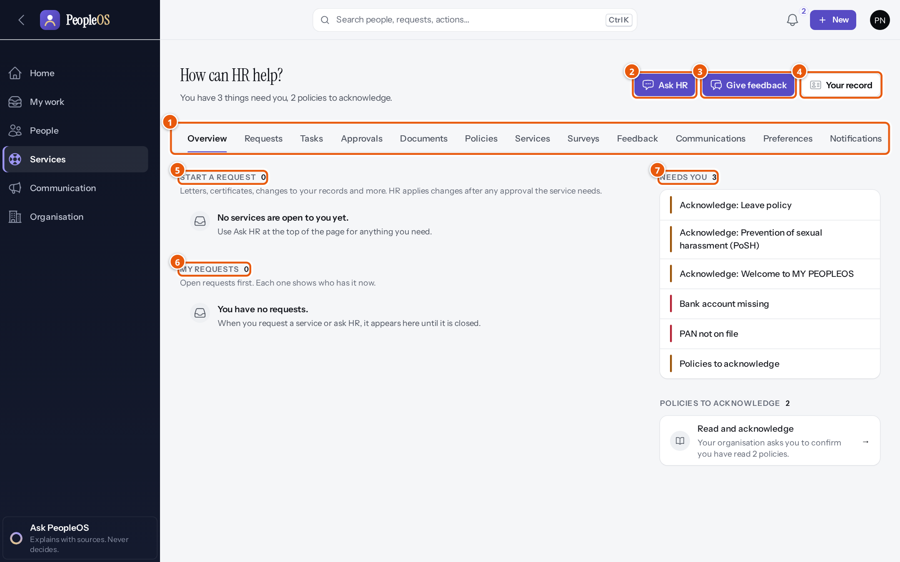
*Figure 7.1 — My HR as Priya Nair sees it: tabs, the three header buttons, Start a request, My requests and Needs you. Demonstration data (fictional).*

1. **Tabs** — **Overview**, **Requests**, **Tasks**, **Approvals**, **Documents**, **Policies**, **Services**, **Surveys**, **Feedback**, **Communications**, **Preferences**, **Notifications** (explained in the table below).
2. **Ask HR** — send HR a question or request that is not in the catalogue.
3. **Give feedback** — send feedback, identified, confidential or anonymous.
4. **Your record** — opens your own employee record, read only (shown only if your role allows it; covered in the People chapter).
5. **Start a request** — the services you can request now, with a search box ("Find a service, for example "experience letter" or "bank"") and a **Request** button on each.
6. **My requests** — open requests first, each with its number, when it was raised and its status. **All my requests →** opens the Requests tab.
7. **Needs you** — tasks and reminders, for example "Acknowledge: Leave policy", "Bank account missing" or "PAN not on file". **Policies to acknowledge** appears below when policies are waiting.

| Tab | What you see there |
|---|---|
| **Overview** | The front door shown above. |
| **Requests** | **My requests**: Number, Service, Status, Raised, and **Open** to read the request and its conversation. |
| **Tasks** | **My tasks**: everything waiting for you in PeopleOS (workflow tasks, requests waiting for you, policies and announcements to acknowledge, open surveys), each with **Open**. Below it, **Needs attention** counts such as "Policies to acknowledge" or "Tax declaration". |
| **Approvals** | **My approvals**: approvals assigned to you, each with **Decide**. |
| **Documents** | **My documents** (Document, Category, Status, Version, Expires, **Download**) and your **Letters** with their status. Downloads use a short-lived private link and are recorded. |
| **Policies** | **Policies and articles**: the published version of each article that applies to you, with **Acknowledge** where your organisation asks for it, or an **Acknowledged** badge. |
| **Services** | **HR services**: the same services as on the front door, as cards with **Request**. |
| **Surveys** | **My surveys**: surveys you are invited to, their privacy mode (Anonymous, Confidential or Identified), the closing date, **Take survey**, and **Results** when the survey shares them. |
| **Feedback** | **My feedback**: **Give feedback**, and the identified feedback you sent with its status. Confidential and anonymous feedback is never listed back, by design. |
| **Communications** | Announcements, circulars and policy publications addressed to you, with **Read the policy**, **Attachment**, **Mark as read** and **Acknowledge**. |
| **Preferences** | **Communication preferences**: how optional messages reach you (see the task below). |
| **Notifications** | Your latest in-app notifications. |

### Tasks

#### Task: Ask HR a question

**Purpose:** reach HR about anything that is not in the service list.
**Before you start:** have the details ready. Do not use Ask HR for a complaint that needs investigation — raise a [grievance](#grievances) instead.

1. Open **Services** (or **avatar menu › My HR**).
2. Click **Ask HR**.
3. Fill in the form (all fields are required):
   - **What is it about?** — choose a category, for example **Letters & certificates** or **Payroll & tax query**.
   - **Subject** — one line.
   - **Description** — what you need.
   - **Priority** — **Low**, **Normal** (default), **High** or **Urgent**.
4. Click **Submit**.
5. PeopleOS shows "Request TKT-2026-00012 raised" (your own number). The request starts as **Submitted**, or **Assigned** when the category sends it straight to a named HR person. The person it is assigned to is notified, and the response-time clock starts.

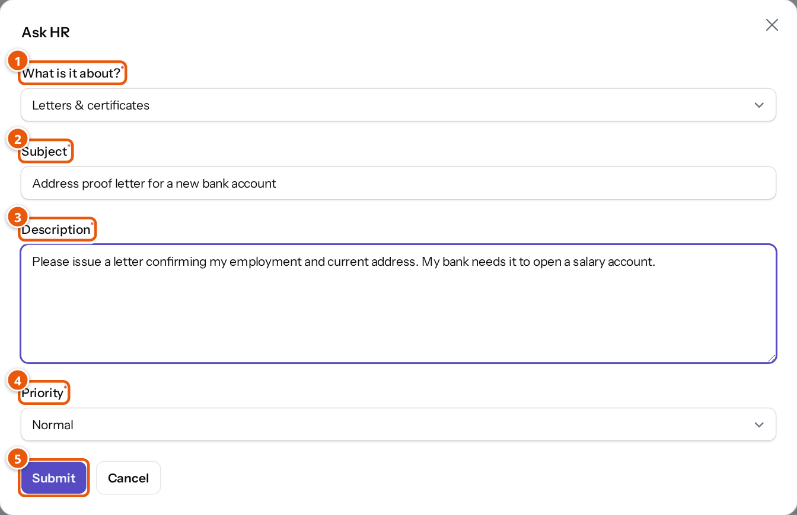
*Figure 7.2 — The Ask HR form, filled with example text and then cancelled. Demonstration data (fictional).*

1. **What is it about?** 2. **Subject** 3. **Description** 4. **Priority** 5. **Submit**.

**Expected result:** the request appears under **My requests** with its number and status.
**How to verify:** open the **Requests** tab and click **Open** on the request.
**Common mistakes:** choosing **Urgent** for routine questions (priority sets the target response time); putting bank or tax numbers in the description — use the matching service instead, which protects those values.
**If it fails:** the form tells you which field is missing. If the list of categories is empty, HR has not set up request categories yet — contact your HR team.

#### Task: Request a service

**Purpose:** use a ready-made HR service, such as a salary certificate or a change to your bank account.
**Before you start:** the service must be approved and open to you. If you see **No services are open to you yet.**, use **Ask HR**.

1. Open **Services**. On **Start a request**, type in the search box or scroll to the service.
2. Click **Request** next to the service.
3. Fill in the form. It always has **Short summary** (optional; the service name is used otherwise) and **Anything else HR should know**. Each service adds its own fields, for example the new bank details. Fields marked **Protected** hold sensitive values; they are encrypted and shown only to people allowed to see them. Some services also ask for an **Attachment** (optional or required).
4. Click **Submit**.
5. PeopleOS confirms "Request TKT-… submitted". What happens next depends on the service:
   - **A question or document request** — HR picks it up in the HR queue.
   - **A leave application, attendance correction or letter** — it is passed at once to the Leave, Attendance or Letters module, which runs its own approval. The request follows that decision.
   - **A change to your own records** (bank account, PAN / UAN, address, emergency contact, family member) — the request waits for approval if the service needs it. After approval, a third person in HR applies the change to your record. You can never approve or apply your own change.

**Expected result:** the request appears under **My requests** with a status such as **Submitted** or **Awaiting approval**.
**How to verify:** open the request. **Status history** shows each step and when it happened.
**Common mistakes:** requesting a change for someone else — self-service requests are for your own record only.
**If it fails:** messages you may see: "This service is not available now." (the service version is not in force), "This service is not available for this employee." (it is limited to certain companies, departments, locations or employment states), "This service needs an attachment.", "The approval workflow for this service is not available; try again later or contact HR."

#### Task: Follow, reply to, close and rate a request

1. Open **My requests** (Requests tab) and click **Open**.
2. Read the **Conversation**. To answer HR, click **Reply**, write your **Message**, add an attachment if needed, and click **Submit**. If HR was waiting for you, your reply moves the request back to **In progress** automatically.
3. When HR resolves the request you are notified. Open it and click **Close & rate**. Choose **How was the help?** (**1 · Poor** to **5 · Excellent**), add an optional comment and submit.
4. Not happy with the answer? Click **Reopen** and give a reason. The request goes back to **In progress** and its resolution clock restarts.
5. Changed your mind before it is done? Click **Cancel request** (under **More**) and give a reason.

> **Note:** If you do not close a resolved request yourself, PeopleOS closes it automatically after five days (the default set by Markedge).

#### Task: Acknowledge a policy or an announcement

1. Open My HR and click the **Policies** tab (or **Read and acknowledge** on the front door).
2. Click the policy title to read it.
3. Click **Acknowledge** and confirm "Confirm you have read and understood version 1 of Leave policy?".
4. The button turns into an **Acknowledged** badge. Your acknowledgement is recorded with the version, date, time and source.

Announcements that ask for acknowledgement work the same way in the **Communications** tab (**Acknowledge**) and in the [Announcements feed](#announcements) (**I acknowledge**).

> **Tip:** When a policy is republished as a new version, you are asked to acknowledge it again. Acknowledging version 1 does not count for version 2.

#### Task: Choose how optional messages reach you

**Purpose:** decide whether optional communication arrives in the app, by email, or both.

1. Open My HR and click the **Preferences** tab.
2. For each optional type — **Announcement**, **Circular**, **Newsletter**, **Survey invitations and reminders** — tick or untick **In-app** and **Email**.
3. Each click is saved at once ("Preference saved").

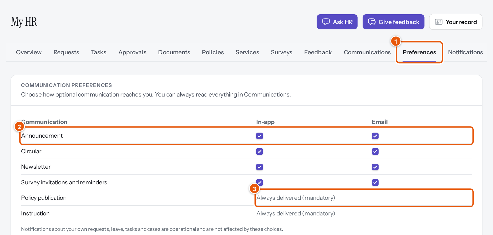
*Figure 7.3 — Communication preferences. Demonstration data (fictional).*

1. **Preferences** tab. 2. An optional type with its **In-app** and **Email** boxes. 3. Mandatory types — **Policy publication** and **Instruction** show **Always delivered (mandatory)** and cannot be switched off.

> **Note:** These choices never affect messages about your own requests, leave, tasks and cases ("operational" notifications). You can always read everything in **Communications**, whatever you choose here. Your organisation does not see a reason; the change itself is recorded.

### Example from everyday work

*Illustrative scenario.* Priya Nair at Demo Technologies needs proof of address for a new bank account. She opens **Services**, finds no letter service yet, and clicks **Ask HR**: **Letters & certificates**, subject "Address proof letter for a new bank account". Neha Kapoor sees it in the HR queue, takes it, and replies with the letter attached. Priya opens the request, downloads the letter, and clicks **Close & rate**.

### Related modules

- **[HR queue](#hr-queue-working-requests)** — where HR works the requests you raise.
- **[Knowledge base](#knowledge-base-policies-and-articles)** — where policies are written and versioned.
- **[Your workspace](01-workspace-and-self-service.md#notifications)** — the Notifications page and My work.

---

## HR queue (working requests)

**Status:** Available.

### Overview

Every HR request — whether raised by an employee, a manager or HR — is one record with a number such as **TKT-2026-00001**. HR agents (people who work requests) see them in the **HR queue**. Employees see the same records, limited to their own, as **My requests**.

The queue shows only what you are allowed to see: requests of employees within your organisation scope (for example only Demo Technologies for Neha Kapoor). You never work a request about yourself. Restricted (confidential) requests are visible only to the people assigned to them or explicitly granted access — there is no "HR sees everything" and no administrator bypass. Opening a sensitive or restricted request is recorded in the audit trail.

Response times are measured in **service hours**: by default Monday to Friday, 09:00–18:00, in the employee's work-location time zone, skipping public and company holidays from the employee's holiday calendar. The clock pauses while the request waits for the employee or for an approval.

### Where to find it

- **Menu path:** **Services › Service Desk › HR queue**. Employees: **You / Your pages › My requests** (the area bar at the top of My day and other personal pages), or the Requests tab of My HR.
- **Who can open it:** HR Manager, Tenant HR Admin and Tenant Super Admin (work requests); Auditor (read only). Employees and managers see **My requests** only.
- **Set-up needed first:** [Categories & SLAs](#categories--slas-and-sla-policies); for services, the [Service catalogue](#service-catalogue).

### The screen at a glance

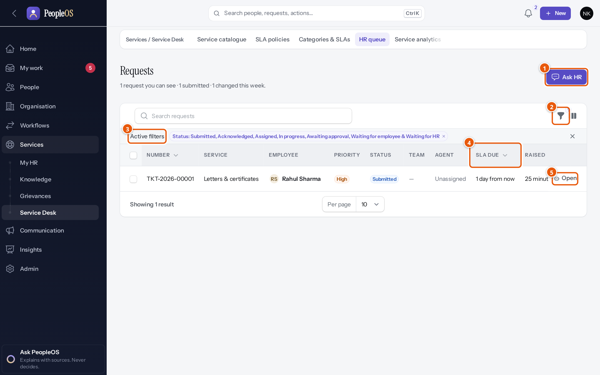
*Figure 7.4 — The HR queue for Neha Kapoor (HR Manager). Demonstration data (fictional).*

1. **Ask HR** — raise a request on an employee's behalf (an extra **For employee** field appears for HR).
2. **Filters** — **Status**, **Service**, **Category**, **Priority**, **Team**, **Unassigned**, **Assigned to me**, **SLA at risk** (due within the next 8 hours), **Overdue**, and a **From** / **Until** date range for when it was raised.
3. **Active filters** — by default the queue shows open statuses only. Remove the status filter to see resolved, closed and cancelled requests too.
4. **SLA due** — time left to the resolution target; shown in red when breached.
5. **Open** — opens the case.

Columns: **Number**, **Service**, **Employee**, **Priority**, **Status**, **Team**, **Agent**, **SLA due**, **Raised**. Search by number or employee name.

**Bulk actions** (tick several rows): **Assign**, **Move status** (to Acknowledged, In progress, Waiting for employee or Waiting for HR) and **Escalate** (with a required reason). Up to 500 requests per run; each one is checked individually and the result lists what was done, skipped or refused. Resolve, close and cancel are never done in bulk.

### The case screen

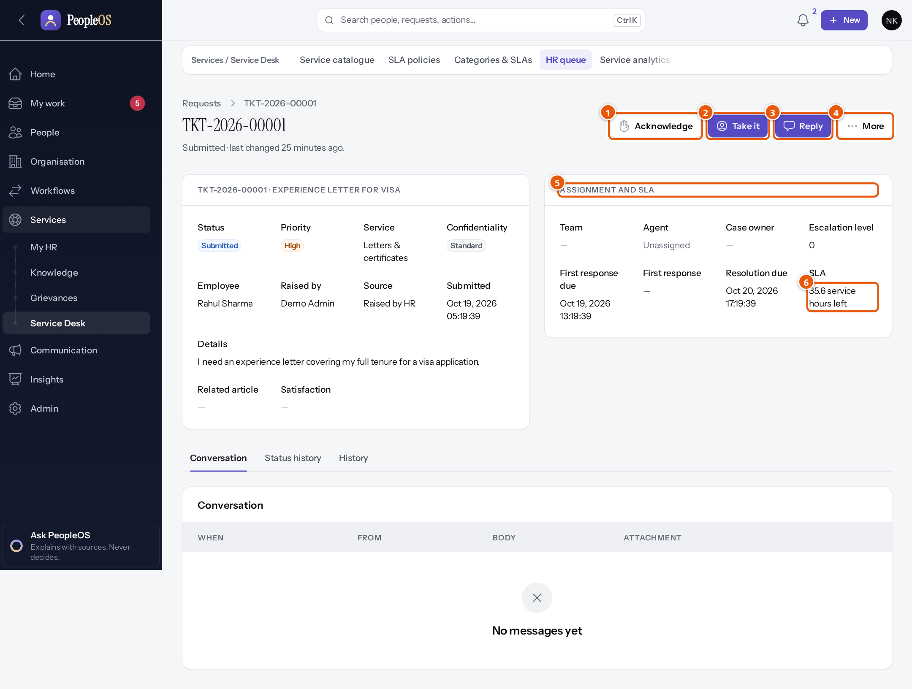
*Figure 7.5 — Case TKT-2026-00001 as an HR agent sees it. Demonstration data (fictional).*

1. **Acknowledge** — tells the employee you have seen it (status **Acknowledged**; counts as the first response).
2. **Take it** — assigns the case to you (status **Assigned**).
3. **Reply** — write a message. Choose **Who sees it**: **Visible to the employee** or **Internal HR note** (and, on restricted cases, **Restricted (people with explicit case access)**). A reply the employee can see moves a new case to **In progress**.
4. **More** — **Assign** (choose an **Agent**; only agents with this employee in their scope are listed; optional **Team** and reason), **Start work**, **Wait for employee**, **Wait for HR** (with an internal "Waiting on" note), **Resolve**, **Cancel request**. When relevant you also see **Apply the change**, **Restart approval**, **Close**, **Reopen** and **Grant access**.
5. **Assignment and SLA** — **Team**, **Agent**, **Case owner**, **Escalation level**, **First response due**, **First response**, **Resolution due**.
6. **SLA** — for example "35.6 service hours left", "Breached by 2.0 service hours", "Paused since 2 hours ago" or "Stopped (Resolved)".

The top section shows **Status**, **Priority**, **Service** (with its version), **Confidentiality** (**Standard**, **Sensitive (protected fields)** or **Restricted (explicit access only)**), **Employee**, **Raised by**, **Source** (for example **Employee self-service** or **Raised by HR**), **Submitted**, **Details**, **Related article** and **Satisfaction**. When the request carries form values, **Request details** lists them; protected values are masked for anyone not allowed to see them, and values for a change are removed once the change is decided. When the request changes an employee record, a **Domain change** section shows **Hands off to**, **Status**, **Resulting record**, **Approved by**, **Executed by** and **Executed**.

Tabs at the bottom: **Conversation** (messages and attachments), **Status history** (every status change: When, From, To, By and Reason) and **History** (the audit trail).

### Tasks

#### Task: Work a request from start to finish

1. Open **Services › Service Desk › HR queue**. Use **Unassigned** or **SLA at risk** to find what needs attention.
2. Click **Open** on the request.
3. Click **Take it** (or **More › Assign** to give it to a colleague).
4. Click **Reply** to answer the employee, or **More › Start work**.
5. If you need something from the employee, click **More › Wait for employee**. The clock pauses; PeopleOS reminds the employee every three days, up to three times. Their reply restarts the work.
6. When done, click **More › Resolve**. Enter the **Resolution** (required). Optionally choose **Link a knowledge article**. Click **Submit**.
7. The employee is notified and can **Close & rate** or **Reopen**.

**Expected result:** status **Resolved**; the SLA shows "Stopped (Resolved)".
**How to verify:** **Status history** lists each step with your name.
**Common mistakes:** resolving a request that still has a pending record change — the helper text warns "Resolving without applying withdraws the requested change."
**If it fails:** "This request changed since you opened it; reload and try again." means a colleague acted first — refresh the page. "You cannot work this case." means the employee is outside your scope, it is your own request, or it is restricted.

#### Task: Apply an approved change to an employee record

**Purpose:** finish a self-service change (for example a new bank account) after it has been approved.
**Before you start:** the **Domain change** section shows **Ready to execute**. You must be a third person: not the person who asked, not the employee concerned and not an approver. For bank account and PAN / UAN changes you also need permission to change sensitive data (for example Tenant HR Admin).

1. Open the request and click **Apply the change**.
2. Read the confirmation ("Runs "Bank account change (Employment)" in its owning domain, once. You cannot apply a change you requested or approved."), fill in any extra fields and confirm.
3. The change is made once in the employee record, the proposed values are deleted from the request, and **Executed by** shows your name.

**If it fails:** "You requested this change (or it is your own record); someone else must execute it.", "You approved this change; someone else must execute it.", "This change is not ready to execute (…)." If an approver was the requester, the status shows **Approval refused (separation of duties)**; click **Restart approval**.

#### Task: Give a colleague access to a restricted case

1. Open the restricted case (you must already have access).
2. Click **Grant access**, choose the **Person** (only people allowed to work confidential cases are listed) and enter a **Reason** (required).
3. The grant is recorded with your reason.

### Statuses explained

| Status | Meaning | What happens next |
|---|---|---|
| Draft | Saved but not submitted (not created from the screens in this chapter) | Submitted or cancelled |
| Submitted | Raised; nobody has picked it up yet; the clock runs | HR acknowledges, takes or assigns it |
| Acknowledged | HR has seen it | Assigned or worked |
| Assigned | An agent owns it | Agent starts work |
| In progress | Being worked | Resolved, or waiting for someone |
| Awaiting approval | Waiting for an approval workflow; clock paused | Approved (back to work) or not approved (resolved) |
| Waiting for employee | HR needs something from the employee; clock paused | The employee replies |
| Waiting for HR | Waiting on another HR person or team | Back to In progress |
| Resolved | HR has answered | Employee closes and rates, or reopens; auto-closed after five days |
| Closed | Finished | Can be reopened with a reason |
| Cancelled | Withdrawn with a reason | Final |

A status can only move along allowed paths (for example a cancelled request can never reopen). Cancel and reopen always need a reason, and resolve always needs a resolution.

**Flowchart — An HR service request from submission to closure.** The path a request takes, including approval and the separate "apply the change" step for changes to employee records. *Roles:* Employee, approver, HR agent, a third HR person. *Starts:* the employee submits a request. *Ends:* the request is closed.

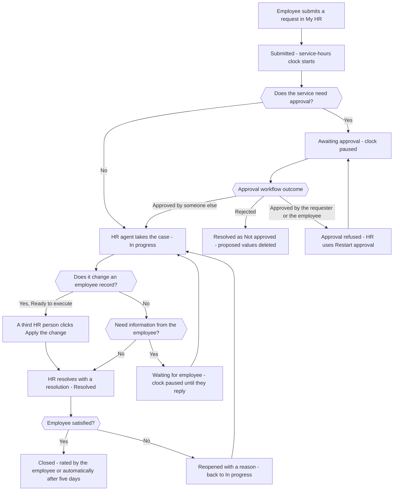

> **Note:** Leave applications, attendance corrections and letter requests raised as services are handed to the Leave, Attendance and Letters modules at once. Those modules run their own approval, and the request follows their decision.

### Example from everyday work

*Illustrative scenario.* Rahul Sharma asks for an experience letter for a visa application (TKT-2026-00001). Neha Kapoor clicks **Take it**, replies that the letter will be ready tomorrow, and clicks **More › Start work**. The next day she resolves the request with the letter attached and links the "Leave policy" article for his travel dates. Rahul closes the request and rates it **5 · Excellent**.

### Related modules

- **[Service catalogue](#service-catalogue)** — defines the services and their forms, approval and SLA.
- **[Service analytics](#service-analytics)** — volumes and response times.
- **[Team HR requests](01-workspace-and-self-service.md#team-hr-requests)** — what managers see about their team's requests.
- **[Feedback inbox](#feedback-and-the-feedback-inbox)** — identified feedback can be turned into a request.

---

## Service catalogue

**Status:** Available with limitations — every new organisation receives 13 starter services as **drafts**; none is open to employees until HR completes and approves it. A service that needs approval must name an active, published approval workflow (built in the Workflows module, covered in the Administration chapter).

### Overview

The catalogue is the menu of HR services employees, managers or HR can request. Each service has **versions**. You edit only a draft version; it is then submitted, approved by a **different** person, and comes into force on its date. An approved version never changes: open requests stay linked to the version they were raised under, and a change is a new version from a later date. This means you always know which rules applied to which request.

The starter services are: Leave query, Attendance correction, Salary certificate, Employment certificate, Address change, Bank account change, PAN / UAN update, Emergency contact update, Payroll query, Compensation query, HR policy query, Experience letter request and Manager change request (managers and HR only).

### Where to find it

- **Menu path:** **Services › Service Desk › Service catalogue**.
- **Who can open it:** HR Manager and Tenant HR Admin (prepare and approve); Auditor (read only).
- **Set-up needed first:** [request categories](#categories--slas-and-sla-policies); an active [SLA policy](#categories--slas-and-sla-policies) if you do not want the category hours; an approval workflow for services that need approval; optionally a published request form (Configuration Forms, Administration chapter).

### The screen at a glance

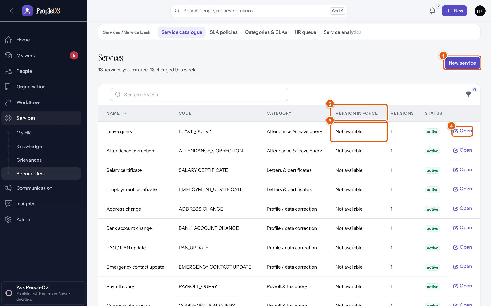
*Figure 7.6 — The service catalogue with the 13 starter services, all still drafts. Demonstration data (fictional).*

Click **New service** to add a service, or **Open** to manage one. Columns: **Name**, **Code**, **Category**, **Version in force** ("Not available" until a version is approved and in force), **Versions**, **Status**. Filter by **Category**.

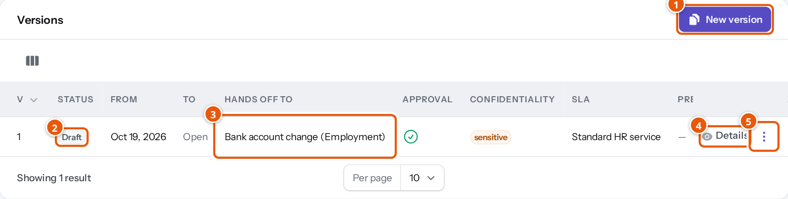
*Figure 7.7 — The Versions tab of the Bank account change service. Demonstration data (fictional).*

1. **New version** — copies the latest version into a new draft from a date you choose.
2. **Status** — **Draft**, **Pending approval**, **Approved — scheduled**, **Active**, **Superseded** or **Archived**.
3. **Hands off to** — the record change this service makes (here, **Bank account change (Employment)**), or "Case only" for a plain request.
4. **Details** — description, form, who it is available to, approval workflow, field classification and the version's checksum (a fingerprint proving it has not changed).
5. **⋮ menu** — **Edit draft**, **Submit for approval**, **Approve**, **Return to draft**, **Archive** (only the steps allowed for the version's status appear).

### Tasks

#### Task: Prepare a service version and have it approved

**Purpose:** open a service to employees.
**Before you start:** decide who may use the service and whether it needs approval.

1. Open **Services › Service Desk › Service catalogue** and click **Open** on the service (or **New service**: enter **Name**, **Code**, **Category**, optional **Subcategory** and **Sort order**, then **Create service**; PeopleOS creates draft version 1 for you).
2. On the **Versions** tab, open the **⋮** menu of the draft and click **Edit draft**.
3. Complete the sections:
   - **Service:** **Effective from** (required), **Default priority** (required), **Description**, **Request form (published Configuration Form version)**, **Hands off to (domain action)** — the record change the service performs, or "None — a case HR resolves" — **Attachment rule** (required) and **Confidentiality** (required).
   - **Who may use it:** **Available to** (required: **Employees, for themselves**, **Managers, for their team**, **HR, on someone's behalf**), **Shown in the catalogue**, **The employee concerned can see the request**, **Managers see its status for their team (standard cases only)**, and optional limits by **Lifecycle states**, **Companies**, **Departments** and **Locations** (empty = all).
   - **Approval, SLA and assignment:** **Needs approval (existing workflow engine)** with the **Approval workflow**, **SLA policy** (empty = "Category hours"), **Team (role)**.
   - **Field classification:** for each form field, a class (**Standard**, **Sensitive**, **Restricted**) and whether the **Employee sees it**.
   - **What changes and why** — a note for the approver.
4. Click **Submit** to save the draft.
5. Open the **⋮** menu again and click **Submit for approval**. The version becomes **Pending approval** and can no longer be edited.
6. A second person (another HR Manager or a Tenant HR Admin) opens the same menu and clicks **Approve** (optional **Note**) or **Return to draft** (note required).
7. If the effective date has come, the version becomes **Active** at once; otherwise it is **Approved — scheduled** and turns **Active** on its effective date (PeopleOS checks this every hour). It then appears in My HR for the people it is available to.

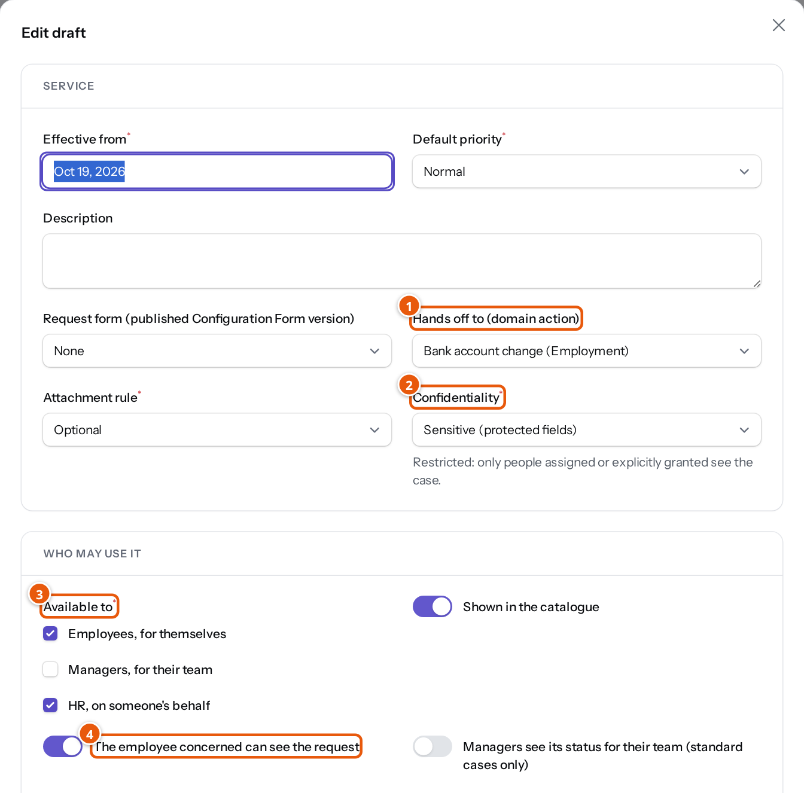
*Figure 7.8 — Edit draft, Service and Who may use it sections (not saved). Demonstration data (fictional).*

1. **Hands off to (domain action)** 2. **Confidentiality** 3. **Available to** 4. **The employee concerned can see the request**.

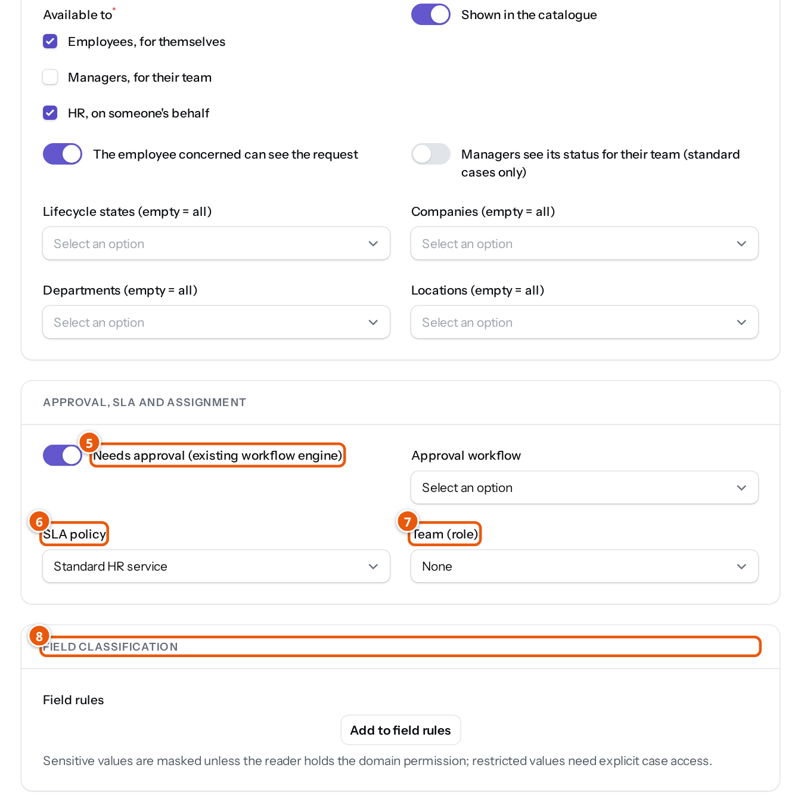
*Figure 7.9 — Edit draft, approval, SLA and field classification (not saved). Demonstration data (fictional).*

5. **Needs approval (existing workflow engine)** 6. **SLA policy** 7. **Team (role)** 8. **Field classification**.

**Expected result:** **Version in force** shows "v1 since …" in the catalogue list.
**How to verify:** sign in as an employee (or ask one) and check **Start a request** in My HR.
**Common mistakes:** switching on **Needs approval** without choosing an approval workflow; approving your own version (the **Approve** action does not appear for the person who prepared it).
**If it fails:** messages include "A service that needs approval needs an active, published approval workflow.", "The person who prepared a service version cannot approve it.", "A service version must start after every approved version (latest from …).", "… is approved in its own domain; the service must not add a second approval." (leave, attendance and letter services already have their own approval), "… cannot be offered to employees (self-service)." (for example a manager change), "This service already has a version in preparation."

> **Note:** Confidentiality **Restricted** means only people assigned to a case, its owner or people explicitly granted access can see it — use it for disciplinary matters or investigations raised by HR. **Sensitive** means certain fields are protected but the case is otherwise visible to agents in scope.

---

## Categories & SLAs and SLA policies

**Status:** Available.

### Overview

**Categories** group requests ("What is it about?" in Ask HR) and route them: a default agent or role, an escalation role, and simple response times in hours. **SLA policies** (service-level agreements — the response and resolution targets you commit to) are the fuller version used by catalogue services: targets per priority, in business hours or calendar hours, with warnings, repeated escalation and pause rules.

PeopleOS starts every organisation with seven categories (Letters & certificates, Payroll & tax query, Attendance & leave query, Profile / data correction, IT & assets, Policy question, Something else) and one SLA policy, **Standard HR service** (business hours; Normal priority: 4 hours to first response, 18 hours to resolution). These are examples you can change.

| Screen | What you store there | Path | Who |
|---|---|---|---|
| Categories & SLAs | **Name**, **Code**, **Sort order**, **Resolution SLA** (hours), **First response** (hours), **Status**, **Default agent**, **or agents with role**, **Escalate breaches to role**, **Start workflow** (optional automation, "e.g. an approval flow for letter requests"), **Description**; a **Reason for change** when editing | **Services › Service Desk › Categories & SLAs** | HR Manager, Tenant HR Admin |
| SLA policies | **Name**, **Code**, **Calendar** (**Business hours (service days, holidays, location timezone)** or **Calendar hours (24 × 7)**), **Effective from**, **Warn when this share of the time is used (%)**, **Escalate to (role)**, **Escalate again every (hours)**, **Highest escalation level**, **SLA paused while (empty = defaults)**, **Status**, and **Targets per priority** (**First response (hours)** and **Resolution (hours)** for Low, Normal, High and Urgent) | **Services › Service Desk › SLA policies** | HR Manager, Tenant HR Admin; Auditor (read only) |

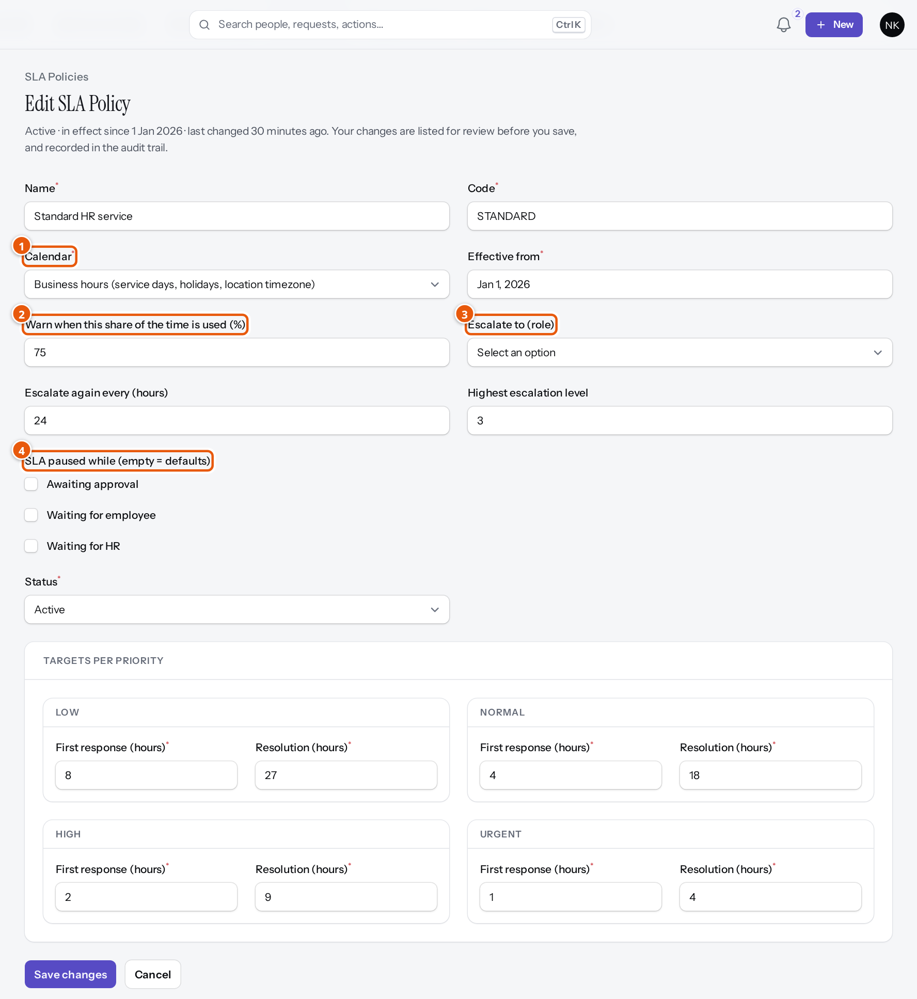
*Figure 7.10 — The starter SLA policy, viewed and not changed. Demonstration data (fictional).*

1. **Calendar** 2. **Warn when this share of the time is used (%)** 3. **Escalate to (role)** 4. **SLA paused while (empty = defaults)** — by default the clock pauses while **Waiting for employee** and **Awaiting approval**.

#### Task: Add a new category or SLA policy

1. Open **Categories & SLAs** and click **New ticket category**, or open **SLA policies** and click **New SLA policy**.
2. Fill in the required fields (marked with a red asterisk) and save.
3. For an SLA policy, choose it in a service version's **SLA policy** field ([Service catalogue](#service-catalogue)).

> **Important:** An SLA policy used by an approved service version cannot be edited. To change targets, create a new policy from a later date and point a new service version at it.

What PeopleOS does with these targets, every hour: it warns the assignee once when the warning share is reached ("SLA approaching: HR request TKT-…"), escalates breached requests one level per repeat interval up to the highest level (notifying the escalation role and the assignee), reminds employees who have not replied, and closes resolved requests after five days.

> **Note:** Category hours (used by Ask HR requests and by services without an SLA policy) are counted around the clock, and the priority adjusts them: **High** halves the resolution target (at least 8 hours), **Urgent** quarters it (at least 4 hours) and **Low** doubles it. Business hours use one standard service week for everyone; separate calendars per HR team are not available.

---

## Service analytics

**Status:** Available.

The **HR service analytics** page (**Services › Service Desk › Service analytics**; HR Manager, Tenant HR Admin) shows, for a **From** / **To** date range (the last 90 days by default) and only for employees within your scope: **Received**, **Open now**, **Overdue backlog**, **Resolved**, **Avg first response (h)**, **Avg resolution (h)** (paused time excluded), **SLA compliance (%)**, **Breached** and **Confidential cases**, broken down **By service**, **By status**, **By priority**, **By HR team** and **By department**.

To protect privacy, any group with fewer than five distinct employees is hidden, and when only one group would be hidden, the next smallest is hidden too, so no one can work out the missing number by subtraction. Restricted cases appear only as a total. If fewer than five employees raised requests in the period, the page shows "Fewer than 5 employees raised requests in this period; no figures are shown."

---

## Grievances

**Status:** Available with limitations — new organisations start with seven categories and **no handler roles** ("Not set — assign manually"), so cases must be assigned by a grievance manager until you set handlers. You create any special role (for example an Internal Committee for sexual-harassment complaints) yourself in **Admin › Roles** (Administration chapter).

### Overview

A grievance is a formal complaint that needs investigation: workplace conduct, discrimination, a manager relationship, health and safety, pay disputes, or sexual harassment. Grievances are kept apart from ordinary HR requests and are **confidential by design**. A case is open only to:

- the handler it is assigned to;
- people holding the category's handler roles;
- people explicitly granted access, with a recorded reason;
- the employee who raised it (unless anonymous);
- for non-confidential categories only, grievance managers within their organisation scope (also for confidential categories that have no handler roles yet, so that someone can act).

There is no blanket access for HR, managers or administrators. Every time someone opens a case, the view is recorded in the audit trail. Anonymous cases store no name at all, and the audit trail never names an anonymous complainant.

### Where to find it

- **Menu path:** HR: **Services › Grievances › Cases** and **Services › Grievances › Categories & handlers**. Employees: **You / Your pages › My grievances**.
- **Who can open it:** employees and managers (their own cases, as **My grievances**); HR Manager, Tenant HR Admin and Tenant Super Admin (**Cases**, filtered to cases they may access; **Categories & handlers**).
- **Set-up needed first:** review the categories; set **Handled by roles** for each.

### Raising a grievance (employee)

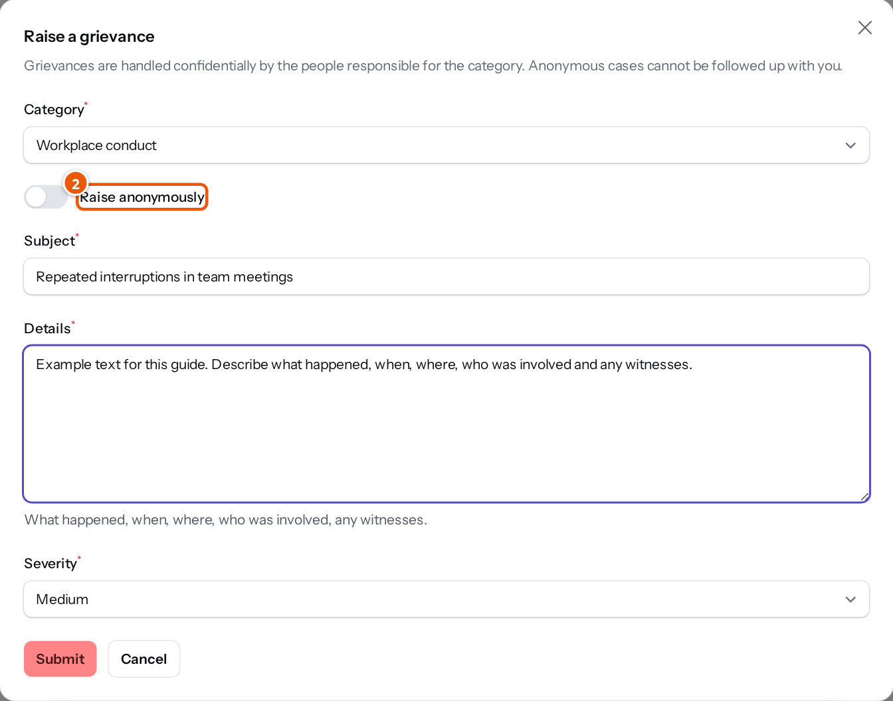
*Figure 7.11 — The Raise a grievance form, filled with example text and then cancelled. Demonstration data (fictional).*

1. The form explains: "Grievances are handled confidentially by the people responsible for the category. Anonymous cases cannot be followed up with you."
2. **Raise anonymously** — appears only for categories that allow anonymous cases.
3. **Subject** 4. **Details** ("What happened, when, where, who was involved, any witnesses.") 5. **Severity** (**Low**, **Medium**, **High**, **Critical**).

#### Task: Raise a grievance

1. Open **You / Your pages › My grievances** (or search "My grievances" with Ctrl K).
2. Click **Raise a grievance**.
3. Choose the **Category** (required). Switch on **Raise anonymously** if you wish and the category allows it.
4. Enter **Subject**, **Details** and **Severity** (all required).
5. Click **Submit**. PeopleOS shows "Case GRV-… raised".
6. If the category has handler roles, the least busy handler is assigned and the case becomes **Under review**. Otherwise it stays **Submitted** until a grievance manager assigns it. The due date is set from the category's deadline (for example 30 days).

**Expected result:** a named case appears in **My grievances**. An anonymous case does not — nobody, including you, can link it to you.
**How to verify:** open the case to see its status, due date and the entries the handler has made visible to you.
**Common mistakes:** choosing anonymous and then expecting a reply — anonymous cases cannot be followed up.
**If it fails:** "This category does not accept anonymous cases." — choose another category or raise it in your name.

After raising a named case you can **Add information** (with optional **Evidence** attachment) and **Withdraw** it with a reason while it is open.

### Handling a case (HR)

On the **Cases** list (columns **Number**, **Subject**, **Category**, **Raised by** — "Anonymous" for anonymous cases — **Severity**, **Status**, **Handler**, **Due on**, shown in red when overdue; filters **Status** and **Category**), click **Open**. The case shows **Status**, **Severity**, **Category**, **Raised by**, **Handler**, **Raised**, **Due**, **Also visible to** and **Details**; the **Case file** tab lists every entry (When, Type, By, Body, Attachment, Employee sees).

Actions on an open case: **Add to case file** (choose the **Type** — **Note**, **Evidence**, **Action taken**, **Decision** — write it, attach **Evidence**, and tick **Visible to the employee** if the employee should see it), **Update status** (**Under review**, **Investigating**, **Action taken**), **Assign** (choose a **Handler**), **Grant access** (a **User** and a required **Reason**; only active people allowed to view grievances can be granted), **Resolve** (a **Resolution** is required) and, once resolved or withdrawn, **Close case**.

Every evidence file is stored privately with a fingerprint that is checked on each download, and every download is recorded. PeopleOS reminds the handler once a day about a case past its due date.

### Statuses explained

| Status | Meaning | What happens next |
|---|---|---|
| Submitted | Raised; no handler yet | A grievance manager assigns a handler |
| Under review | A handler is assigned | Investigation |
| Investigating | Facts are being gathered | Action taken or resolved |
| Action taken | An action has been recorded (adding an **Action taken** entry sets this automatically) | Resolved |
| Resolved | Outcome recorded; the employee is notified | Handler closes the case |
| Withdrawn | The employee withdrew it | Handler closes the case |
| Closed | Finished; nothing more can be added | Final |

**Flowchart — Raising and handling a grievance.** Confidential handling from complaint to closure. *Roles:* Employee, grievance handler, grievance manager. *Starts:* the employee raises a grievance. *Ends:* the case is closed.

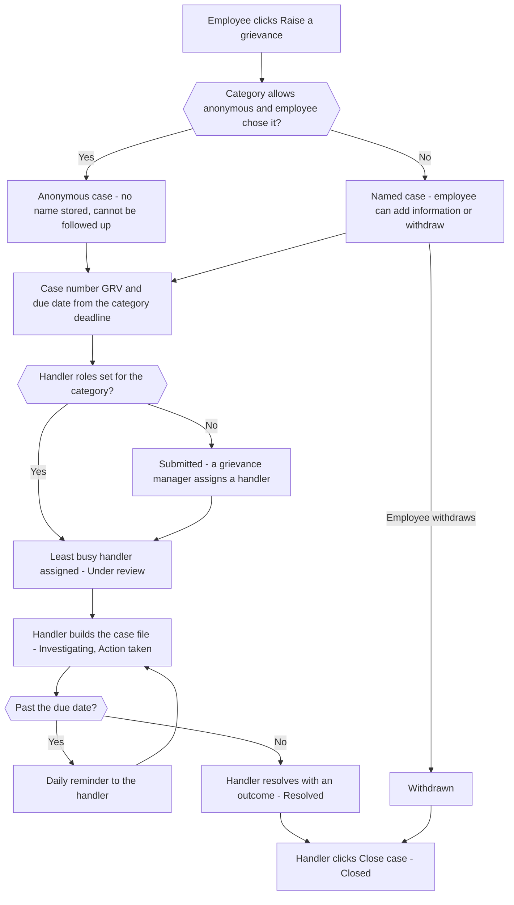

> **Note:** Every opening of a case is recorded in the audit trail, whoever opens it.

### Categories & handlers

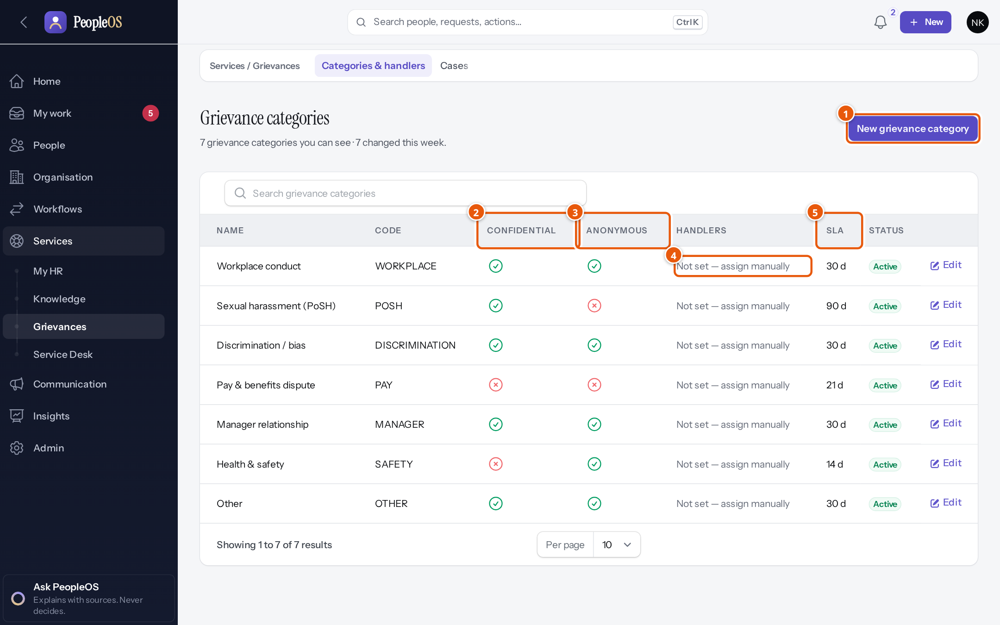
*Figure 7.12 — Grievance categories as delivered. Demonstration data (fictional).*

1. **New grievance category** 2. **Confidential** (handlers only) 3. **Anonymous** (allowed or not) 4. **Handlers** — "Not set — assign manually" until you choose roles 5. **SLA** — days to resolve.

#### Task: Set who handles a category

1. Open **Services › Grievances › Categories & handlers** and click **Edit** on the category.
2. Set **Handled by roles** (for example the Internal Committee role for PoSH), **Confidential (handlers only)**, **Allow anonymous cases**, **Resolve within** (days) and **Status**.
3. Enter a **Reason for change** and save. New cases in this category are assigned automatically to the least busy holder of those roles.

### Example from everyday work

*Illustrative scenario.* An employee at Demo Services raises an anonymous case in **Workplace conduct**. It is assigned automatically to a member of the role Demo Group set as handler for that category. The handler records interviews as **Evidence**, records an **Action taken**, resolves the case, and closes it. Nobody, including HR, can see who raised it.

### Related modules

- **[Feedback inbox](#feedback-and-the-feedback-inbox)** — anonymous feedback can be referred as an anonymous grievance.
- **[Knowledge base](#knowledge-base-policies-and-articles)** — publish your grievance and PoSH policies there.

---

## Knowledge base (policies and articles)

**Status:** Available with limitations — search is basic text matching, and PeopleOS does not yet suggest articles while an employee types a request.

### Overview

The knowledge base holds your HR policies and guides. Every article is written by an author, **reviewed by a different person**, and published as a new, unchangeable version. Readers always see the published version only, never a work in progress. To change a published article, an author starts a revision; readers keep seeing the published version until the revision is approved and published.

An article can require acknowledgement. Each acknowledgement is recorded per version, with the date, time, source and network address, and is never deleted. An article can also be marked as mandatory reading, which puts it into the reader's Needs attention list. An audience rule (for example by company or location; empty means everyone) decides who sees an article.

### Where to find it

- **Menu path:** authors: **Services › Knowledge › Articles**. Readers: **You / Your pages › Knowledge base**, or My HR › **Policies**.
- **Who can open it:** everyone with an employee record reads articles addressed to them; HR Manager and Tenant HR Admin write and review.
- **Set-up needed first:** none. Policy *documents and rules* in **Workflows › Policies** are a different module, covered in the Administration chapter.

### The screen at a glance

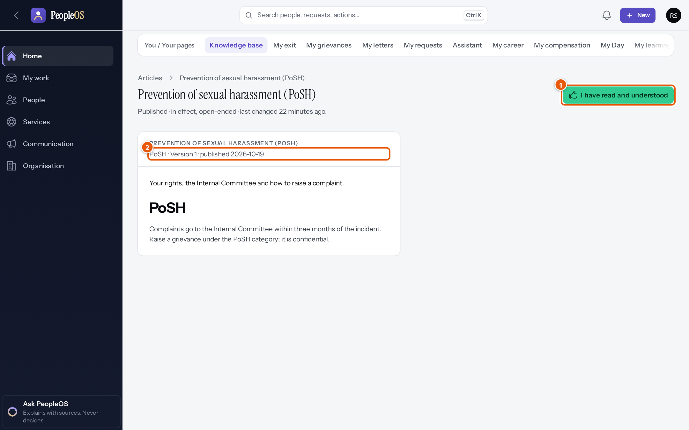
*Figure 7.13 — A published policy article as an employee sees it. Demonstration data (fictional).*

1. **I have read and understood** — records your acknowledgement of this version (shown only when acknowledgement is required and you have not yet acknowledged this version).
2. The version line, for example "PoSH · Version 1 · published 2026-10-19".

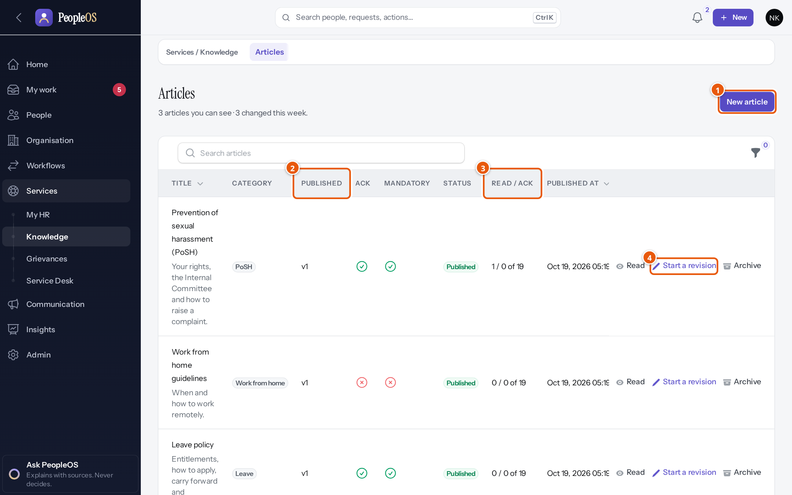
*Figure 7.14 — Knowledge articles as an author sees them. Demonstration data (fictional).*

1. **New article** 2. **Published** — the published version number 3. **Read / ack** — how many readers have read and acknowledged, out of the audience ("1 / 0 of 19") 4. **Start a revision** — begin changing a published article.

Other columns: **Title**, **Category**, **Ack**, **Mandatory**, **Status**, **Published at**. Row actions: **Read**, **Edit** (drafts), **Submit for review**, **Review**, **Publish**, **Start a revision**, **Archive**. Filters: **Category**, **Status**.

### Tasks

#### Task: Write, review and publish an article

1. Open **Services › Knowledge › Articles** and click **New article**.
2. In **Article**, enter **Title** (required), **Category** (required, for example **HR policies**, **Leave**, **PoSH**, **Work from home**), optional **Slug**, **Effective from**, **Tags**, **Summary**, and the **Body** (required).
3. In **Audience & acknowledgement**, switch on **Employees must acknowledge** and/or **Mandatory reading (shows in Needs Attention)**, and add **Audience (empty = everyone)** conditions if needed. Save.
4. Click **Submit for review** and confirm ("A reviewer (not you) approves or returns it before it can be published."). Reviewers are notified.
5. A reviewer (another HR Manager or a Tenant HR Admin) clicks **Review**, keeps **Approve for publication** on (or switches it off and writes a **Note (required to return)**), and submits.
6. The author clicks **Publish** and confirms. PeopleOS shows "Published v1". Employees who must acknowledge are asked to do so; weekly reminders go to people who have not.

**Expected result:** status **Published**, **Published** column "v1".
**How to verify:** the article appears in readers' **Knowledge base** and My HR › **Policies**.
**If it fails:** "The author of an article cannot review or approve it.", "Returning an article needs a note.", "The article has no content."

### Statuses explained

| Status | Meaning | What happens next |
|---|---|---|
| Draft | Being written or revised; readers see the last published version, if any | Submit for review |
| In review | Waiting for a reviewer | Approved or returned to draft |
| Approved | Ready to publish | Author publishes |
| Published | Readers see this version | Start a revision or archive |
| Archived | Withdrawn from readers | Final |

### Related modules

- **[Announcements](#announcements)** — link an article from an announcement instead of copying policy text.
- **[HR queue](#hr-queue-working-requests)** — link an article when resolving a request.

---

## Announcements

**Status:** Available — in-app and email are the only channels that send messages; SMS, WhatsApp and push are not offered for announcements.

### Overview

Announcements are intentional messages from the organisation: holiday notices, circulars, newsletters, policy publications, instructions. An announcement is prepared by one person and **approved by another**, who must cover the whole audience within their own scope. From submission on, its content and audience are frozen; a correction is a new version, and publishing the new version archives the old one.

When an announcement is published, PeopleOS takes a **snapshot** of its audience — the list of people it was sent to is fixed at that moment and does not change if the organisation changes later. An empty audience means "everyone employed within the preparer's scope", never the whole company by default. Messages go out in-app and by email, following each employee's [preferences](#task-choose-how-optional-messages-reach-you) for optional types. The notification carries only the title and a pointer; the full text is read in PeopleOS.

### Where to find it

- **Menu path:** readers: **Communication › Announcements** (for employees, clicking **Communication** opens it), or My HR › **Communications**. HR: **Communication › Communication › Announcements**.
- **Who can open it:** the feed: anyone with an employee record. Management: HR Manager, Tenant HR Admin, Tenant Super Admin.
- **Set-up needed first:** optionally saved [audiences](#campaigns-and-audiences).

### The employee's feed

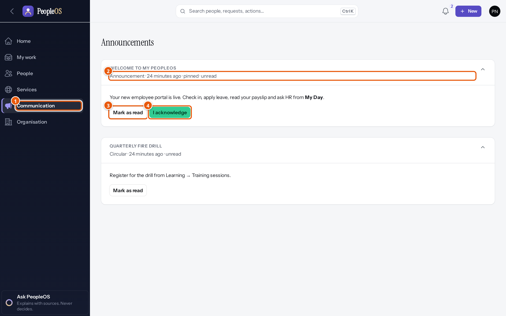
*Figure 7.15 — The Announcements feed for Priya Nair. Demonstration data (fictional).*

1. **Communication** — opens the feed.
2. Type, age, **pinned** and **unread** markers. Pinned items come first; read items are collapsed.
3. **Mark as read**.
4. **I acknowledge** — shown when the announcement asks for acknowledgement; afterwards it reads "Acknowledged … ago". **Read the full article** appears when an article is linked.

### Managing announcements

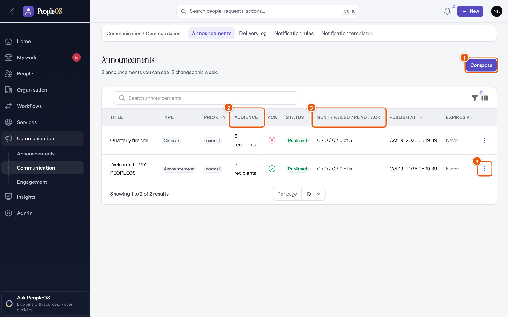
*Figure 7.16 — The announcements list for HR. Demonstration data (fictional).*

1. **Compose** — start a new announcement.
2. **Audience** — the number of recipients once published, or a description of the criteria before.
3. **Sent / failed / read / ack** — delivery and reading counts, for example "0 / 0 / 0 / 0 of 5".
4. **⋮ menu** — the next steps allowed: **Submit for approval**, **Approve**, **Return to draft**, **Publish**, **New version**, **Cancel**, **Archive**. **Edit** appears on drafts and **Attachment** when a file is attached.

Other columns: **Title**, **Type**, **Priority**, **Ack**, **Status**, **Publish at**, **Expires at**. Filters: **Status**, **Type**.

#### Task: Compose and publish an announcement that needs acknowledgement

1. Open **Communication › Communication › Announcements** and click **Compose**.
2. In **Message**, enter **Title**, **Type** (**Announcement**, **Circular**, **Newsletter**, **Policy publication**, **Instruction**), **Body** and **Priority** (**Normal**, **High**, **Critical**) — all required. Optionally choose **Link a knowledge article**, a **Campaign**, **Publish at** (empty = "Immediately on publish"), **Expires at** (empty = "Never") and one **Attachment (private)**.
3. In **Audience & options**, switch on **Employees must acknowledge** (and **Pin to the top** if needed). Choose a **Saved audience**, or fill **Audience criteria** (Companies, Locations, Business units, Departments, Teams, Designations, Grades, Employment types, Establishments, Lifecycle states, Reports of (managers), Named employees). Every dimension you fill must match.
4. Check the **Review before creating** panel and click **Create announcement**. It is saved as a **Draft**.
5. In the list, open the **⋮** menu and click **Submit for approval**. Confirm: "The message and its audience are frozen from now on; a correction is a new version."
6. A different person with approval rights opens the **⋮** menu and clicks **Approve** (optional **Note**) or **Return to draft** (note required).
7. Click **Publish** and confirm. If **Publish at** is in the future the announcement is **Scheduled** and released automatically within minutes of that time; otherwise it is **Published** at once, the audience snapshot is taken and delivery starts.

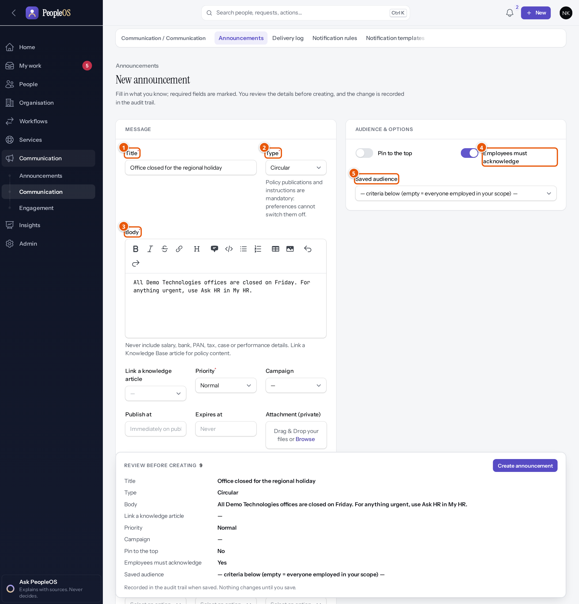
*Figure 7.17 — The New announcement form with example text and the review panel (not created). Demonstration data (fictional).*

1. **Title** 2. **Type** — "Policy publications and instructions are mandatory: preferences cannot switch them off." 3. **Body** — "Never include salary, bank, PAN, tax, case or performance details. Link a Knowledge Base article for policy content." 4. **Employees must acknowledge** 5. **Saved audience**.

**Expected result:** status **Published**; the **Audience** column shows "N recipients".
**How to verify:** watch **Sent / failed / read / ack** fill in as people read and acknowledge.
**Common mistakes:** expecting to edit a submitted announcement — use **New version** instead.
**If it fails:** "The audience names people or organisation units outside your scope.", "The audience is outside your scope; an approver who covers it must decide.", "The person who prepared it cannot approve it.", "The announcement would expire before it is published.", "That file type is not accepted (…)." / "The attachment is too large."

> **Note:** "Sent" means the in-app inbox entry was written or the email was accepted by the mail system. PeopleOS never claims an email was *delivered*. Failed deliveries are retried up to three times. A recipient is **Skipped** if they have no active account or switched off every channel for an optional type.

### Statuses explained

| Status | Meaning | What happens next |
|---|---|---|
| Draft | Being prepared | Submit for approval |
| In review | Frozen; waiting for an approver | Approved, returned or cancelled |
| Approved | Ready to publish | Publish, or cancel |
| Scheduled | Waiting for its publish date | Released automatically, or cancelled |
| Published | Sent to the audience snapshot | New version or archive |
| Archived | No longer current (also when a newer version is published) | Final |
| Cancelled | Stopped with a reason | Final |

**Flowchart — Publishing an announcement that needs acknowledgement.** From draft to acknowledged, with separation of duties. *Roles:* Preparer (HR), approver (a second HR person), employees. *Starts:* HR composes an announcement. *Ends:* employees acknowledge it.

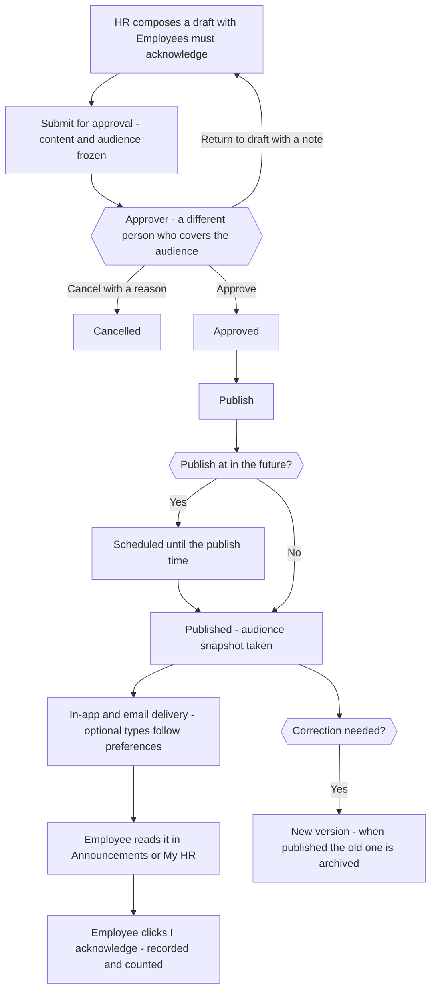

### Example from everyday work

*Illustrative scenario.* Neha Kapoor prepares the circular "Office closed for the regional holiday" for Demo Technologies, ticks **Employees must acknowledge**, and submits it. Kavya Menon approves it. Neha publishes it; Priya Nair sees it pinned in her feed and clicks **I acknowledge**. Two days later Neha checks **Sent / failed / read / ack** to see who still has to confirm.

### Related modules

- **[Notification rules and templates](#notification-rules-templates-and-the-delivery-log)** — automatic messages, as opposed to announcements.
- **[Campaigns](#campaigns-and-audiences)** — publish several approved items together.

---

## Notification rules, templates and the delivery log

**Status:** Available with limitations — existing rules and templates can be edited, but this version has no screen action to create new ones or delete them (ask Markedge, your provider, if you need additional rules). The rule form lists **SMS**, **WhatsApp** and **Push**, but these do not send anything yet; only **In-app** and **Email** reach people.

### Overview

Many PeopleOS events send automatic notifications — a request assigned, a leave approved, a document about to expire. Most modules notify the right people by themselves. **Notification rules** let your organisation add messages for chosen events: *when this event happens, send this template to these people on these channels, only when these conditions are true*. **Notification templates** hold the wording, with placeholders such as `{{ employee.first_name }}`. The **Delivery log** records every message PeopleOS sent, so you can check whether someone was told.

Service-desk, grievance and survey notifications carry references only (a number, a service name, a status), never the text of a request, a comment, a grievance or a survey answer.

### Where to find it

- **Menu path:** **Communication › Communication › Notification rules**, **Notification templates**, **Delivery log**.
- **Who can open it:** rules and templates: Tenant HR Admin and Tenant Super Admin (edit); HR Manager, Account Owner and Auditor (view only). Delivery log: Tenant HR Admin, Tenant Super Admin, HR Manager and Auditor; **Send again** is for Tenant HR Admin and Tenant Super Admin.
- **Set-up needed first:** none; the demonstration includes one rule, "Welcome every joiner".

### The screen at a glance

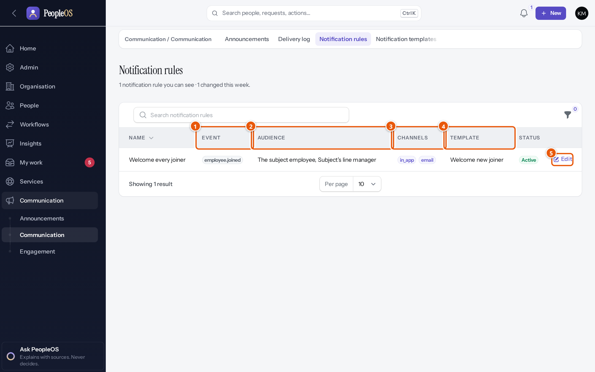
*Figure 7.18 — Notification rules as Kavya Menon (Tenant HR Admin) sees them. Demonstration data (fictional).*

1. **Event** — what triggers the rule, for example `employee.joined`.
2. **Audience** — who receives it.
3. **Channels** — for example in-app and email.
4. **Template** — which wording is used.
5. **Edit** — change the rule.

#### Task: Change who receives an automatic message

1. Open **Communication › Communication › Notification rules** and click **Edit** on the rule.
2. Adjust the fields:
   - **Name**, **Event**, **Template** and **Status** (all required).
   - **Audience** — one or more entries, each with a **Type**: **The subject employee**, **Subject's line manager**, **Who started it**, **Everyone with a role** (choose the role), **A specific user** (choose the user) or **Task assignee**. Use **Add to audience** for more.
   - **Channels** (required) — tick **In-app** and/or **Email**.
   - **Only when** — optional conditions, each with a field (for example `employee.department`), an operator and a value.
3. Enter a **Reason for change** and click **Save changes**. The before and after values and your reason are recorded.

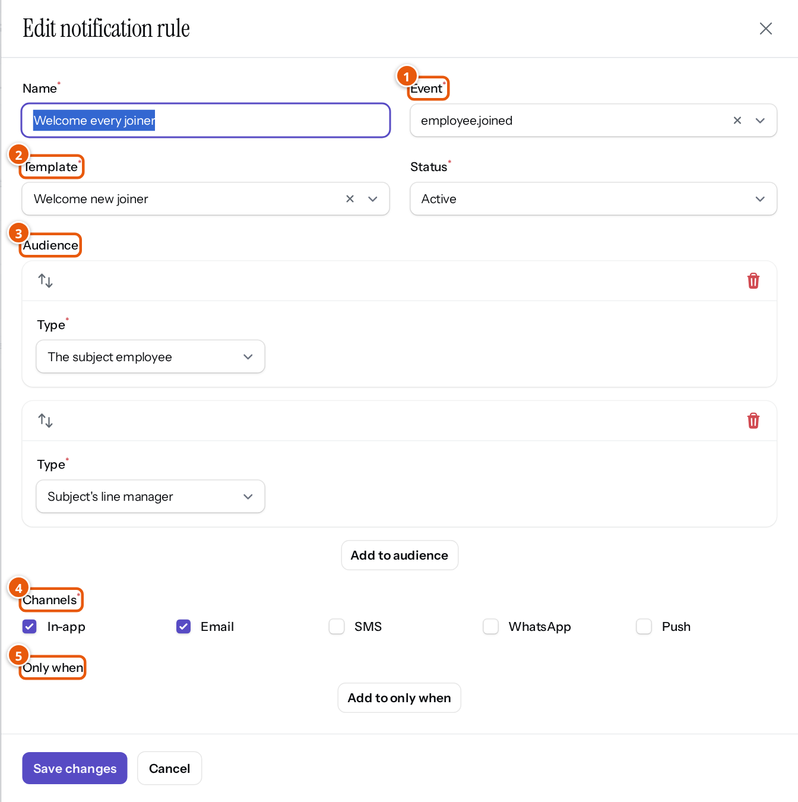
*Figure 7.19 — A notification rule opened for editing (not saved). Demonstration data (fictional).*

1. **Event** 2. **Template** 3. **Audience** 4. **Channels** 5. **Only when**.

**Common mistakes:** ticking SMS, WhatsApp or Push and expecting a text message — those channels are not connected.

#### Task: Change the wording of a template

1. Open **Notification templates** and click **Edit**.
2. Change **Name**, **Subject** or **Body**. The **Key** cannot be changed. The help text lists placeholders you can use: employee.name, employee.code, employee.department, employee.manager, subject.label, initiator.name, tenant.name, app.url, task.title, workflow.name, lifecycle.to and more.
3. Set **Status**, enter a **Reason for change**, and click **Save changes**.

#### Task: Check whether a message went out, and send it again

1. Open **Communication › Communication › Delivery log**.
2. Search by recipient (**To**) or **Subject**, or filter by **Channel** and **Status** (**Queued**, **Sending**, **Sent**, **Failed**, **Read**).
3. Click **View** to see the recipient, channel, event, status, subject, body, sent time and any error.
4. For a **Failed** delivery, a Tenant HR Admin can click **Send again**, enter a **Reason** (at least five characters) and confirm. It is sent once, even if two people click at the same time.

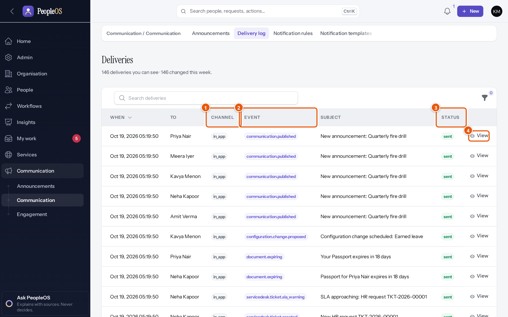
*Figure 7.20 — The delivery log. Demonstration data (fictional).*

1. **Channel** 2. **Event** 3. **Status** 4. **View**.

> **Note:** If a delivery stopped while it was being sent, PeopleOS marks it failed with an unknown outcome and never resends it automatically, because the person may have received it. Send it again only if the recipient confirms they did not get it.

---

## Surveys and survey results

**Status:** Available with limitations — results cannot be exported; surveys are in one language; there is no question branching; employees take surveys only while signed in (no external survey links or kiosk mode); results are broken down by one dimension only.

### Overview

PeopleOS runs engagement, pulse, culture, onboarding, exit, event and custom surveys with one approach. Privacy is part of the design, not a setting you can forget:

- **Anonymous** — PeopleOS stores no link at all between who took part and what they answered. Nobody can ever see who said what: not HR, not managers, not administrators, not Markedge through the application.
- **Confidential** — the person is stored apart from the answers and can be identified only by someone with special rights (Tenant HR Admin or Tenant Super Admin), one response at a time, with a written reason that is recorded.
- **Identified** — HR can see answers with names.

Results are shown only as totals and averages. No result is shown for fewer than **five** respondents; a group (for example one department) is shown only with five or more, and smaller groups are merged or hidden so that nobody can work out a hidden group by subtraction. Free-text comments are shown only overall (never per group), only when there are at least **ten** respondents and ten comments, shuffled and without names or dates. **Anonymous and confidential results appear only after the survey closes**; identified results can be viewed while it is open. PeopleOS calculates no engagement score, no sentiment and no attrition prediction.

A survey is prepared by one person and **approved by another** (or, if Markedge has configured it, by an approval workflow). Its questions, audience and privacy settings are frozen from submission. A change is a new version; responses stay with the version they answered.

### Where to find it

- **Menu path:** **Communication › Engagement › Surveys**. Results: the **Results** action on a survey version, or **Results** in My HR › **Surveys** for participants when the survey shares them.
- **Who can open it:** HR Manager and Tenant HR Admin (prepare, approve, results); Auditor (configuration only, never responses). Employees take surveys in My HR › **Surveys**.
- **Set-up needed first:** optionally a saved [audience](#campaigns-and-audiences).

### The screen at a glance

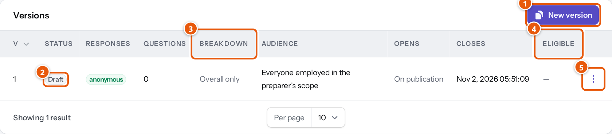
*Figure 7.21 — The Versions tab of a draft example survey created for this guide. Demonstration data (fictional).*

1. **New version** — copies the latest version (settings and questions) into a new draft.
2. **Status** — **Draft**, **In review**, **Approved**, **Scheduled**, **Open**, **Closed**, **Archived**.
3. **Breakdown** — the one dimension results can be split by ("Overall only" if none).
4. **Eligible** — how many people were invited when it opened.
5. **⋮ menu** — **Edit settings**, **Questions**, **Submit for approval**, **Approve**, **Return to draft**, **Publish**, **Close now**, **Archive**, as allowed. **Results** appears for open, closed and archived versions.

Other columns: **Responses** (the privacy mode), **Questions**, **Audience**, **Opens**, **Closes**. The survey list shows **Code**, **Name**, **Type**, **Latest version**, **Responses** and **Closes**, with **Manage** on each row.

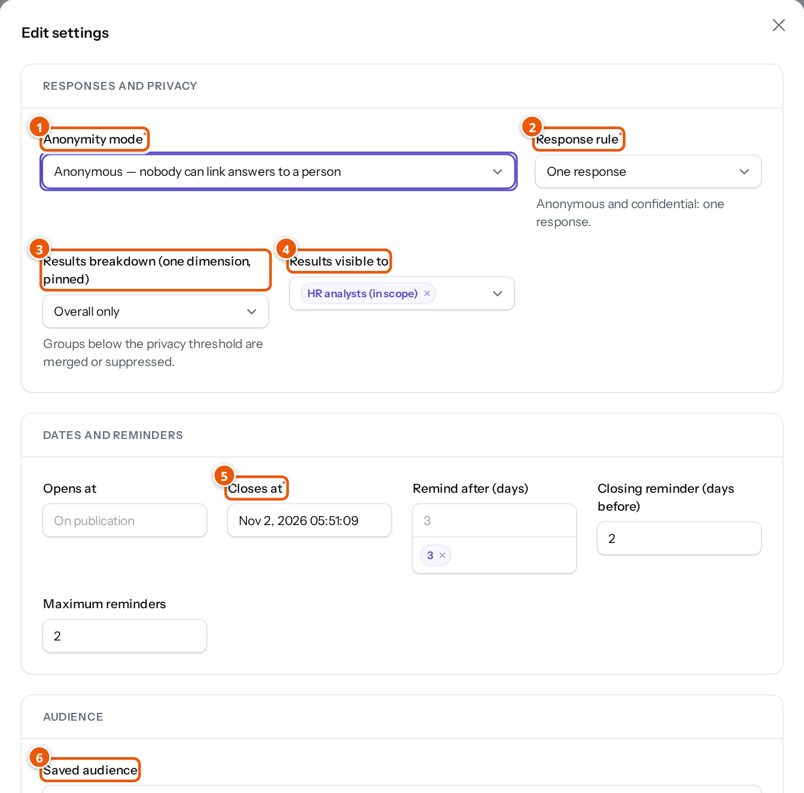
*Figure 7.22 — Edit settings of a draft survey version (not saved). Demonstration data (fictional).*

1. **Anonymity mode** 2. **Response rule** — **One response**, **Several responses (identified only)**, **One response per period (identified only)** 3. **Results breakdown (one dimension, pinned)** — Overall only, Company, Location, Department, Business unit, Grade or Line manager 4. **Results visible to** — **HR analysts (in scope)**, **Managers — own team (needs the line-manager breakdown)**, **Participants — overall only** 5. **Closes at** 6. **Saved audience** (or the **Audience criteria** below it).

### Tasks

#### Task: Create and launch a survey

1. Open **Communication › Engagement › Surveys** and click **New survey**.
2. Enter **Code**, **Name**, **Survey type** and **Category** (required) and an optional **Description**. In **First version**, choose the **Anonymity mode** ("This is fixed per version") and **Closes at**. Click **Create survey**. Version 1 is created as a **Draft**.
3. On the **Versions** tab, open the **⋮** menu and click **Questions**. For each question enter a **Key** (a short stable name; trends follow it across versions), **Type** (**Single choice**, **Multiple choice**, **Rating**, **Agreement scale (5 points)**, **Yes / No**, **Free text**, **Number**, **Date**), **Prompt**, optional **Help**, **Required**, and the options or scale. **Administrator metadata** and **Analysis tags** are never shown to employees. Click **Submit**.
4. Click **Edit settings** and choose the privacy, results and reminder options (**Opens at** — empty means "On publication" — **Remind after (days)**, **Closing reminder (days before)**, **Maximum reminders**, up to 3), the audience and an **Introduction shown to employees**. Click **Submit**.
5. Click **Submit for approval** and confirm: "Content, audience and privacy settings are frozen from now on; a change needs a new version."
6. A different person clicks **Approve** (optional **Note**) or **Return to draft** (note required).
7. Click **Publish**. The survey is **Scheduled** for its opening time, or opens at once if that time has come. On opening, PeopleOS takes a snapshot of who is invited and sends invitations; each invitee sees **Take survey** in My HR › **Surveys** and in their tasks.
8. The survey closes on its closing date (PeopleOS checks every 15 minutes) or when you click **Close now**. Unanswered invitations become **Expired**.

**Expected result:** **Eligible** shows the number invited; once closed, **Results** shows the totals.
**How to verify:** open **Results** and check **Participation** (Eligible, Opened, Submitted, Expired, Response rate).
**Common mistakes:** leaving the audience empty — a survey is never sent to "everyone" by default; choosing managers' results without the line-manager breakdown.
**If it fails:** "A survey version needs at least one question.", "Choose an audience (a saved audience or criteria); a survey is never sent to "everyone" by default.", "Anonymous and confidential surveys allow exactly one response per person.", "Managers can see team results only when the breakdown is by line manager.", "The person who prepared it cannot approve it.", "The audience reaches nobody in your scope.", "Another version of this survey is still open; close it first."

#### Task: Take a survey (employee)

1. Open My HR and click the **Surveys** tab (or the survey task under **Needs you**).
2. Click **Take survey**. The form explains the privacy mode, for example "Anonymous: your answers are stored without any link to you, and results are shown only for groups of at least 5 people. Anonymous responses cannot be changed after you submit."
3. Answer the questions (required ones are marked) and click **Submit my response**.
4. PeopleOS shows "Thank you — your response was recorded." Nothing is saved before you submit, so there are no drafts that could link you to your answers.

> **Note:** Reminders for anonymous and confidential surveys go to everyone invited ("if you have already responded, thank you"), so even the reminder list reveals nothing about who took part.

#### Task: Read the results

1. On the survey's **Versions** tab, click **Results** on an open, closed or archived version.
2. The page **Results: [survey] v[n]** shows the privacy mode and threshold, **Participation** (HR only), **Respondents**, and for each question the number answered, the distribution and, where meaningful, the average — overall and for each group of the pinned breakdown. Hidden cells read "suppressed (too few answers)".
3. **Comments** sections (HR with comment rights) show free text overall only, shuffled, "never attributed". For confidential surveys a Tenant HR Admin or Tenant Super Admin sees **Identify author** next to each comment; it asks for a reason of at least ten characters and records the request. Anonymous comments never have this button.
4. **Trend (overall, closed versions)** compares versions of the same survey when there is more than one.

Managers see only their own team's group, and only when the survey allows it and the breakdown is by line manager. Participants see the overall result when the survey shares it.

### Statuses explained

| Status | Meaning | What happens next |
|---|---|---|
| Draft | Questions and settings can be edited | Submit for approval |
| In review | Frozen; waiting for approval | Approved or returned to draft |
| Approved | Approved; content fingerprinted | Publish |
| Scheduled | Waiting for its opening time | Opens automatically |
| Open | Invitations sent; employees can respond | Closes on its date or with Close now |
| Closed | No more responses; anonymous and confidential results released | Archive |
| Archived | Kept for history and trends | Final |

**Flowchart — Running an employee survey.** From draft to results, with the privacy thresholds. *Roles:* Survey preparer (HR), approver (a second HR person), employees. *Starts:* HR creates a survey. *Ends:* results are read.

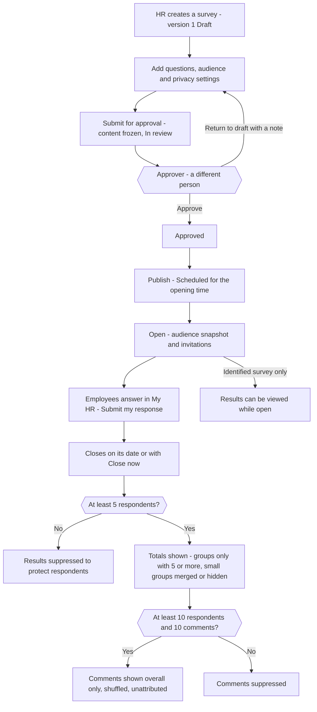

### Example from everyday work

*Illustrative scenario.* Neha Kapoor prepares an anonymous quarterly pulse for Demo Technologies with a department breakdown and three agreement-scale questions. Kavya Menon approves it. It opens on Monday; Priya Nair answers from My HR. After it closes, Neha sees results for the two large departments; the small Finance team is merged so that nobody can be singled out.

### Related modules

- **[Campaigns and audiences](#campaigns-and-audiences)** — reuse audiences and launch a survey with announcements.
- **[My HR](#my-hr-employee-self-service)** — where employees take surveys.

---

## Campaigns and audiences

**Status:** Available.

### Overview

An **audience** is a saved description of who should receive something — for example "all employees in Bengaluru in the Engineering department". It is checked against the organisation as it is on the day it is used, and only within the preparer's scope. Previewing an audience shows a **count**, never a list of names. Surveys and announcements copy the audience criteria when they are submitted, so later edits to a saved audience do not change anything already approved.

A **campaign** groups surveys, announcements, knowledge articles and HR services under one name and timetable, for example a "Wellbeing month". A campaign is approved by a second person. On its start date, PeopleOS publishes every **approved** item through its own module and reports anything not ready as skipped; it never forces an unapproved item out. Articles and services are included as references.

| Screen | What you store there | Path | Who |
|---|---|---|---|
| Audiences | **Code**, **Name**, **Description** and **Audience criteria**: Companies, Locations, Business units, Departments, Teams, Designations, Grades, Employment types, Establishments, Lifecycle states (empty = employed), Reports of (managers), Named employees. Row actions: **Edit**, **Count** ("N employees match today (inside your scope)"), **Deactivate** | **Communication › Engagement › Audiences** | HR Manager, Tenant HR Admin; Auditor (view) |
| Campaigns | **Code**, **Name**, **Starts on**, **Ends on**, **Audience (for reference)**, **Purpose**; an **Items** tab (**Add item**: Type **Survey**, **Announcement**, **Knowledge Base article** or **HR service**). Row actions: **Manage**, **Metrics**, **Submit for approval**, **Approve**, **Return to draft**, **Schedule**, **Cancel** | **Communication › Engagement › Campaigns** | HR Manager, Tenant HR Admin; Auditor (view) |

Campaign statuses: **Draft**, **In review**, **Approved**, **Scheduled**, **Active**, **Completed**, **Cancelled**. **Metrics** shows counts from each module, such as recipients sent, failed, skipped and pending, acknowledgements, and survey eligible and submitted.

#### Task: Create a campaign

1. Open **Communication › Engagement › Campaigns** and click **New engagement campaign**.
2. Enter **Code**, **Name** and **Starts on** (required), optional **Ends on**, **Audience (for reference)** and **Purpose**. Create it.
3. On the **Items** tab, click **Add item**, choose the **Type** and the **Item**, and repeat. Items can be added or removed only while the campaign is a draft.
4. Click **Submit for approval**. A second person clicks **Approve**.
5. Click **Schedule** and confirm ("On its start date, every approved item is published by its own module; items that are not approved are reported as skipped.").

**If it fails:** "A campaign needs at least one item.", "A campaign ends on or after its start date.", "The person who prepared it cannot approve it."

> **Tip:** Get each survey and announcement approved in its own module before the campaign starts; otherwise it is skipped. Cancelling a campaign does not withdraw items that were already published.

---

## Feedback and the feedback inbox

**Status:** Available with limitations — anonymous feedback cannot be answered (there is nobody to reply to), and see the known issue below.

### Overview

Employees can send HR feedback at any time with **Give feedback** in My HR, choosing how it is sent:

- **Identified** — "HR knows it is from you and can follow up."
- **Confidential** — "your name is kept apart and revealed only for a serious, audited reason."
- **Anonymous** — "nobody can ever see who sent it — and nobody can reply."

Feedback is stored with the same privacy protections as survey answers: anonymous and confidential items carry no name and only the date, not the time. HR reads feedback in the **Feedback inbox** and routes it to where it can be acted on: an HR request for identified (or, with a recorded reason, confidential) feedback, or an anonymous grievance for anonymous feedback.

### Where to find it

- **Menu path:** employees: My HR › **Give feedback** (header button or **Feedback** tab). HR: **Communication › Engagement › Feedback inbox**.
- **Who can open it:** every employee can give feedback; the inbox is for HR Manager, Tenant HR Admin and Tenant Super Admin.
- **Set-up needed first:** none.

### The screen at a glance

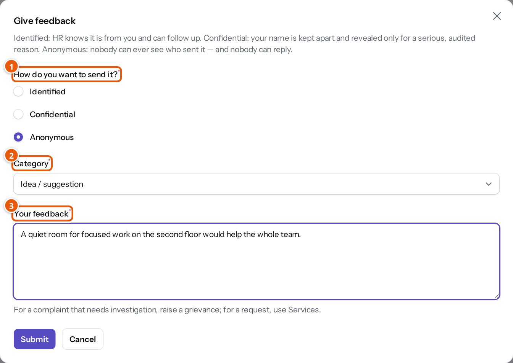
*Figure 7.23 — The Give feedback form, filled and then cancelled. Demonstration data (fictional).*

1. **How do you want to send it?** — **Identified**, **Confidential** or **Anonymous**. 2. **Category** — **Workplace**, **Processes & tools**, **Wellbeing**, **Communication**, **Idea / suggestion**, **Other**. 3. **Your feedback** — 5 to 5,000 characters ("For a complaint that needs investigation, raise a grievance; for a request, use Services.").

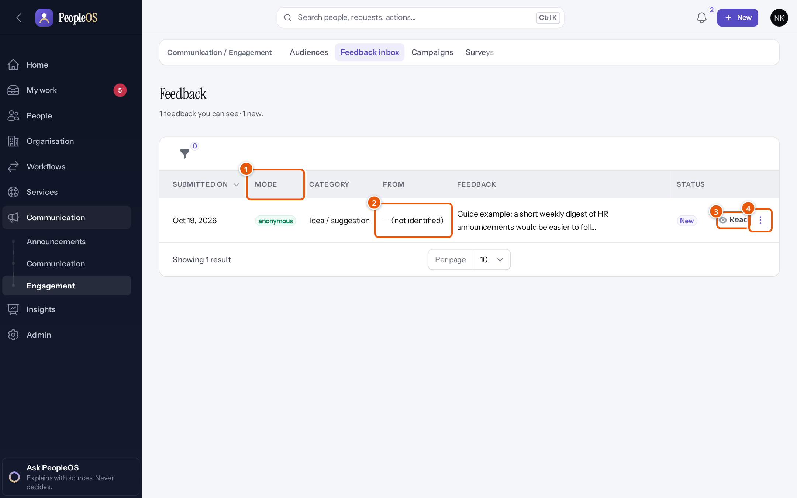
*Figure 7.24 — The feedback inbox with one anonymous example item submitted for this guide. Demonstration data (fictional).*

1. **Mode** — identified, confidential or anonymous. 2. **From** — "— (not identified)" for confidential and anonymous items. 3. **Read** — the full text, the **Handling note** and where it was **Referred to**. 4. **⋮ menu** — **Mark in review**, **Close** (with a **Handling note**), **Refer to HR service desk** (identified or confidential), **Refer as anonymous grievance** (anonymous only).

### Tasks

#### Task: Give feedback (employee)

1. Open My HR and click **Give feedback**.
2. Choose **How do you want to send it?**, a **Category**, and write **Your feedback** (all required).
3. Click **Submit**. The confirmation reads "Thank you — your feedback was sent."
4. Identified feedback appears in your **Feedback** tab with its status. Confidential and anonymous feedback is not listed back, by design.

> **Important — known issue:** in the version documented here, clicking **Submit** can show a "Not allowed" message with a technical error, although the feedback **has** been received and appears in HR's Feedback inbox. Do not submit the same feedback again; if unsure, ask HR. This issue has been reported to Markedge.

#### Task: Handle feedback (HR)

1. Open **Communication › Engagement › Feedback inbox**. Filter by **Status** (**New**, **In review**, **Referred to HR service desk**, **Closed**) or **Category**.
2. Click **Read** to see the full text.
3. Open the **⋮** menu and choose:
   - **Mark in review** — you are looking at it.
   - **Close** — optionally add a **Handling note**.
   - **Refer to HR service desk** — choose a **Request category**. PeopleOS opens an HR request for the employee (source "Raised by HR"). For confidential feedback you must also explain **Why the author must be identified (audited)** (at least ten characters); only a Tenant HR Admin or Tenant Super Admin may identify the author.
   - **Refer as anonymous grievance** — choose a **Grievance category** (only categories that accept anonymous cases are listed). PeopleOS raises an anonymous grievance.
4. The item's status becomes **Referred to HR service desk** (for both routes) or **Closed**.

**If it fails:** "This feedback was already referred.", "Anonymous feedback has nobody to open a request for; refer it as an anonymous grievance.", "That feedback is outside your scope."

### Example from everyday work

*Illustrative scenario.* Rahul Sharma suggests, anonymously, a weekly digest of HR announcements. Neha Kapoor reads it in the Feedback inbox, marks it **In review**, discusses it with Kavya Menon, and closes it with the handling note "Newsletter type will be used for a weekly digest from next month."

### Related modules

- **[Grievances](#grievances)** — where anonymous feedback that needs investigation is referred.
- **[HR queue](#hr-queue-working-requests)** — where identified feedback becomes a request.

---

## Questions people often ask

**Can HR see who answered an anonymous survey?** No. PeopleOS stores no link between the person and the answers, keeps no time of submission, and shows results only for groups of five or more. There is no administrator override.

**Can my manager see my HR requests?** Managers see only the *status* of standard requests for services that allow it, for people they manage — never the content, comments or form values, and never sensitive or confidential requests. See [Team HR requests](01-workspace-and-self-service.md#team-hr-requests).

**Who can approve a change to my bank account?** Someone other than you, through the approval workflow set on the service, and then a third HR person applies it. Nobody can approve or apply their own change.

**Can I switch off policy announcements?** No. **Policy publication** and **Instruction** are always delivered. You can choose channels for announcements, circulars, newsletters and survey invitations.

**Is there a mobile app or text-message service?** PeopleOS works in the web browser on phones (tested at phone width with the WebKit engine). SMS, WhatsApp and push messages are not available.

**What are the service-level commitments of Markedge itself?** To be confirmed with the SaaS provider. The SLA policies in this chapter are the targets *your HR team* sets for answering employees.
