# Insights: analytics, reports, audit trail and AI assistance

> **In this chapter:** how PeopleOS turns your HR records into figures, dashboards and reports, how it records every change in a trail that cannot be quietly altered, and how its assistant answers questions without ever making decisions. **Who should read it:** executives and business owners, HR managers and administrators, auditors, and anyone who uses **Ask PeopleOS**.

Insights is where you step back from day-to-day HR work and look at the whole picture. Executives see the month's workforce movement on one page. HR builds and runs reports, and exports them for Excel. Administrators and auditors can answer "who changed this, when, and why?" in a few clicks, because every important change is recorded with its before and after values and its reason. The assistant explains your own records in plain words and always shows where its answer came from. Throughout, PeopleOS shows each person only what their role allows, and hides figures about very small groups so that no individual can be identified.

| Module | What it is for | Where to find it | Who uses it | Status |
|---|---|---|---|---|
| Workforce Command Centre ("Workforce pulse") | The month's movement, size, attendance, skills and items waiting for a decision, on one page | Insights › Analytics › Workforce Command Centre | Executive, Tenant HR Admin, Auditor | Available |
| Dashboards | Ready-made boards of key figures, trends and report charts | Insights › Analytics › Dashboards | Executive, HR Manager, Tenant HR Admin, Auditor | Available with limitations (see Dashboards) |
| Dashboard builder | Create and change dashboards and choose who sees them | Insights › Analytics › Dashboard builder | Tenant HR Admin | Available |
| People analytics | One factual overview across all HR areas, with privacy thresholds | Insights › Analytics › People analytics | Most HR and management roles (each area needs its own access) | Available |
| Workforce Intelligence | Attrition and capacity facts and critical skills, never individual predictions | Insights › Analytics › Workforce Intelligence | Executive, HR Manager, Tenant HR Admin | Available |
| Reports | Run starter reports, build your own, chart them, export CSV, schedule them | Insights › Analytics › Reports | HR Manager, Tenant HR Admin, Executive, Auditor | Available with limitations (see Reports) |
| Change history | The full audit trail: who changed what, when, before and after, and why | Insights › Audit › Change history | Tenant HR Admin, HR Manager, Payroll Admin, Auditor, Account Owner | Available |
| Change intelligence | The audit trail as a story you can filter by employee, with a plain **Explain** view | Insights › Audit › Change intelligence | Same as Change history | Available |
| AI interactions | The log of every question asked of the assistant and every answer it gave | Insights › Audit › AI interactions | Tenant HR Admin, Auditor | Available |
| Ask PeopleOS and the Assistant page | Ask questions in plain words and get sourced answers | Sidebar › Ask PeopleOS; **Assistant** in the "You / Your pages" area bar | Employees, managers, HR, payroll, executives | Available with limitations (see AI assistance) |
| PeopleOS Intelligence | Short, sourced notes on Home, the Approval Center and an employee's record | Inside those screens | Anyone the assistant is available to | Available |

---

## Finding your way around Insights

Click **Insights** in the left sidebar. It opens two groups, **Audit** and **Analytics**, and takes you to your usual landing page: an executive lands on the **Workforce Command Centre**, an HR or payroll user on **Change intelligence**, and a manager on **People analytics**. At the top of each page, the **area bar** shows "Insights / Analytics" (or "Insights / Audit") followed by the other pages of that group that you may open.

The Insights section appears only if your role may open at least one of its pages. An ordinary employee does not see it. The table below shows who can open each page with the standard roles. Your administrator can create other roles.

| Page | Tenant Super Admin | Tenant HR Admin | HR Manager | Executive | Payroll Admin | Auditor | Account Owner | Manager |
|---|---|---|---|---|---|---|---|---|
| Workforce Command Centre | Yes | Yes | — | Yes | — | Yes | — | — |
| Dashboards | Yes | Yes | Yes | Yes | — | Yes | — | — |
| Dashboard builder | Yes | Yes | — | — | — | — | — | — |
| People analytics | Yes | Yes | Yes | Yes | Yes | Yes | — | Yes |
| Workforce Intelligence | Yes | Yes | Yes | Yes | — | — | — | — |
| Reports | Yes | Yes | Yes | Yes | — | Yes | — | — |
| Change history, Change intelligence | Yes | Yes | Yes | — | Yes | Yes | Yes | — |
| AI interactions | Yes | Yes | — | — | — | Yes | — | — |

People analytics also opens for the HR Executive and Attendance Admin roles, each seeing only the areas they have access to.

> **Tip:** you can always find a page with the search bar at the top ("Search people, requests, actions…", Ctrl K), and **Admin › All modules** lists every module you may open.

## Privacy rules that apply to every insight

Every figure in this chapter follows the same rules. You do not have to switch them on.

- **You only see your own scope.** If your access is limited to one company (for example, Neha Kapoor sees only Demo Technologies), every count, report row and audit entry is limited to that company. That is why the same dashboard can show a headcount of 21 to the CEO and 19 to an HR Manager.
- **Small groups are hidden.** A count or share about fewer than five people is shown as "fewer than 5", or a note such as "Fewer than 5 employees in scope; no figures are shown." This stops anyone working out a colleague's details from a tiny group. Five is the standard threshold; Markedge (your provider) can set a different one for your organisation.
- **Figures from protected areas need that area's access.** For example, people cost needs payroll or compensation access. Without it you see "—" and a short **Restricted** note that names the access needed (in system terms).
- **Sensitive fields are removed.** In reports, a field such as **Annual CTC** (annual cost to company) appears only to people who may see both sensitive employee data and compensation.
- **No individual scoring or prediction.** PeopleOS never scores, ranks or predicts whether a person will leave, be promoted or be let go. Its analytics are counts, shares and trends only.

---

## Workforce Command Centre (Workforce pulse)

**Status:** Available

### Overview

The Workforce Command Centre tells the story of your workforce this month on a single page, under the heading **Workforce pulse**. It answers four questions: what changed, what needs attention, what is trending and what needs a decision. It is meant for senior leaders who want facts without building reports. Every figure comes from live records, uses the privacy rules above, and can be opened to see what is behind it.

### Where to find it

- **Menu path:** Insights › Analytics › Workforce Command Centre (the executive's Insights landing page)
- **Who can open it:** Executive, Tenant HR Admin, Auditor, Tenant Super Admin
- **Set-up needed first:** none. Figures fill in as people, positions, leave, attendance, exits and skills are recorded.

### The screen at a glance

*Figure 8.1 — The Workforce pulse as Meera Iyer (Executive) sees it. Demonstration data (fictional).*

1. **Insights** — the sidebar section; the executive lands here.
2. **Headline** — one sentence built only from the figures below, for example "Workforce movement is 14.3% of headcount this month, up from 0% last month: 1 internal move, 1 promotion and 1 exit."
3. **Movement figures** — **Internal moves**, **Promotions**, **Joiners** and **Exits** this month, each compared with last month ("+1 vs last month"). Red means a change in the unwelcome direction. Click a figure to see what is behind it (Figure 8.2). **Critical positions affected** appears only to people with succession access.
4. **Requires a decision** — items waiting for you, such as **Your approvals**, and (with the right access) **Headcount plans awaiting review** and **Configuration changes awaiting approval**. Each line opens the screen where you decide.
5. **Go deeper** — links to **Change intelligence**, **Workforce intelligence** and **People analytics**, shown only if you may open them.

Further down the page:

- **Size** — **Headcount today**, **Average tenure, months**, **Attrition, 12 months** (exits in the last 12 months divided by average headcount) and a 12-month headcount line.
- **Attendance** — **Absenteeism, last 30 days** (absent days divided by scheduled working days) and **On leave today** (clickable).
- **Performance and capability** — **High performers** (final rating of 4 or more in the latest closed cycle) and **Mandatory learning done**. "Some figures need the matching analytics permission and show "—"" appears if you lack that access.
- **Critical skills** — skills with the fewest advanced or expert holders; "No expert" marks a skill nobody holds at that level.
- **Exceptions** — risks that cross a fixed threshold: attrition of 15% or more, absenteeism of 5% or more, mandatory learning below 80%, skills without an expert, and open grievance cases. When none applies you see "No workforce risk crosses its threshold."
- **Planning** and **People cost** (side column) — **Open positions**, **Plans awaiting review** and the cost of the last finalised payroll, each only with the matching access.

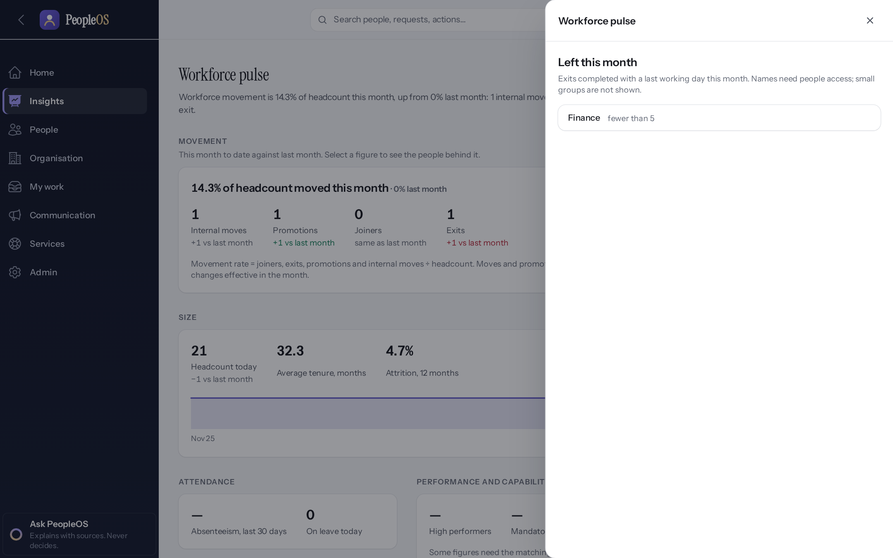
*Figure 8.2 — Clicking **Exits** opens "Left this month". The executive has no access to people records, so she sees counts by department, and a department with fewer than five people shows "fewer than 5". Demonstration data (fictional).*

**Flowchart — What a Workforce pulse drill-down shows you.** The same click shows different detail depending on your access. *Roles:* Executive, Tenant HR Admin, Auditor. *Starts:* you click a movement figure. *Ends:* the drawer lists people or department counts.

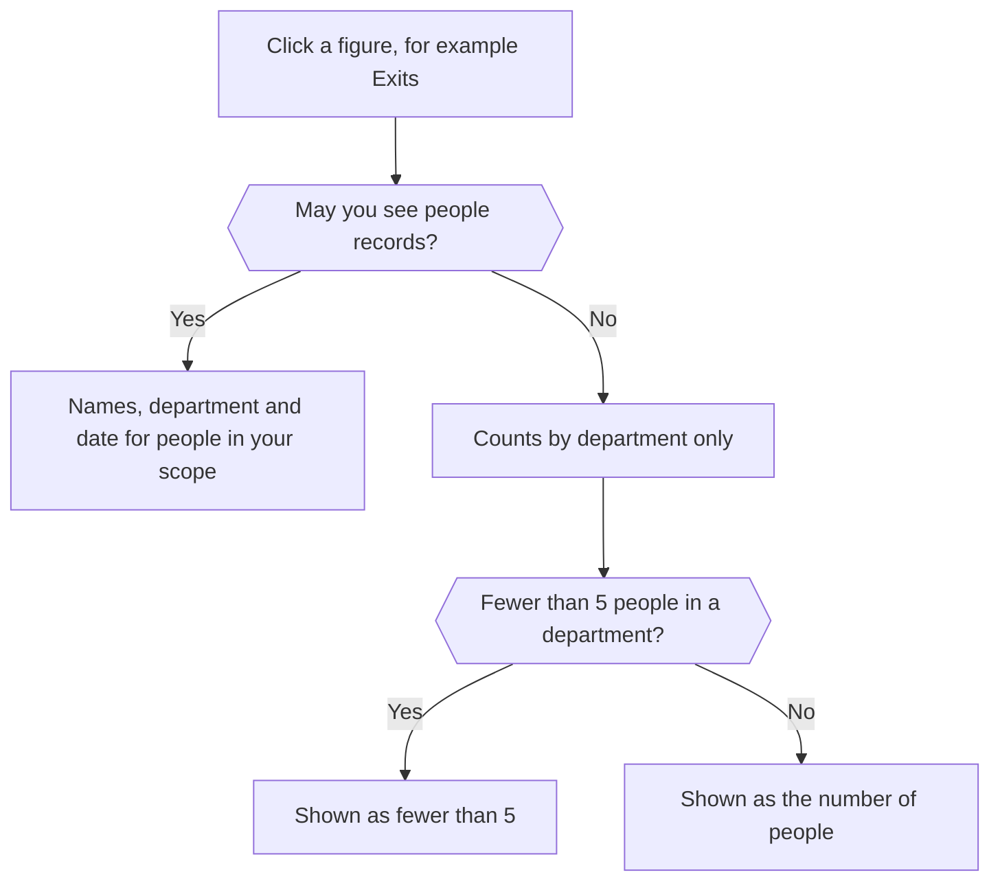

### Tasks

#### Task: Review the month and look behind a figure

**Purpose:** understand this month's workforce movement before a leadership meeting.
**Before you start:** you need one of the roles listed above.

1. Open **Insights › Analytics › Workforce Command Centre**.
2. Read the headline under **Workforce pulse**.
3. Under **Movement**, click a figure such as **Exits** or **Joiners**.
4. Read the drawer: its title (for example "Left this month") says exactly what was counted. Close it with the **×**.
5. Scroll to **Exceptions** to see whether any risk crosses its threshold.

**Expected result:** you know how many people joined, left, moved and were promoted this month, and in which departments.
**How to verify:** the drawer count matches the figure you clicked (people outside your scope are not listed).
**Common mistakes:** reading "Joiners" as people who accepted an offer. It counts people whose joining date is this month and who have actually joined. "Exits" counts completed exits with a last working day this month, not resignations still in progress.
**If it fails:** a figure showing "—" needs access you do not have. Ask your administrator if your role should include it.

#### Task: Act on items that need your decision

1. Open the Workforce pulse.
2. In **Requires a decision**, click a line such as **Your approvals**.
3. Decide on the screen that opens. The Command Centre itself never approves anything.

**Expected result:** the count goes down the next time you open the page.

### Example from everyday work

*Illustrative scenario.* On the first Monday of the month, Meera Iyer, CEO of Demo Group, opens Insights and sees that one person left in October. She clicks **Exits**; the drawer shows only "Finance — fewer than 5", because her role does not include people records. That is enough for her meeting. She asks Kavya Menon, Head of People, who can see the name, to brief her privately.

### Related modules

- **Dashboards** — the same figures as configurable tiles.
- **People analytics** — detail per HR area.
- **Approvals** (Chapter 1) — where the decisions are taken.

---

## Dashboards and the Dashboard builder

**Status:** Available with limitations: a chart or table taken from a report shows a message instead of data to viewers who may not use that report's records, and the widget types are limited to the six listed below.

### Overview

A dashboard is a board of tiles (widgets): key figures, 12-month trends, charts and tables taken from shared reports, and a "Needs attention" list for the viewer. Every organisation starts with a default dashboard called **HR overview**. The Tenant HR Admin can create more dashboards and decide which roles see each one.

### Where to find it

- **Menu path:** Insights › Analytics › Dashboards (viewer); Insights › Analytics › Dashboard builder (design)
- **Who can open it:** Dashboards: Executive, HR Manager, Tenant HR Admin, Auditor, Tenant Super Admin. Dashboard builder: Tenant HR Admin, Tenant Super Admin.
- **Set-up needed first:** none for **HR overview**. Charts and tables from reports need a shared report.

### The screen at a glance

*Figure 8.3 — The HR overview dashboard as Neha Kapoor (HR Manager) sees it. Demonstration data (fictional).*

1. **Key figure (KPI number)** — here **Headcount**. Other default tiles: **Attrition (12 mo)**, **Absenteeism (30 d)**, **People cost**.
2. **Restricted note** — Neha has no payroll or compensation access, so **People cost** shows "—" and a note.
3. **Trend (last 12 months)** — monthly bars; "Latest:" gives this month's value.
4. **Open report** — a chart taken from the shared report "Headcount by department". The link opens the report.
5. **Needs attention** — counts of things waiting for *you* (for example policies to acknowledge), each with **Go**.
6. **Report the viewer may not use** — "You cannot report on the Learning enrolments dataset." Neha's role does not include learning records, so this tile shows a message instead of data.

If more than one dashboard is available to you, a **Switch dashboard** button appears at the top right.

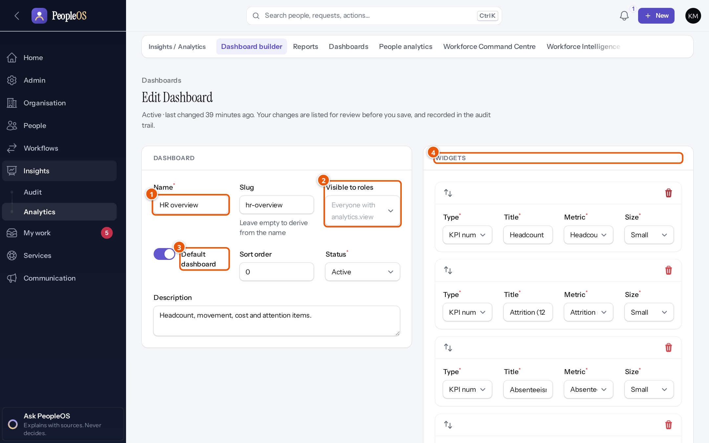
*Figure 8.4 — Editing the HR overview dashboard in the Dashboard builder (nothing was saved). Demonstration data (fictional).*

1. **Name** (required) — **Slug** is a short web name; leave it empty and PeopleOS makes one from the name.
2. **Visible to roles** — choose roles; leave it empty to show the dashboard to everyone who may open Dashboards.
3. **Default dashboard** — the board people see first. The default dashboard cannot be deleted.
4. **Widgets** — one block per tile, in the order shown; drag the arrows to reorder or use the bin to remove.

Each widget has a **Type**, a **Title** (required) and a **Size** (**Small**, **Half width** or **Full width**). The types are:

| Type | What it shows | Extra field |
|---|---|---|
| KPI number | One figure, such as Headcount or Open grievances | **Metric** |
| Trend (last 12 months) | Monthly values for headcount, joiners, exits, people cost or absenteeism | **Metric** |
| Chart from a report | The chart of a shared report | **Report** |
| Table from a report | The first rows of a shared report | **Report**, **Limit** |
| Leaderboard (top rows of a report) | The top rows of a shared report | **Report**, **Limit** |
| Needs attention counts | The viewer's own attention items | — |

The **Metric** list includes Headcount, Joiners (last 30 days), Exits (last 30 days), Attrition rate (12 months, %), Absenteeism (last 30 days, %), On leave today, People cost (last finalized payroll), Cost per head (last payroll), Average tenure (months), Women in workforce (%), High performers (latest cycle), Mandatory learning completion (%), Open service desk tickets, Open grievances, Exits in progress and Pending approvals.

### Tasks

#### Task: View a dashboard

1. Open **Insights › Analytics › Dashboards**. Your first dashboard opens.
2. If you have more than one, click **Switch dashboard**, choose a dashboard and confirm.
3. Click **Open report** under a chart to see the full report, or **Go** next to an attention item.

**Expected result:** the tiles show figures within your scope.
**If it fails:** a tile with "You cannot report on the … dataset." or "Restricted" needs access your role does not have. This is expected behaviour, not an error. Ask your administrator.

#### Task: Create or change a dashboard

**Before you start:** you need the Tenant HR Admin role. Any report you want to show must be **Shared** (see Reports).

1. Open **Insights › Analytics › Dashboard builder**.
2. Click **New dashboard**, or **Edit** on an existing one (**Open** shows it as viewers see it).
3. Enter the **Name**. Choose **Visible to roles**, **Status** (**Active** or **Draft**) and, if wanted, **Default dashboard**.
4. Click **Add to widgets** for each tile. Choose the **Type**, enter a **Title**, pick the **Metric** or **Report**, and set the **Size**.
5. When editing, enter a **Reason for change** ("Recorded in the audit trail alongside the before/after values").
6. Review the changes listed and click **Create dashboard** or **Save changes**.

**Expected result:** the dashboard appears in the list with its **Audience** and number of **Widgets**, and in **Dashboards** for the chosen roles.
**How to verify:** click **Open** in the list.
**Common mistakes:** adding a report-based tile for an audience that may not use the report's records (for example the Executive role has no access to employee records by default). Those viewers see a message instead of the chart.

### Related modules

- **Reports** — every chart and table tile comes from a shared report.

---

## People analytics

**Status:** Available

### Overview

People analytics gives one factual overview across all HR areas on a chosen date: people, workforce positions, attendance, leave, performance, learning, career and talent, compensation, HR service and engagement. Each area card appears only if you have access to that area, so a Payroll Admin and an HR Manager see different cards. Counts below the privacy threshold are suppressed, and the page shows no individual scores, rankings or predictions.

### Where to find it

- **Menu path:** Insights › Analytics › People analytics (the manager's Insights landing page)
- **Who can open it:** Tenant Super Admin, Tenant HR Admin, HR Manager, HR Executive, Executive, Payroll Admin, Attendance Admin, Manager, Auditor
- **Set-up needed first:** none.

### The screen at a glance

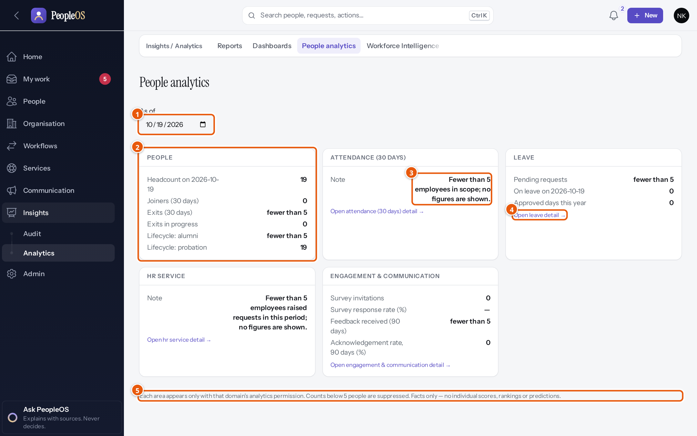
*Figure 8.5 — People analytics for an HR Manager. Demonstration data (fictional).*

1. **As of** — the date the figures describe. It starts at today; pick an earlier date to look back.
2. **Area card** — for example **People**: headcount on the date, joiners and exits in the last 30 days, exits in progress and counts by lifecycle state.
3. **Suppression note** — "Fewer than 5 employees in scope; no figures are shown."
4. **Open … detail →** — opens that area's own analytics page, if you may open it.
5. **Footnote** — "Each area appears only with that domain's analytics permission. Counts below 5 people are suppressed. Facts only — no individual scores, rankings or predictions."

### Tasks

#### Task: Look at the organisation on an earlier date

1. Open **Insights › Analytics › People analytics**.
2. In **As of**, choose a date. The cards refresh at once.
3. Click **Open … detail →** on a card for more detail.

**Expected result:** headcount and lifecycle counts reflect the chosen date.
**Common mistakes:** expecting an area you have no access to. It is not hidden by mistake; your role simply does not include it.

### Related modules

- The detailed analytics pages of each area (see "Other analytics pages" at the end of this chapter).

---

## Workforce Intelligence

**Status:** Available

### Overview

Workforce Intelligence shows aggregate attrition and capacity facts and the skills you are shortest of. It says plainly at the top: "Aggregate facts only. PeopleOS does not score, rank or predict whether any individual will leave, be promoted or be let go."

> **Note:** earlier development versions of PeopleOS calculated an "attrition risk" score for individual employees on this page. That score was removed and is not part of the product. PeopleOS does not predict or rank individuals.

### Where to find it

- **Menu path:** Insights › Analytics › Workforce Intelligence
- **Who can open it:** Executive, HR Manager, Tenant HR Admin, Tenant Super Admin, while the Workforce Analyst feature is switched on (it is on by default)
- **Set-up needed first:** record people's skills and proficiency to fill the skills table.

### The screen at a glance

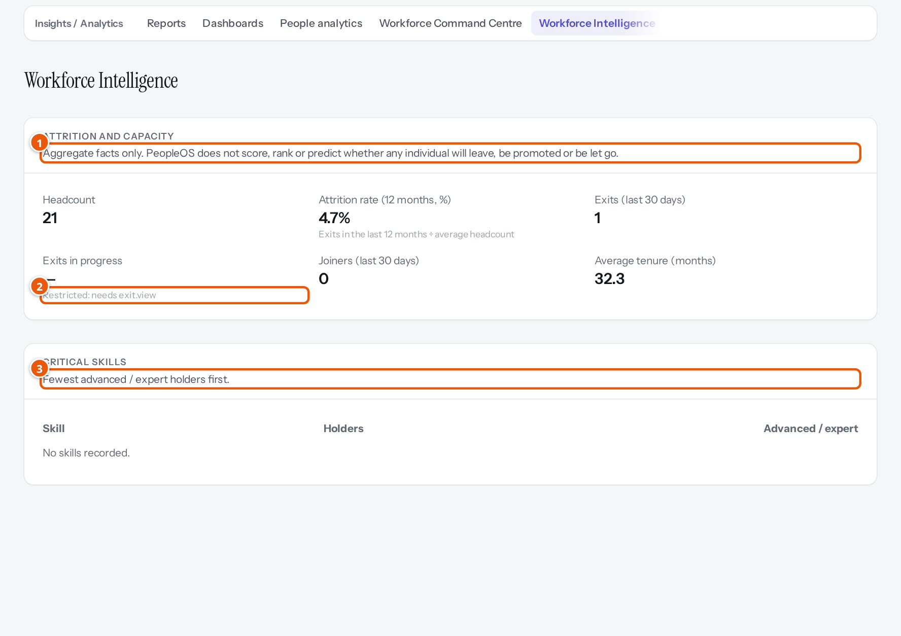
*Figure 8.6 — Workforce Intelligence for an executive. Demonstration data (fictional).*

1. **Attrition and capacity** — **Headcount**, **Attrition rate (12 months, %)**, **Exits (last 30 days)**, **Exits in progress**, **Joiners (last 30 days)** and **Average tenure (months)**, with how each is calculated where useful.
2. **Restricted** — a figure your role cannot see (here exits in progress need access to exit cases).
3. **Critical skills** — **Skill**, **Holders** and **Advanced / expert**, fewest experts first; a skill with no expert is shown in red. "No skills recorded." means no skills have been entered yet.

#### Task: Check attrition and skill coverage

1. Open **Insights › Analytics › Workforce Intelligence**.
2. Read the attrition rate and exits in progress.
3. In **Critical skills**, note skills with 0 advanced or expert holders and discuss development or hiring.

**Expected result:** you have the facts for a workforce review, without any individual being singled out.

### Related modules

- **Workforce Analyst** assistant — answers the same questions in plain words (see AI assistance).
- **Skills** (Chapter 5) — where skills are recorded.

---

## Reports

**Status:** Available with limitations:
- In this version the **Filters**, **Group by**, **Chart axis / label**, **Chart value** and **Sort by** lists on the report form contain no fields to choose from. You can choose a dataset and fields, add calculated fields, pick how the result is shown and limit the rows, but you cannot yet add a filter or a grouping from the screen. The six starter reports come with their filters and grouping already set and run correctly.
- Exports are CSV only (Excel-compatible); there is no Excel or PDF file.
- A run handles up to 10,000 rows; the screen shows the first 500.
- Scheduled reports send an in-app notice, not an e-mail, and run with the report owner's access (see Schedule a report).

### Overview

Reports let you ask your own questions of your HR data. You pick a **dataset** (a kind of record, such as employees or leave requests), choose the **fields** (columns) you want, and decide whether to see a table, a chart or a single number. You can export the result as a CSV file and, for reports you own, schedule it to run automatically. Every organisation starts with six shared starter reports.

Two rules keep reports safe:

- **A report shows only what the person running it may see.** The same shared report gives an HR Manager limited to one company fewer rows than the Tenant HR Admin. If you may not use a dataset at all, the report says "You cannot report on the … dataset."
- **Sensitive fields drop out.** A field such as **Annual CTC** is offered only to people allowed to see it, and is removed from a saved report for anyone else.

### Where to find it

- **Menu path:** Insights › Analytics › Reports
- **Who can open it:** HR Manager, Tenant HR Admin, Tenant Super Admin, Executive, Auditor
- **Set-up needed first:** none for the starter reports.

What each role can do:

| Action | Who can do it |
|---|---|
| See and run shared reports | Everyone who can open Reports |
| Create a report (**New report**) | HR Manager, Tenant HR Admin, Tenant Super Admin, Executive |
| Share a report with everyone who can see its dataset | Tenant HR Admin, Tenant Super Admin |
| Edit, delete or schedule a report | The report's owner; Tenant HR Admin and Tenant Super Admin for any report |
| **Export CSV** and download earlier exports | HR Manager, Tenant HR Admin, Tenant Super Admin |

> **Important:** the standard Executive role can open Reports but has no access to any dataset. Its dataset list is empty, and the starter reports show "You cannot report on the … dataset." Executives get their figures from the Workforce Command Centre and Dashboards, or your administrator can give them a role with the record access they need.

The datasets, and the access each needs:

| Dataset (as shown) | One row per | Needs access to |
|---|---|---|
| Employees (headcount, demographics, tenure, cost) | Employee | People records (Annual CTC also needs sensitive data and compensation access) |
| Attendance records (one row per employee per day) | Employee per day | Attendance |
| Leave requests | Leave request | Leave |
| Payroll entries (finalized and paid runs) | Payslip line in a finalised or paid payroll | Payroll |
| Exits and attrition | Exit case | Exit cases |
| Appraisals | Appraisal | Performance |
| Learning enrolments | Enrolment | Learning |
| Asset register | Asset | Assets |
| HR service desk tickets | Ticket | Service desk |

The starter reports:

| Report | Dataset | Shows as |
|---|---|---|
| Absence by department (last 30 days) | Attendance records | Bar chart |
| Exits by month | Exits and attrition | Line chart |
| Headcount by department | Employees | Bar chart |
| Mandatory learning completion | Learning enrolments | Table |
| Payroll cost by period | Payroll entries | Bar chart |
| Rating distribution (latest cycle) | Appraisals | Pie chart |

### The screen at a glance

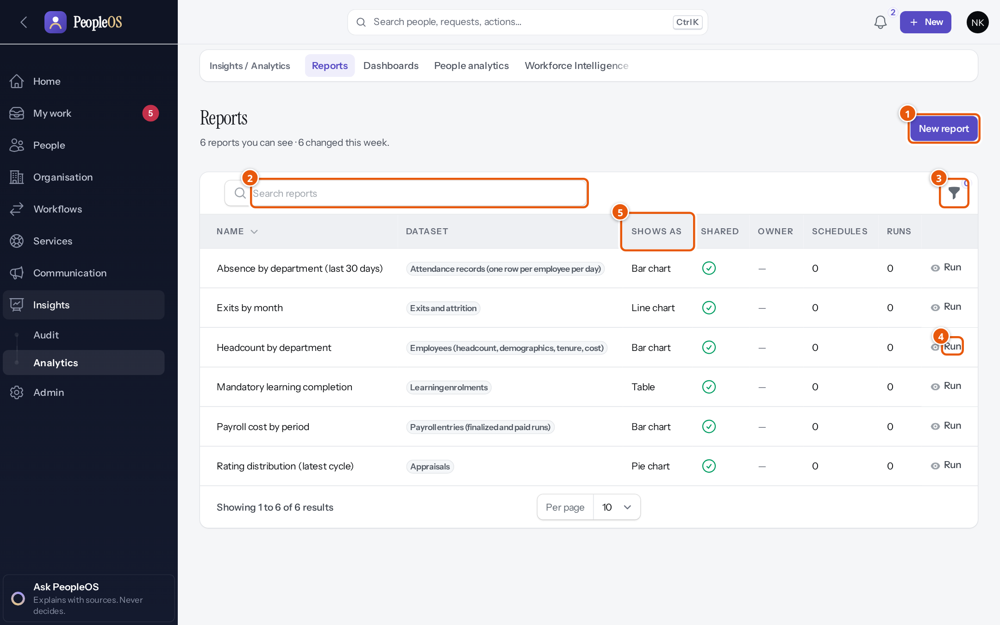
*Figure 8.7 — The Reports list with the six starter reports. Demonstration data (fictional).*

1. **New report** — opens the report form.
2. **Search reports** — find a report by name.
3. **Filter** — narrow the list by **Dataset**.
4. **Run** — runs the report and shows the result. People who may change a report also see **Edit**.
5. Columns — **Name**, **Dataset**, **Shows as** (Table, Bar chart, Line chart, Pie chart or Single number), **Shared**, **Owner** ("—" for starter reports), **Schedules** and **Runs** (how many exports have been made).

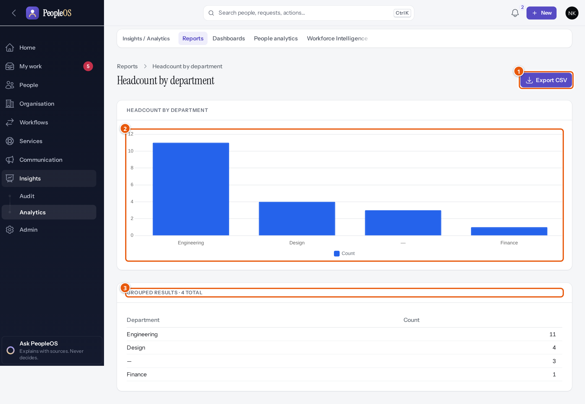
*Figure 8.8 — Running "Headcount by department". "—" groups people with no department recorded. Demonstration data (fictional).*

1. **Export CSV** — downloads the full result as a CSV file that opens in Excel.
2. **Chart** — drawn for bar, line and pie reports.
3. **Result table** — "Grouped results · 4 total" for a grouped report, or "Rows · … total (showing 500)" when a long list is cut on screen. "No rows match." means nothing met the report's conditions.

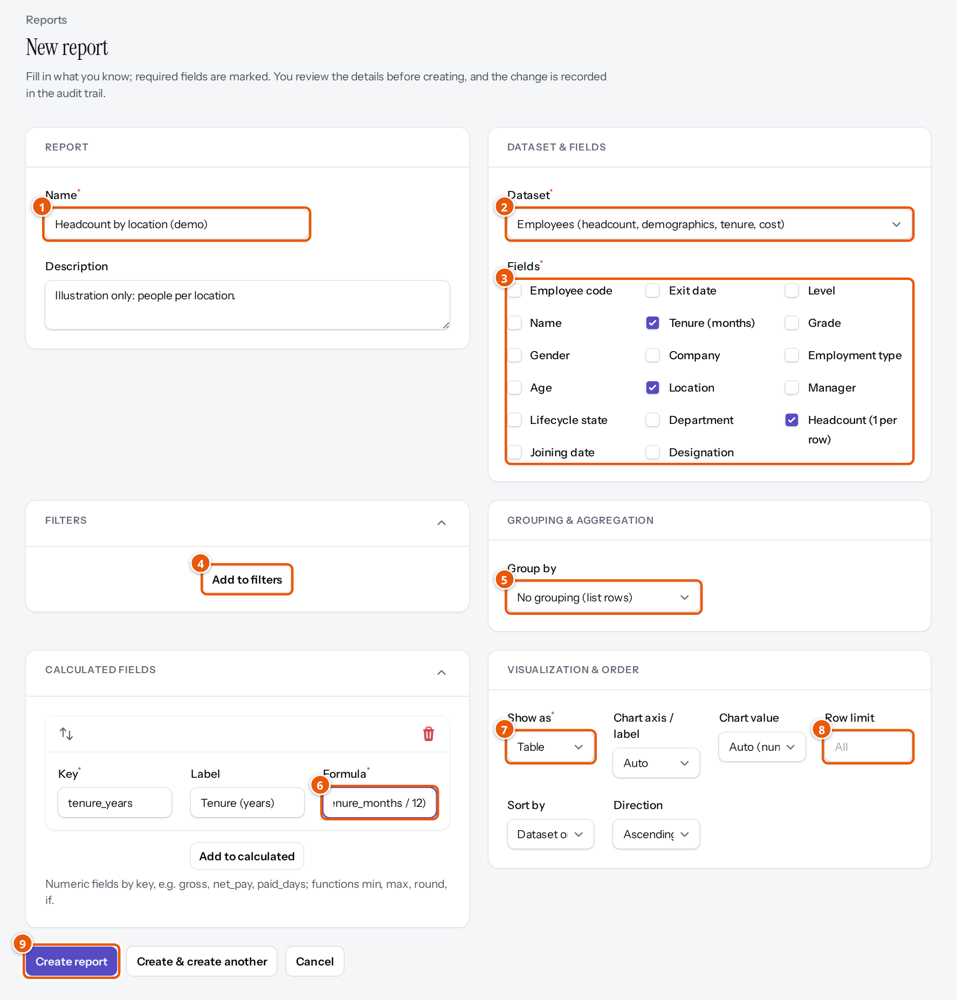
*Figure 8.9 — The New report form, filled with fictional values (not saved). Demonstration data (fictional).*

1. **Name** (required). **Description** is optional. A Tenant HR Admin also sees **Shared with everyone who can see the dataset**.
2. **Dataset** (required) — only datasets you may use are listed. It cannot be changed after the report is created.
3. **Fields** (required) — tick the columns you want.
4. **Filters** — **Add to filters** adds a row with **Field**, **Operator** and **Value**. *In this version the Field list is empty (see Status).*
5. **Group by** — "No grouping (list rows)" lists one row per record. *In this version no field can be chosen (see Status).*
6. **Calculated fields** — **Key** (letters, numbers, dashes and underscores, for example tenure_years), **Label** and **Formula** (for example round(tenure_months / 12)). Formulas use numeric field keys and the functions min, max, round, floor, ceil, abs and if. A field key is the field's short internal name (for example tenure_months for **Tenure (months)**); the form does not list the keys, so ask your administrator or Markedge if you are unsure. PeopleOS checks the formula when you save.
7. **Show as** (required) — **Table**, **Bar chart**, **Line chart**, **Pie chart** or **Single number** (a total of the first numeric column, or the row count).
8. **Row limit** — leave empty for all rows. **Sort by** and **Direction** (**Ascending** or **Descending**) order the rows.
9. **Create report** — a **Review before creating** panel lists every value first. **Create & create another** saves and starts a fresh form.

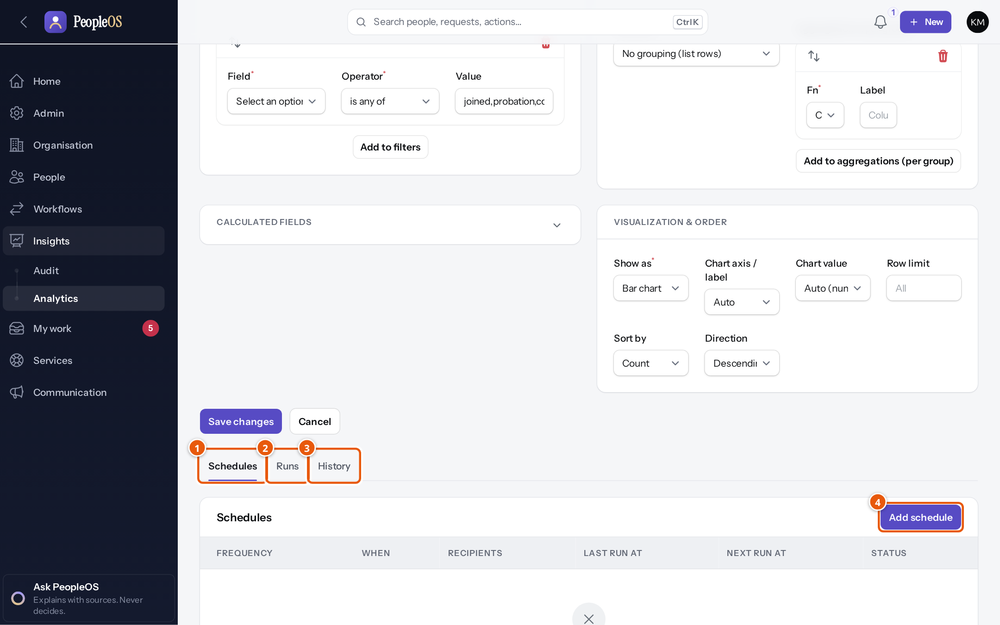
*Figure 8.10 — The tabs below the form when you edit a report: (1) **Schedules**, (2) **Runs**, (3) **History**, (4) **Add schedule**. This is the starter report "Headcount by department": note that **Field** and **Group by** show empty here although the report is filtered and grouped (see the Important note under Edit or delete your report). Demonstration data (fictional).*

- **Schedules** — **Frequency**, **When**, **Recipients**, **Last run at**, **Next run at** and **Status** (Active or Paused), with **Edit** and **Delete**.
- **Runs** — every export: **Started at**, **By** ("Schedule" for a scheduled run), **Rows**, **Format**, **Status** and **Error**, with **Download**.
- **History** — every change made to the report, from the audit trail.

**Flowchart — Building, running and scheduling a report.** *Roles:* HR Manager, Tenant HR Admin (export and schedules); anyone who can open Reports (run). *Starts:* you need figures. *Ends:* results on screen, a CSV file, or a scheduled export.

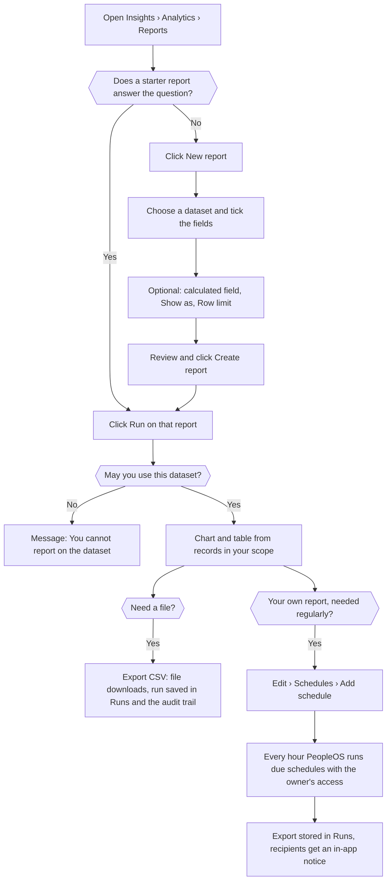

### Tasks

#### Task: Run a starter report

**Purpose:** get a quick, ready-made answer, for example headcount by department.
**Before you start:** you need access to the report's dataset (see the datasets table).

1. Open **Insights › Analytics › Reports**.
2. Click **Run** on the report, for example **Headcount by department**.
3. Read the chart and the table below it.

**Expected result:** the chart and table show only records in your scope.
**How to verify:** totals should match what you see elsewhere for your scope (for example the headcount on Dashboards).
**If it fails:** "You cannot report on the … dataset." means your role lacks that area's access. Ask your administrator.

#### Task: Export a report to CSV

**Before you start:** you need export access (HR Manager, Tenant HR Admin or Tenant Super Admin).

1. Run the report.
2. Click **Export CSV**.
3. Open the downloaded file in Excel or another spreadsheet.

**Expected result:** the file contains every row of the result (up to 10,000), with the same columns. PeopleOS records the export in the report's **Runs** and in the audit trail (action **Export**, with the number of rows).
**Common mistakes:** expecting the file to include fields you cannot see on screen. It never does.
**If it fails:** if the export fails, an error message appears and the run is recorded with status **failed** and the error.

#### Task: Create your own report

**Purpose:** list records with the columns you choose, or add a calculated column.
**Before you start:** you need the HR Manager, Tenant HR Admin or Tenant Super Admin role (or Executive with dataset access).

1. Open **Insights › Analytics › Reports** and click **New report**.
2. Enter a **Name** (required) and, if you like, a **Description**.
3. Choose the **Dataset** (required). The **Fields** list fills in.
4. Tick the **Fields** you want (at least one is required).
5. Optional: open **Calculated fields**, click **Add to calculated**, and enter a **Key**, **Label** and **Formula**. The formula can only use numeric fields you have ticked.
6. Under **Visualization & order**, choose **Show as** (required) and, if needed, a **Row limit**, **Sort by** and **Direction**.
7. Check the **Review before creating** panel, then click **Create report**.

**Expected result:** PeopleOS opens the new report and runs it. You are its **Owner**. Only you (and the Tenant HR Admin) can see it unless a Tenant HR Admin shares it.
**How to verify:** the report appears in the list with your name under **Owner**.
**Common mistakes:** a calculated field that refers to a field you did not tick shows empty values; tick the field it uses. Do not add an empty filter row: **Field** and **Operator** are required in a filter row, and in this version the **Field** list is empty, so the form cannot be saved until you remove the row with its bin icon.
**If it fails:** a formula error is shown under **Formula** (for example an unknown function). Correct it and save again.

#### Task: Schedule a report

**Purpose:** have PeopleOS run a report you own on a regular basis and keep the export ready.
**Before you start:** you must be able to edit the report: your own report, or any report if you are Tenant HR Admin. Read the note below first.

1. Open the report, click **Edit**, and scroll to the tabs below the form.
2. On **Schedules**, click **Add schedule**.
3. Choose the **Frequency** (required): **Daily**, **Weekly** (then **Day of week**) or **Monthly** (then **Day of month**, from 1 to 28).
4. Enter the **Time** (required; "24-hour, server time"; it starts at 07:00).
5. Choose one or more **Recipients** (required) and the **Status** (**Active** or **Paused**).
6. Click **Create**.

**What happens next:** every hour, PeopleOS runs schedules that are due. It runs the report exactly as if the report's owner ran it, stores the CSV under **Runs** ("By" shows "Schedule") and sends each active recipient an in-app notification: "Report ready: *report name* (*number* rows)", or "Report failed: *report name*" with the reason.

> **Important:** scheduled runs always use the access of the report's **owner**. The starter reports have no owner, so a schedule on a starter report produces a failed run ("The report owner is not an active user; scheduled runs use the owner's access."). Schedule reports that you created yourself. The same message appears if the owner's user account has been deactivated.

> **Note:** a stored export can be downloaded only by the person who produced it or, for a scheduled run, by the report's owner. Other recipients receive the notice but should run the report themselves, so that they see only what their own access allows. Notices are in-app only; no e-mail is sent.

**Expected result:** the schedule shows **Next run at**; after it runs, **Last run at** is filled and a new line appears under **Runs**.

#### Task: Download an earlier export

1. Open the report, click **Edit**, and open the **Runs** tab.
2. Click **Download** on a completed run.

**Expected result:** the stored CSV downloads. The download is recorded in the audit trail.
**If it fails:** **Download** is shown only for your own exports (and scheduled runs of reports you own). Run the report again instead.

#### Task: Edit or delete your report

1. Open the report and click **Edit** (or **Edit** in the list).
2. Change the fields or settings and click **Save changes**; or open **More** and choose **Delete**.

> **Important:** when you open a starter report for editing, its filter and grouping are not shown in the form in this version (Figure 8.10). Do not save changes to the starter reports until Markedge confirms this is fixed; ask your administrator or Markedge if a starter report needs to change.

### Statuses explained

| Status | Where | Meaning | What happens next |
|---|---|---|---|
| completed | Runs | The export finished; the file is stored | Download it (if you produced it or own the report) |
| failed | Runs | The export did not finish; **Error** says why | Fix the cause (for example the owner is inactive) and run again |
| running | Runs | The export is in progress | Refresh in a moment |
| Active | Schedules | The schedule will run at **Next run at** | Recipients get a notice after each run |
| Paused | Schedules | The schedule is kept but does not run | Edit it and choose **Active** to restart |

### Example from everyday work

*Illustrative scenario.* Neha Kapoor, HR Manager for Demo Technologies, is asked how many people each department has. She opens **Reports**, clicks **Run** on **Headcount by department**, and sees Engineering 11, Design 4, Finance 1 and 3 people with no department recorded. She clicks **Export CSV** and attaches the file to her monthly note, then asks Kavya Menon to fix the three missing departments in the employee records.

### Related modules

- **Dashboards** — show shared reports as tiles.
- **Change history** — records each export and download.

---

## Change history (the audit trail)

**Status:** Available

### Overview

PeopleOS records every material change: creating, changing, approving, rejecting, importing, exporting and deleting records; sign-ins; role and setting changes; and every look at sensitive data such as an employee's record. Each entry says **who** did it, **what** changed (each field's value **before** and **after**), **when**, and **why** (the reason entered on the form).

The trail is **tamper-evident**. Each entry is sealed with a code calculated from its own content and from the entry before it, like links in a chain. If anyone altered or removed an entry, the chain would no longer match and a check would show it. Entries cannot be edited or deleted from any screen. PeopleOS checks every organisation's chain automatically once a day.

### Where to find it

- **Menu path:** Insights › Audit › Change history (the page heading reads "Audit events")
- **Who can open it:** Tenant HR Admin, HR Manager, Payroll Admin, Auditor, Account Owner, Tenant Super Admin. People whose access is limited to part of the organisation see only entries about employees in their scope.
- **Set-up needed first:** none. Recording is always on.

### The screen at a glance

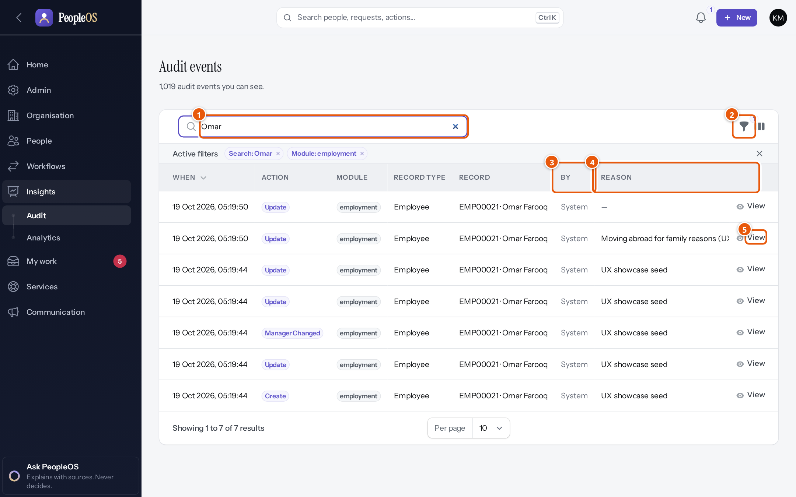
*Figure 8.11 — Change history filtered to the "employment" module and searched for "Omar". Demonstration data (fictional).*

1. **Search audit events** — searches the **Record** and **By** columns.
2. **Filter** — **Action** (for example Update, Approved, Export, Login), **Module** (for example employment, leave, payroll) and **From** / **Until** dates, then **Apply filters**. Active filters are listed under the search bar.
3. **By** — who made the change; "System" means PeopleOS itself (for example an automatic step or an import).
4. **Reason** — the reason given; "—" if none was required.
5. **View** — opens the full entry.

Other columns: **When**, **Action**, **Module**, **Record type** and **Record**. **Source** and **Request id** can be shown with the column button.

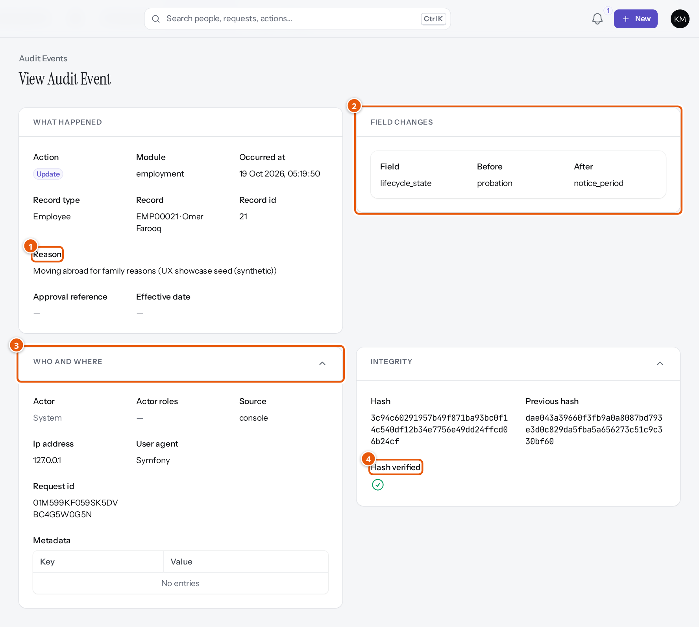
*Figure 8.12 — One change in full: Omar Farooq's lifecycle moved from probation to notice period. Demonstration data (fictional).*

1. **Reason** — in **What happened**, with **Action**, **Module**, **Occurred at**, **Record type**, **Record**, **Record id**, **Approval reference** and **Effective date** (the date from which the change applies).
2. **Field changes** — each **Field** with its **Before** and **After** value. Field names may appear in the system's internal form (for example lifecycle_state). Values of very sensitive fields are stored masked.
3. **Who and where** — **Actor**, **Actor roles**, **Source**, **Ip address**, **User agent**, **Request id** and any extra details.
4. **Integrity** — **Hash** (the entry's seal), **Previous hash** (the seal of the entry before it) and **Hash verified**: a green tick means the entry is unchanged since it was written.

People with the Auditor or Tenant Super Admin role also see **Verify integrity** at the top of the list. It re-checks the whole chain and reports, for example, "Chain intact: 1023 events verified", or "Chain broken" with the entry where the break was found.

### Tasks

#### Task: Find who changed a record and why

1. Open **Insights › Audit › Change history**.
2. Type part of the record's name (for example the employee's name or code) in **Search audit events**.
3. Optional: click the filter icon, choose an **Action** or **Module**, set **From** / **Until**, and click **Apply filters**.
4. Click **View** on the entry.
5. Read **Reason**, **Field changes** and **Who and where**.

**Expected result:** you know who changed which values, when, and the reason they gave.
**Common mistakes:** looking for a person outside your scope. Entries about employees outside your access are not listed.
**If it fails:** if you cannot find an entry you expect, ask a Tenant HR Admin or Auditor, who may have wider access.

#### Task: Check the trail has not been altered

**Before you start:** you need the Auditor or Tenant Super Admin role.

1. Open **Insights › Audit › Change history**.
2. Click **Verify integrity**.
3. Read the message.

**Expected result:** "Chain intact: *number* events verified".
**If it fails:** "Chain broken" names the first entry that does not match. Contact Markedge (your provider) immediately and do not change any data in the meantime.

### Example from everyday work

*Illustrative scenario.* An auditor asks Kavya Menon why Omar Farooq is shown as serving notice. Kavya searches "Omar" in Change history, opens the update and finds the change from probation to notice period, the reason "Moving abroad for family reasons", the time it happened and a green **Hash verified** tick.

### Related modules

- **Change intelligence** — the same trail, easier to follow for one person.
- **History** tabs on many records (for example a report or dashboard) show that record's own entries.

---

## Change intelligence

**Status:** Available

### Overview

Change intelligence reads the same audit trail but is built for investigations: you can filter by one employee or department and get a plain **Explain** view of each change, including the approval, integration or bulk operation behind it. It stores nothing of its own. Values on financial, statutory or confidential records are masked unless you may see sensitive employee data.

### Where to find it

- **Menu path:** Insights › Audit › Change intelligence (the Insights landing page for HR, payroll and administrators)
- **Who can open it:** the same roles as Change history
- **Set-up needed first:** none.

### The screen at a glance

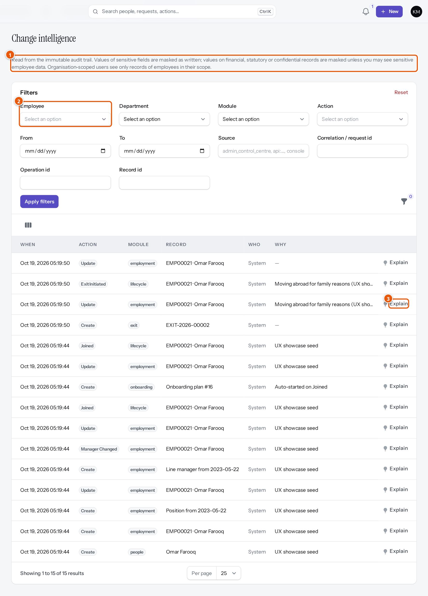
*Figure 8.13 — Change intelligence showing every recorded change for one employee, from joining to exit. Demonstration data (fictional).*

1. **Notice** — explains what is masked and that people with limited access see only their scope.
2. **Filters** — **Employee** (search by employee code), **Department**, **Module**, **Action**, **From**, **To**, **Source**, **Correlation / request id**, **Operation id** and **Record id**; click **Apply filters**, or **Reset** to clear.
3. **Explain** — opens a summary of the change: **What**, **Who**, **When**, **Why**, **Approval**, **Integration**, **Correlation**, **Operation** and **Changes** (each field as before → after).

Columns: **When**, **Action**, **Module**, **Record**, **Who** and **Why**. **Source**, **Correlation** and **Operation** can be shown with the column button. A correlation id ties together everything that happened in one request, so you can see related changes at once.

**Flowchart — Investigating a change with the audit trail.** *Roles:* Tenant HR Admin, HR Manager, Payroll Admin, Auditor, Account Owner. *Starts:* someone asks why a record looks the way it does. *Ends:* you know who changed it, when, why and whether the record is intact.

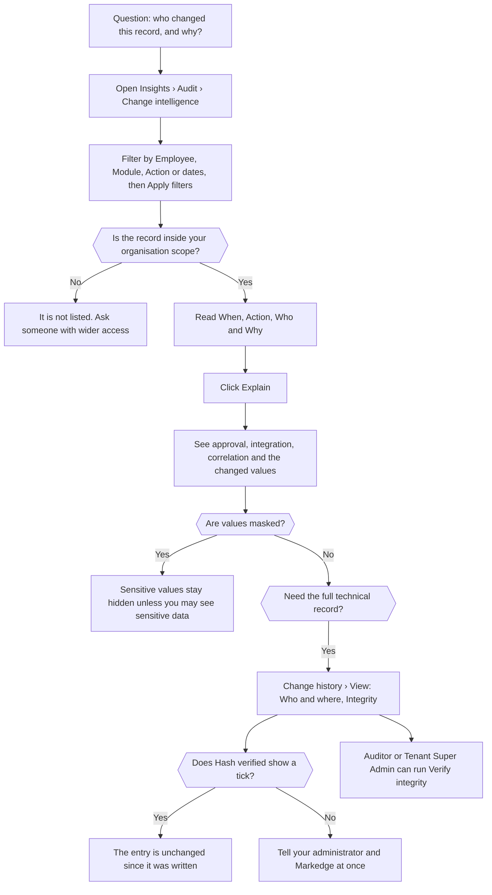

### Tasks

#### Task: Investigate everything that happened to one employee

1. Open **Insights › Audit › Change intelligence**.
2. Click the filter icon. In **Employee**, type the employee code (for example EMP00021) and choose it. Optionally add **Module**, **Action** or dates.
3. Click **Apply filters**.
4. Read the list from the newest change down. Click **Explain** on any line.
5. Click **Cancel** to close the explanation.

**Expected result:** the full story of the person's record (joining, manager changes, lifecycle changes, exit) with the reason for each step.
**Common mistakes:** searching by name in **Employee**. The filter searches employee codes.
**If it fails:** no rows means there are no recorded changes in your scope for those filters; widen the dates or ask someone with wider access.

### Example from everyday work

*Illustrative scenario.* Kavya Menon opens Change intelligence for EMP00021 (Omar Farooq). She sees him join, his onboarding plan start automatically, his line manager being set, and finally "Exit Initiated" with the reason "Moving abroad for family reasons". When Neha Kapoor tries the same, nothing is listed: Omar works outside the company Neha looks after.

### Related modules

- **Change history** — technical detail and the integrity check.
- **HR Copilot** — answers "What changed this week?" with counts and links here.

---

## AI assistance: Ask PeopleOS, the Assistant page and PeopleOS Intelligence

**Status:** Available with limitations: the assistant understands questions by matching key words, so unusual phrasing may not be understood; each question is answered on its own (it does not remember the previous question); and answers appear when complete (no word-by-word typing).

### Overview

The assistant answers questions about your HR records in plain words, for example "How many leaves do I have?", "Whose probation ends this month?" or "What is our attrition?". Five promises apply to every answer:

1. **It only uses records you are allowed to see.** It reads your data through the same rules as your screens. If a topic needs access you do not have, it says so instead of answering.
2. **It shows its sources.** Every answer lists where its facts came from, for example "Leave ledger" or "Employee 360".
3. **It never decides or changes anything.** Suggested actions only open the screen where you can act; you review and confirm there, with the usual approvals and audit. "Assistive only. No employment, pay or compensation decisions are made here."
4. **By default no outside AI service is used.** Answers are computed by PeopleOS itself. An external language model can rephrase answers only if your organisation switches it on (see below).
5. **Every interaction is logged** in **AI interactions**, so it can be reviewed later.

### Where to find it

- **Ask PeopleOS** — the button at the bottom of the left sidebar ("Explains with sources. Never decides.") opens the **PeopleOS Assistant** panel on any page.
- **Assistant page** — a full page with your conversation history. Open any personal page from the avatar menu (for example **My day**) and choose **Assistant** in the "You / Your pages" area bar, or search for "Assistant".
- **Summarise** — a button on an employee's record (Employee 360) for HR users.
- **PeopleOS Intelligence** — short notes shown on Home, the Approval Center and an employee's record.
- **Who can open it:** Employee, Manager, HR Manager, Payroll Admin, Executive, Tenant HR Admin and Tenant Super Admin, while the assistants are switched on for your organisation (they are on by default). Auditor and Account Owner do not get an assistant.

### The assistants

You see a tab for each assistant your role includes.

| Assistant | What it answers | Who gets it |
|---|---|---|
| Employee Assistant | Your leave balance and requests, latest payslip, attendance this month, open HR requests, upcoming holidays, goals, learning, assets, and "What should I do next?" | Every employee (needs an employee record) |
| Policy Assistant | Your notice period, your attendance, leave and overtime policy settings, and knowledge-base articles you may read. It never answers from general knowledge. | Every employee |
| Manager Assistant | Who is on leave or absent today, what is waiting for you, team goal progress, and team members without a one-on-one in the last 90 days | Managers (and HR roles) with current direct reports |
| HR Copilot | Probations ending, onboarding, expiring documents, background checks, workforce figures, "what needs attention", people searches in plain words (for example "Employees in Delhi who joined this year"), **Summarise** *employee code*, and "What changed this week?" (counts only) | HR Manager, Tenant HR Admin |
| Payroll Auditor | Possible problems in the latest calculated payroll run, such as duplicate bank accounts, zero or negative net pay, unusually high deductions, missing bank or PAN details, large changes in net pay or tax, and people who have left but are still in the run | Payroll Admin, Tenant HR Admin |
| Workforce Analyst | A workforce summary, 12-month trends, critical skills, attrition as an overall rate, cost and capacity | Executive, HR Manager, Tenant HR Admin |

The Tenant Super Admin can use them all. Payroll Auditor findings are indicators to check, not decisions. If you ask the Manager Assistant or Workforce Analyst who is likely to leave or be promoted, it explains that PeopleOS does not score, rank or predict individuals, and offers factual alternatives.

### The screen at a glance

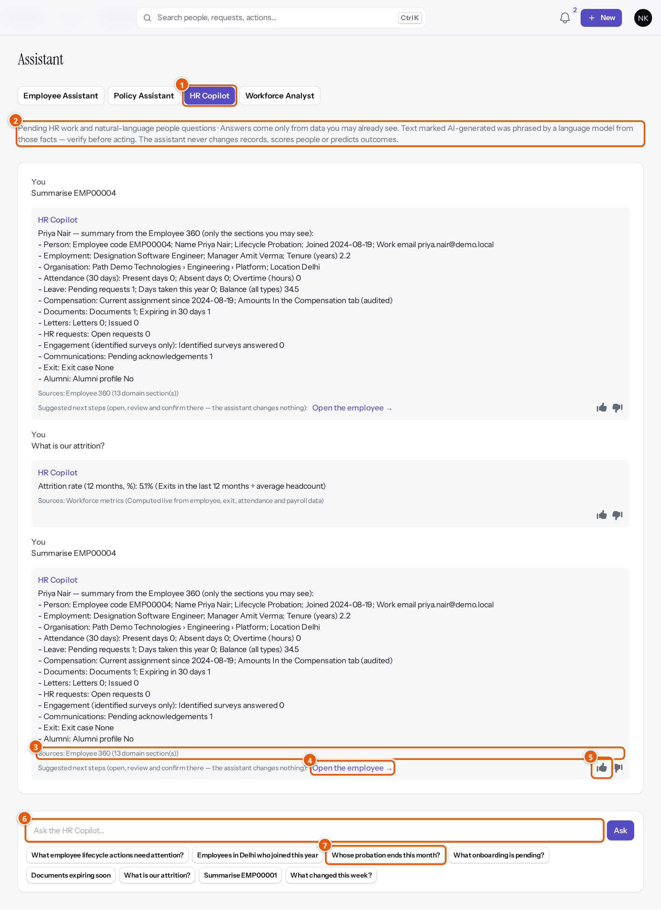
*Figure 8.14 — The Assistant page for Neha Kapoor (HR Manager) after two questions. Demonstration data (fictional).*

1. **Assistant tabs** — here **HR Copilot** is selected.
2. **What it covers** — a description of the assistant and the promise: "Answers come only from data you may already see… The assistant never changes records, scores people or predicts outcomes."
3. **Sources** — where the answer came from.
4. **Suggested next steps** — links that open a screen ("open, review and confirm there — the assistant changes nothing").
5. **Helpful / Not helpful** — thumbs to rate the answer; your rating is shown afterwards.
6. **Ask the HR Copilot…** — type a question (up to 1,000 characters) and click **Ask**.
7. **Example questions** — click one to ask it.

The page keeps your last 20 questions for each assistant. A badge **AI-generated** appears on an answer only if an external language model reworded it.

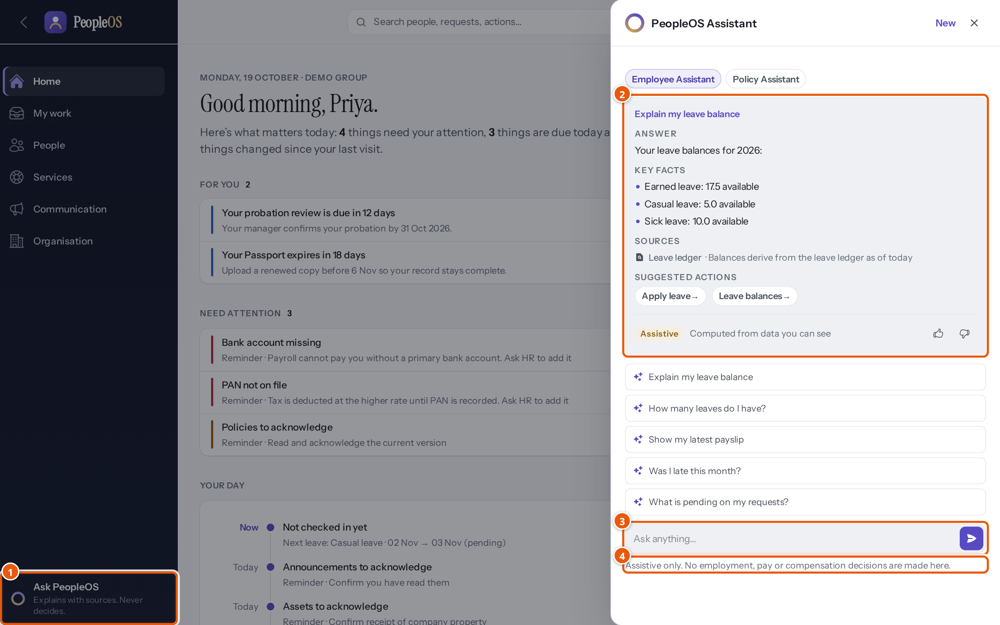
*Figure 8.15 — Priya Nair asks "Explain my leave balance" in the Ask PeopleOS panel. Demonstration data (fictional).*

1. **Ask PeopleOS** — opens the panel from any page.
2. **Answer** — the answer, **Key facts**, **Sources** and **Suggested actions** (here **Apply leave** and **Leave balances**). The footer reads **Assistive** and "Computed from data you can see", with thumbs to rate it.
3. **Ask anything…** — type your own question, or pick a suggested question above it. **New** (top) clears the conversation.
4. **Assistive only. No employment, pay or compensation decisions are made here.**

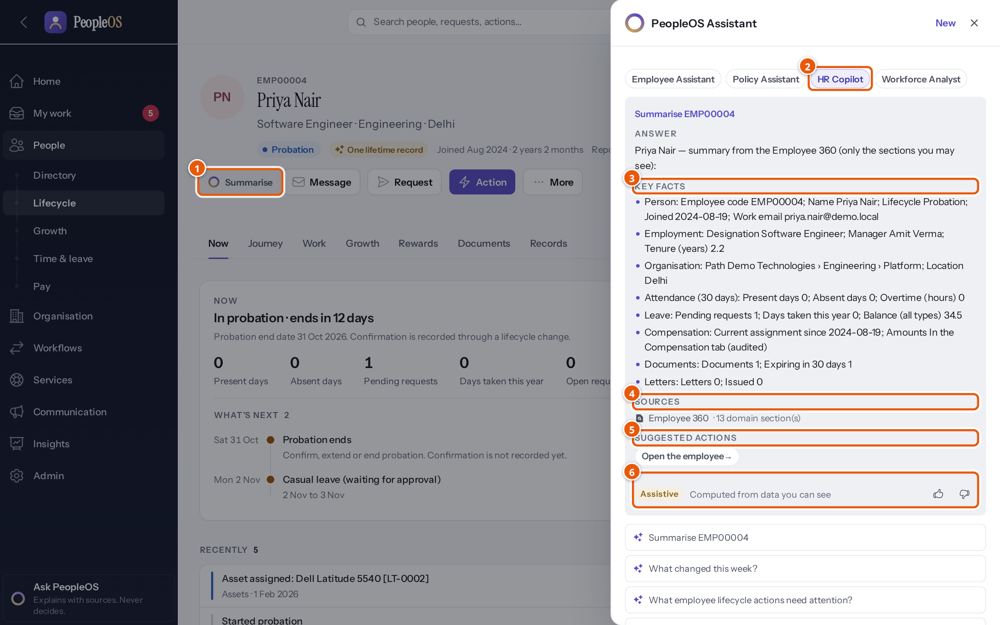
*Figure 8.16 — **Summarise** on Priya Nair's record opens the assistant with a summary. Demonstration data (fictional).*

1. **Summarise** — shown to people who have the HR Copilot.
2. **HR Copilot** — the assistant chosen automatically.
3. **Key facts** — one line per area of the record that *you* may see (person, employment, organisation, attendance, leave, compensation, documents, letters and more). Pay amounts are not repeated; the summary points to the Compensation tab instead.
4. **Sources** — "Employee 360" and how many areas were used.
5. **Suggested actions** — **Open the employee**.
6. **Assistive** footer with the rating thumbs.

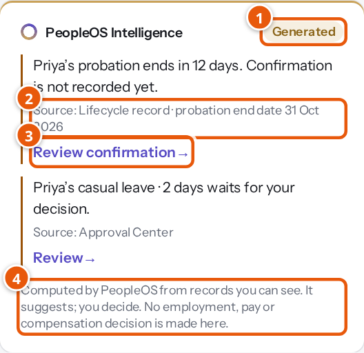
*Figure 8.17 — PeopleOS Intelligence on an employee's record. Demonstration data (fictional).*

1. **Generated** — marks the card as produced by PeopleOS, not written by a person.
2. **Source** — each note names its source, for example "Lifecycle record · probation end date 31 Oct 2026".
3. **Link** — opens the screen where you can act (here **Review confirmation**).
4. **Footnote** — "Computed by PeopleOS from records you can see. It suggests; you decide. No employment, pay or compensation decision is made here."

**Flowchart — How an AI answer is produced.** *Roles:* everyone with an assistant. *Starts:* you ask a question or click **Summarise**. *Ends:* a sourced answer, logged, with suggestions you decide on.

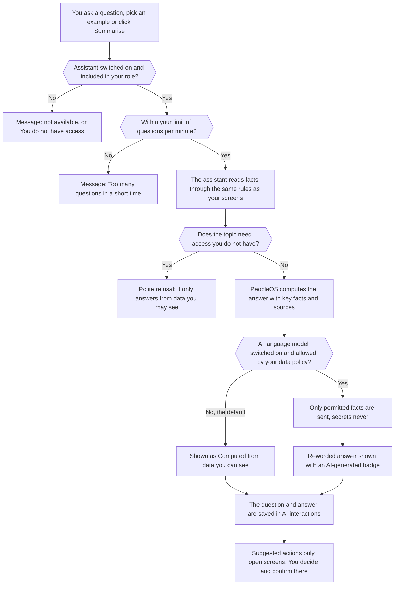

### The optional external language model

PeopleOS can let an external language model reword its computed answers so they read more naturally. This is **off by default**.

- **Admin › Setup › Feature flags** lists the feature **ai.llm** with **Enabled** set to **No**. With the standard roles, only the Tenant Super Admin can change feature flags, and each change is recorded with a reason.
- Markedge (your provider) must also connect a model provider for your organisation. Without that, nothing is sent even if the feature is on. *Set up by Markedge (provider-assisted).*
- The setting **ai.external_data_policy** (Admin › Setup › Settings) decides what may leave PeopleOS: **none** (never send anything), **allowed** (the default: allowed facts only) or **restricted** (also restricted personal data such as bank, salary or contact details). Passwords, keys, tokens and similar secrets are never sent and never stored in the log.
- Only your question, the computed facts and PeopleOS's draft answer are sent, after the data policy has removed what may not leave, and with employee codes and similar identifiers hidden. The model is told to use only those facts and never to suggest changing a record. If it fails, PeopleOS shows its own computed answer.
- Every call to the outside model is recorded in the audit trail with counts of what was removed or hidden, never the content.

### Tasks

#### Task: Ask the assistant a question

1. Click **Ask PeopleOS** at the bottom of the sidebar.
2. If you have more than one assistant, click its tab (for example **Policy Assistant** for rules, **Employee Assistant** for your own records).
3. Click a suggested question, or type your own in **Ask anything…** and press Enter.
4. Read the **Answer**, **Key facts** and **Sources**.
5. To act, click a **Suggested actions** link and complete the task on that screen.
6. Rate the answer with a thumb if you wish.

**Expected result:** a short answer from your own records, with sources.
**How to verify:** open the source screen (for example your leave balances) and compare.
**Common mistakes:** asking about something your role cannot see, or asking the wrong assistant (a policy question to the Employee Assistant). Switch tabs and ask again.
**If it fails:** messages you may see: "Too many questions in a short time. Try again in … seconds." (there is a per-person limit, 20 a minute by default); "Ask a question of up to 1000 characters."; "You do not have access to …"; "… is switched off for this tenant."; or "The assistant is not available to you". The Employee Assistant also needs your user account to be linked to an employee record ("I can only answer personal questions for a user linked to an employee record."). Contact your administrator if you think you should have access.

#### Task: Summarise an employee before a conversation

**Before you start:** you need the HR Copilot (HR Manager or Tenant HR Admin) and the employee must be in your scope.

1. Open the employee's record (People › Directory, then the person).
2. Click **Summarise** next to the name.
3. Read the **Key facts**. Use **What changed this week?** below it for recent changes.
4. Click **Open the employee** or close the panel with **×**.

**Expected result:** a one-screen summary of the areas you may see. Areas you cannot see are left out, not guessed.
**If it fails:** "You may not see that employee." means the person is outside your scope.

---

## AI interactions (the AI log)

**Status:** Available

### Overview

AI interactions is the governance log of the assistant. It lists every question and answer, which assistant answered, whether any outside model was involved, and the rating the user gave. The notes shown by PeopleOS Intelligence are logged too (assistant "intelligence", question "Context: …"). Questions can contain personal context, so only people responsible for AI governance can open the log of everyone's questions.

### Where to find it

- **Menu path:** Insights › Audit › AI interactions (the page heading reads "Ai interactions")
- **Who can open it:** Tenant HR Admin, Auditor, Tenant Super Admin
- **Set-up needed first:** none.

### The screen at a glance

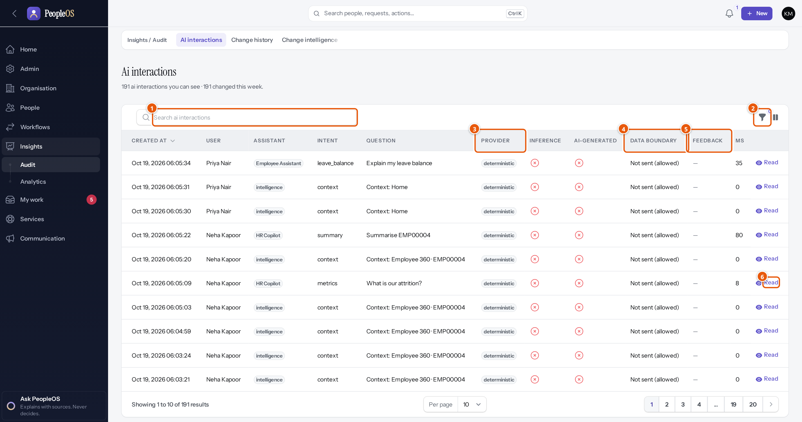
*Figure 8.18 — The AI interactions log, shown in a wide window. Demonstration data (fictional).*

1. **Search ai interactions** — search by user or question.
2. **Filter** — by **Assistant** or **Feedback** (**Helpful**, **Not helpful**).
3. **Provider** — **deterministic** means PeopleOS computed the answer itself, with no language model. If an outside model was used, its name appears here.
4. **Data boundary** — for example "Not sent (allowed)": nothing left PeopleOS, under the "allowed" data policy. If something was sent, it shows how many items were hidden or removed.
5. **Feedback** — the user's rating, or "—".
6. **Read** — opens the full **Question**, **Answer**, **Sources**, **Proposals (links only; confirmed on the domain screen)** and **Feedback note**. Click **Close** to return.

Other columns: **Created at**, **User**, **Assistant**, **Intent** (the topic PeopleOS recognised, for example leave_balance or summary), **Question**, **Inference**, **AI-generated** and **ms** (time taken).

#### Task: Review AI use

1. Open **Insights › Audit › AI interactions**.
2. Filter by **Feedback** › **Not helpful** to find answers people did not like, or by **Assistant**.
3. Click **Read** on a line to see the full exchange.

**Expected result:** you can show an auditor what the assistant was asked, what it answered, its sources, and that no data left PeopleOS.
**Common mistakes:** looking for a change to a record here. The assistant never changes records; changes are in **Change history**.

### Example from everyday work

*Illustrative scenario.* During a quarterly governance review, Kavya Menon filters AI interactions to **HR Copilot**. Every line shows the provider **deterministic** and "Not sent (allowed)". She opens Neha Kapoor's question "What is our attrition?", sees the answer (5.1%) and its source "Workforce metrics", and records in her review that no data was sent outside PeopleOS.

### Related modules

- **Change history** — every call to an outside model, if ever switched on, is also recorded there.
- **Feature flags** and **Settings** (Chapter 9) — where the AI options are controlled.

---

## Other analytics pages

These analytics pages belong to other areas of PeopleOS and are described in their own chapters. They follow the same privacy rules.

| Page (title) | What it shows | Where to find it | Who sees it | Chapter |
|---|---|---|---|---|
| Performance analytics | Review completion and rating figures by cycle and department | People › Growth › All in Growth › Analytics (Performance) | Tenant HR Admin, Auditor, Tenant Super Admin | 5 |
| Talent analytics | Bench strength for critical positions and talent figures | People › Growth › All in Growth › Analytics (Talent) | Tenant HR Admin, Tenant Super Admin | 5 |
| Learning & development | Enrolments, completion, mandatory compliance, learning hours | People › Growth › Dashboard | Tenant HR Admin, Auditor, Tenant Super Admin | 5 |
| Compensation analytics | Approved pay totals, averages and range penetration by group | People › Pay › All in Pay › Analytics | Tenant HR Admin, HR Manager, Payroll Admin, Executive, Auditor, Tenant Super Admin | 4 |
| Workforce analytics | Seats, FTE, occupied and vacant positions; plans and budgets against actuals | Organisation › Workforce › Analytics | Executive, Tenant HR Admin, Tenant Super Admin | 6 |
| HR service analytics | Request volumes, backlog and response times | Services › Service Desk › Service analytics | HR Manager, Tenant HR Admin, Tenant Super Admin | 7 |
| Exit insights | Why people leave, from exit interviews | People › Lifecycle › All in Lifecycle › Exit insights | HR Manager, Tenant HR Admin, Auditor, Tenant Super Admin | 2 |
| Survey results | Results of a survey version, with anonymity protection | Communication › Engagement › Surveys › a survey › **Results** (employees: from My HR) | HR Manager, Tenant HR Admin, Auditor; managers and participants where the survey allows | 7 |

---

## Known limitations at a glance

> **Note:** PeopleOS is not yet generally released. The points below describe the current version.

- **Report form field lists** — the Filters, Group by, Chart axis / label, Chart value and Sort by lists have no fields to choose from, so new reports cannot be filtered or grouped from the screen yet. The starter reports run correctly; avoid saving changes to them.
- **Report output** — CSV only (no Excel or PDF files); up to 10,000 rows per run; 500 rows on screen.
- **Scheduled reports** — in-app notices only (no e-mail); runs use the owner's access, so starter reports (no owner) cannot be scheduled; only the producer or owner can download a stored export.
- **Executive role** — can open Reports but has no dataset access by default; report-based dashboard tiles show a message for executives.
- **Dashboards** — six widget types; no heatmap, funnel or calendar views.
- **Assistant** — key-word understanding, one question at a time, no word-by-word display; the optional external language model is off by default and needs Markedge to connect a provider.
- **Analytics** — figures for groups of fewer than five people are always hidden, by design; some on-screen notes use system names for the access they need.
