# Administration: users, roles, configuration, security and integrations

> **In this chapter:** how your administrators give people access, shape PeopleOS to your rules, keep it secure, connect it to other systems and take a full copy of your data. It also lists what Markedge (your provider) does for you. **Who should read it:** Tenant Super Admin, Account Owner, Tenant HR Admin, and auditors who review administration.

Every organisation sets up an HR system a little differently. PeopleOS keeps those choices in screens your own administrators control: who may sign in and what they may see, the rules for codes, probation, attendance and payroll, the forms and approval workflows people use, and how strict sign-in security should be. Important changes are recorded with who made them, when, the values before and after, and the reason. Configuration changes can also wait for a second person's approval before they apply. Some things stay with Markedge, such as creating your organisation, subscriptions and verifying statutory rules. The table at the end of this chapter shows the split.

> **Note:** PeopleOS is not yet generally released. The screens in this chapter come from a demonstration organisation ("Demo Group") with fictional people. Commercial terms, hosting region, service levels and support channels are to be confirmed with the SaaS provider, Markedge.

| Module | What it is for | Where to find it | Who uses it | Status |
|---|---|---|---|---|
| All modules (Admin Centre) | One page with every module you may open, a setting finder and items waiting for you | Admin › All modules | Administrators, HR, auditors | Available |
| What do you want to configure? | Find a configuration screen by typing what you want to set up | Admin › Setup › What do you want to configure? | Most staff roles | Available |
| Change Centre | Review, approve, schedule and roll back configuration changes | Admin › Setup › Change Centre | Tenant HR Admin, Tenant Super Admin (approval), HR Manager and Auditor (read) | Available with limitations |
| Packs & Blueprints | Start from a ready-made configuration; copy configuration between organisations | Admin › Setup › All in Setup › Packs & Blueprints | Tenant HR Admin, Tenant Super Admin | Available |
| Users | Invite people, give roles and access scopes, suspend accounts | Admin › Setup › Users | Tenant HR Admin, Account Owner, Tenant Super Admin | Available |
| Roles | The ready-made roles and your own roles, with their permissions | Admin › Setup › Roles | Tenant Super Admin (edit); others read | Available |
| Settings | Organisation-wide values such as employee code format or leave year | Admin › Setup › Settings | Tenant HR Admin, Account Owner, Tenant Super Admin | Available with limitations |
| Feature flags | Switch optional features on or off | Admin › Setup › All in Setup › Feature flags | Tenant Super Admin (switch); others read | Available with limitations |
| Custom fields | Extra fields on employees, companies, departments, locations, designations and assets | Admin › Setup › All in Setup › Custom fields | Tenant HR Admin, Tenant Super Admin | Available with limitations |
| Forms | Versioned forms with optional approval of submissions | Admin › Setup › All in Setup › Forms | Tenant HR Admin; HR Manager and Auditor see the list | Available |
| Workflows | Build approval and automation flows without programming | Workflows › Workflows | Tenant HR Admin; HR Manager starts runs from the Employee 360 | Available with limitations |
| Runs | Follow every workflow run, its tasks and its log | Workflows › Workflows › Runs | Tenant HR Admin, HR Manager, Auditor | Available |
| Policies | Versioned leave, attendance, overtime, working-hours and exit rules, and who they apply to | Workflows › Policies | Tenant HR Admin; others read | Available |
| Security policy | Multi-factor sign-in, network allow-list, idle sign-out, passwords, retention | Admin › Platform › Security policy | Tenant HR Admin, Account Owner, Tenant Super Admin | Available with limitations |
| Single sign-on | Sign in with Microsoft Entra ID, Google Workspace, Okta or another OpenID Connect provider | Admin › Platform › All in Platform › Single sign-on | Tenant HR Admin, Tenant Super Admin | Available with limitations |
| API keys (including SCIM) | Credentials for other systems to read or write PeopleOS data | Admin › Platform › API keys | Tenant HR Admin, Tenant Super Admin | Available |
| Webhooks | Tell other systems the moment something happens in PeopleOS | Admin › Platform › All in Platform › Webhooks | Tenant HR Admin, Tenant Super Admin, Auditor | Available |
| Integration hub | Register the systems that send signed events into PeopleOS | Admin › Platform › Integration hub | Tenant HR Admin, Tenant Super Admin | Available |
| Inbound events | Every event received from those systems, with retry | Admin › Platform › Inbound events | Tenant HR Admin, Tenant Super Admin | Available |
| Exchange rates | Dated currency rates against your base currency | Admin › Platform › All in Platform › Exchange rates | Tenant HR Admin, Tenant Super Admin | Available with limitations |
| Country packs | Read-only view of the country frameworks and which companies use them | Admin › Platform › All in Platform › Country packs | Most staff roles | Available with limitations |
| Data export | Download an encrypted copy of all your organisation's data | Admin › Platform › All in Platform › Data export | Tenant Super Admin, Account Owner | Available |
| Getting started | First-run checklist for a newly registered organisation | Admin area and a Home banner, listed only for self-registered organisations | Account Owner and other administrators | Available with limitations |

## Who can administer what

PeopleOS ships with ready-made roles (see [Roles and permissions](#roles-and-permissions)). The table shows what the four roles that touch administration can do. The Tenant Super Admin can do everything.

| Task | Tenant Super Admin | Account Owner | Tenant HR Admin | HR Manager | Auditor |
|---|---|---|---|---|---|
| Invite users, change their roles and access scope, suspend them | Yes | Yes | Yes | See only | See only |
| Delete a user | Yes | No | Yes | No | No |
| Give the Tenant Super Admin role | Yes | No | No | No | No |
| Create or edit roles | Yes | See only | See only | No | See only |
| Change settings | Yes | Yes | Yes | No | See only |
| Switch feature flags | Yes | See only | See only | No | See only |
| Change the security policy | Yes | Yes | Yes | No | No |
| Approve or reject configuration changes | Yes | No | No | No | No |
| Publish now, discard or roll back a configuration change | Yes | No | Yes | See only | See only |
| Build custom fields, forms, policies and workflows | Yes | Policies: see only | Yes | See the lists; start workflows from the Employee 360 | See only |
| Apply packs, export or import blueprints | Yes | No | Yes | No | No |
| Single sign-on, API keys, integration hub, exchange rates | Yes | No | Yes | No | No |
| Webhooks | Yes | No | Yes | No | Yes |
| Request a full data export | Yes | Yes | No | No | No |

> **Note:** "See only" means the screen opens but its change buttons are not offered. If a button described in this chapter is missing for you, your role does not include that action; ask your administrator.

---

## Admin Centre and the setting finder

**Status:** Available

### Overview

The **Admin Centre** (menu label **All modules**) is the front door to administration. It lists every module you may open, grouped into plain-language areas such as *Organisation and positions*, *Time and leave rules* or *Access and security*. It also has a search box that finds individual settings by name, and two panels that tell you when something needs attention: configuration changes waiting for approval, and integration messages that failed.

**What do you want to configure?** is a second finder. You type what you are trying to set up, for example "working hours", and it lists the screens that deal with it.

### Where to find it

- **Menu path:** **Admin › All modules** and **Admin › Setup › What do you want to configure?**
- **Who can open it:** Admin Centre: Tenant Super Admin, Account Owner, Tenant HR Admin, HR Manager, HR Executive, Auditor. The finder: almost every staff role (Manager, Payroll Admin, Executive and others too).
- **Set-up needed first:** none.

### The screen at a glance

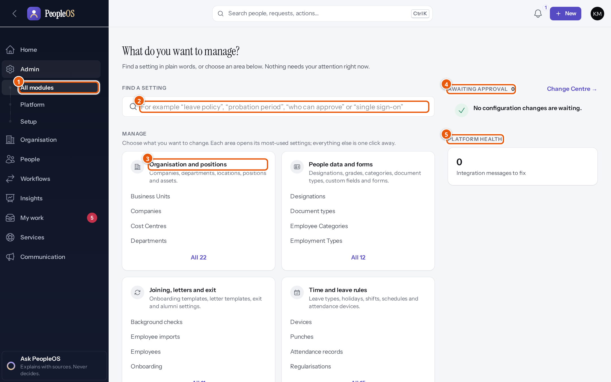
*Figure 9.1 — The Admin Centre for a Tenant HR Admin. Demonstration data (fictional).*

1. **All modules** — opens this page. The Admin section of the sidebar also offers **Platform** (security and integrations) and **Setup** (users, roles, settings and configuration).
2. **Find a setting** — type plain words, for example "probation period" or "single sign-on". Results list individual settings and the modules that match, limited to what you may open.
3. **Area cards** — each card shows the most used modules of an area. **All 22** (or another number) lists the rest.
4. **Awaiting approval** — the number of configuration changes waiting in the Change Centre, with a link.
5. **Platform health** — the number of integration messages that need attention.

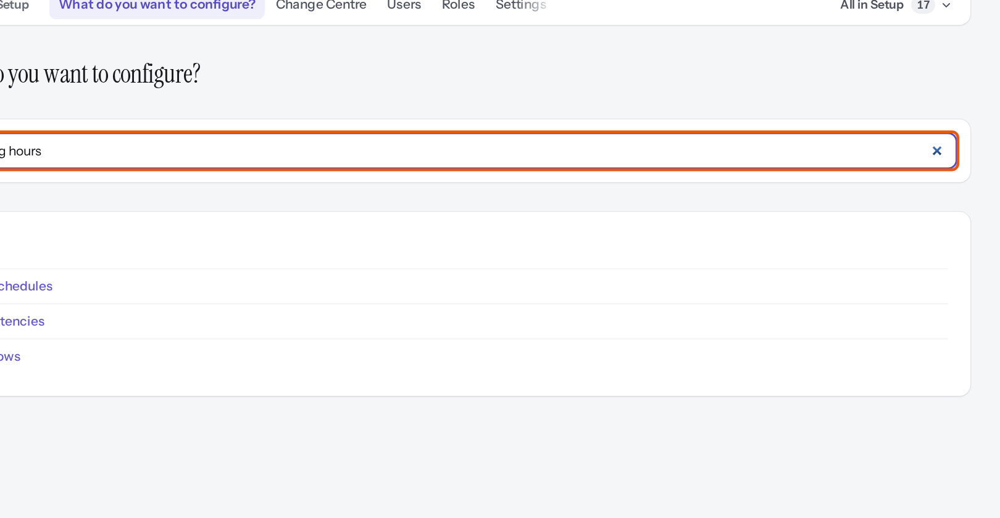
*Figure 9.2 — The configuration finder. Demonstration data (fictional).*

1. **Search box** — type what you want to set up.
2. **What do you want to configure?** — the finder's place on the **Admin / Setup** area bar, next to **Change Centre**, **Users**, **Roles**, **Settings** and the **All in Setup** menu.

> **Tip:** The finder searches a fixed map of keywords, so its list can include screens your role cannot open. The Admin Centre search only shows what you may open, and it also finds individual settings.

### Related modules

- **Change Centre** — the Admin Centre shows how many changes wait there.
- **Inbound events** and **Webhooks** — the source of the "integration messages to fix" count.

---

## Users and access

**Status:** Available

### Overview

**Users** is where you decide who can sign in to PeopleOS and what each person can reach. A user account is separate from the employee record: an employee becomes able to sign in only when an administrator invites them as a user, and sees their own records (leave, payslips, My HR) only once the account is linked to their employee record.

Three rules keep this safe:

- **Administrators never set or see passwords.** A new person receives a one-time invitation e-mail and chooses their own password. A forgotten password is reset by its owner through a link.
- **Roles decide what a person can do; the access scope decides whose records they can reach.** An access scope narrows a person's view to chosen companies, locations, departments, business units or establishments (an establishment is a registered site used for statutory data). Leave the scope empty and the person's roles apply across the whole organisation. When you choose more than one kind (for example a company *and* a location), a record must match all of them.
- **Nobody can give more than they have.** You can give any ready-made role except Tenant Super Admin. You can give one of your own custom roles only if you hold every permission in it. Only a person who already holds Tenant Super Admin (or Markedge) can give Tenant Super Admin.

Every invitation, role change, scope change, password-reset request, multi-factor reset and forced sign-out is recorded in the audit trail.

### Where to find it

- **Menu path:** **Admin › Setup › Users**
- **Who can open it:** Tenant Super Admin, Account Owner, Tenant HR Admin (all can invite and edit); HR Manager, HR Executive and Auditor (read only). Deleting a user needs Tenant HR Admin or Tenant Super Admin.
- **Set-up needed first:** companies, locations, departments and business units must exist if you want to use them in access scopes.

### The screen at a glance

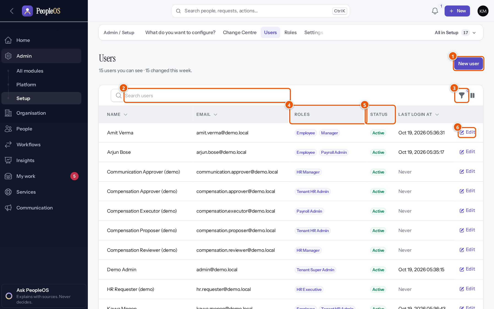
*Figure 9.3 — The Users list. Demonstration data (fictional).*

1. **New user** — invites a new person.
2. **Search users** — finds people by name or e-mail.
3. **Filter** — filter by **Status** or by **Roles**.
4. **Roles** — the roles each person holds.
5. **Status** — **Invited**, **Active** or **Suspended**.
6. **Edit** — opens the user's account, roles and access scope.

The list also shows **Last login at** ("Never" for people who have not signed in yet).

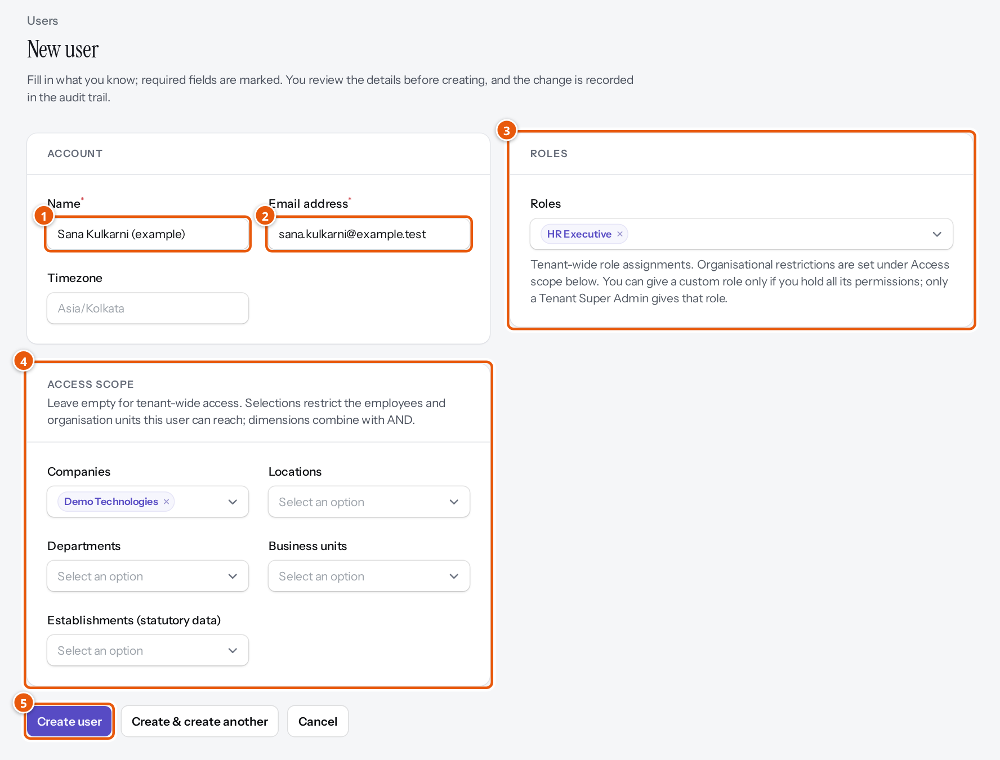
*Figure 9.4 — Inviting a new user (fictional values, not saved). Demonstration data (fictional).*

1. **Name** (required).
2. **Email address** (required, must be unique). The invitation goes here.
3. **Roles** — one or more roles. The note under the field repeats the rule about who can give which role.
4. **Access scope** — **Companies**, **Locations**, **Departments**, **Business units** and **Establishments (statutory data)**. Leave everything empty for organisation-wide access.
5. **Create user** — sends the invitation. **Create & create another** keeps the form open for the next person.

The optional **Timezone** field sets the person's time zone (for example Asia/Kolkata). A **Review before creating** panel lists what you filled in before you confirm.

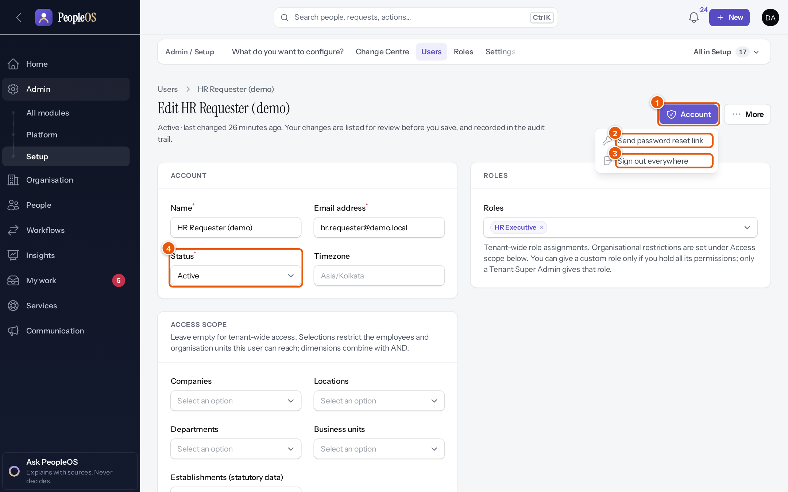
*Figure 9.5 — A user's page with the Account menu open (nothing clicked). Demonstration data (fictional).*

1. **Account** — account actions. For an active person: **Send password reset link** and **Sign out everywhere**; **Reset multi-factor authentication** appears when the person uses an authenticator app. For an invited person: **Send a new invitation** and **Revoke invitation**.
2. **Send password reset link** — e-mails the person a link to choose a new password. You never see it.
3. **Sign out everywhere** — ends the person's sessions on every device (a reason is required).
4. **Status** — switch between **Active** and **Suspended**. For an invited person the field shows **Invited** and cannot be changed ("Activated when the person accepts their invitation.").

The **More** menu holds **Delete**. A **Reason for change** box at the bottom of the form is recorded in the audit trail, and a **Your changes** panel shows each field's old and new value before you save. A **History** list at the bottom of the page shows past changes to the account: when, what, by whom, the changed values and the reason.

### Tasks

#### Task: Invite a new user

**Purpose:** let a person sign in to PeopleOS with the right roles and reach.
**Before you start:** decide which roles they need and whether their access should be limited to part of the organisation.

1. Open **Admin › Setup › Users**.
2. Click **New user**.
3. Enter **Name** and **Email address** (both required). Optionally enter **Timezone**.
4. Under **Roles**, choose one or more roles.
5. Under **Access scope**, choose companies, locations, departments, business units or establishments only if this person should be limited to them.
6. Check the **Review before creating** panel, then click **Create user**.
7. PeopleOS shows "User invited. They will receive an e-mail to set their password." The account appears with status **Invited**.

**What happens next:** the person receives an e-mail titled "You have been invited to *your organisation* on PeopleOS" with an **Accept the invitation** button. The link works once and expires after a set time (72 hours unless Markedge has configured otherwise). On the **Accept your invitation** page the person chooses a **Password** and types it again in **Confirm password**. The password must follow your [security policy](#security-policy). The account then becomes **Active**. If your organisation requires multi-factor sign-in, PeopleOS asks them to set up an authenticator app at their first sign-in, before anything else.

**Link the account to the employee record:** if the person is also an employee, open their employee record for editing (chapter 5.2), choose the account under **Login user** ("Link the employee to a portal login.") and save. Without this link they can sign in but do not see their own leave, payslips or My HR.

**Expected result:** the person signs in and sees only the modules their roles open, limited to their access scope.
**How to verify:** the user's **Status** shows **Active** and **Last login at** shows a date.
**Common mistakes:** inviting a person with a personal e-mail address you do not control; giving a broad role "for now" and forgetting to narrow it; filling the access scope when the person needs organisation-wide access.
**If it fails:**
- "You cannot assign the role "…": it grants permissions you do not hold yourself." — the role is a custom role with permissions you lack. Ask a Tenant Super Admin.
- "Only a Tenant Super Admin can assign the role "Tenant Super Admin"." — only a holder of that role (or Markedge) can give it.
- The e-mail address is already used by another account — e-mail addresses must be unique.
- "Invitations cannot be sent while the organisation is suspended." — contact Markedge.

#### Task: Resend or withdraw an invitation

1. Open **Admin › Setup › Users** and click **Edit** next to the invited person.
2. Click **Account**, then **Send a new invitation** (the previous link stops working) or **Revoke invitation** (give a reason of at least five characters).
3. If you correct the e-mail address of an invited person and save, PeopleOS sends a fresh invitation to the new address and the old link stops working.

If the person says the link does not work, they see "This invitation link is invalid or has expired. Ask your administrator to send a new one." Send a new invitation. The message is the same whatever the cause, so the link reveals nothing to a stranger.

#### Task: Change a person's roles or access scope

1. Open the user with **Edit**.
2. Add or remove roles under **Roles**, and adjust the **Access scope**.
3. Type a **Reason for change** (recommended; it is stored in the audit trail).
4. Check **Your changes**, then click **Save changes**.

Removing roles is never restricted. Adding a role follows the rule above. Each change of roles is recorded as a role change with the roles given and removed, who did it and the reason. A role the person already held does not count as "given" again, so you can edit other fields of someone who holds a role you could not give yourself.

> **Note:** Changing a person's e-mail address on an active account sends a verification e-mail to the new address; the person confirms it at their next visit.

#### Task: Suspend or reactivate an account

1. Open the user with **Edit**.
2. Set **Status** to **Suspended** (or back to **Active**), enter a **Reason for change**, and click **Save changes**.

A suspended person is signed out at their next page load and cannot sign in again until reactivated.

> **Note:** At present PeopleOS does not tell a signed-out person why. Whether the account was suspended, the organisation was suspended, the session was ended by **Sign out everywhere** or the person was idle too long, they simply land on the sign-in page with no explanation, and a suspended person who tries to sign in sees the standard sign-in failure message. Tell the person yourself when you suspend them or end their sessions.

#### Task: Help someone who lost their phone or password

- **Forgotten password:** the person can use **Forgot password** on the sign-in page, or you can click **Account › Send password reset link**. The e-mail "Reset your PeopleOS password" contains a one-time link.
- **Lost or replaced phone (authenticator app):** click **Account › Reset multi-factor authentication** and give a reason. This needs the right to manage the security policy (Tenant HR Admin, Account Owner or Tenant Super Admin). The authenticator and recovery codes are removed and the person is signed out everywhere. If your organisation requires multi-factor sign-in, they set up a new authenticator at their next sign-in. You cannot reset your own.
- **A device you no longer trust:** click **Account › Sign out everywhere** and give a reason.

#### Task: Delete a user

Prefer **Suspended**: it keeps the account and its history. If you must delete, open the user, click **More › Delete** and confirm. You cannot delete your own account.

### Statuses explained

| Status | Meaning | What happens next |
|---|---|---|
| Invited | The account exists but the person has not chosen a password. Nobody can sign in with it. | Becomes Active when the person accepts the invitation. You can resend or revoke the invitation. |
| Active | The person can sign in. | You can suspend the account at any time. |
| Suspended | Sign-in is blocked and open sessions end at the next page load. | Set the status back to Active to restore access. |

**Flowchart — Inviting a user and giving access.** From the administrator's invitation to the person's first sign-in. *Roles:* administrator (Tenant HR Admin, Account Owner or Tenant Super Admin), the invited person. *Starts:* New user. *Ends:* the person works in PeopleOS with their roles and scope.

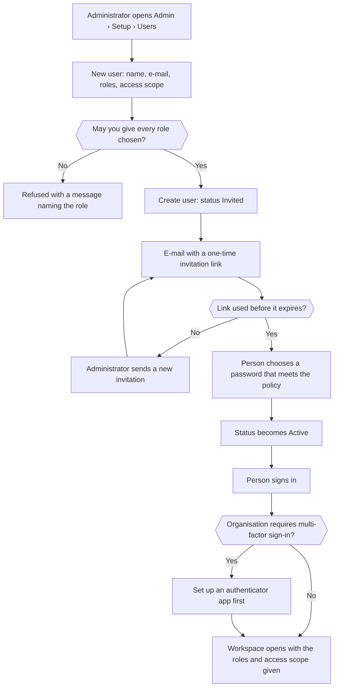

### Example from everyday work

*Illustrative scenario.* Demo Technologies hires an HR assistant who will handle only its own staff. Kavya Menon, Head of People and Tenant HR Admin, opens **Users**, clicks **New user**, enters the assistant's name and work e-mail, chooses the **HR Executive** role and, under **Companies**, picks **Demo Technologies**. The assistant accepts the invitation the same afternoon, chooses a password and signs in. Because of the access scope, the assistant sees Demo Technologies employees only, not Demo Services.

### Related modules

- **Roles** — what each role allows.
- **Security policy** — password rules and whether multi-factor sign-in is required.
- **Single sign-on** — an alternative to passwords; it can create accounts automatically.
- **Change history** (Insights › Audit) — every invitation and role change.

---

## Roles and permissions

**Status:** Available

### Overview

A **role** is a named bundle of permissions, for example "approve leave requests" or "view payroll runs". People get permissions only through roles. PeopleOS ships 14 ready-made **system roles** for every organisation; a Tenant Super Admin can also create **custom roles**. Permissions come from a fixed catalogue: you can combine them, but you cannot invent new ones.

### Where to find it

- **Menu path:** **Admin › Setup › Roles**
- **Who can open it:** Tenant Super Admin (create, edit, delete); Account Owner, Tenant HR Admin and Auditor (read only).
- **Set-up needed first:** none.

### The ready-made roles

The description in quotes is exactly what the **Roles** screen shows.

| Role | On-screen description | In plain words |
|---|---|---|
| Tenant Super Admin | "Full control of the tenant." | Every permission, including approving configuration changes, editing roles, switching feature flags, full data export and giving the Tenant Super Admin role. Give it to very few people. |
| Account Owner | "Sets up the organisation, invites people and gives them roles. Payroll, statutory and sensitive data need a specialist role, given explicitly." | The first administrator of an organisation that registered itself. Sets up companies, organisation and people data, invites users and gives roles, manages settings and the security policy, reads the audit trail, requests the full data export. It has no payroll, statutory, compensation or sensitive personal data access unless a specialist role is added. |
| Tenant HR Admin | "Configures the HRMS for the tenant." | Runs and configures almost all of HR: organisation, employees, custom fields, forms, policies, workflows, integrations, security policy, settings and users. It cannot approve configuration changes, edit roles, switch feature flags, request the full data export or give Tenant Super Admin. |
| HR Manager | "Operates HR processes." | Day-to-day HR across employees, onboarding, leave, service desk, grievances, exits, letters and engagement; proposes and reviews compensation; starts workflows; reads the Change Centre and the audit trail. |
| HR Executive | "Day-to-day HR operations." | Adds and updates employee records, uploads documents, handles onboarding tasks and applies for leave. |
| Payroll Admin | "Runs and approves payroll." | Payroll, bank and statutory details of employees, compensation execution and compliance reading. |
| Attendance Admin | "Manages attendance configuration and exceptions." | Shifts, schedules, devices, punches and attendance exceptions; reads leave and policies. |
| Performance Admin | "Manages performance cycles." | In this release the ready-made role only reads companies, organisation and people set-up (see the note below). |
| Asset Admin | "Manages company assets." | The asset register: assigning, returning, repairing and disposing of assets. |
| Manager | "People manager." | Their team: leave and attendance approvals, goals and reviews, learning, one-on-ones, exit clearance. |
| Employee | "Standard employee access." | Own records only: profile, leave, attendance corrections, payslips, documents, goals, learning, requests. |
| Executive | "Workforce Command Centre and dashboards; no transactional access." | Dashboards and analytics, with no day-to-day transactions. |
| Alumni | "Former employee: own documents and requests only." | The alumni portal and own payslips. |
| Auditor | "Read-only access with full audit visibility." | Reads almost everything, including the full audit trail and the Change Centre. |

> **Note:** Two ready-made roles behave in ways you may not expect. The **Performance Admin** role currently carries no performance permissions; to run performance cycles, give a person a role that includes them (for example a custom role). The **Auditor** role, although read-only elsewhere, may manage webhook endpoints so that it can inspect deliveries. Review both before you assign them.

### The screen at a glance

The **Roles** list shows **Name**, **Slug** (a short fixed identifier, such as hr-manager), **Description**, **System** (Yes for ready-made roles), **Permissions** (how many) and **Users** (how many people hold it). A Tenant Super Admin also sees **New role** and **Edit**.

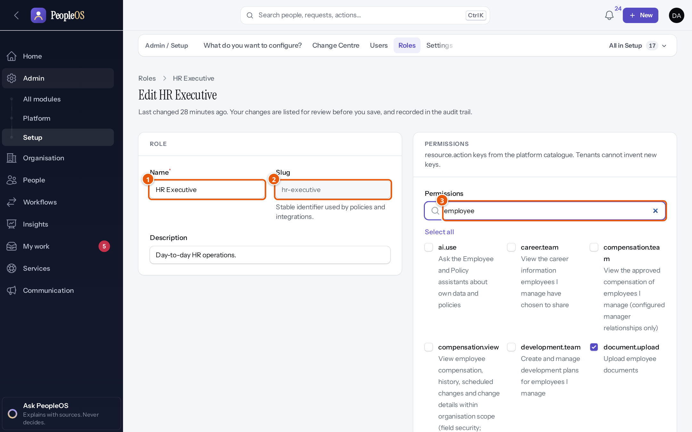
*Figure 9.6 — The permissions of a role, filtered with the word "employee" (not saved). Demonstration data (fictional).*

1. **Name** — the role's name, which you may change.
2. **Slug** — fixed for ready-made roles; used by policies and integrations.
3. **Permissions** — search box over the catalogue. Each permission shows a short code (for example employee.create) and a plain description. Ticked boxes are what the role grants. **Select all** ticks every permission shown.

### Tasks

#### Task: Create a custom role

**Purpose:** give a group of people exactly the permissions they need, for example a "Regional HR coordinator".
**Before you start:** you need the Tenant Super Admin role.

1. Open **Admin › Setup › Roles** and click **New role**.
2. Enter **Name** (required). The **Slug** fills in automatically; you may change it before saving. Add a **Description**.
3. Under **Permissions**, search and tick the permissions the role should grant.
4. Click **Create role**.
5. Give the role to people in **Users**. Limit their reach with the **Access scope** on each user.

**Expected result:** the role appears with **System** = No and the number of permissions you chose.
**How to verify:** open **Change history** (Insights › Audit): creating a role records its permissions.
**Common mistakes:** copying a broad role and forgetting to remove payroll or sensitive-data permissions; expecting the role to limit *whose* records someone sees (that is the access scope, set per user).
**If it fails:** "You cannot add permissions you do not hold yourself: …" — only someone who holds those permissions can add them.

#### Task: Change what an existing role allows

1. Open the role with **Edit**, tick or untick permissions, enter a **Reason for change**, check **Your changes**, and click **Save changes**.
2. Every permission given or removed is recorded with the reason.

> **Important:** Roles are high-risk configuration. If your organisation has switched on change approval (feature flag **configuration.approval**), saving may send the change to the Change Centre instead of applying it at once. Ready-made roles cannot be deleted. When a PeopleOS release adds a new permission to a ready-made role, PeopleOS adds it to that role in your organisation and records this in the audit trail; permissions you removed yourself are not put back.

### Related modules

- **Users** — giving roles and access scopes.
- **Change Centre** — approval of role changes when switched on.

---

## Settings

**Status:** Available with limitations (several stored settings have no effect yet; see the reference table)

### Overview

**Settings** holds organisation-wide values that PeopleOS reads while it works: the employee code format, default probation length, when the leave year starts, how payroll prorates pay, exit rules and more. Each setting has a **Key** (its name, written with dots, such as employee.code.prefix) and a **Value**. Changes apply straight away and are recorded with the old and new value and your reason.

### Where to find it

- **Menu path:** **Admin › Setup › Settings**
- **Who can open it:** Tenant HR Admin, Account Owner and Tenant Super Admin (change); Auditor (read).
- **Set-up needed first:** none. Markedge provides a value for every setting when your organisation is created.

### The screen at a glance

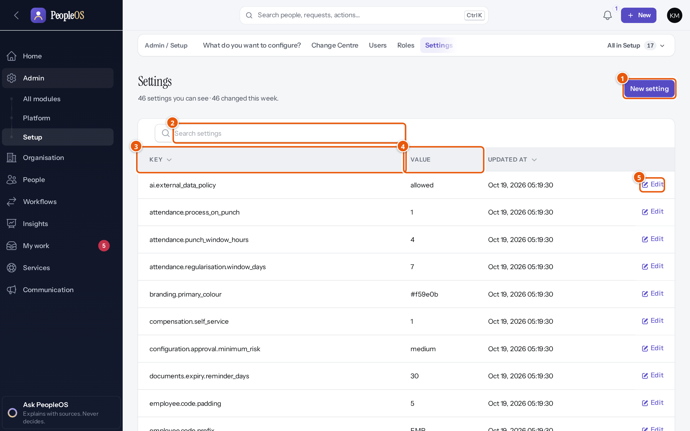
*Figure 9.7 — The Settings list. Demonstration data (fictional).*

1. **New setting** — adds a setting by key. You rarely need it: every setting PeopleOS uses already exists.
2. **Search settings** — type part of a key, for example probation.
3. **Key** — the setting's name.
4. **Value** — its current value. For on/off settings, on shows as 1 and off appears empty.
5. **Edit** — change the value.

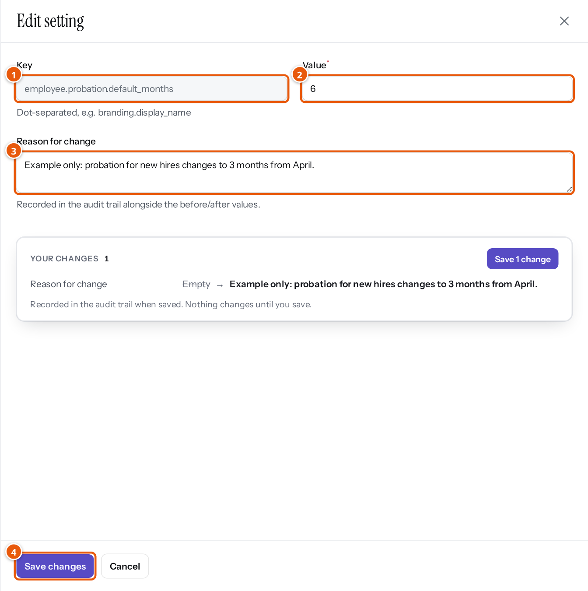
*Figure 9.8 — Editing a setting with a fictional reason (cancelled, not saved). Demonstration data (fictional).*

1. **Key** — cannot be changed.
2. **Value** (required).
3. **Reason for change** — stored in the audit trail with the before and after values.
4. **Save changes** — applies the new value at once. The **Your changes** panel shows what will change first.

### Task: Change a setting

1. Open **Admin › Setup › Settings** and search for the key.
2. Click **Edit** on its row.
3. Enter the new **Value** in the form the reference table shows (a number, 1 for on and 0 for off, or one of the listed words).
4. Type a **Reason for change**, then click **Save changes**.

**Expected result:** the row shows the new value and a new **Updated at** time.
**Common mistakes:** typing "yes" instead of 1; mistyping a word value (for example "Basic" instead of basic); editing the security keys here instead of on the **Security policy** page, which shows them with explanations.
**If it fails:** settings cannot be deleted. If you entered a wrong value, edit it again; the audit trail shows the previous value.

> **Important:** Settings changes apply immediately. They do not wait in the Change Centre, even when change approval is switched on. Agree risky changes (leave year, payroll proration) with the people affected before you save.

### Settings reference

"Who is affected" names the people whose work changes. "Reversible" means you can set the old value again; work already done with the new value is not recalculated unless the table says so. Defaults are the values PeopleOS provides for a new organisation.

**Employees and documents**

| Setting (as shown) | What it controls | Effect of changing it | Who is affected | Reversible? | Risks |
|---|---|---|---|---|---|
| employee.code.prefix (default EMP) | Letters at the start of automatically generated employee codes | New employees get codes with the new prefix; numbering continues after the highest code already using that prefix. Existing codes do not change. | HR when hiring; systems that read employee codes | Yes, for future codes | Two code formats in reports and integrations |
| employee.code.padding (default 5) | Number of digits in the code (EMP00001) | Applies to new codes only | HR; integrations | Yes, for future codes | Mixed code lengths |
| employee.probation.default_months (default 6) | Probation length used when a hire has no probation end date of its own | New hires and pre-employees get the new default | HR; new joiners | Yes | Existing employees are not changed |
| employee.probation.reminder_days (default 14) | How many days before probation ends PeopleOS raises "Probation ending soon" | The daily reminder uses the new window; workflows and notifications listening for it start earlier or later | HR, managers | Yes | Very small values leave little time to act |
| employee.joining.reminder_days (default 3) | Days before a joining date that "Joining date approaching" is raised | Same, for joiners | HR, onboarding owners | Yes | — |
| documents.expiry.reminder_days (default 30) | Days before a document expires that "Document expiring" is raised | Same, for documents | HR, employees | Yes | — |

**Attendance and leave**

| Setting (as shown) | What it controls | Effect of changing it | Who is affected | Reversible? | Risks |
|---|---|---|---|---|---|
| attendance.punch_window_hours (default 4) | How many hours before a shift starts and after it ends a punch still counts for that shift | Attendance calculated from now on uses the new window | Everyone with a shift | Yes; days are recalculated only when attendance is processed again | Too small: real punches fall outside the shift and become exceptions |
| attendance.regularisation.window_days (default 7) | How many days back an employee may ask to correct attendance, unless their attendance policy sets its own window | Requests older than the window are refused: "Regularisation is only allowed within N days." | Employees, managers | Yes | — |
| attendance.process_on_punch (default 1) | Whether a day is recalculated as soon as a punch arrives | 0: punches are stored and the day is calculated at the nightly processing or a manual reprocess | Employees, attendance staff | Yes | Off: same-day attendance views lag behind |
| leave.year_start_month (default 1) | Month the leave year starts (1 = January, 4 = April) | Balances, accruals and carry-forward are counted in the new leave year | Everyone who takes leave | Technically yes, but avoid | High: change it only at a year boundary and after checking balances with HR |
| leave.exclude_weekly_offs, leave.exclude_holidays (default 1) | Not used today | No effect. Whether weekly offs and holidays count inside a leave span is set in each leave **policy** ("Count weekly offs inside a leave span", "Count holidays inside a leave span"). | — | — | Changing them misleads readers |

**Payroll and compensation**

| Setting (as shown) | What it controls | Effect of changing it | Who is affected | Reversible? | Risks |
|---|---|---|---|---|---|
| payroll.lop_from_attendance (default 1) | Whether loss-of-pay days come from processed attendance | 0: payroll takes no loss of pay from attendance; only loss of pay entered by hand | Payroll; every paid employee | Yes, before a run is calculated | Under- or over-payment if changed mid-cycle |
| payroll.proration_basis (default calendar_days) | How partial months are prorated: calendar_days, working_days or fixed_days | New calculations use the new basis. working_days needs attendance for every day of the period, otherwise calendar days are used and an exception is shown | Payroll; joiners and leavers | Yes, before calculation | Changing between runs makes months hard to compare |
| payroll.proration_fixed_days (default 30) | The divisor when the basis is fixed_days | As above | Payroll | Yes | — |
| payroll.negative_net_policy (default block) | What happens when deductions exceed earnings: block, or allow | Anything other than allow marks the entry with the exception "Deductions exceed earnings; net pay is negative." | Payroll | Yes | allow lets negative pay through unnoticed |
| payroll.adjustments.require_approval (default 0) | Whether payroll adjustments need approval | 1: new adjustments start as pending until approved | Payroll | Yes | — |
| payroll.payslip.prefix (default PS) | Start of payslip numbers (PS-YYYYMM-employee code) | New payslips use the new prefix | Payroll, employees | Yes, for new payslips | Two numbering styles |
| compensation.self_service (default 1) | Whether employees see their own approved compensation | 0: employees no longer see it | All employees | Yes | — |

**Exit and final settlement**

| Setting (as shown) | What it controls | Effect of changing it | Who is affected | Reversible? | Risks |
|---|---|---|---|---|---|
| exit.notice_days (default 30) | Default notice period for resignations when none is given | New exit cases use it | HR, leavers | Yes | Existing cases keep their notice |
| exit.clearance_lead_days (default 7) | Clearance tasks start automatically when the last working day is this close | New exits | HR, clearance teams | Yes | — |
| exit.encashment_basis (default basic) | Leave encashment in the final settlement uses monthly basic or gross pay: basic or gross | New settlements | Payroll, leavers | Yes, before settlement | Cost difference |
| exit.notice_recovery (default 1) | Whether a notice shortfall is deducted in the final settlement of a resignation | 0: no deduction | Payroll, leavers | Yes, before settlement | — |
| exit.it_clearance_role (default asset-admin), exit.finance_clearance_role (payroll-admin), exit.hr_clearance_role (tenant-hr-admin) | Which role receives IT and asset, finance, and HR clearance tasks. The value is the role's **Slug** from the Roles screen | New clearances go to holders of that role | Clearance teams | Yes | A misspelt slug leaves tasks without a role |

**Security and retention** (change these on the **Security policy** page, which explains each field)

| Setting (as shown) | What it controls | Effect / notes |
|---|---|---|
| security.ip_allowlist | Networks allowed to use PeopleOS | See [Security policy](#security-policy) |
| security.mfa_required (default 0) | Whether everyone must use an authenticator app | See Security policy |
| security.session_idle_minutes (default 0) | Sign out after this many idle minutes (0 = never) | See Security policy |
| security.password_min_length (default 10) | Minimum password length | See Security policy |
| security.password_expiry_days (default 0) | Intended password expiry | **No effect today** (stored but not enforced) |
| retention.ai_interactions_days (365), retention.notification_deliveries_days (180), retention.report_runs_days (90) | How long these records are kept | Deleted by a nightly clean-up; 0 keeps them |
| warehouse.export_enabled (default 0), warehouse.retention_days (30) | The daily data warehouse feed and how long its snapshots are kept | See Security policy |
| security.password.min_length (12), security.session.lifetime_minutes (120) | Older keys | **No effect.** Use the Security policy fields instead |

**Configuration, AI and data**

| Setting (as shown) | What it controls | Effect of changing it | Who is affected | Reversible? | Risks |
|---|---|---|---|---|---|
| configuration.approval.minimum_risk (default medium) | Lowest risk level that waits for approval when change approval is on: low, medium or high | low: almost every configuration edit waits; high: only high-risk edits wait | Administrators | Yes | low can slow everyday upkeep |
| ai.external_data_policy (default allowed) | What may be sent to an external AI provider when the AI language model is switched on: none, allowed (allowed facts only) or restricted (also restricted personal data; never prohibited data such as passwords) | none: nothing leaves PeopleOS even if the AI language model flag is on | Everyone using Ask PeopleOS | Yes | restricted sends personal data such as pay or contact details to the provider |
| warehouse.include_sensitive (default 0) | Whether the warehouse feed includes sensitive fields | 1: sensitive fields are exported too | Data recipients | Yes, for future exports | Personal data leaves PeopleOS |

**Branding and locale (no effect today)**

| Setting (as shown) | Notes |
|---|---|
| branding.display_name, branding.primary_colour | Stored but not used. PeopleOS uses its own look. |
| locale.date_format, locale.time_format, tenant.locale | Stored but not used. |
| tenant.base_currency | Stored but not used as a setting. Your base currency (shown on **Exchange rates**) is part of your organisation's profile, maintained by Markedge. |

---

## Feature flags

**Status:** Available with limitations (the Description column is empty on screen; two flags have no effect)

### Overview

**Feature flags** switch optional features on or off for your whole organisation. Only a Tenant Super Admin can change them. Changes apply straight away and are recorded with your reason. Like settings, they do not wait in the Change Centre.

### Where to find it

- **Menu path:** **Admin › Setup › All in Setup › Feature flags**
- **Who can open it:** Tenant Super Admin (change); Account Owner, Tenant HR Admin and Auditor (read).

### The screen at a glance

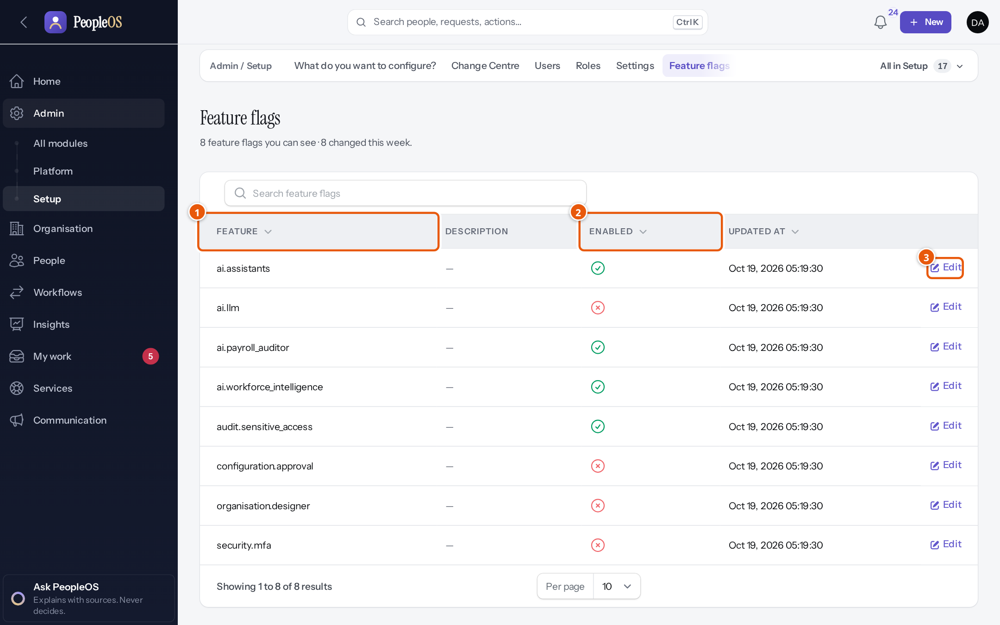
*Figure 9.9 — Feature flags as a Tenant Super Admin sees them. Demonstration data (fictional).*

1. **Feature** — the flag's name.
2. **Enabled** — a green tick for on, a red cross for off.
3. **Edit** — opens a dialog with an **Enabled** switch and a **Reason for change** box.

> **Note:** The **Description** column currently shows a dash for every flag. Use the reference table below.

### Feature flags reference

| Flag (as shown) | What it does | Default |
|---|---|---|
| ai.assistants | The Employee, Policy and Manager assistants and the HR Copilot. Off: these assistants disappear for everyone. | On |
| ai.payroll_auditor | The Payroll Auditor page and assistant, which look for unusual values in payroll runs. | On |
| ai.workforce_intelligence | The Workforce Intelligence page and the Workforce Analyst assistant (aggregate trends only). | On |
| ai.llm | Sends permitted facts to the language-model provider configured by Markedge for written answers. Off: answers are produced by PeopleOS alone. What may be sent is limited by the setting ai.external_data_policy. | Off |
| audit.sensitive_access | Records an audit entry every time someone views sensitive fields such as bank or statutory details. Off: those views are no longer recorded. | On |
| configuration.approval | Sends medium- and high-risk configuration edits to the Change Centre for approval (the threshold is the setting configuration.approval.minimum_risk). | Off |
| organisation.designer | No effect today. Access to the Organisation Designer is decided by role. | Off |
| security.mfa | No effect today. Whether multi-factor sign-in is required is set on the Security policy page; people can always set up an authenticator voluntarily. | Off |

> **Important:** Switching off **audit.sensitive_access** removes a safeguard that auditors and data-protection officers may rely on. Agree it with them first.

---

## Change Centre

**Status:** Available with limitations (covers only the edit screens of certain configuration records; see below)

### Overview

The **Change Centre** is where governed configuration changes are reviewed. When your organisation switches on the feature flag **configuration.approval**, saving an edit to a governed configuration record whose risk is at or above the threshold does not change the record. PeopleOS shows "Submitted for approval" and the change waits in the Change Centre until someone approves it. Each waiting change shows what will change (before and after), how many employees it affects, the requester and the reason.

Approving publishes the change at once, or on its effective date if that date is in the future. Any published change can be **rolled back**: PeopleOS creates a new change that restores the previous values. Nothing is ever deleted from the history.

**Which edits are governed.** Each type of configuration record has a risk level:

| Risk | Records (edit screen) |
|---|---|
| Low | Designations, departments, teams, locations, employee categories, employment types, work modes, job families, levels, grades, skills, courses, learning paths, asset categories and models, competencies, KRAs, career paths |
| Medium | Companies, business units, divisions, cost centres, profit centres, salary components and structures, company statutory profiles, custom fields, forms, policies |
| High | Roles, single sign-on connections, webhook endpoints |

With the default threshold (**medium**), medium- and high-risk edits wait for approval and low-risk edits apply at once.

> **Note:** The Change Centre covers saving the main edit form of these records. Creating or deleting records, editing a policy's versions or assignment rules, a form's fields, a workflow's builder, **Settings** and **Feature flags** apply immediately (all are still audited). With approval switched off, edits apply at once, are audited, and do not appear in the Change Centre.

### Where to find it

- **Menu path:** **Admin › Setup › Change Centre**
- **Who can open it:** Tenant HR Admin and Tenant Super Admin (act); HR Manager and Auditor (read).
- **Who can approve or reject:** among the ready-made roles, only the Tenant Super Admin. Tenant HR Admins can **Publish now**, **Discard** and **Roll back**.
- **Set-up needed first:** a Tenant Super Admin switches on **configuration.approval** in **Feature flags**, and optionally sets **configuration.approval.minimum_risk** in **Settings**. The Enterprise configuration pack switches approval on.

### The screen at a glance

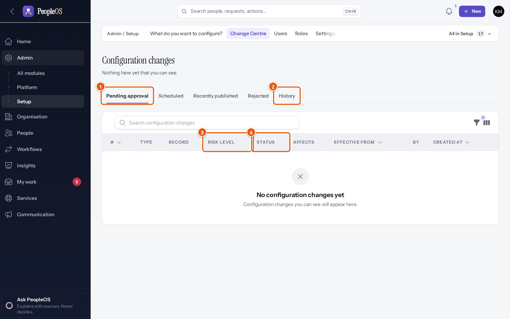
*Figure 9.10 — The Change Centre (no changes in the demonstration). Demonstration data (fictional).*

1. **Pending approval** — changes waiting for a decision (the default tab). The other tabs are **Scheduled**, **Recently published** (the last 30 days) and **Rejected** (rejected and discarded).
2. **History** — every change.
3. **Risk level** — Low, Medium or High.
4. **Status** — see the table below.

Other columns: **#** (change number), **Type**, **Record**, **Affects** (employees affected), **Effective from** ("Now" when immediate), **By** (requester) and **Created at**. Filters: **Risk level** and **Status**. Clicking a change opens its detail page with the sections **Change**, **What changes** (field, before, after), **Impact preview** and **Review**.

### Tasks

#### Task: Approve or reject a configuration change

**Before you start:** you need the right to approve (Tenant Super Admin among the ready-made roles).

1. Open **Admin › Setup › Change Centre**. The **Pending approval** tab opens.
2. Click a change to open it. Read **What changes** and **Impact preview**.
3. Click **Approve** (an optional note) or **Reject** (a note is required).
4. An approved change publishes immediately, unless it has a future effective date; then it becomes **Scheduled** and is published on that date. **Publish now** publishes a scheduled change early.

**Expected result:** the record shows the new values; the change shows **Published**, with your name under **Review**.
**If it fails:** "Not allowed" with a message such as "Change #12 is Published, expected Pending Approval." means someone acted on it before you. Refresh the page.

> **Note:** PeopleOS does not stop a person approving a change they proposed themselves. If you need two different people, give the approval right only to people who do not make configuration changes.

#### Task: Roll back a published change

1. Open the change in the **History** or **Recently published** tab.
2. Click **Roll back** and enter a **Reason** (required).
3. PeopleOS creates a new change marked as a rollback that restores the previous values. If approval applies, the rollback itself waits for approval. The original change shows **Rolled Back**.

#### Task: Discard a change that is no longer wanted

Open a **Pending approval** or **Scheduled** change, click **Discard**, optionally add a note, and confirm. The record stays as it is.

### Statuses explained

| Status | Meaning | What happens next |
|---|---|---|
| Pending Approval | Waiting for a decision; the record is unchanged | Approve, reject or discard |
| Scheduled | Approved, with an effective date in the future | Published on that date or with Publish now; can be discarded |
| Published | Applied to the record | Can be rolled back |
| Rejected | Refused by the approver | Nothing more; propose again if needed |
| Discarded | Withdrawn before it applied | Nothing more |
| Rolled Back | Undone by a later rollback change | The rollback change shows its own status |

**Flowchart — Changing configuration through the Change Centre.** How a governed edit travels when change approval is switched on. *Roles:* administrator who edits, approver (Tenant Super Admin). *Starts:* saving an edit form. *Ends:* the change is published, rejected or discarded.

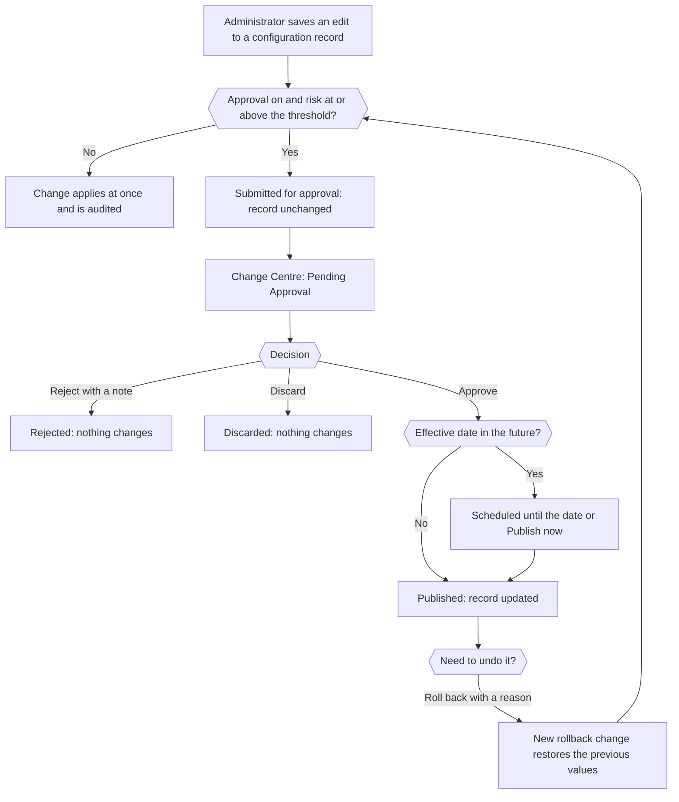

### Example from everyday work

*Illustrative scenario.* Demo Group's Tenant Super Admin has switched on change approval. Kavya Menon renames the Demo Services company after a rebrand and saves with the reason "Brand change approved by the board". PeopleOS tells her the change is waiting. The Tenant Super Admin sees "1 configuration change awaits approval" on the Admin Centre, opens it, checks the before and after names, and approves. The next week a typing error is spotted; Kavya clicks **Roll back**, and the corrected change goes through approval again.

### Related modules

- **Feature flags** and **Settings** — switch approval on and set its threshold.
- **Workflows** — a workflow with the trigger "Configuration change proposed" can notify approvers automatically.

---

## Packs and blueprints

**Status:** Available

### Overview

A **configuration pack** is a ready-made starting configuration for a type of organisation. A **blueprint** is a file containing your own organisation's configuration (settings, feature flags, roles, people set-up, skills, custom fields, forms and policies with their rules). It never contains employee data. Use blueprints to copy configuration between group companies or from a test organisation to the live one.

Applying a pack or importing a blueprint **adds or updates** records, matched by their code, and **never deletes anything**. You can edit everything afterwards. A blueprint import can only give roles permissions that the importing person holds.

### Where to find it

- **Menu path:** **Admin › Setup › All in Setup › Packs & Blueprints**
- **Who can open it:** Tenant HR Admin, Tenant Super Admin.

### The screen at a glance

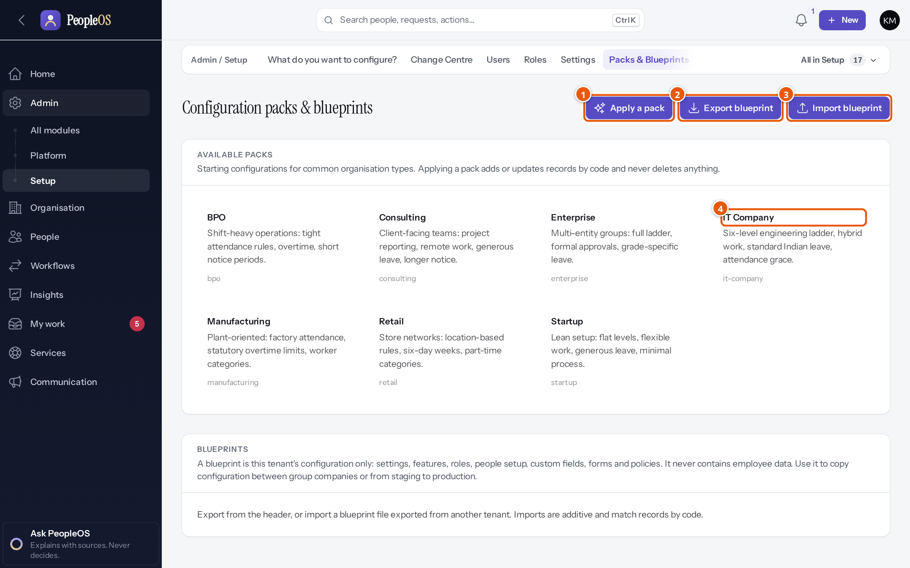
*Figure 9.11 — Configuration packs and blueprints. Demonstration data (fictional).*

1. **Apply a pack** — choose a pack and give a reason.
2. **Export blueprint** — downloads your configuration as a file (the export is recorded in the audit trail).
3. **Import blueprint** — upload a blueprint file exported from another organisation and give a reason.
4. **Available packs** — BPO, Consulting, Enterprise, IT Company, Manufacturing, Retail and Startup, each with a short description.

### Task: Apply a configuration pack

1. Open **Packs & Blueprints** and click **Apply a pack**.
2. Choose the **Pack**, type a **Reason for change**, and confirm.
3. PeopleOS shows "Pack applied" with the number of records added or updated per kind.

> **Important:** A pack can change settings and feature flags. For example, the Enterprise pack switches on change approval. Read the pack's description first, and apply packs before you start live operations.

**If it fails:** "Could not apply pack" or "Import failed" with the reason, for example "Unrecognised blueprint format." for a file that is not a PeopleOS blueprint.

---

## Custom fields and forms

**Status:** Custom fields: Available with limitations. Forms: Available.

### Custom fields

**Custom fields** add your own fields to **Employee**, **Company**, **Department**, **Location**, **Designation** and **Asset** records, for example "Laptop asset tag". Once defined, the field appears on that record's form and detail page.

- **Menu path:** **Admin › Setup › All in Setup › Custom fields**
- **Who can open it:** Tenant HR Admin, Tenant Super Admin (change); Auditor (read).
- **List columns:** **Entity**, **Label**, **Key**, **Type**, **Required**, **Sort order**, **Status**. Filters: entity and status.

#### Task: Add a custom field

1. Click **New custom field**.
2. Under **Definition**, choose the **Entity** (required), type the **Label** (required; the **Key** fills in from it and is used in reports and integrations), and choose the **Type** (required): Text, Long text, Number, Date, Yes / No, Dropdown, Multi-select, Email, Phone or URL. For Dropdown and Multi-select, add **Options** (value and label). Add **Help text** if useful.
3. Under **Behaviour**, set **Required**, **Searchable**, **Reportable**, **Sort order**, **Status**, and optionally **Effective from** / **Effective to** dates. **Extra validation rules** is optional and meant for your IT team.
4. Click **Create custom field**.

Entity, key and type cannot be changed after creation; create a new field instead.

> **Note:** The switches **Visible to employee**, **Visible to manager** and **Visible to HR** are saved with the field, but in this release they do not hide the field from anyone. Do not use custom fields for confidential information you need to hide from some audiences.

### Forms

**Forms** are versioned questionnaires, for example "IT asset handover". You edit the fields of a **draft** version; publishing freezes it and retires the previous version. Each submission keeps the version it was made with. If **Submissions need approval** is on, each submission waits until someone with approval rights approves or rejects it. Forms can also be used by the HR service catalogue, and a submission can start a workflow (trigger "Form submitted").

- **Menu path:** **Admin › Setup › All in Setup › Forms**
- **Who can open it:** Tenant HR Admin and Tenant Super Admin (build, publish, fill and approve submissions); HR Manager and Auditor (the list only).
- **List columns:** **Name**, **Key**, **Published** (latest version, or "Never"), **Draft**, **Approval**, **Submissions**, **Status**.
- **Tabs on a form:** **Versions & fields**, **Submissions** (with **Approve** and **Reject**), **History**.

#### Task: Build and publish a form

1. Click **New form**. Enter **Name** (the **Key** fills in), optional **Description**, **Submissions need approval** and **Status**. Click **Create form**; a first draft is created.
2. On the **Versions & fields** tab, click **Edit fields** on the draft. Add fields with **Label**, **Key**, **Type** (Text, Long text, Number, Date, Dropdown, Radio, Checkbox, Email, Employee selector, Department selector, Location selector), **Required** and **Help text**. Save.
3. Click **Publish draft** at the top of the page and confirm.
4. To change a published form later, click **New draft** (it copies the published fields), edit, and publish again.

**If it fails:** "A form needs at least one field before it can be published." or "Nothing to publish: create a draft first."

> **Tip:** **Fill form** (top of a published form) lets an administrator record a submission on someone's behalf.

---

## Workflows and runs

**Status:** Available with limitations (the "Generate document" step does nothing yet; there is no drag-and-drop canvas)

### Overview

A **workflow** is a chain of steps that PeopleOS carries out for you: ask a manager to approve, then HR, update a record, tell the employee. You build it from **nodes** (steps) and **edges** (which step follows which) without programming. A workflow starts either **manually** (from the workflow page or from an employee's Employee 360) or **automatically** when an event happens, for example "Employee joined", "Leave requested" or "Form submitted". Each start is a **run**.

Workflows are versioned like forms and policies: you edit a **draft**, check it, and publish it. Runs already in progress keep the version they started with.

The demonstration organisation has one workflow, **Probation confirmation**: the manager recommends confirmation (with a reminder after 48 hours and escalation to the manager's own manager after 96), HR confirms, PeopleOS stamps the confirmation date on the employee record and tells the employee and manager by in-app message and e-mail.

### Where to find it

- **Menu path:** **Workflows › Workflows** (the area bar shows **Workflows / Workflows** with **Runs** and **Workflows**)
- **Who can open it:** Tenant HR Admin and Tenant Super Admin (build, publish, run, cancel); HR Manager and Auditor (the list and the runs). HR Managers can also start manual employee workflows with **Start workflow** on an employee's Employee 360.
- **Set-up needed first:** roles and managers should be in place if approvals go to "Line manager of the subject employee" or to a role.

### The screen at a glance

The **Workflows** list shows **Name**, **Key**, **Trigger**, **Runs on**, **Published** (version or "Never"), **Draft**, **Runs** and **Status**, with **New workflow** at the top.

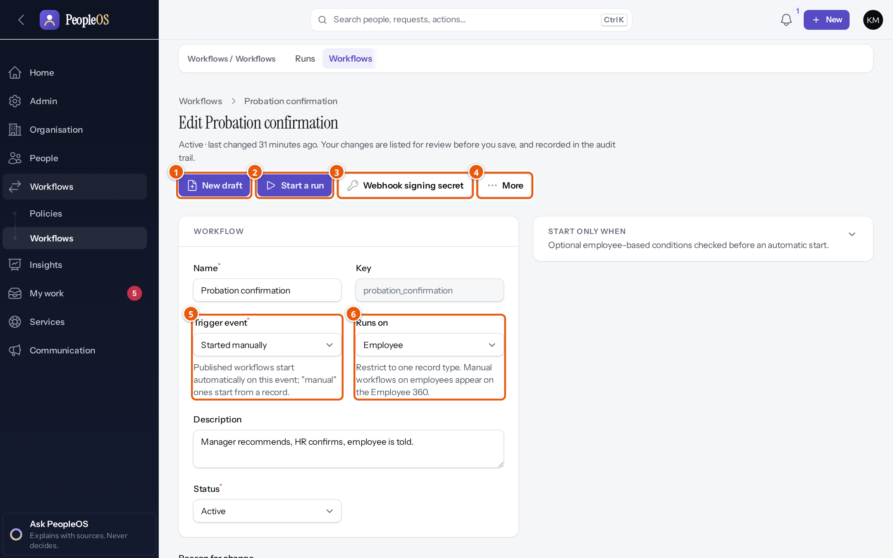
*Figure 9.12 — A workflow's page (not saved). Demonstration data (fictional).*

1. **New draft** — creates an editable copy of the published version (shown when no draft exists). When a draft exists, **Publish draft** appears instead.
2. **Start a run** — starts the published version manually; for employee workflows you choose the **Employee**.
3. **Webhook signing secret** — shows the secret that systems receiving this workflow's webhook steps use to check that requests really come from PeopleOS. Opening it is recorded in the audit trail.
4. **More** — **Rotate signing secret** (the old secret stops working at once) and **Delete**.
5. **Trigger event** — "Started manually" or an event. Published workflows start automatically on their event.
6. **Runs on** — limits the workflow to one record type: **Employee**, **Form submission** or **Configuration change**, or **Any**. Manual workflows on employees appear on the Employee 360.

The collapsed **Start only when** section holds optional conditions on the employee (for example a department) that must be true before an automatic start.

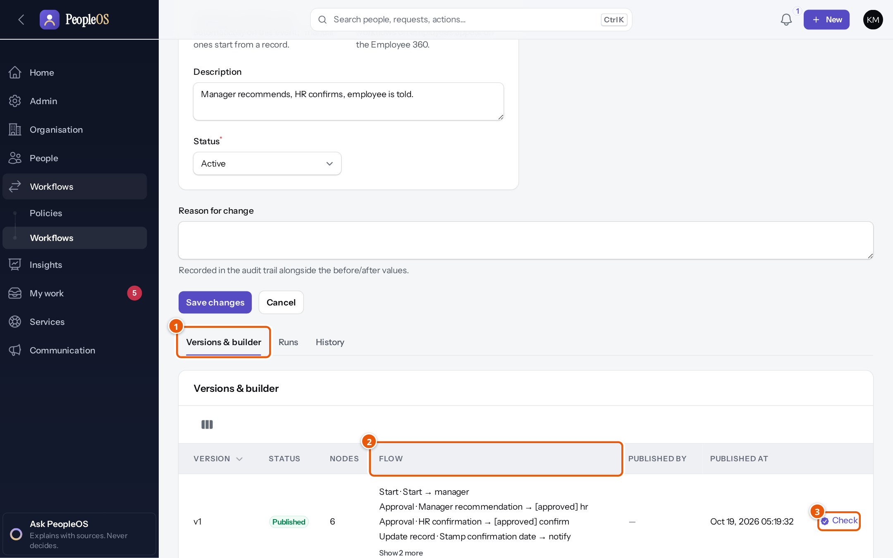
*Figure 9.13 — The Versions & builder tab. Demonstration data (fictional).*

1. **Versions & builder** — every version with its status. The other tabs are **Runs** and **History**.
2. **Flow** — a readable summary of each step and where it leads.
3. **Check** — validates a version and lists any problems. **Open builder** appears on draft versions.

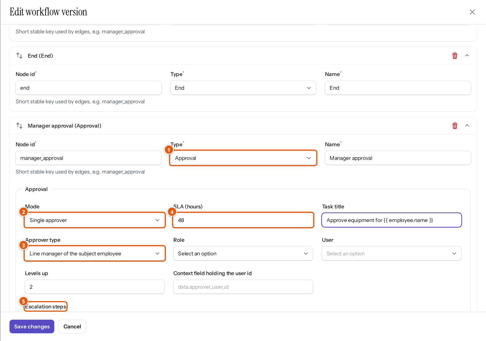
*Figure 9.14 — The builder, adding an Approval node to a fictional draft (not saved; the draft was removed afterwards). Demonstration data (fictional).*

1. **Type** — the kind of node: Start, Approval, Condition, Task, Notification, Wait, Webhook, Update record, Generate document or End. Each node also has a **Node id** (a short key used by edges, filled in from the **Name**) and a **Name**.
2. **Mode** — for approvals: **Single approver**, **One after another**, **All must approve** or **Majority decides**.
3. **Approver type** — **Line manager of the subject employee**, **Manager N levels up**, **Anyone holding a role**, **A specific user**, **Initiator's line manager** or **User id from a context field**. The fields beside it (**Role**, **User**, **Levels up**, **Context field holding the user id**) are filled in for the matching approver type.
4. **SLA (hours)** — when the approval is due. **Task title** can include placeholders such as {{ employee.name }}.
5. **Escalation steps** — **Add to escalation steps**: after a number of hours, **Send a reminder**, **Escalate to the assignee's manager** or **Escalate to a role**. Without steps, overdue tasks get a daily reminder.

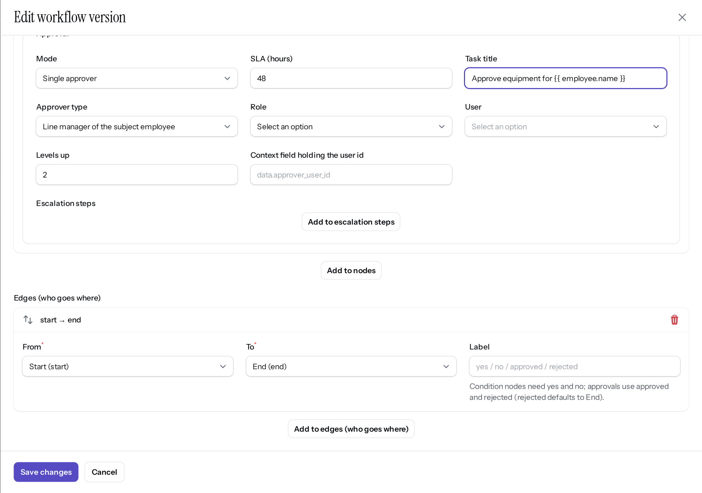
*Figure 9.15 — Edges ("who goes where") in the builder. Demonstration data (fictional).*

Each edge has **From**, **To** and an optional **Label**. Condition nodes need a **yes** and a **no** edge; approvals use **approved** and **rejected** (a rejection without its own edge ends the run). Use **Add to nodes** and **Add to edges (who goes where)** to extend the flow, then **Save changes**.

What the other node types do:

| Node type | What it does |
|---|---|
| Condition | Checks conditions ("All conditions" or "Any condition") on employee details, the record or form answers, and follows the yes or no edge |
| Task | Gives a to-do to an **Assignee**, due in a number of hours, with **Instructions** and optional escalation |
| Notification | Sends a message to an audience (for example the employee or their manager) by the chosen channels, with **Subject** and body |
| Wait | Pauses the run for a number of hours |
| Webhook | Sends a signed message to another system's address (POST, PUT or PATCH, optional headers) |
| Update record | Sets fields on the record the workflow runs on, for example a confirmation date (audited) |
| Generate document | Not functional yet: the run records the step as skipped and continues |

### Tasks

#### Task: Design and publish a workflow

1. Open **Workflows › Workflows** and click **New workflow**.
2. Enter **Name** (the **Key** fills in), choose the **Trigger event** (required) and **Runs on**, add a **Description**, keep **Status** Active, and click **Create workflow**. PeopleOS creates draft v1 with a Start node joined to an End node and opens the workflow.
3. On **Versions & builder**, click **Open builder** on the draft.
4. Add nodes with **Add to nodes** and set each node's settings. Join them with edges under **Edges (who goes where)**. Click **Save changes**.
5. Click **Check** on the draft. Fix any problems listed.
6. Click **Publish draft**, optionally give a reason, and confirm. The draft becomes the live version.

**If it fails** (messages shown when checking or publishing): "A workflow needs exactly one Start node.", "A workflow needs at least one End node.", "Approval node [id] needs an approver.", "Condition node [id] needs a 'yes' and a 'no' edge.", "Node [id] has no outgoing edge.", "Webhook node [id] needs a URL.", or "Nothing to publish: create a draft first."

#### Task: Start a run and follow it

1. On a published workflow, click **Start a run**, choose the **Employee** if asked, and confirm. PeopleOS opens the new run. (Alternatively, on an employee's Employee 360, click **Start workflow**, choose the **Workflow** and confirm.)
2. Open **Workflows › Workflows › Runs** at any time to see every run. Columns: **#**, **Workflow**, **Subject**, **Status**, **At** (the current node), **Outcome**, **By** and **Started at**; filters by status and workflow.
3. A run's page shows **Run** details, the collapsed **Flow** and **Context** sections, a **Tasks** tab (who each task is assigned to, due date, escalation level, decision) and a **Run log** tab.
4. To stop an open run, click **Cancel run** and give a **Reason** (Tenant HR Admin or Tenant Super Admin).

Approvers and assignees act on their tasks from **My work › Task inbox** or **My work › Approvals** (see chapter 5.1). A task given to a role can be handled by anyone holding that role.

### Statuses explained

| Run status | Meaning | What happens next |
|---|---|---|
| Running | The run is moving or waiting for a person's task | Continues when the task is handled |
| Waiting | Paused by a Wait node | Resumes automatically when the time has passed |
| Completed | Reached an End node; **Outcome** shows completed or rejected | Nothing more |
| Cancelled | Stopped by a person | Open tasks are closed |
| Failed | A step could not be carried out; the **Error** field explains why | Correct the cause and start a new run |

Task statuses: **Pending**, **Approved**, **Rejected**, **Completed**, **Skipped**, **Cancelled**. Version statuses (workflows, forms and policies): **Draft**, **Published**, **Retired**.

**Flowchart — Designing and running a workflow.** From an empty workflow to a finished run. *Roles:* Tenant HR Admin (design), approvers and assignees (tasks). *Starts:* New workflow. *Ends:* the run is completed.

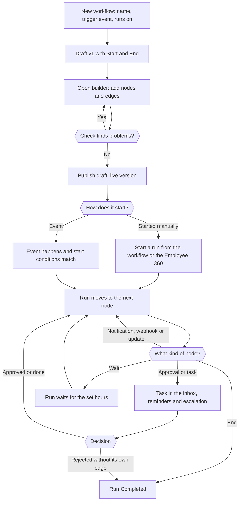

### Example from everyday work

*Illustrative scenario.* Rahul Sharma's probation at Demo Technologies is ending. Neha Kapoor, HR Manager, opens Rahul's Employee 360, clicks **Start workflow** and chooses **Probation confirmation**. Amit Verma, his manager, gets a task "Recommend confirmation for Rahul Sharma" and approves it. The HR confirmation task goes to the HR Manager role; Neha approves. PeopleOS stamps the confirmation date on Rahul's record and sends him and Amit a message. Kavya Menon later opens **Runs** to confirm the run shows **Completed**.

### Related modules

- **Task inbox** and **Approvals** (My work) — where people act on workflow tasks.
- **Webhooks** — signed messages for whole-organisation events; workflow webhook steps use each workflow's own signing secret.

---

## Policies

**Status:** Available

### Overview

**Policies** hold your rules as typed, versioned bundles of settings: **Leave policy**, **Attendance policy**, **Overtime policy**, **Working hours policy**, **Exit policy** and **General policy**. Other modules read the version that applies to an employee on a date, so a rule change never requires a code change.

- **Versions** are effective-dated. You edit a draft and publish it with an **effective from** date; the previous version then ends the day before. Published versions cannot be changed. **Restore as draft** copies an old version into a new draft.
- **Assignment rules** decide who gets the policy: "IF these conditions THEN this policy", with a **priority** (the lower number wins when several rules match) and optional effective dates.

A **leave policy** sets, per leave type, the **Days per year**, **Accrual** (annual, monthly or quarterly), pro-ration in the joining year, when the leave becomes available, carry-forward limit and expiry, encashment, use during probation, negative balance, half days, minimum notice, maximum consecutive days and when a document is required. It also decides whether weekly offs and holidays inside a leave span count. Chapter 5.3 explains how leave uses these values.

### Where to find it

- **Menu path:** **Workflows › Policies**
- **Who can open it:** Tenant HR Admin and Tenant Super Admin (create, edit, publish); HR Manager, Attendance Admin, Account Owner and Auditor (read).

### The screen at a glance

The list shows **Name**, **Code**, **Type**, **Current version** (for example "v1 from 2026-10-19", or "None published"), **Rules** and **Status**, with **New policy** at the top. The demonstration has four policies: Standard leave, Office attendance, Standard 9-hour day and 60-day notice.

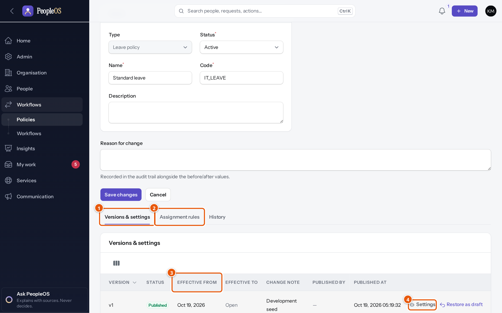
*Figure 9.16 — A policy's page with the Versions & settings tab. Demonstration data (fictional).*

1. **Versions & settings** — every version with **Status**, **Effective from**, **Effective to** ("Open" when it has no end), **Change note**, **Published by** and **Published at**.
2. **Assignment rules** — the rules that give this policy to employees. Each rule has **Impact** (how many employees it captures), **Edit** and **Delete**.
3. **Effective from** — the date the version starts to apply.
4. **Settings** — shows a version's settings. **Restore as draft** copies a past version into a new draft.

At the top of the page, **New draft** (or **Publish draft** when a draft exists) and **More** (with **Delete**).

### Tasks

#### Task: Change a policy with a new version

1. Open the policy and click **New draft**.
2. On **Versions & settings**, click **Edit draft**, change the settings, describe the change under **What changed**, add a **Reason for change**, and save.
3. Click **Publish draft**, choose the **Effective from** date (required; "The previous version ends the day before."), and confirm.

**If it fails:** "A published version already starts after [date]." — choose a later effective date; "Nothing to publish: create a draft first."

#### Task: Decide who gets a policy

1. On **Assignment rules**, click **New policy assignment rule**.
2. Enter **Name**, **Priority** (lower wins), whether **All conditions** or **Any condition** must match, **Status**, and optional **Effective from** / **Effective to** dates.
3. Add the conditions (for example department equals Engineering), and a **Reason for change**. Save.
4. Click **Impact** on the rule to see how many employees it captures.

> **Tip:** Keep one broad rule (for example "Everyone", as in the demonstration) with a high priority number as a fallback, and add specific rules with lower numbers.

---

## Security policy

**Status:** Available with limitations (password expiry is not enforced; sign-out reasons are not shown to the person)

### Overview

The **Security & retention policy** page sets how strictly your organisation's users sign in and how long some operational records are kept. It applies to every user of your organisation; Markedge operators are governed by Markedge's own stricter rules.

### Where to find it

- **Menu path:** **Admin › Platform › Security policy**
- **Who can open it:** Tenant HR Admin, Account Owner, Tenant Super Admin.

### The screen at a glance

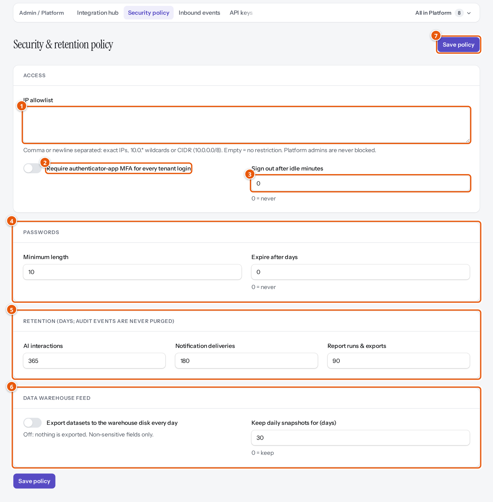
*Figure 9.17 — The Security & retention policy page (not saved). Demonstration data (fictional).*

1. **IP allowlist** — the networks allowed to use PeopleOS.
2. **Require authenticator-app MFA for every tenant login** — makes multi-factor sign-in compulsory.
3. **Sign out after idle minutes** — 0 means never.
4. **Passwords** — **Minimum length** and **Expire after days**.
5. **Retention (days; audit events are never purged)** — **AI interactions**, **Notification deliveries**, **Report runs & exports**.
6. **Data warehouse feed** — **Export datasets to the warehouse disk every day** and **Keep daily snapshots for (days)**.
7. **Save policy** — saves every field at once (also at the bottom of the page).

### Security policy reference

| Field (as shown) | What it controls | Effect of changing it | Who is affected | Reversible? | Risks |
|---|---|---|---|---|---|
| IP allowlist (default empty) | Exact addresses, wildcards such as 10.0.* or ranges such as 10.0.0.0/8, separated by commas or new lines. Empty = no restriction | From the next page load, anyone outside the listed networks is refused with "Your network is not allowed to access this tenant." Markedge operators are never blocked | Every user, including you | Yes, from an allowed network | You can lock yourself out; staff working from home or mobile networks are blocked. Ranges work for IPv4 addresses only |
| Require authenticator-app MFA for every tenant login (default off) | Whether everyone must use an authenticator app | People without an authenticator are sent to set one up before they can do anything else | Every user | Yes | Plan for lost phones: administrators can reset a person's authenticator |
| Sign out after idle minutes (default 0) | Automatic sign-out after inactivity | People idle longer than this are signed out at their next click | Every user | Yes | They are not told why (see note) |
| Minimum length (default 10, range 8–64) | Shortest allowed password | Applies when people next choose a password (invitation, reset, change). Passwords must also mix upper- and lower-case letters and include a number | Every user choosing a password | Yes | Existing passwords are not re-checked |
| Expire after days (default 0) | Intended password expiry | **No effect today:** the value is stored but PeopleOS does not ask anyone to change an old password | — | — | Do not rely on it |
| AI interactions (default 365), Notification deliveries (180), Report runs & exports (90) | How long these records are kept | A nightly clean-up deletes older records; 0 keeps them. Audit events are never deleted | Auditors, HR | Deleted records cannot be restored | Shorter periods lose history; a legal hold placed by Markedge pauses deletion |
| Export datasets to the warehouse disk every day (default off) | A daily copy of non-sensitive analytics datasets to the data warehouse storage operated by Markedge | On: a snapshot is written every day | Data recipients | Yes | How you receive the snapshots is arranged with Markedge (to be confirmed with the SaaS provider) |
| Keep daily snapshots for (days) (default 30) | How long warehouse snapshots are kept; 0 = keep | Older snapshots are deleted nightly | Data recipients | No, for deleted snapshots | — |

> **Note:** When a person is signed out because they were idle, because their account or the organisation was suspended, or because an administrator used **Sign out everywhere**, PeopleOS returns them to the sign-in page without explaining why. Tell your users about the idle limit when you set it.

### Task: Require multi-factor sign-in for everyone

1. Tell your users first, so they have an authenticator app (for example on their phone) ready.
2. Open **Admin › Platform › Security policy**.
3. Switch on **Require authenticator-app MFA for every tenant login**.
4. Click **Save policy**. PeopleOS shows "Security policy saved".

**Expected result:** at their next page load, anyone without an authenticator is taken to the set-up screen; people who already use one are asked for their code at sign-in as before.
**Common mistakes:** switching it on without warning users; adding an IP allow-list in the same change without testing from home networks.
**If it fails:** if someone loses their phone, open their user and use **Account › Reset multi-factor authentication**.

---

## Single sign-on

**Status:** Available with limitations (OpenID Connect only; SAML is not supported; the "primary login" switch has no visible effect; further hardening is planned)

### Overview

**Single sign-on** (SSO) lets people sign in with the account they already use at work, from Microsoft Entra ID, Google Workspace, Okta or any other provider that supports OpenID Connect (a widely used sign-in standard). PeopleOS gives each connection its own sign-in address. A connection can create PeopleOS accounts automatically the first time someone signs in, with a role you choose. It never gives the Tenant Super Admin role automatically.

### Where to find it

- **Menu path:** **Admin › Platform › All in Platform › Single sign-on**
- **Who can open it:** Tenant HR Admin, Tenant Super Admin.
- **Set-up needed first:** your identity team registers PeopleOS as an application in your provider and gives you the client id and client secret.

### The screen at a glance

The list (page title "Sso connections") shows **Name**, **Provider**, **Login URL** (copyable), **Domains** ("Any" when not limited), **Auto-provision**, **Last login at** and **Status**.

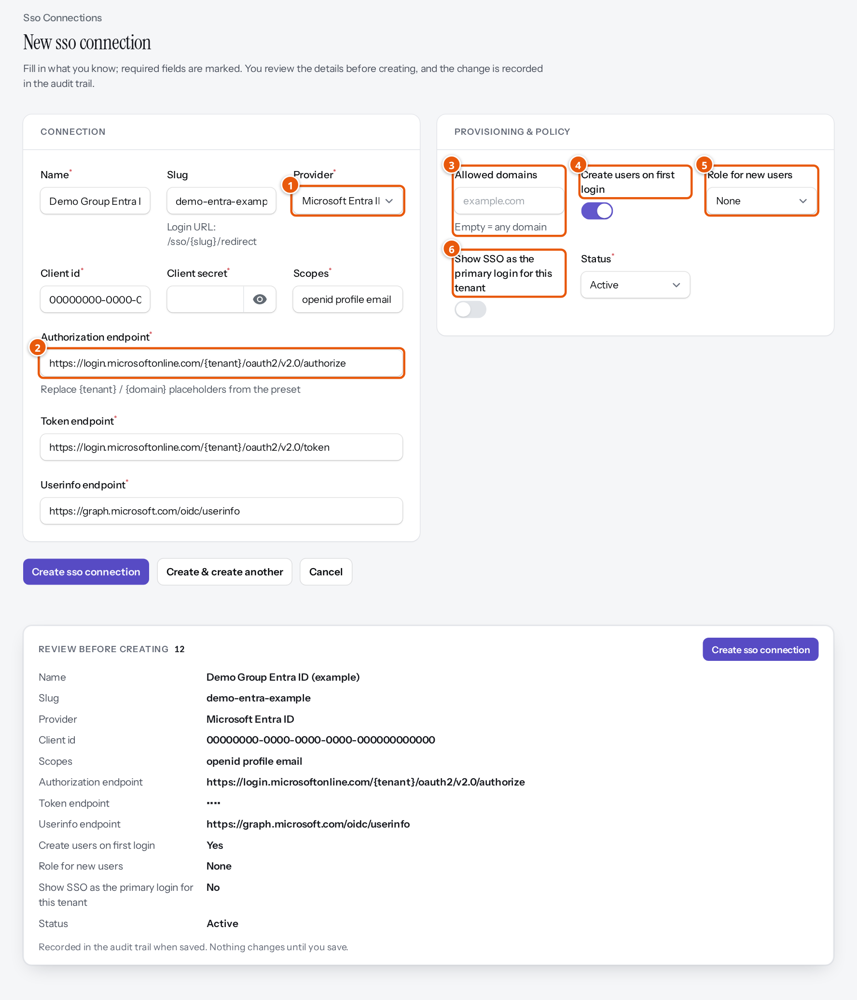
*Figure 9.18 — A new SSO connection with fictional values (not saved; no secret entered). Demonstration data (fictional).*

1. **Provider** — **Microsoft Entra ID**, **Google Workspace**, **Okta** or **Generic OpenID Connect**. Choosing one of the first three fills in the endpoints and **Scopes** for you.
2. **Authorization endpoint** — replace the {tenant} or {domain} placeholder with your own value, as the helper text says. **Token endpoint** and **Userinfo endpoint** are filled in the same way.
3. **Allowed domains** — e-mail domains allowed to sign in (empty = any domain).
4. **Create users on first login** — create an account automatically for someone who has none.
5. **Role for new users** — the role those new accounts receive (or None). Tenant Super Admin is not offered, and you can only choose a role you are allowed to give.
6. **Show SSO as the primary login for this tenant** — stored, but the sign-in page does not change in this release; share the **Login URL** instead.

Other fields: **Name**, **Slug** (forms the sign-in address /sso/*slug*/redirect), **Client id**, **Client secret** (hidden; stored encrypted) and **Status** (**Active** or **Disabled**).

### Task: Connect Microsoft Entra ID

1. Click **New sso connection**.
2. Enter **Name** and a **Slug**. Choose **Provider** **Microsoft Entra ID**.
3. Enter **Client id** and **Client secret** from your identity team. Replace {tenant} in the three endpoints.
4. Add **Allowed domains** (for example your company domain), decide on **Create users on first login** and **Role for new users**.
5. Click **Create sso connection** after checking **Review before creating**.
6. Copy the **Login URL** from the list and share it with your staff.

**What happens at sign-in:** the person is sent to your provider and back. PeopleOS links them to the existing account with the same e-mail address, or creates one if allowed. Sign-ins are recorded in the audit trail.
**If it fails:** messages people may see include "This email domain is not allowed to sign in with [connection].", "No account exists for [e-mail] and automatic provisioning is off.", "Your identity provider has not verified this e-mail address." and "This account is not active." (a suspended user). Your security policy still applies: if multi-factor sign-in is required, people confirm their authenticator after SSO too.

---

## API keys, SCIM and the PeopleOS API

**Status:** Available

### Overview

An **API key** lets another system, such as a recruitment system, an attendance device platform or your identity provider, talk to PeopleOS without a person signing in. Each key carries **scopes**: the exact things it may do, for example "Read employees and positions" or "Push attendance punches". The key is bound to your organisation, so it can never reach another organisation's data. Reads of sensitive data need their own scope and are audited.

The **scim** scope ("SCIM 2.0 user provisioning") lets an identity system create, update and switch off PeopleOS user accounts automatically, using the SCIM standard. SCIM manages user accounts only; employee records stay under HR control, and SCIM groups do not set roles.

Markedge provides the technical API reference (the list of operations and the scope each needs) for your IT team on request.

### Where to find it

- **Menu path:** **Admin › Platform › API keys**
- **Who can open it:** Tenant HR Admin, Tenant Super Admin.

### The screen at a glance

The list (page title "Api keys") shows **Name**, **Prefix** (the first, non-secret part of the key), **Scopes**, **Last used at**, **Expires at**, **Status** (**Active**, or **Inactive** once revoked) and **Created by**, with a **Revoke** action per key.

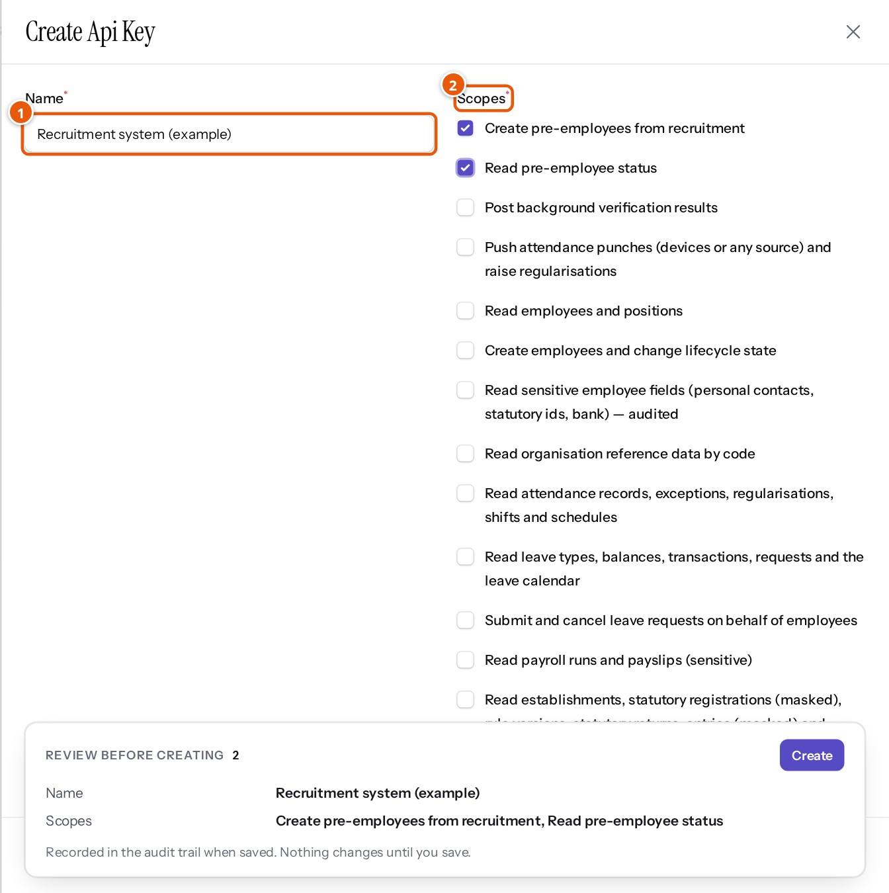
*Figure 9.19 — Issuing an API key with fictional values (cancelled; no key issued). Demonstration data (fictional).*

1. **Name** (required) — say which system uses it.
2. **Scopes** (required) — tick only what the system needs.

The dialog also has **Expires at** (optional; empty = never) and a **Review before creating** panel.

### Task: Issue an API key

1. Click **Issue key**.
2. Enter **Name**, tick the **Scopes**, optionally choose **Expires at**, and click **Create**.
3. PeopleOS shows the key once, in a message "API key issued — copy it now, it will not be shown again". Copy it into the other system straight away.

> **Important:** Scopes are not limited by your own permissions. Give each system its own key with the fewest scopes it needs, set an expiry date, and click **Revoke** (with an optional reason) as soon as a key is no longer used or may have leaked. A revoked key stops working at once.

> **Note:** Each key has a limit on requests per minute. Details are in the API reference.

---

## Webhooks

**Status:** Available

### Overview

A **webhook** tells another system the moment something happens in PeopleOS, for example "employee.joined" or "leave.approved". PeopleOS posts a short message to an address you register. Each message is signed with a secret shared with the receiving system, so it can check the message came from PeopleOS. Messages carry identifiers and business facts, never free-text notes or comments. If the receiving system does not answer, PeopleOS retries several times with growing pauses, then marks the delivery **Dead letter**.

### Where to find it

- **Menu path:** **Admin › Platform › All in Platform › Webhooks**
- **Who can open it:** Tenant HR Admin, Tenant Super Admin, Auditor.

### The screen at a glance

The list (page title "Webhook endpoints") shows **Name**, **URL**, **Events** (how many), **Last delivered at**, **Failures** and **Status**, with **Send test** and **Edit** per endpoint. An endpoint's page has a **Deliveries** tab: each delivery's time, event, status (**Pending**, **Delivered**, **Dead letter**), attempts, HTTP answer and next attempt, with **Payload** (view the message), **Retry now** (for a pending delivery) and **Replay** (for a dead letter).

### Task: Add a webhook endpoint

1. Click **New webhook endpoint**.
2. Enter **Name** and **Url** (an HTTPS address of the receiving system). PeopleOS refuses addresses it is not allowed to reach, such as internal network addresses.
3. A **Secret** is generated for you (hidden). Give it to the receiving system's team securely.
4. Keep **Status** **Active** (or **Paused**), and tick the **Events** to send.
5. Click **Create webhook endpoint**, then **Send test** on its row. PeopleOS shows "Delivered (HTTP 200)" or the answer it received.

---

## Integration hub and inbound events

**Status:** Available

### Overview

The **Integration hub** registers each external system that *sends* information into PeopleOS, such as a background verification provider or another HR system. Each integration gets its own inbound address and signing secret. PeopleOS checks every incoming event (signature, time window, accepted event types, optionally a specific API key), records it, and processes it once even if it arrives twice. **Inbound events** lists everything received, never showing the message body itself. Failed events can be reprocessed with a reason.

### Where to find it

- **Menu path:** **Admin › Platform › Integration hub** and **Admin › Platform › Inbound events**
- **Who can open it:** Tenant HR Admin, Tenant Super Admin.

### The screen at a glance

- **Integration hub** list: **Code**, **Name**, **Kind** (for example Recruitment / ATS, Payroll provider, Attendance devices, Finance / ERP, Identity provider, Background verification, External HR system), **Status**, **Signed**, **Secret rotated**; actions **Edit** and **Rotate secret**. An integration's page has the tabs **Inbound events**, **External references** (the other system's identifiers for PeopleOS records, with **Retire**), **Mappings** (**Add mapping**: an external value to a PeopleOS code) and **History**.
- **Inbound events** list: **Received at**, **Integration**, **Event type**, **Event id**, **Status**, **Attempts**, **Error**; actions **Details** (keys, size and checksum of the message, never the body) and **Reprocess**.

### Task: Register an integration

1. Open **Integration hub** and click **New integration system**.
2. Enter **Code** (used in the inbound address), **Name** and **Kind**.
3. Under **Inbound security**, keep **Require signed events (HMAC-SHA256 over "timestamp.body")** switched on (it means every event must carry a valid signature), set the **Timestamp window (seconds)**, optionally choose a key under **Only this API key may post (optional)**, and list the **Accepted event types (empty = every registered handler)**.
4. Click **Create integration system**. PeopleOS shows the signing secret once ("copy it now; it is not shown again"). Give it to the sending system's team securely.
5. The sending system also needs an API key with the scope "Post signed events to an integration registered in PeopleOS".

| Inbound event status | Meaning |
|---|---|
| Received | Accepted and waiting to be processed |
| Processing | Being processed now |
| Succeeded | Processed |
| Retrying | A temporary problem; PeopleOS tries again |
| Failed (refused) | Refused, for example an unknown employee; fix the cause, then **Reprocess** |
| Dead letter | Gave up after several attempts; fix the cause, then **Reprocess** |

Message bodies of finished events are deleted after a few days; the event record itself stays.

---

## Exchange rates and country packs

| Screen | What you store or see there | Path | Who |
|---|---|---|---|
| Exchange rates | Dated rates: **From** and **To** currency (three-letter codes), **Rate** ("1 unit of "from" = rate units of "to""), **Effective on**. The page subtitle shows your base currency (for example "Base currency: INR"). | Admin › Platform › All in Platform › Exchange rates | Tenant HR Admin, Tenant Super Admin |
| Country packs | Read-only cards per country: currency, language, time zone, financial-year start, tax framework, social security, labour rules, documents, date and number format, and which of your companies use the pack | Admin › Platform › All in Platform › Country packs | Most staff roles |

**Task: Add an exchange rate.** Open **Exchange rates**, click **New exchange rate**, enter **From**, **To**, **Rate** and **Effective on**, and save. Rates can be edited or deleted from the list.

> **Note:** Exchange rates are stored as reference data for consolidated reporting. At the time of writing no PeopleOS screen converts amounts with them automatically. Your base currency is part of your organisation's profile and is changed by Markedge.

> **Note:** Country packs exist for India, the United Arab Emirates, the United Kingdom, the United States, Singapore, Australia and Canada. Only India has the full statutory engine, and its statutory rules are not yet verified. Apart from one illustrative UAE rule, the other countries carry descriptive information without statutory rates. Payroll is blocked in a country for which PeopleOS holds no statutory rules. Pack contents are maintained by Markedge.

---

## Data export

**Status:** Available

### Overview

**Data export** gives your organisation a complete copy of its own data: every record in machine-readable form, plus the files people uploaded (documents, attachments, certificates). PeopleOS prepares the package in the background as a ZIP file in which every entry is encrypted. You open it with a passphrase that PeopleOS shows only to an authorised person. A signed manifest lists every file with its size and checksum, and what was left out. Passwords, secrets and other credentials are never included.

Only one export is prepared at a time. A ready package stays available for a limited time (seven days unless Markedge has configured otherwise) and is then deleted; its record and checksums remain. Each download link is personal and works for a few minutes. Every request, download and passphrase display is recorded in the audit trail.

### Where to find it

- **Menu path:** **Admin › Platform › All in Platform › Data export**
- **Who can open it:** Tenant Super Admin and Account Owner. Tenant HR Admins cannot.

### The screen at a glance

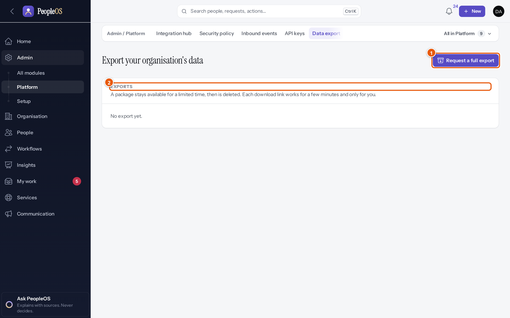
*Figure 9.20 — The Data export page before any export. Demonstration data (fictional).*

1. **Request a full export** — starts a new export.
2. **Exports** — your organisation's exports with **Requested**, **Status**, **Records / files**, **Available until** and **Actions** (**Download** and **Show passphrase** when ready).

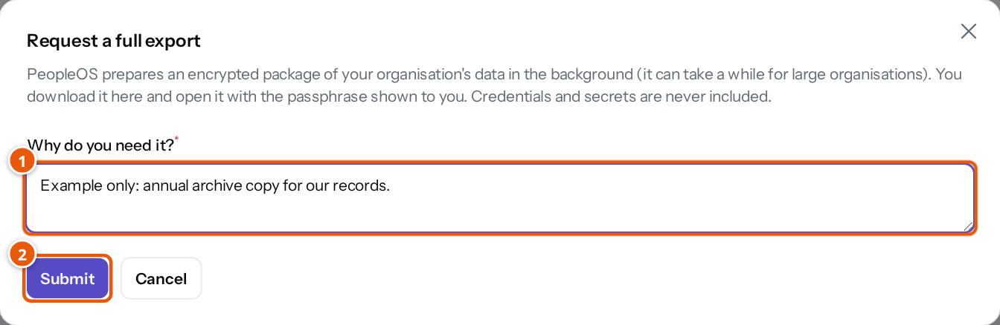
*Figure 9.21 — Requesting an export, with a fictional reason (cancelled). Demonstration data (fictional).*

1. **Why do you need it?** (required, at least five characters).
2. **Submit** — starts the export. PeopleOS shows "Export requested: it appears below when ready".

### Task: Request and open a full export

1. Open **Data export** and click **Request a full export**.
2. Enter **Why do you need it?** and click **Submit**.
3. Come back later; large organisations take longer. When **Status** shows **Ready**, click **Download**. The link works only for you and only for a few minutes.
4. Click **Show passphrase** and confirm ("Showing it is recorded."). Keep the passphrase apart from the file.
5. Open the ZIP with a tool that supports AES-encrypted ZIP files, using the passphrase.

**If it fails:** "This export is not available for download." — the package has expired; request a new one. A request made while another export is being prepared joins that export. A **Failed** export cannot be retried from this page; contact Markedge. While an approved deletion of the organisation is under way, no new export can be requested.

### Statuses explained

| Status | Meaning |
|---|---|
| Queued | Waiting to start |
| Generating | Being prepared |
| Ready | Can be downloaded until the date shown |
| Expired | The package was deleted after its availability period |
| Failed | Preparation stopped; contact Markedge |

**Flowchart — Requesting a full data export.** *Roles:* Tenant Super Admin or Account Owner. *Starts:* Request a full export. *Ends:* the package is opened, or it expires.

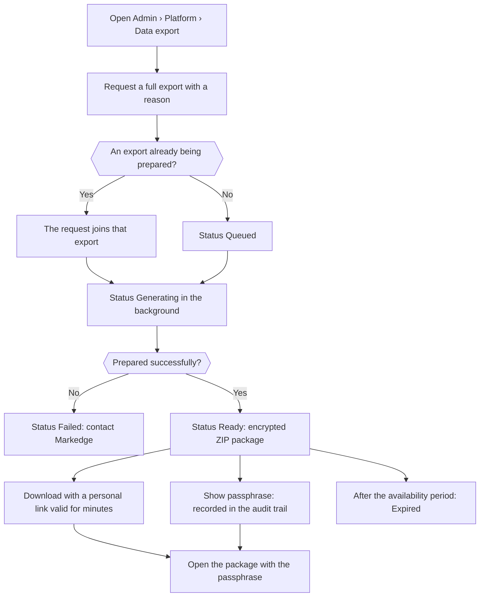

---

## Getting started and the Account Owner

**Status:** Available with limitations (self-service registration is switched off, so organisations are currently set up by Markedge)

### Overview

When an organisation registers itself through PeopleOS's self-service signup, its first administrator receives the **Account Owner** role and a **Getting started** page appears in the menu and as a banner on Home until set-up is done. The page shows where things stand and nine set-up steps, each with a link to the right screen, or the role needed if you cannot open it. It is read only: nothing is switched on from it.

Public self-service signup exists but is **switched off** at present. Organisations created by Markedge have a Tenant Super Admin as first administrator and do not see Getting started in their menu, although any administrator who invites people or changes settings can still open it by its address.

### The screen at a glance

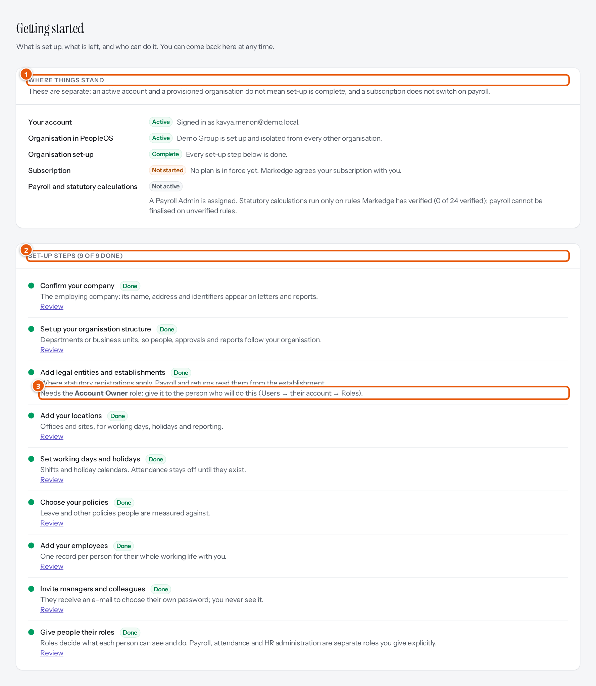
*Figure 9.22 — Getting started, opened by a Tenant HR Admin in the demonstration organisation. Demonstration data (fictional).*

1. **Where things stand** — five separate states: **Your account**, **Organisation in PeopleOS**, **Organisation set-up**, **Subscription** (for example "Not started: No plan is in force yet. Markedge agrees your subscription with you.") and **Payroll and statutory calculations** (always "Not active" here, with the number of statutory rules Markedge has verified).
2. **Set-up steps** — Confirm your company; Set up your organisation structure; Add legal entities and establishments; Add your locations; Set working days and holidays; Choose your policies; Add your employees; Invite managers and colleagues; Give people their roles. Each shows **Done** when complete, with **Start** or **Review**.
3. **Needs the … role** — shown when your own role cannot open that step's screen.

> **Tip:** The Account Owner deliberately has no payroll, statutory, compensation or sensitive-data access. Give those specialist roles (for example Payroll Admin) to the people who will do that work, from **Users**.

---

## What you can do yourself and what Markedge does

| You can do (with the right role) | Markedge does (set up by Markedge) |
|---|---|
| Invite users, give roles and access scopes, suspend accounts, reset passwords by link and authenticators | Create your organisation and invite its first administrator |
| Create custom roles and change role permissions (Tenant Super Admin) | Give the Tenant Super Admin role when no holder is available |
| Change settings, feature flags and the security policy | Change your organisation profile: name, web address, country, time zone, language, base currency, data region |
| Build custom fields, forms, policies and workflows; govern changes in the Change Centre | Plans, subscriptions and trials; billing and invoicing (not yet live) |
| Apply configuration packs; export and import blueprints | Verify statutory rules and maintain country pack and statutory rule data |
| Connect single sign-on; issue API keys (including SCIM); add webhooks and integrations | Configure the AI language-model provider, e-mail delivery and other platform services |
| Maintain exchange rates | Suspend or reactivate your organisation |
| Request a full encrypted export of your data | Closing an organisation: retention periods, legal holds and deletion (deletion is switched off at present) |
| Read the audit trail, including every Markedge access | Support access to your organisation (see below) |

**Markedge support access.** A Markedge operator can enter your organisation only through a controlled "Enter tenant" step: they must give a reason (at least ten characters) and may add a ticket reference. Access lasts a limited time (60 minutes unless Markedge has configured otherwise), then ends by itself, or earlier when they exit or sign out. Every start and end is recorded twice: in Markedge's own platform record, and in *your* audit trail, so you can see who at Markedge looked at your data, when and why (**Insights › Audit › Change history**, see chapter 5.8). No user account, employee record or role is created for the operator in your organisation.

> **Note:** Data deletion of a whole organisation exists in PeopleOS but is switched off. When you leave PeopleOS, request a data export first; closing arrangements are agreed with Markedge (to be confirmed with the SaaS provider).

## Related chapters

- **Chapter 5.1 Your workspace** — signing in, Account security (setting up an authenticator), Task inbox and Approvals where workflow tasks arrive.
- **Chapter 5.3 Time and leave** — how leave and attendance use the policies and settings in this chapter.
- **Chapter 5.4 Pay** — how payroll uses the payroll settings and why statutory verification matters.
- **Chapter 5.6 Organisation** — companies, departments, locations and establishments used in access scopes, and the people set-up lists.
- **Chapter 5.8 Insights** — Change history and Change intelligence, where administration changes and Markedge access are recorded.
