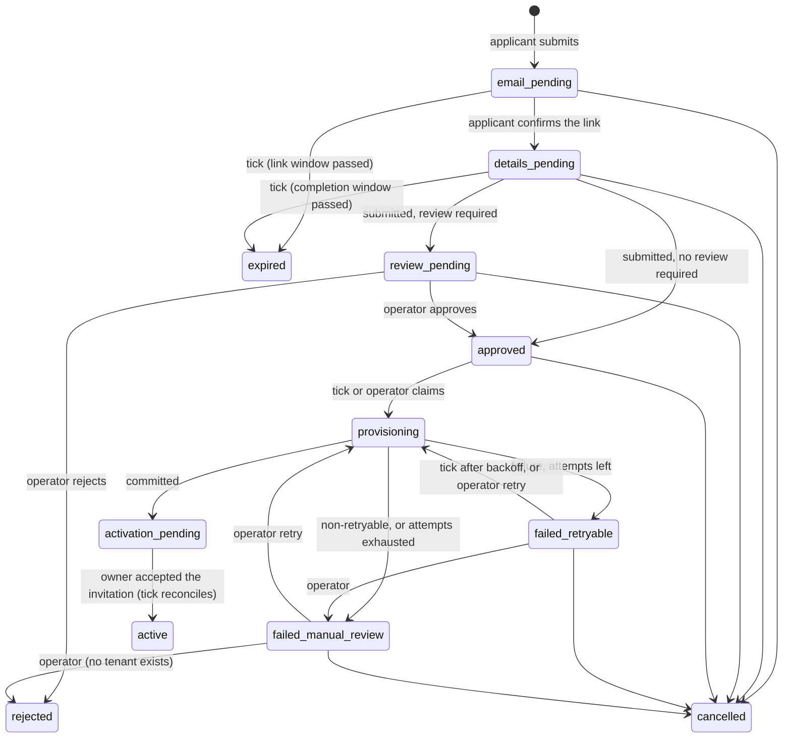

# SaaS.10 — Self-service signup and tenant provisioning: discovery and architecture

Date: 9 October 2026. Branch `feature/oct_1_phase_1`, starting at `8e2b8c5` (clean tree, 47 commits ahead of origin,
nothing pushed). Written before any SaaS.10 code.

## 0. Inherited conditions, revalidated

| Condition | State on 9 October 2026 |
|---|---|
| GitHub repository visibility | Public (SaaS.9 closure). No owner decision recorded |
| Leaked credential in Git history | Still in history. Rotated in every local PeopleOS database (SaaS.9 closure); history not rewritten |
| Statutory verification | 24 rules, 0 verified (`peopleos:readiness`) |
| Backup restore and DR | Unverified |
| Production configuration | Not validated |
| Production-copy offboarding rehearsal | Not run |
| Retention D8-1 to D8-8 | Pending; no retention policy configured in any database |
| Tenant deletion | Off (`PEOPLEOS_TENANT_DELETION_ENABLED` unset) |
| Commercial catalogue | `hcm` and `hcm_ux_showcase` have no plans, markets, prices or approved policy versions |
| Entitlement engine | `shadow` mode: evaluated and recorded, never blocking (D-16 open) |
| D-9 (self-service at launch) | SaaS.1 recommendation "sales-led first", never approved |
| D-17 (one login per e-mail) | Open. `users.email` is globally unique |

## 1. Existing reusable components

| Need | Existing component | Reused how |
|---|---|---|
| Tenant creation, seeding, first administrator | `ProvisionTenantAction` (one transaction: tenant, roles, settings, features, organisation and module defaults, first admin as `invited`, audit on both chains) | Split into a transactional core and the post-commit invitation, so a signup can run the core inside its own transaction. The operator path is unchanged |
| First administrator activation | `UserInvitations` (64-character token, only the SHA-256 stored, single use, expiring, revocable, one message for every failure); `TenantFirstAdministrator` (post-commit invitation, failure recorded, operator resend with throttle and row lock) | The activation e-mail **is** the existing invitation. Resend uses the same service. No new identity flow |
| Password policy, MFA, verified e-mail per request | `PasswordPolicy`, `MultiFactor`, `EnforceAccountSecurity` | Unchanged; the new administrator meets them at first sign-in |
| Enumeration-safe guest pages | `RequestPasswordReset` (Timebox, rate limit, one answer), `AcceptInvitation` (guest Filament `SimplePage`, `#[Locked]` state, throttled route) | The same patterns for the signup pages |
| Operator guard | `PlatformOperator::assert` (named operator, or the console only), `PlatformOperator::reason` | Every operator action and the system provisioning path |
| Trials and subscriptions | `CommercialSubscriptions` (effective-dated, idempotent, projects plan assignments under `TenantCommercialLock`, both audit chains; the scheduler already acts with no operator) | One new entry point, `startSignupTrial`, trigger `signup`, refused unless the tenant has no subscription |
| Plan catalogue | `Plan`, `PlanVersion::onSaleOn()`, `PlanEntitlement` (`active_employees.max`) | Plan availability and the employee limit |
| Markets and prices | `BillingMarket` (countries, currency, selling entity), `BillingCatalog::versionOnSale()` | Country eligibility; a price on sale is required |
| Effective-dated commercial policy with maker-checker | `CommercialConfiguration` + `ConfigurationKey` + Approvals page | New keys: signup offers, review policy, terms and privacy-notice versions. No parallel configuration store |
| Audit | `AuditRecorder` (tenant and platform hash chains) | Every transition. The platform chain carries the application reference, never the e-mail or name |
| Scheduled work | `routes/console.php` with `withoutOverlapping()->onOneServer()` (invariant 26), `docs/operations/queue-and-scheduler.md` | `peopleos:signups:tick` |
| Platform pages | `PlatformOffboardingPage` pattern (list, selection, reasoned actions, service-level guards) | `PlatformSignupsPage` |
| Links that respect access | `ScreenAccess` (UX.19) | Getting-started checklist links only to screens the person can open |
| Data classification | `DataInventory` (every table classified; architecture test) | The new table is classified |

## 2. Missing capabilities

1. Public signup pages and a registration switch (default off).
2. A signup application record with a state machine and expiring, single-use e-mail tokens.
3. Eligibility from approved commercial configuration (offer, plan on sale, market, price, employee limit, terms).
4. Operator review, rejection, cancellation, retry and manual-review handling.
5. Idempotent, recoverable provisioning with a fencing token, retries with backoff, and a lease for interrupted runs.
6. A system path to start a trial (no operator).
7. An explicit, least-privilege first-administrator role (today the first administrator gets `tenant-super-admin`, which is `*`).
8. A guided first-run checklist for the new tenant.
9. Signup e-mails (verification, address already registered, outcome) with recorded transport results.

## 3. Defects found in existing code (in scope: they decide whether the first administrator's boundary is real)

| ID | Finding | Severity | Action |
|---|---|---|---|
| E1 | Anyone holding `user.assign_roles` (including `tenant-hr-admin`) can assign any role, including `tenant-super-admin`, to anyone, themselves included | P1 (privilege escalation inside a tenant) | Fixed: `RoleGrants` delegation guard on every assignment path |
| E2 | Blueprint import (`blueprint.import`, held by `tenant-hr-admin`) can rewrite the permissions of any role, system roles included, with no ceiling | P1 | Fixed: an importer can only write permissions they hold, unless they are a super administrator, an operator or the console |
| E3 | The SSO connection's default role can be `tenant-super-admin`, so every SSO-provisioned user becomes a super administrator | P2 | Fixed: the default role must be one the editor may assign |

Without these fixes a narrower first-administrator role would be cosmetic: the owner could grant themselves `tenant-super-admin`.

## 4. Signup state machine

Stored on `signup_applications.status` (`SignupStatus`). Every change is a conditional update from the expected state,
audited on the platform chain.

| State | Meaning | Candidate state(s) covered |
|---|---|---|
| `email_pending` | Submitted; verification link sent | EMAIL_VERIFICATION_PENDING |
| `details_pending` | E-mail verified; company details and acknowledgements outstanding | EMAIL_VERIFIED, BUSINESS_DETAILS_PENDING |
| `review_pending` | An operator must review (policy, or a flag) | VERIFICATION_REQUIRED, COMMERCIAL_REVIEW_PENDING |
| `approved` | Eligible; waiting for provisioning | ELIGIBLE_FOR_PROVISIONING |
| `provisioning` | Claimed by one provisioning run (fencing token) | PROVISIONING |
| `activation_pending` | Tenant, owner account and trial exist; the owner has not yet chosen a password | PROVISIONED, ACTIVATION_PENDING |
| `active` | The owner activated their account | ACTIVE |
| `rejected` | An operator rejected it (terminal) | REJECTED |
| `expired` | The verification or completion window passed (terminal) | EXPIRED |
| `cancelled` | Withdrawn by the applicant or an operator (terminal) | CANCELLED |
| `failed_retryable` | Provisioning failed; retried automatically with backoff | FAILED_RETRYABLE |
| `failed_manual_review` | Provisioning failed in a way that needs a person, or retries ran out | FAILED_MANUAL_REVIEW |

Not introduced:
- **DRAFT.** Nothing is stored before the first submission, and that submission already sends the verification link.
- **Separate PROVISIONED and ACTIVATION_PENDING.** The provisioning transaction ends in `activation_pending`. A failed
  invitation e-mail is a recorded flag with automatic retry, not a state.

Allowed transitions (anything else is refused):

Guarantees:
- **Terminal states stay terminal.** `rejected`, `expired`, `cancelled` and `active` are never left. A new attempt is a
  new application; one after a rejection is flagged for review.
- **One open application per e-mail.** A generated column is unique over the open states.
- **Approval is server-side.** It is decided by `SignupEligibility` and, where review applies, by an operator, never
  by a request parameter.

## 5. Provisioning workflow

`SignupProvisioning::provision(application, ?operator)`. The tick runs it with no operator, in the console only. An
operator runs it from the Signups page and is named in the audit.

1. **Claim** (its own short transaction). The status moves conditionally from `approved`, `failed_retryable` (backoff
   elapsed) or `failed_manual_review` (operator only) to `provisioning`. The claim increments `attempts`, sets a new
   `claim_token` and `claimed_at`. Losing the race means another run owns it, so this one returns.
2. **Core** (one transaction, application row locked):
   1. Re-check the claim token and that no tenant is linked (a stale run after a lease expiry stops here).
   2. Re-evaluate eligibility: the offer is in force, the plan version is on sale, a market and price exist, and the
      owner's address is not used by any account.
   3. Run `ProvisionTenantAction` core: tenant (`trial` or `active`), system roles, settings, features and defaults, and
      the owner user (`invited`, role `account-owner`, no usable password).
   4. Start the trial, if the offer has one.
   5. Link the tenant, user and subscription to the application, set `activation_pending`, and audit both chains.

   Any failure rolls all of it back: no tenant, no user, no subscription.
3. **After commit:** the owner's invitation (`TenantFirstAdministrator::inviteAfterProvisioning`). A mail failure is
   recorded and the tick retries it later. The invitation token is never stored in plain text or queued.
4. **On failure:** the application becomes `failed_retryable` (with `next_attempt_at` from the backoff list) or
   `failed_manual_review` (a non-retryable code, or attempts exhausted). It records a safe failure code and summary,
   never an exception message, SQL or personal data.
5. **Lease:** a run interrupted between claim and commit leaves `provisioning` with no tenant. After the lease expires,
   the tick moves it to `failed_retryable`.

Why a scheduled tick and not a queued job:
- Invariant 25 requires every queued job to be tenant-aware, and a signup has no tenant until it is provisioned.
- The tick follows the SaaS.9 offboarding pattern: one server, no overlap, every minute.
- Provisioning never runs in the applicant's web request.

## 6. Security boundaries

| Boundary | Control |
|---|---|
| Public registration | `PEOPLEOS_PUBLIC_SIGNUP_ENABLED`, default **false**. When off, every signup page shows a non-sensitive message and every action refuses. Existing tenants and the operator page are unaffected |
| E-mail ownership | Single-use, expiring link: 64 random characters, only the SHA-256 stored. Consuming it is a POST (link scanners cannot), and the session is regenerated |
| Enumeration | One answer and one timing (Timebox) for "start" and "resend", whether or not the address has an account or an application. The e-mail, not the page, tells an existing account holder to sign in |
| Abuse | Rate limits per IP and per address hash; a honeypot field; nothing provisioned before verification; review by default |
| Tenant identifiers | The applicant never supplies a tenant id or slug; the slug is derived server-side, unique, reserved words refused |
| First administrator | A tenant user, `account-owner` (explicit permissions, not `*`), never a platform operator (`is_platform_admin` is never set by signup; architecture test) |
| Delegation | `RoleGrants`: only a super administrator, an operator or the console grants `tenant-super-admin` or writes permissions beyond their own (E1–E3) |
| Operators | Signups page and services: platform operator, reason, audited; no passwords, tokens or IP addresses shown; no impersonation |
| Commercial | Only an approved, in-force offer leads to a trial. A paid subscription is never started by signup. Payments stay in test mode; nothing calls a provider |
| Personal data | The application holds the contact's name and e-mail until activation; after activation they are removed from the application (the account in the tenant holds them, under SaaS.9's deletion controls) |

## 7. Schema changes

One additive migration, `2026_11_01_100001_saas10_signup_applications`: `signup_applications`, a platform table.

- **Identity:** `reference` (ULID).
- **State:** `status`.
- **Contact:**
  - `email` and its lower-case `email_hash`;
  - `contact_name`;
  - the company's `legal_name`, `display_name`, `country_code` and `timezone`;
  - `intended_employees`.
- **Plan:** `plan_code`, pinned `plan_version_id`, `billing_market_id`, `trial_days`.
- **Acknowledgements:** `terms_version` and `privacy_version`, with the accepting time and IP.
- **Token:** `token_hash` and `token_expires_at`.
- **Review:**
  - `review_required` and `review_reasons` (JSON codes);
  - the decision: `decided_by`, `decided_at`, `decision_reason`.
- **Provisioning:**
  - attempt tracking: `attempts`, `claim_token`, `claimed_at`, `next_attempt_at`;
  - failure: `failure_code`, `failure_summary`;
  - links: `provisioned_tenant_id`, `provisioned_user_id`, `subscription_id`;
  - timestamps: `invitation_sent_at`, `activated_at`;
  - window and cancellation: `expires_at`, `cancelled_at`, `cancel_reason`.
- **One open application per address:** a generated `open_email_hash`, unique.

The tenant link is named `provisioned_tenant_id`, not `tenant_id`, because invariant 22 reads `tenant_id` as tenant
ownership.

No change to existing tables. New permission keys: none. A new system role template `account-owner` reaches existing
tenants through `peopleos:sync-permissions`.

## 8. Migration and rollback

- **Up:** create one table. It is additive, so existing tenants and code are unaffected.
- **Down:** drop the table. Safe while no tenant was provisioned through signup. Tenants that were provisioned stay
  normal tenants, but lose their application record.
- **Code rollback:** with the switch off, no route accepts a submission, so reverting the code needs no data step. The
  new `account-owner` role is unused by operator provisioning.

## 9. Failure recovery

| Failure | Recovery |
|---|---|
| Verification e-mail not accepted by the transport | Recorded (`SIGNUP_EMAIL_FAILED`); the applicant can ask for a new link (same generic answer) |
| Provisioning error | Transaction rolled back. Retryable errors (deadlock, lock timeout, slug collision) are retried with backoff. Others, or exhausted attempts, go to `failed_manual_review` with a safe code; an operator retries, rejects or cancels |
| Run interrupted mid-transaction | Nothing committed; the lease expiry moves it to `failed_retryable` |
| Two runs at once | The claim is a conditional update; the core re-checks the fencing token under the row lock; the tenant slug and owner e-mail are unique. One tenant at most |
| Offer withdrawn, plan retired or price removed before provisioning | Eligibility re-check fails: `failed_manual_review`, code `OFFER_NOT_IN_FORCE` / `PLAN_VERSION_NOT_ON_SALE` / `PRICE_NOT_CONFIGURED` |
| Owner address taken meanwhile (D-17) | `failed_manual_review`, code `EMAIL_IN_USE` |
| Invitation e-mail failed after commit | Tenant exists; the owner cannot sign in (no usable password), so nothing looks active. The tick resends (system path, throttled), and an operator can resend |
| Invitation expired before activation | The applicant asks for a new activation e-mail from the status page (throttled), or an operator resends |

## 10. Test strategy

- **SQLite feature tests:**
  - every transition and every refusal;
  - token expiry and replay;
  - enumeration (same answer and e-mail branching);
  - rate limits;
  - the switch;
  - eligibility codes;
  - provisioning, idempotent rerun, partial failure and recovery;
  - the account-owner boundary;
  - `RoleGrants` on every path;
  - operator authorisation and audit;
  - no secrets in logs;
  - the first-run checklist.
- **MySQL races (real processes):**
  - two submissions of one address;
  - two provisioning claims (tick and operator);
  - approve, reject and cancel at once;
  - two provisionings that derive the same slug;
  - a lease expiry against a slow run.
- **Mutation testing** on a private copy: guards, conditions, locks.
- **Browser:**
  - the public flow on a disposable fixture database (switch on there only);
  - the operator page;
  - the getting-started page;
  - axe accessibility, plus the existing visual and browser suites for regressions.
- **Performance:**
  - signup submission;
  - verification;
  - provisioning time and queries;
  - the tick at volume;
  - the operator page with thousands of applications.

## 11. Decisions requiring owner input

| ID | Decision | Default until decided |
|---|---|---|
| D10-1 | Authorise public registration (after security review) | Off (`PEOPLEOS_PUBLIC_SIGNUP_ENABLED=false`) |
| D10-2 | Self-service offers: plans, trial length (D-4), countries (`signup.offers`) | None configured, so no plan is offered |
| D10-3 | Review policy (`signup.review`): every application, or flagged only (D-9) | `all`: every application is reviewed |
| D10-4 | Terms of Service and Privacy Notice documents and versions (`signup.terms`, `signup.privacy_notice`) | None, so signup cannot complete |
| D10-5 | D-17: one login per e-mail address | Kept. An existing account holder is told to sign in or use another address |
| D10-6 | Retention of applications that never became tenants (abandoned, rejected, expired, cancelled) | Kept, never purged (no invented period) |
| D10-7 | `account-owner` permission set; whether operator-provisioned tenants should also start with it | Signup only; operators keep `tenant-super-admin` |
| D10-8 | MFA for account owners from the first sign-in | Existing tenant policy (off by default) |
| D10-9 | CAPTCHA or bot-protection provider | None; rate limits and a honeypot |
| D10-10 | What happens to a provisioned tenant whose owner never activates | Nothing automatic; visible to operators |
| D10-11 | Data region (D-11) at signup | Not set (as operator provisioning without a region) |
